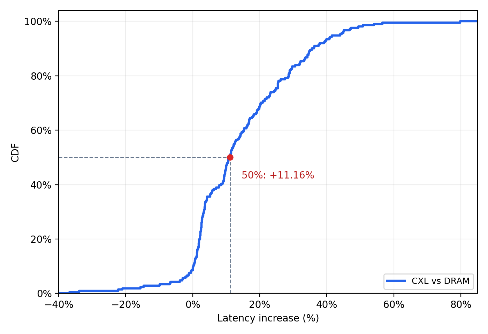

# agent-sandbox-cxl

처음 읽는 경우 [CXL microVM 연구와 구현 전체 정리](docs/cxl-microvm-overview.md)부터 본다. Workload 관측부터 실행 이전 구현, PML·MPTCP 검증, 파일 공유 설계와 후속 계획을 연결했다. 구현·실측·시뮬레이션·설계 중인 내용을 구분한다.

2026-10-30의 [읽기 데이터 pooling prototype](docs/cxl-data-pooling.md)은 guest metadata를 VM별로 유지하면서 virtio-blk에서 관측한 데이터 페이지를 CXL에서 공유한다. Host NFS와 DRAM/CXL 왕복을 포함한 [검증 결과](implementation/virtual_machine/results/pool-20261030/README.md), 재현 명령과 현재 한계를 함께 기록한다.

같은 upstream의 [수정하지 않은 Firecracker와 비교](docs/firecracker-pooling-comparison.md)하여 독립 VM의 데이터 frame 공유, stock snapshot clone의 기존 공유 기능, guest 작업 시간과 현재 CoW 비용을 구분했다. [실측 자료](implementation/virtual_machine/results/stock-comparison-20261030/README.md)는 원본 증거와 오프라인 검증기를 포함한다.

[공유 페이지 폐기와 재사용](docs/cxl-page-discard.md)은 guest의 명시적 free-page report를 받아 해당 VM의 공유 연결을 private zero backing으로 바꾸고, 완료 ACK 이후 재사용하는 경로를 설명한다. 기존 4.08초 측정은 한 페이지가 아니라 160MiB cache eviction과 224MiB 전체 재사용 workload의 시간이다.

mini-swe-agent의 기록된 명령을 Docker에서 재실행하고 CPU·메모리·동시성·LLC MPKI를 측정한다. Trace replay는 CPU NUMA node 0과 DRAM(node 0) / CXL(node 2) 메모리 비교를 지원한다. 별도 microVM 실험은 공유 DAX RAM 위의 상태 복원·KVM worker 재사용·direct handoff와 PML/cache 처리 비용을 검증한다. GPU, 모델 가중치, LLM API key는 사용하지 않는다.

2026-10-23 기준 microVM 구현·측정·EMR/DSA 조사와 MPTCP 연결을 유지한 snapshot 이전 결과는 [실행 문서와 다음 세션 인계](implementation/virtual_machine/README.md#session-handoff)에 모았다. 현재 전환 실험은 한 물리 호스트의 두 Linux VM 사이이며 실제 비일관 CXL 다중 호스트 검증은 남아 있다. DSA와 주기적 preflush는 조사·설계 단계로, 해당 성능을 측정한 결과는 없다.

2026-10-26 정리: 아래 Docker replay의 메모리·MPKI·write 관측 결과를 추가했다. 다른 머신에서 진행한 [microVM contention 실측](experiments/contention/RESULTS-20261021.md), [fleet 시뮬레이션](experiments/contention/RESULTS-fleet.md), [RL rollout trace 수집 계획](docs/trace-collection-plan.md)도 같은 저장소에서 이어간다. Docker의 write 관측 결과를 microVM의 PML/cache 처리 비용이나 실제 다중 호스트 coherence 비용으로 바로 환산하지 않는다.

## 완료한 DRAM / CXL 실험

264개 trace를 DRAM과 CXL에서 한 번씩, 총 528회 재생했다. MPKI는 전부 유효했고 OOM·PID 제한·payload 시작/종료 NUMA 배치 오류는 없었다. 비교 가능한 211개 쌍에서 CXL latency는 기하평균 13.15%, 시간 합계 기준 17.38% 증가했다. p95 증가율은 42.79%, 최대는 79.85%다.

timeout 50개 쌍과 명령 결과가 다른 3개 쌍은 제외했다. CXL에서만 timeout이 난 trace는 11개다. 각 조건 1회·고정 DRAM→CXL 순서이며 cache·호스트 경합 영향을 분리한 인과 추정은 아니다.

[결과와 보관 자료](docs/results/numa-immediate-20261014/README.md) · [전체 비교표](docs/results/numa-immediate-20261014/report.md)



저장소의 CSV만으로 그림을 다시 만들 수 있다.

```bash
python harness/trace-replay/analyze.py --cdf docs/results/numa-immediate-20261014
```

## DRAM tool call별 write 관측 결과

264개 trace / 13,600개 tool call을 CPU·메모리 **NUMA node 1**, 컨테이너당 **24 GiB**, 순차·model wait 없이 재생했다. write 관측이 유효한 13,565개 call의 중앙값은 **2.02 MB**, p95는 **315.22 MB**다. 새 메모리 샘플까지 있는 13,468개 call에서 `관측 write bytes / call 구간 최대 memory.current`의 중앙값은 **27.08%**, p95는 **199.57%**다.

이 비율은 RSS나 현재 상주 메모리의 dirty 비율이 아니다. 분자는 구간 중 해제된 페이지도 포함하는 누적 관측 집합이고 분모는 100ms 간격 cgroup 총메모리 샘플이므로 100%를 넘을 수 있다. write fault 유도와 THP 비활성화가 성능에 영향을 주므로 이 실행의 latency·MPKI는 기존 무계측 결과와 직접 비교하지 않는다.

[측정 정의·검증·CDF 두 개·재실행 방법](docs/results/write-pages-node1-20261021/write-report.md) · [최대 메모리 CDF와 MPKI 대기 시간 검증](docs/results/numa-immediate-20261014/README.md)

원시 로그나 Docker 없이 저장소의 CSV로 write 용량·비율 CDF를 다시 그린다. 선형 축, DRAM 범례, 50% 표시를 사용한다.

```bash
python harness/trace-replay/analyze.py --write-cdf docs/results/write-pages-node1-20261021
```

## 저장소 구성

| 파일 | 역할 |
|---|---|
| `harness/trace-replay/experiment.py` | trace 다운로드·검증, 시간 배치, 컨테이너 실행, NUMA·자원 제한, 계측·정리 |
| `harness/trace-replay/analyze.py` | 종료 코드·제출 내용 비교, CPU·메모리·동시성·지연 분석과 그래프 |
| `harness/trace-replay/configs/node0.json` | CPU pool, 작업별·전체 메모리 상한, PID 상한, 계측 주기 |
| `harness/trace-replay/data/inventory.json` | 원본 제출의 고정 commit, trace 경로·크기·SHA-256 |
| `harness/trace-replay/data/sample16.json` | 기존 pilot에 사용한 16개 파일 이름 |
| [기존 실험 보고서](docs/replay-report.md) | 완료한 pilot과 전체 실행 계획 |
| [CXL microVM 구현·사용법](implementation/virtual_machine/README.md) | DAX RAM, snapshot, KVM worker 재사용, direct handoff 실험 |
| [microVM handoff 문서](docs/microvm-handoff.md) | 상태 분류, NUMA 실행 실험, Firecracker 소스 빌드 방법 |
| [microVM CPU scheduling 분석](docs/microvm-scheduling.md) | Preact trace의 1·2 vCPU 비교, guest interrupt·선점·CPU 이동, host vCPU 스케줄링 |

Trace replay의 Python 실행 파일은 두 개로 유지한다. microVM 운영은 `implementation/virtual_machine/lab.py`, 빌드는 같은 디렉토리의 `build.sh`로 모았다. 원본 trace, Docker 이미지, 원시 실행 로그와 upstream 저장소 사본은 각 머신에서 준비한다. 커널·Firecracker·QEMU 변경은 원본 버전 정보와 패치로 배포한다.

## 다른 머신에서 준비

기존 검증 환경은 x86_64 Linux, Python 3.12, cgroup v2와 systemd driver를 사용하는 로컬 Docker daemon이다. 새 머신에도 Docker CLI, `numactl`, Python 3.11 이상과 `sudo -n`으로 필요한 systemd 자원 설정을 수행할 권한이 필요하다. rootless Docker와 원격 Docker daemon은 현재 실행 경로의 지원 대상이 아니다. task 이미지의 개발 도구는 컨테이너 안에 있으므로 호스트에 언어별 도구를 모두 설치할 필요는 없다.

```bash
git clone https://github.com/zktsd813/agent-sandbox-cxl.git
cd agent-sandbox-cxl
python3 -m venv .venv
. .venv/bin/activate
python -m pip install matplotlib
```

기본 재생 프로그램은 Python 표준 라이브러리만 사용한다. `matplotlib`은 분석 그래프용이다. `--write-pages` 계측에는 BCC Python binding, 실행 중인 커널과 일치하는 build headers, gcc·정적 libc와 root 권한이 추가로 필요하다. mini-swe-agent와 SWE-agent 패키지를 설치하거나 별도 checkout할 필요는 없다.

먼저 새 머신의 NUMA topology와 실행 권한을 확인한다.

```bash
numactl --hardware
lscpu -e=CPU,NODE
docker info --format '{{.Architecture}} {{.CgroupVersion}} {{.CgroupDriver}}'
sudo -n true
```

`configs/node0.json`의 `node_cpu_pool`, `controller_cpus`, `workload_cpus`를 새 머신의 NUMA node 0 CPU 번호에 맞춘다. controller와 workload CPU는 겹치지 않아야 한다. 현재 기본값은 controller `0-1`, workload `2-31`, 최대 1개 작업이다. 아래 전체 실행 예제의 `2-31`도 새 머신에 맞게 바꾼다.

기본 node 0 설정의 작업당 메모리 상한은 32GiB, PID 상한은 16384다. 이전 16GiB/4096 조건에서 발생한 Babel OOM과 Preact PID 제한을 고려해 두 비교 조건 모두 같은 상한으로 높였다. 별도 부모 cgroup이 전체 합계를 최대 33GiB 및 실행 준비 시 대상 memory node 가용량 추정치의 80% 이하로 제한한다. 현재 추정치는 MemFree + max(0, inactive file cache + active file cache의 절반 − shmem − dirty − writeback) + SReclaimable의 절반이다. kernel MemAvailable과 같은 값은 아니다. 전체 예산이 작업 하나의 상한보다 작으면 실행을 거부한다. node 1 write 계측은 별도 보관 설정의 24GiB/25GiB 상한과 90% 추정 비율을 썼다.

## trace 준비와 실행 계획 확인

원본은 `SWE-bench/20260902_mini-v2.4.6_gemini-3-5-flash`의 commit `8dcca98587e7f698753903e3b1747eb5dc013cb1`이다. 아래 명령은 264개 trace를 내려받고 크기와 SHA-256을 검증한다. 이미 있는 파일도 검증하며, 불일치 파일은 덮어쓰지 않고 오류를 낸다.

```bash
python harness/trace-replay/experiment.py --download-traces
python harness/trace-replay/experiment.py --plan \
  harness/trace-replay/data/native/*.traj.json > /tmp/mini-replay-plan.json
```

`--plan`은 Docker를 호출하거나 workload를 실행하지 않는다. 검증된 입력은 264개 trace, 13,600개 명령이며 기록상 작업 시간창 최대 12개가 겹친다. 전체 시간 범위는 6,822.64초, 약 114분이다.

## 한 작업부터 재생

```bash
python harness/trace-replay/experiment.py --pull \
  --output harness/trace-replay/results/smoke-gin \
  harness/trace-replay/data/native/gin-gonic__gin-3741.traj.json
python harness/trace-replay/analyze.py harness/trace-replay/results/smoke-gin
```

`--pull`은 측정 시작 전에 task 이미지를 준비한다. Docker Hub 다운로드 한도에 걸리면 해당 머신의 터미널에서 `docker login` 후 다시 준비한다. 인증 정보는 저장소에 넣지 않는다. 출력 디렉토리는 덮어쓰지 않으므로 재실행에는 새로운 이름을 사용한다.

## 대기 없는 DRAM / CXL 비교

```bash
python harness/trace-replay/experiment.py --compare-memory --schedule immediate \
  --perf --keep-going --workload-cpus 2-31 --max-active 1 \
  --output harness/trace-replay/results/numa-immediate \
  harness/trace-replay/data/native/*.traj.json
python harness/trace-replay/analyze.py harness/trace-replay/results/numa-immediate
```

전체 입력을 memory node 0에서 한 번씩 실행한 뒤 같은 순서로 memory node 2에서 한 번씩 실행한다. 두 run 모두 CPU node 0을 사용한다. 다음 명령은 이전 명령이 반환하는 즉시 실행하며 timestamp/gap 대기를 추가하지 않는다. 명령 자체의 sleep과 timeout은 유지한다. 이미지 ID를 시작 시 고정하고 각 trace는 새 컨테이너에서 실행한다.

현재 Niagara node 2는 `ZONE_MOVABLE`만 제공한다. `cpuset.mems=2`만 허용하면 파이프 등 비이동 커널 메모리가 할당되지 않아 runc가 실패한다. 비교 모드는 cpuset memory mask를 `0,2`로 두고, 각 payload를 정적 helper의 `set_mempolicy/get_mempolicy(MPOL_BIND)`로 node 0 또는 2에 고정한 뒤 exec한다. 두 조건 모두 같은 helper와 `SYS_NICE` capability, 기본 seccomp를 사용한다. helper는 기존 experiment.py가 결과 디렉토리에 생성·컴파일하므로 호스트에 gcc와 정적 libc 개발 파일이 필요하다.

payload 시작/종료의 익명 메모리 배치를 검증하고 runc 초기화 중 일시적인 다른 node 익명 메모리는 별도 최대값으로 기록한다. 기존 공유 파일 cache가 DRAM에 남을 수 있으며 cgroup의 파일 cache 통계는 과금된 페이지만 포함한다. 이 실험은 모든 파일 접근을 CXL로 강제하는 구성은 아니다.

상위 `report.md`, `summary.json`, `paired-traces.csv`, `paired-commands.csv`에 동일 trace/명령의 CXL/DRAM latency 비율과 MPKI를 비교한다. latency는 Docker exec 시작부터 종료까지의 호스트 monotonic 시간으로 Docker 제어 경로를 포함한다. pidfd로 종료를 감지해 polling 지연을 줄였다. 실패·timeout·이미지/종료 코드/제출 내용 불일치가 있는 trace는 대표 latency 비교에서 제외하고 원시 결과를 보존한다. 두 run의 계측은 `node0/`, `node2/`에 저장한다.

사용자 요청대로 DRAM→CXL 순서로 각 조건을 한 번씩 실행한다. 전역 cache를 비우지 않고 다른 호스트 작업을 유지하므로 순서·cache·경합 영향을 분리한 반복 실험은 아니다.

## timestamp를 유지하며 264개를 하나씩 실행하고 MPKI 측정

```bash
python harness/trace-replay/experiment.py --sequential --perf --keep-going \
  --workload-cpus 2-31 --schedule timestamps --scale 1 \
  --output harness/trace-replay/results/sequential-mpki \
  harness/trace-replay/data/native/*.traj.json
python harness/trace-replay/analyze.py harness/trace-replay/results/sequential-mpki
```

입력 순서대로 각 trace를 한 번씩 실행한다. 이전 컨테이너와 계측을 정리한 뒤 다음 trace를 시작한다. 각 trace의 시계를 초기화해 내부 timestamp를 유지한다. 원본 시간창 합계는 약 19.6시간이며 실제 소요 시간은 명령 실행 속도에 따라 달라진다. 순차 모드는 trace마다 분석을 수행하므로 실행 환경에도 matplotlib이 필요하다.

`--perf`는 workload cgroup의 모든 프로세스에 대해 user+kernel instructions, cycles, LLC reference/miss, retired load L3 miss를 같은 event group에서 측정한다. LLC MPKI는 `1,000 × cache-misses / instructions`이고, 별도 `retired_load_l3_mpki`도 제공한다. 두 miss 이벤트의 의미는 [Intel 공식 정의](https://perfmon-events.intel.com/platforms/emeraldrapids/core-events/core/)를 따른다. 카운터 실행 비율 99% 미만이나 누락은 유효한 MPKI로 보고하지 않는다. instructions가 없는 구간의 MPKI는 비워 둔다. MPKI 계측 실패 시 순차 실험을 중단한다.

현재 raw event는 Intel Sapphire/Emerald Rapids(model 143/207)에 한정했다. 이 서버의 기본 perf wrapper는 사용자 정의 커널을 찾지 못해 설치된 `/usr/lib/linux-tools-6.8.0-146/perf`를 직접 사용한다. 다른 환경에서는 `--perf-bin`으로 실행 가능한 perf를 지정하고 해당 CPU의 이벤트를 검증해야 한다. cgroup 하드웨어 계측에는 `sudo -n` 권한이 필요하다.

상위 결과에는 진행 상태 `suite.json`, trace별 지표 `traces.csv`, 누적 `summary.json`·`report.md`·`distributions.png`가 생성된다. 개별 디렉토리에는 기존 자원 시계열과 함께 원시 `.perf.jsonl`, 구간별 `.perf.csv`, CPU·메모리·MPKI 그래프가 저장된다. 실행 중 코드를 변경하면 서로 다른 구현의 결과가 섞이지 않도록 다음 trace 전에 중단한다. 전역 cache를 비우거나 다른 호스트 작업을 중지하지 않는다.

## 기록된 상대 시작 시각으로 전체 264개 재생

```bash
python harness/trace-replay/experiment.py --pull \
  --setup on-arrival --max-active 12 --workload-cpus 2-31 --keep-going \
  --output harness/trace-replay/results/full264 \
  harness/trace-replay/data/native/*.traj.json
python harness/trace-replay/analyze.py harness/trace-replay/results/full264
```

이 명령은 trace 사이의 기록된 상대 시작 시각과 각 명령 묶음의 timestamp를 유지한다. 264개를 한순간에 시작하지 않는다. 첫 명령 목표 시각에 컨테이너를 생성하고, 준비·슬롯 대기·명령 지연을 기록한다. `--keep-going`은 자원 제한으로 실패한 작업을 정리하고 다른 작업을 계속한다. 일반 명령의 nonzero 종료 코드는 원본과 비교하며, 그것만으로 실험 전체를 중단하지 않는다.

결과에는 `manifest.json`, `events.jsonl`, `metrics.csv`, 작업별 출력 로그가 생성된다. 분석 후 `summary.json`, `report.md`, `timeline.png`가 추가된다. 원시 결과는 Git에 올리지 않는다.

## 후속 실험과 해석 범위

초기 16개 pilot 이후 이미지 준비와 전체 528회 DRAM/CXL 재생을 완료했다. 초기 보고서의 다운로드 한도와 16GiB/PID 4096 설정은 당시 기록이며, 현재 설정은 32GiB/PID 16384다. 이미지 캐시와 원시 로그는 다른 머신으로 전달되지 않는다. 결과 폴더에 실제 사용한 이미지 digest와 trace 실행 순서를 함께 보관했다. 위 glob 실행 예제는 파일 이름 순서이므로 기록한 순서를 재현하려면 `run.json`의 `trace_order`를 사용한다.

다음 단계는 순서·cache 조건을 통제한 반복 측정과, idle 시간에 남는 익명 메모리·파일 cache를 구분한 CXL 배치/회수 실험이다.

- timestamp는 assistant 메시지 시각이다. 원래 sandbox 생성 시각이나 정확한 LLM 추론 시간을 뜻하지 않는다. trace 사이의 wall clock 비교 가능성은 실험 가정이다.
- 각 trace는 같은 컨테이너를 유지하고 명령마다 새 Bash를 실행한다. 기록된 다음 행동을 사용하므로 실행 결과에 따라 LLM이 계획을 수정하지 않는다.
- mini와 같이 timeout은 Docker CLI를 종료하고 기록한다. 컨테이너 내부 명령은 계속 살아 있을 수 있어 대기 중에도 계측한다. 세션 종료 때 컨테이너 전체를 정리한다.
- 익명 메모리의 node 0 제한과 이미 다른 node에 존재하는 공유 파일 cache의 사용은 구분한다. Docker daemon과 기존 호스트 서비스는 workload 계측 합계에 포함하지 않는다.
- 제출 내용 일치는 SWE 정답 채점 결과가 아니다. 이 replay만으로 DSec의 운영 sandbox 생성 burst나 CXL 효과를 검증했다고 해석하지 않는다.

원본 harness 참고용 checkout은 mini-swe-agent `04d809ceab9df28f9adaed044884180159172930`, SWE-agent `3ea751c087f32b16e039a2233dd6eefecef325d5`였다. 구현 참고가 필요할 때 각 upstream 저장소에서 해당 commit을 확인한다.
