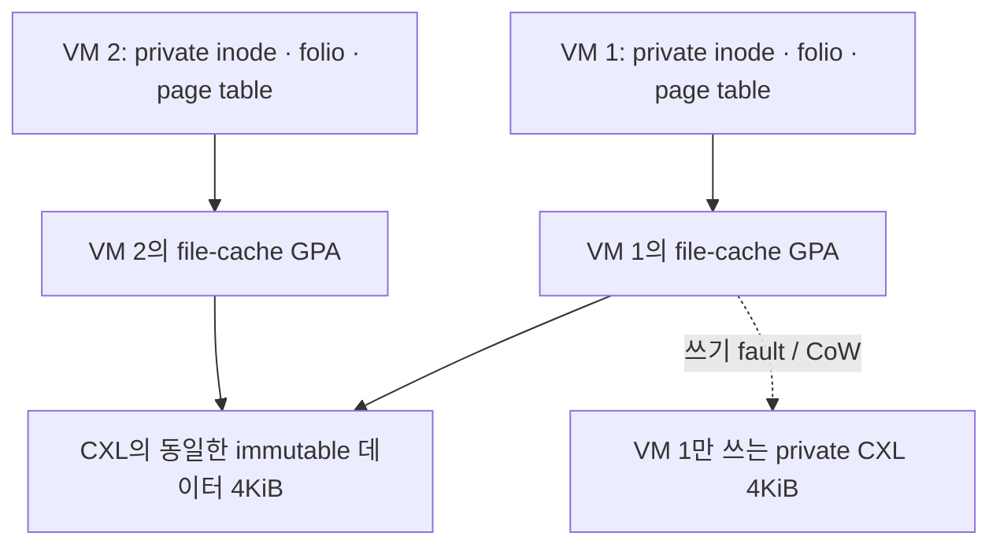

# Guest metadata 기반 CXL page pooling과 두 handoff 모드

이 문서는 immutable lower ext4의 현재 guest page cache를 공유하는 후속 구현을 설명한다. 기존 virtio-blk read history는 공유 자격의 근거로 사용하지 않는다. Bloom은 데이터의 위치를 찾는 힌트이고, 실제 공유 자격은 각 guest kernel이 자신의 inode와 page-cache mapping을 확인해 부여한다.

대상은 **DRAM에서 독립적으로 시작한 VM을 CXL로 promotion할 때 중복된 clean 파일 데이터의 backing을 합치고, CXL에서는 두 handoff 방식을 모두 사용하며, demotion할 때 현재 내용을 DRAM으로 복사하는 것**이다. 이전 full-RAM snapshot 실험과 별도의 구현·검증이다. 실행 증거와 재현 절차는 [이번 결과](../implementation/virtual_machine/results/guest-pool-handoff-20261030/README.md)에 모은다.

## 메모리와 파일 경로

Guest는 ext4와 virtio-blk을 계속 사용한다. A의 local 이미지와 B host가 NFS로 여는 이미지는 같은 immutable 이미지 버전에 속한다. Guest cache hit에는 Bloom 조회나 host RPC를 추가하지 않는다. Cache miss는 기존 virtio-blk 경로로 처리한다.

Guest inode, address_space, folio, LRU 등 쓰기 가능한 metadata는 VM마다 private으로 유지한다. 공유되는 것은 이미지에서 읽은 clean 데이터 페이지뿐이다. Canonical 데이터는 변경하지 않으며, 이후 CPU 또는 host 장치 I/O가 공유 GPA에 쓰면 해당 VM만 private CXL frame을 얻는다.

| 실행 위치·tier | Guest cache hit | Guest cache miss | 파일 수정 |
|---|---|---|---|
| A / DRAM | Private guest RAM | virtio-blk → A local image | Guest tmpfs upper |
| A / CXL | Private 또는 공유 CXL 데이터 | virtio-blk → A local image | Guest tmpfs upper; 필요한 backing만 CoW |
| B / CXL | 같은 CXL 데이터 | virtio-blk → B host NFS FD → A image | 같은 VM의 tmpfs upper 유지 |
| A 복귀 / DRAM | 현재 내용을 복사한 private RAM | virtio-blk → A local image | 이전 upper 내용 유지 |

NFS를 쓰는 조건은 **이미지의 고향 A가 아닌 B에서 실행되는 경우**다. CXL 메모리 자체가 NFS를 사용하는 것은 아니다. Guest는 어느 경우든 같은 virtio-blk와 ext4를 본다. 다른 노드 B의 DRAM으로 demotion하면서 B의 별도 disk로 바꾸는 기능은 이번 범위에 포함하지 않는다.

## 현재 guest metadata를 통한 등록

`guest-pool.c`는 지정한 read-only ext4 파일의 현재 resident folio만 조회한다. 읽기를 완료한 order-0 clean 페이지 중 mapping/index가 일치하고 writeback 중이 아닌 페이지를 선택한다. 파일 데이터가 없는 cache miss를 채워서 후보 수를 늘리지 않는다.

등록된 페이지는 참조와 folio lock을 유지한다. Host는 이미지 버전, inode/generation, 파일 page index, GPA, 전환 epoch와 token을 받는다. Host의 frozen ext4 extent 목록은 파일 offset을 canonical image offset으로 변환하고 guest의 bmap 결과와 대조한다. 첫 범위는 일반 파일의 완전한 4KiB 페이지이며 hole, 부분 EOF, 암호화 및 large folio는 제외한다.

Kernel은 별도의 영구 status page에 ACTIVE, session cookie, epoch, token과 전체 등록 목록의 SHA-256을 게시한다. Host는 VM을 정지하고 장치 I/O를 drain한 뒤 이 status page를 읽어 등록 목록과 대조한다. Helper가 종료되거나 FD가 닫히면 kernel은 페이지 lock을 풀기 전에 INACTIVE로 바꾼다. 따라서 과거 등록 목록만 남아 있어도 공유를 승인할 수 없다. 이 검사는 파일 데이터 4KiB 전수 비교와 다르다.

공유 자격은 다음 조건을 함께 만족해야 한다.

1. 같은 immutable image digest와 ext4 UUID, inode/generation의 동일 file page다.
2. Guest의 현재 folio가 그 inode의 mapping/index에 속하고, 읽기 완료·clean·writeback 아님을 확인했다.
3. 해당 GPA와 image offset이 고정 image의 extent 정보에 맞으며, 등록 동안 folio가 잠겨 있다.
4. 정지된 guest의 영구 status가 지금 전달된 전체 목록·cookie·epoch·token에 일치한다.

여기서 clean은 guest 파일 캐시의 상태다. KVM dirty bitmap/PML이 0이라는 조건만으로 파일 정체성을 판단하지 않는다. Kernel status와 controller는 신뢰하는 구성요소다. 악의적인 guest kernel이 자신의 metadata와 status를 위조하는 경우까지 격리하는 범용 서비스는 아니다.

## Bloom이 하는 일

각 VM의 Bloom slot은 tier와 관계없이 CXL에 있다. Promotion controller가 `(image version, image offset)`으로 다른 VM의 slot을 조회해 후보를 좁힌다. 그다음 controller가 private으로 유지하는 정확한 canonical index와 READY 상태를 조회한다. 다른 VM의 inode나 XArray를 직접 탐색하지 않는다.

Bloom이 hit이어도 위 guest 등록 조건과 정확한 canonical 조회를 모두 통과해야 한다. False positive는 추가 조회로 끝난다. False negative는 이미 공유 가능한 페이지를 이번에 private으로 복사하게 만들 뿐, 잘못된 데이터 공유를 허용하지 않는다. 시험은 Bloom을 모두 0 또는 모두 1로 만든 후보 조회와 controller 선택 규칙을 포함한다. 모든 bit를 0으로 바꾼 전체 promotion의 성능을 측정한 것은 아니다.

첫 구현은 224MiB의 immutable image 전체를 canonical 영역에 미리 적재한다. 다른 VM의 임의 GPA를 곧바로 donor로 export하거나 canonical frame을 온라인으로 회수하는 구현은 아니다. 따라서 공유 중인 160MiB만 canonical 비용으로 계산하면 안 된다. 비일관 CXL에서 Bloom의 stale read를 허용하더라도 canonical 게시·수명·소유권에는 별도의 정확한 프로토콜이 필요하다.

## Promotion과 demotion

Promotion은 현재 guest 등록과 Bloom/정확한 canonical 조회로 공유 대상을 정한다. Controller는 나머지 GPA에만 private CXL frame을 할당하고 내용을 복사한다. 공유 GPA에는 이미 있는 canonical frame을 연결한다. GPA와 guest page table은 유지한다.

`pool_memory_module.c`는 하나의 연속된 host 가상주소 공간을 여러 private/canonical CXL frame에 연결한다. Canonical PTE는 read-only이고, 쓰기 fault에서 할당받은 private CXL frame으로 4KiB를 복사한 뒤 KVM translation을 무효화하고 writable mapping을 게시한다. CoW에 사용할 여유 frame은 controller가 해당 VM에 독점적으로 부여한다. 미사용 여유 frame도 할당량에 포함하며, 부족할 경우 추가 grant가 필요하다.

Guest free-page reporting의 discard는 선택된 이전 공유 GPA의 기존 내용을 복사하지 않고 해당 VM의 backing을 zero private CXL frame으로 바꾼 뒤 ACK한다. 다른 VM의 canonical mapping은 그대로 유지한다. Pending block I/O와 겹치거나 pooling 대상이 아닌 페이지는 교체하지 않는다. 따라서 ACK된 전체 크기와 실제 backing 교체 크기는 구분한다.

Demotion은 현재 논리 RAM을 private DRAM으로 복사한다. 이 복사에는 canonical 데이터와 이미 CoW된 private 데이터가 모두 포함된다. 원래 raw DAX span을 복사하지 않는다. HVA 교체와 KVM translation 무효화를 마친 뒤 controller가 해당 VM의 private frame 및 미사용 grant를 반환한다. 이는 RAM snapshot 파일 저장과 별개인 메모리 배치 변경이다.

따라서 비용의 위치는 다음과 같다. 일반 cache hit 경로에는 작업을 추가하지 않는다. Promotion에는 guest metadata 등록, 정지·I/O drain, mapping 교체와 private 데이터 복사가 들어간다. 공유 페이지를 실제로 쓰는 경우에만 4KiB CoW가 발생한다. Demotion은 전체 논리 RAM을 복사한다. Guest free-page report가 먼저 완료되면 그 GPA를 새 데이터로 재사용할 때 canonical 내용 복사를 생략한다. 이 네 비용을 하나의 `CoW 시간`으로 묶지 않는다.

## CXL에서 두 handoff 방식

### State-only

CPU·장치 상태만 Firecracker 상태 파일로 저장한다. Guest RAM은 CXL에 남는다. Mapper가 내보낸 현재 GPA→CXL frame 목록과 여유 grant 목록을 목적지에서 동일하게 연결한다. 상태 파일의 SHA-256을 placement manifest에 묶어 다른 전환의 상태와 mapping을 혼합하지 못하게 한다. Source를 fence한 뒤 목적지를 재개한다.

이 모드는 목적지에서 KVM 객체를 새로 만들지만 RAM 파일을 생성하거나 RAM 데이터를 전송하지 않는다. `FC_POOL_MEMORY=1` 경로에서 full-RAM snapshot 요청은 거절한다.

Firecracker API의 `snapshot_type: Full`은 상태 파일 형식을 가리키며, 이 실험의 RAM 대상은 `/dev/dax0.0`이다. 수정된 persist 경로가 RAM dump를 생략하고 mapper manifest를 사용한다. 문자열 `Full`만 보고 full-RAM 복사라고 해석하지 않도록 실행 증거에서는 RAM 파일 경로·복사량과 state/manifest를 따로 확인한다.

### Direct

수정 KVM의 동일 VM/vCPU/VMCS/EPT 객체를 detach/attach한다. CPU register 상태를 snapshot으로 저장하거나 복원하지 않는다. 목적지 Firecracker wrapper는 기존 virtio 구현을 사용하여 node-local FD, IRQ/eventfd와 local/NFS 파일 backend를 다시 연결한다. 이때 전달하는 device binding 상태와 placement manifest는 CPU/RAM snapshot과 구분한다.

일반 Pause는 KVM 소유권을 유지하므로 guest 등록 검증과 promotion을 수행할 수 있다. 명시적인 `DirectExport`가 장치 I/O drain, device binding export, eventfd 해제, kernel 객체 detach를 수행한다. 목적지는 전체 GPA의 실제 PFN이 export된 mapping과 일치하는지 확인한 후 같은 kernel 객체를 실행한다.

현재 direct 구성은 1 vCPU, read-only virtio-blk, reporting-only balloon을 대상으로 한다. 한 retained KVM graph와 일반 peer VM들이 같은 실험 host kernel에서 공존하도록 선택된 Firecracker TGID만 DAX kernel-object allocator를 사용한다. 여러 retained graph의 동시 direct handoff를 지원한다는 의미는 아니다.

Direct가 유지하는 것은 kernel VM/vCPU/VMCS/EPT root의 identity다. 실행 중 page fault, CoW, promotion/demotion으로 EPT leaf 내용은 바뀔 수 있다. Host FD, eventfd, thread, Rust VMM wrapper와 private allocator metadata까지 동일 객체로 공유하는 것은 아니다.

| 항목 | State-only | Direct |
|---|---|---|
| Guest RAM 데이터 | 현재 CXL frame 유지 | 현재 CXL frame 유지 |
| GPA→CXL placement manifest | 전달·검증 | 전달·검증 |
| CPU register snapshot | 저장·복원 | 없음 |
| 목적지 KVM 생성 | 새로 생성 | 동일 객체 attach |
| 장치의 논리 상태·host 연결 | 상태 복원 후 local/NFS 연결 | Device binding export/import 후 local/NFS 연결 |
| DRAM demotion | 현재 논리 RAM 복사 | 현재 논리 RAM 복사 |

## 구현 파일과 신뢰 경계

| 파일 | 역할 |
|---|---|
| `guest-pool.c`, `guest-pool-uapi.h` | 현재 clean resident folio 등록·고정과 영구 status 게시 |
| `guest-pool-cli.c`, `guest-pool-build.py` | Guest 도구와 커널 빌드 |
| `guest_pool_protocol.py` | 등록 digest·image identity·extent 검증 |
| `pool_handoff_control.py` | Private CXL frame·여유 grant의 단일 controller 소유권 |
| `pool_memory_module.c`, `pool_memory_uapi.h` | `/dev/cxl_pool` mapping, private CXL CoW, discard, 실제 PTE audit |
| `firecracker.patch`의 `pool_memory.rs` | 정지 상태 authority 검증, promotion/demotion, 현재 mapping export/restore |
| `firecracker.patch`의 `direct.rs`, `kvm-dax-state.patch` | 같은 KVM 객체 detach/attach, PFN 검증, 장치 재연결 |
| `pool_handoff_bench.py`, `pool_handoff_run.py` | 독립 VM과 새 A/B pair에서 두 모드 실행 |
| `verify_pool_handoff.py` | Controller/parser를 import하지 않는 원시 증거 독립 검증 |

Module은 CAP_SYS_RAWIO가 있는 controller/VMM을 신뢰한다. VM 내부의 guest metadata, host mapper table, controller allocation table은 서로 다른 역할이며 모두 VM 사이에 공유하는 writable metadata가 아니다. 각 VM의 private frame이 겹치지 않도록 controller가 독점 grant를 관리한다. Module은 한 context의 mapping·credit 중복, canonical 쓰기, 두 번째 VMA alias 등을 거절한다.

이는 단일 controller가 있는 실험 구현이다. Controller 장애 복구·여러 allocator의 동시 동작, 동적 canonical 회수, production seccomp 정책, 3GiB 이상의 다중 RAM region은 추가 작업이다.

## 검증 기준

- Guest의 현재 metadata로 100MiB를 넘는 cache를 확인하고, 등록 중 추가 file read가 없음을 확인한다.
- 여러 독립 VM의 데이터와 private 변경을 반복 promotion/demotion 및 각 handoff 모드에서 검증한다.
- 실제 canonical/private PFN, CoW 이후 PFN 분리와 peer 보존을 확인한다.
- State-only에서는 작은 CPU·장치 상태와 placement metadata만 전달했음을 확인한다. Direct에서는 같은 kernel 객체 identity를 유지했음을 추가로 확인한다.
- B의 cold refill에서 virtio-blk와 host NFS READ가 실제로 발생하는지 확인한다.
- 반환한 private frame을 다른 VM에 재할당하고 양쪽 데이터를 검증한다. 원래 reservation을 유지한 채 공유 PFN만 세는 것을 용량 회수로 계산하지 않는다.
- Helper 종료, 오래된 epoch/token, 변조된 등록 목록, Bloom 오판, 잘못된 allocation/manifest, 전환 실패를 거절하는지 확인한다.

실험 환경은 한 physical host의 coherent shared memory를 이용한 nested KVM이다. 실제 비일관 CXL 장비의 cache publication/invalidation 동작까지 검증한 것으로 해석하지 않는다. 첫 canonical 영역은 immutable image를 미리 적재하므로 해당 영역 전체와 미사용 CoW grant도 총 할당량에 포함한다.
