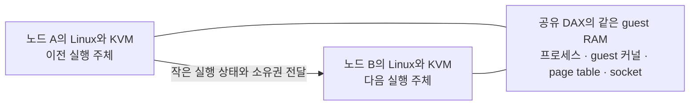
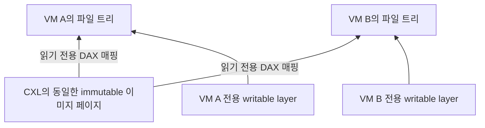

# CXL microVM 실행 이전 연구와 구현 정리

정리 기준: 2026년 10월 30일. Host NFS와 고향 disk의 DRAM↔CXL 수명주기, virtio-blk 관측 prototype에 이어, 현재 guest metadata로 공유 자격을 확인하는 pooling과 direct/state-only handoff를 추가했다. 측정 날짜와 환경은 각 결과에 따로 표시한다.

목표는 **sandbox의 메모리를 CXL에 유지하면서 실행을 담당하는 노드를 바꾸는 것**이다. RAM 전체를 옮기는 비용을 줄여, 이미 실행 중인 sandbox도 다른 노드의 여유 CPU를 사용할 수 있게 하려는 연구다.

현재는 공유 RAM을 유지하는 실행 이전, PML을 이용한 캐시 처리, MPTCP 연결 유지까지 **각각 검증**했다. 파일 접근과 장치 소유권, 비일관 CXL의 가시성 보장을 포함하는 하나의 서비스 전환 경로로 통합하는 작업은 남아 있다.

이 문서는 처음의 workload 관측부터 microVM 구현, 파일 공유 논의와 후속 계획까지 연결한다. 실행 명령과 상세 설정은 기존 [구현 README](../implementation/virtual_machine/README.md)를 따른다. 별도 작업 흐름에서 main에 합쳐진 contention·write 관측·rollout 계획도 배경 근거로 포함하되, 실제 handoff 측정과 구분한다.

## 읽는 순서

- [현재 상태](#현재-상태): 무엇이 끝났고 무엇이 남았는가
- [출발점과 초기 실험](#출발점과-초기-실험): 왜 실행 위치를 바꾸려 하는가
- [실행 이전 구현](#실행-이전-구현): RAM을 옮기지 않고 무엇을 이전하는가
- [측정 결과의 의미](#측정-결과의-의미): 어느 구간이 얼마나 걸렸는가
- [PML과 캐시 일관성](#pml과-캐시-일관성): 변경된 데이터가 다른 CPU에 어떻게 보이는가
- [MPTCP와 연결 유지](#mptcp와-연결-유지): 실행 노드가 바뀌어도 연결을 어떻게 이어가는가
- [파일과 이미지 공유](#파일과-이미지-공유): guest cache와 실제 저장소를 어떻게 연결하는가
- [선행 연구와의 관계](#선행-연구와의-관계)
- [후속 구현 계획](#후속-구현-계획)
- [용어와 근거 자료](#용어와-근거-자료)

## 현재 상태

| 영역 | 구현하거나 확인한 것 | 아직 남은 것 |
|---|---|---|
| Workload | Docker trace 재생, DRAM/CXL 비교, microVM 실행과 scheduling 관측 | 반복·순서 랜덤화, 실제 RL rollout으로 확대 |
| 배치 효과 | 작은 CPU pool의 contention 실측, 큰 fleet의 시뮬레이션 | 실제 다중 노드에서 서비스 성능과 비용 이득 검증 |
| Guest RAM과 CPU | 공유 DAX snapshot(2 vCPU trace 포함), worker reuse/prepared, 제한된 KVM 객체 direct handoff | Direct의 다중 vCPU·일반 장치 구성, 실제 CXL 다중 host |
| PML과 cache | Dirty-page 기반 CPU flush/invalidate의 독립 계측 | 모든 writer 추적, 실제 handoff 통합, 비일관 환경 correctness |
| DSA | Cache Flush capability와 preflush 순서 조사 | 실제 DSA 접근·완료 처리·성능 검증 |
| MPTCP | Guest client가 A→B snapshot 복원 뒤 같은 연결로 통신 | 빠른 제어 경로, 반복 이동, server 이동, direct/reuse 장치 승계 |
| Filesystem | RO lower + tmpfs upper의 trace, 별도 writable ext4 lifecycle, pooling의 RO block direct/state-only와 실제 OverlayFS copy-up | Writable disk의 direct 승계, 장애 복구·전원 장애 내구성, 일반 장치·다중 vCPU |
| NFS와 RAM 배치 | Host NFS image 접근과 guest cache 유지, DRAM→CXL promotion·고향 DRAM 복귀 | 실제 다중 host·물리 network, 명령 실행 도중 이전, 최적화된 제어 경로와 통합 |
| 읽기 데이터 pooling | 현재 guest inode/folio 등록, CXL Bloom, promotion 공유·private CXL CoW, demotion 할당 반환, shared backing을 유지하는 두 handoff | 온라인 admission·동적 canonical 회수, 분산 allocator와 장애 복구, 비일관 CXL publish, PML/MPTCP 통합 |

**환경을 구분해야 한다.** DRAM/CXL workload 실험과 microVM handoff 실험은 같은 종류의 측정이 아니다. 현재 handoff는 한 coherent 물리 host 위의 QEMU A/B와 nested KVM 환경이다. 독립된 Linux 사이의 실행 이전을 확인했지만, 실제 비일관 CXL에서 stale cache가 발생하는 상황을 검증한 것은 아니다.

현재 [guest metadata 기반 pooling](cxl-guest-pool-handoff.md)은 guest의 inode·folio·XArray를 VM별로 유지하고 immutable lower의 데이터 backing만 공유한다. Guest ext4/virtio-blk는 유지한다. 현재 mapping과 private CXL CoW를 manifest로 이어서 direct/state-only 모두 RAM snapshot 없이 이전한다. Demotion 후 반환한 grant의 실제 타 VM 재사용도 별도로 확인한다. 이전 [read-hint prototype](cxl-data-pooling.md)은 full-RAM snapshot과 반환하지 않은 DAX reservation을 사용하는 역사적 결과다.

## 출발점과 초기 실험

### 실행 중인 sandbox를 옮기려는 이유

Agent sandbox는 명령 실행·빌드·테스트 때 CPU를 쓰고, 다음 작업을 기다릴 때는 CPU 사용이 낮아질 수 있다. 그동안 프로세스와 파일 상태, 메모리는 계속 남는다. 생성 시점에 좋은 노드를 골랐더라도 이후의 CPU 수요까지 균등해지지는 않는다.

우리가 확인하려는 것은 두 가지다. 첫째, 다른 노드의 빈 CPU를 쓰면 얼마나 도움이 되는가. 둘째, CXL 접근 비용과 실행 이전 비용을 지불하고도 이득이 남는가. 모든 sandbox를 CXL에 놓는 것이 항상 유리하다고 전제하지 않는다.

### Docker에서 시작한 workload 재생

처음에는 기록된 mini-swe-agent 명령을 Docker에서 재생하고 CPU·메모리·명령 결과를 검증했다. 16개 pilot 이후 264개 trace를 DRAM과 CXL에서 각각 실행했다. 모델 추론을 다시 실행한 실험이 아니라 기록된 명령의 재생이다.

| 2026년 10월 14일 정리 결과 | 값과 해석 |
|---|---|
| 실행 규모 | 264개 trace × DRAM/CXL, 총 528회 |
| 대표 latency 비교 | 비교 가능한 211쌍에서 CXL 증가율 기하평균 13.15%, 시간 합계 17.38% |
| 긴 꼬리 | 증가율 p95 42.79%, 최대 79.85%; CXL에서만 timeout인 trace 11개 |
| 비교 조건 | CPU node 0 고정, 익명 메모리를 DRAM 또는 CXL node에 배치 |
| 해석 한계 | 조건별 1회, DRAM→CXL 고정 순서. 기존 공유 파일 cache까지 전부 CXL에 배치한 것은 아님 |

이 결과는 CXL의 비용이 작업마다 다르다는 출발점이다. 평균만으로 비용이 작다고 결론 내리거나, 반복 실험 없이 차이 전부를 CXL의 인과 효과로 해석하지 않는다. [DRAM/CXL 결과](results/numa-immediate-20261014/README.md), [초기 pilot](replay-report.md)

### Firecracker로 실제 작업 실행과 상태 복원 확인

초기 microVM 실험은 1 vCPU·128 MiB·initramfs 구성에서 시작했다. 2026년 10월 14일 pause/resume과 새 VMM의 snapshot 복원을 확인했고, 재부팅 없이 counter가 이어졌다. 이때는 128 MiB RAM을 실제 snapshot 파일로 저장했다. 당시의 state 크기는 13,652 bytes였다.

같은 날 Gin trace 27개 명령을 guest 내부에서 실행해 비교 가능한 종료 코드 26개와 최종 제출 내용이 원본과 일치함을 확인했다. 이어 Preact를 1·2 vCPU에서 실행해 guest 내부 선점과 작업 이동, host의 vCPU thread scheduling을 관측했다. Host scheduler가 같은 KVM 객체의 thread를 다른 CPU에 배치하는 것은 서로 다른 host 간 handoff와 구분한다. [초기 실험](microvm-handoff.md), [Scheduling 관측](microvm-scheduling.md)

### Contention과 큰 fleet에서의 효과 검토

별도 실험에서는 한 물리 서버를 작은 CPU pool로 나눠 실제 microVM을 실행했다. 코어당 sandbox 2.8~4.2개 조건에서 node별 runqueue 대기가 나타났고, CPU 공유 범위를 넓히면 대기가 줄었다. 이것은 메모리와 KVM 객체를 그대로 둔 **동일 host의 affinity 공유 실측**이며, 물리 노드 간 migration 실측이 아니다. [Contention 결과](../experiments/contention/RESULTS-20261021.md)

16개 node × 192코어 fleet는 실측 burst를 입력한 **시뮬레이션**이다. 큰 node에서는 내부 자원 공유로 완화되는 불균형이 많고, 모든 node가 함께 포화되면 옮길 여유가 없다. 보고서는 작은 node 검증의 대기 합계 기준을 통과하지 못한 점과 scheduler 대기 보정의 한계를 명시한다. 빠른 handoff의 모델상 이점을 실제 클러스터에서 입증한 결과로 읽으면 안 된다. [Fleet 결과](../experiments/contention/RESULTS-fleet.md)

### Tool call별 write 범위 관측

추가 Docker replay는 DRAM node 1에서 13,600개 tool call을 계측했다. 유효한 13,565개 call의 관측 write 범위는 중앙값 2.02 MB, p95 315.22 MB였다. 이 자료는 변경량 분포를 탐색하는 데 사용한다.

**이 값은 전환 순간 flush해야 하는 dirty cache line 수가 아니다.** Call 동안 관측한 페이지 집합에는 나중에 해제된 페이지도 포함된다. 새 메모리 샘플까지 있는 13,468개 call에서 `관측 write bytes / call 중 샘플 최대 memory.current`의 중앙값은 27.08%였다. 현재 상주 메모리의 dirty 비율이 아니므로 100%를 넘을 수 있다. Write fault 유도와 THP 비활성화의 비용도 있어 기존 latency 결과와 직접 비교하지 않는다. [Write 관측 정의와 결과](results/write-pages-node1-20261021/write-report.md)

## 실행 이전 구현

### 메모리와 실행 주체를 분리하는 모델



그림의 A/B는 현재 실험에서 각각 QEMU 내부의 Linux다. Guest RAM을 같은 backing에 유지해도 실행 주체의 레지스터·interrupt·clock 상태와 host 자원 연결은 따로 처리해야 한다.

| 상태 | 어디에 있는가 | 실행 노드가 바뀔 때 |
|---|---|---|
| Guest process, guest page table, inode, FD, page cache | Guest RAM | 같은 RAM을 유지 |
| Guest TCP/MPTCP socket와 송수신 buffer | Guest RAM | 같은 RAM을 유지하고 외부 경로 재연결 |
| vCPU register, MSR, interrupt, clock | KVM 실행 상태 | 의미적 export/import 또는 제한된 direct 승계 |
| EPT | Host의 GPA→HPA 변환 구조 | 경로에 따라 새로 생성, 목적지 것을 재사용, 또는 direct 승계 |
| TAP, file FD, eventfd, thread, io_uring | 각 host의 실행 자원 | 목적지에서 준비하고 source 처리를 차단 |
| Disk image와 writable bytes | Guest RAM 밖의 storage | 동일 데이터 접근과 단일 writer 보장 |
| DAX로 매핑한 별도 이미지 영역 | Guest RAM과 별도 device backing | 목적지에서 동일 이미지·offset 매핑 복원 |

Guest page table과 EPT는 다른 계층이다. Guest VA/GPA를 유지한다고 목적지 EPT까지 자동으로 유지되는 것은 아니다.

### 구현한 경로의 차이

| 경로 | Guest RAM | CPU와 KVM 상태 처리 | 의미 |
|---|---|---|---|
| Full snapshot migration | 전체 snapshot·전송 | 목적지에 새 KVM 생성 | RAM 복사 비용을 포함한 비교 기준 |
| Shared-DAX snapshot | 같은 backing 유지 | 작은 의미적 상태 복원, KVM/EPT 새로 생성 | RAM 복사를 제거한 기본 경로 |
| Reuse | 같은 backing 유지 | 사용 이력이 있는 목적지 KVM worker에 복원 | 생성 비용과 일부 translation 준비 비용 절감 |
| Reuse-prepared | Reuse와 동일 | 반환 worker 정리를 다음 요청 전에 수행 | 준비 비용을 정지 구간 밖으로 이동 |
| Direct handoff | 같은 backing 유지 | 수정 KVM의 동일 VM/vCPU/VMCS/EPT 객체를 detach/attach | 더 강한 주소·CPU·수명 제약을 가진 실험 경로 |

의미적 상태는 guest가 재개하는 데 필요한 register·MSR·interrupt·clock·장치 상태다. Raw `struct kvm`이나 host FD를 직렬화하는 방식이 아니다. 측정 구성에서 크기는 약 14 KB였으며 일반 VM의 고정 크기는 아니다.

Reuse-prepared는 노드마다 worker 하나를 교대로 사용하는 구현이다. 임의 구성의 N개 worker pool이나 일반 scheduler가 완성된 것은 아니다. 준비 비용도 없어진 것이 아니라 peer 실행 중에 지불한다.

Direct는 지정 KVM 객체와 pointer graph를 DAX에 두고 일부 host 연결을 목적지의 것으로 다시 연결한다. 현재 지원 범위는 1 vCPU와 호환 CPU/VMCS, 맞춰 둔 kernel/module 주소와 DAX PFN 등 강한 조건을 전제로 한다. Linux guest direct 경로에서는 source Firecracker가 A에 남고 B의 executor가 동일 KVM 객체를 실행한다. 완전한 VMM·I/O 서비스 이전으로 해석하지 않는다. Block/net/vsock 등의 worker 재사용과 direct의 PML 활성화는 현재 제한 또는 거부 대상이다.

상태 전달 계열의 `snapshot`·`reuse`·`reuse-prepared`와 direct를 별도로 재실행해 지원 구성의 회귀를 확인했다.
파일 경로는 일반 snapshot의 DAX mailbox에 연결해 검증했다. `PrepareReuse`와 direct의 block/다중 vCPU 지원 제한은 유지한다.
10월 27일 direct + block 거절 뒤 읽기가 멈추는 문제가 발견됐고, 10월 28일 **정지 전 구성 검사와 API event loop의 거절 처리**를 수정했다.
수정 후에는 HTTP 400 직후 별도 Resume 없이 같은 열린 FD의 cold read가 완료됐다. 2-vCPU VM도 요청 거절 뒤 counter가 `2→4→6`으로 진행했고, 별도 1-vCPU diskless direct는 20회 handoff를 통과했다.
이것은 실패 처리의 수정이지 direct의 virtio-blk 이전 구현이 아니다.
[이전 모드 검증과 당시 실패](../implementation/virtual_machine/results/mode-compatibility-20261027/README.md) ·
[수정 후 디스크·RAM 검증](../implementation/virtual_machine/results/home-storage-20261028/README.md)

### 진행 과정의 주요 시점

| 시점 | 축적한 결과 |
|---|---|
| 10월 14일 | DRAM/CXL 결과 정리, 기본 Firecracker 부팅·snapshot 복원, 실제 trace와 scheduling 관측 |
| 10월 15~16일 | Direct handoff 최적화와 단계별 지연 분석 |
| 10월 19일 | Shared-DAX 의미적 snapshot, used-worker reuse와 준비 분리 비교 |
| 10월 20일 | 512 MiB~2 GiB 크기별 비교, full migration 및 network 방향 차이 재검증 |
| 10월 21일 | PML/cache 독립 측정, host reference와 장치·coherence 후속 설계 정리 |
| 10월 22일 | MPTCP guest-client 경로 교체와 실제 A→B snapshot 연결 유지 |
| 10월 23일 | 구현·문서·보관 로그 검증 후 main에 MPTCP 결과 반영 |
| 이후 논의와 10월 26일 정리 | 파일 경로, guest-only cache, DSec, CXL 공통 이미지 공유 비교와 후속 계획 통합 |
| 10월 27일 | Host NFS 실제 trace, DAX state mailbox, 기존 모드 호환성과 direct 실패 경계 |
| 10월 28일 | 고향 writable disk 왕복, DRAM↔CXL RAM 복사, direct 거절 처리 수정, RL tmpfs 사례 확인 |

## 측정 결과의 의미

### CPU가 재개되는 시점과 작업이 끝나는 시점

다음은 10월 20일의 준비된 반복 전환에서 관측한 **평균**이다. Coherent host의 nested 환경이며 크기마다 warmup 4회 뒤 20회 측정했다. W는 guest의 `MemAvailable − 16 MiB`를 확보한 working set이며 4 KiB 페이지마다 64 B를 초기화·검증한다.

| Guest RAM | 경로 | 정지부터 첫 ACK | 정지부터 첫 W scan 완료 |
|---:|---|---:|---:|
| 1 GiB | Reuse-prepared | 2.92 ms | 18.31 ms |
| 1 GiB | Direct | 0.73 ms | 13.91 ms |
| 2 GiB | Reuse-prepared | 2.81 ms | 35.67 ms |
| 2 GiB | Direct | 0.34 ms | 26.13 ms |

Guest RAM 전송량은 두 경로 모두 0이지만, 재개 뒤 메모리·translation 접근 비용과 제어 전달은 남는다. 최초 방문도 별도다. 예를 들어 1 GiB direct의 첫 A→B는 ACK 4.70 ms, W 완료 679.07 ms였다. 첫 방문의 준비 조건까지 동일한 실험은 아니므로 scan 시간을 순수 EPT 비용으로 해석하지 않는다. [크기별 원자료](../implementation/virtual_machine/dax-size-comparison.json)

Full migration은 RAM snapshot·전송·새 restore 뒤의 재접근까지 측정했다. 별도 TAP 기반 1 GiB 실험에서 정지→첫 ACK 평균은 약 773 ms, W 완료까지는 4.896초였다. 초기 QEMU socket 경로에서 방향별 차이가 나타나 바깥 TCP의 NODELAY와 batching을 조사했고, TAP/vhost 대조군을 추가했다. 준비된 worker, 목적지 translation 준비와 network 조건이 다른 결과를 섞어 speedup 하나로 만들지 않는다. [Network 비교](../implementation/virtual_machine/network-fairness-comparison.json)

### 서로 더하거나 바꿔 읽으면 안 되는 값

- `저장+복원`과 `정지→ACK`, `정지→working-set 완료`, `외부 client 응답 공백`은 다른 지표다.
- 독립 cache-bench의 flush 시간을 CPU/RAM handoff에 더해 통합 실측값이라고 부르지 않는다.
- MPTCP 기능 시험에는 느린 serial state 전달이 들어갔다. 기존 ms 단위 handoff와 직접 비교하지 않는다.
- 작은 node의 실측, 큰 fleet의 시뮬레이션, 실제 다중 host CXL 검증은 서로 다른 증거다.

## PML과 캐시 일관성

### PML이 필요한 이유와 제공하는 정보

RAM이 같은 CXL 위치에 있어도 source CPU의 cache에 최신 데이터가 남을 수 있다. 비일관 host 사이에서는 source의 변경을 내보내고 destination의 오래된 복사본을 무효화해야 한다.

PML은 Page Modification Logging이다. Guest 쓰기로 EPT dirty bit가 설정된 페이지를 기록하며, 현재 구현은 KVM의 dirty bitmap API로 결과를 수집한다. **PML은 아직 cache에 남은 dirty line의 주소 목록을 주지 않는다.**

현재 방식은 dirty 4 KiB 페이지마다 64 B cache line 64개를 처리한다. 실제로 64 B만 쓴 페이지도 대상 범위는 4 KiB다. `CLWB` 명령에 지정한 범위와 실제 CXL writeback traffic은 같지 않다.

### 지금까지 검증한 범위

```text
Writer guest 정지
  → dirty bitmap 수집 및 재설정
  → 해당 페이지에 CLWB와 SFENCE
  → epoch와 bitmap 전달
Reader
  → 같은 offset의 로컬 주소에 CLFLUSHOPT와 MFENCE
  → ACK와 데이터 검증
```

10월 21일 native KVM/memfd와 nested KVM/shared-DAX에서 총 60조건·1,200회 본 측정을 완료했다. 아래는 **nested shared-DAX에서 writer flush + reader invalidate 합계 p50**이며, 페이지당 실제 쓰기량은 64 B다.

| 변경 페이지 비율 | 1 GiB | 2 GiB |
|---:|---:|---:|
| 0.1% | 0.131 ms | 0.214 ms |
| 1% | 0.911 ms | 1.784 ms |
| 10% | 10.477 ms | 20.465 ms |
| 100% | 98.039 ms | 172.637 ms |

1 GiB에서 1%만 썼어도 전체 RAM을 처리하면 99.781 ms였다. 선별 처리의 가능성을 보여주지만, Ice Lake의 coherent 환경에서 잰 명령 비용이다. Nested PML에는 에뮬레이션이 포함되며 EMR의 순수 hardware PML 비용이나 실제 비일관 CXL correctness를 측정한 결과가 아니다. [PML/cache 결과](../implementation/virtual_machine/results/cache-pml-20261021/summary.json)

### 다음 단계는 모든 writer를 포함하는 것

Guest PML만으로는 VMM의 RX·block completion 쓰기, virtqueue 변경, KVM 객체, VMCS, EPT 자체의 A/D 갱신, DMA를 모두 추적하지 못한다. Guest page table의 A/D와 EPT table의 A/D도 구분해야 한다.

먼저 실제 handoff에서 모든 writer를 멈추거나 drain하고, 각 변경 영역을 어떻게 추적할지 정해야 한다. 현재 direct가 PML을 거부하는 조건도 buffer·index·bitmap의 수명과 마지막 drain, 목적지 재설정을 구현한 뒤에 해제할 수 있다.

### DSA preflush 후속 설계

DSA는 DMA 기반 데이터 처리 가속기다. 여기서는 Cache Flush를 실행 중 미리 제출해 전환 순간 source의 잔여 일을 줄이는 후보로 조사했다. **DSA flush와 주기적 preflush는 아직 구현·측정하지 않았다.** 후속 preflush는 DSA를 대상으로 하고, CPU cache 명령은 전환 시 처리 baseline으로 유지한다.

두 dirty 집합을 따로 관리해야 한다.

| 집합 | 용도 |
|---|---|
| 마지막 CLEAR/rearm 이후의 재쓰기 집합 | Source에서 아직 처리할 변경을 추적 |
| Destination의 마지막 동기화 이후 누적 집합 U | Destination이 무효화해야 할 전체 변경을 추적 |

```text
실행 중: GET → U에 합치기 → CLEAR/rearm → DSA flush 제출 → 완료 확인
전환 시: 모든 writer 정지·drain → 상태 저장/detach 준비 → 최종 harvest
         → 이미 제출한 DSA flush 완료 확인
         → 최종 재쓰기 flush 완료 → U 게시 → reader invalidate → 실행
```

Flush 뒤에 dirty 기록을 지우면 그 사이의 재쓰기를 잃을 수 있다. Source가 이미 writeback한 페이지도 reader에는 오래된 복사본이 남으므로 최종 잔여 집합만 전달해서는 안 된다. 여러 노드로 확대할 때는 destination별 마지막 동기화 epoch 이후의 변경을 빠짐없이 합치거나 보수적으로 전체를 invalidate해야 한다. 현재 detach의 조기 `DETACHED` 게시도 flush 성공 뒤 ownership이 확정되도록 바꿔야 한다.

DSA capability, DAX 주소 접근과 IOMMU/SVA, batch 부분 실패와 timeout을 먼저 검증한다. 단순 enqueue 성공이나 CPU fence는 DSA 완료가 아니다. Reader의 invalidate가 이전 dirty 데이터를 writeback하지 않도록 이전 owner의 쓰기도 먼저 정리해야 한다. [상세 설계와 근거](../implementation/virtual_machine/README.md#dsa-cache-flush와-주기적-preflush-조사후속-설계), [KVM dirty logging](https://docs.kernel.org/virt/kvm/api.html#kvm-cap-manual-dirty-log-protect2)

## MPTCP와 연결 유지

### Guest 연결 상태와 host 패킷 경로

MPTCP는 하나의 연결 아래 여러 TCP subflow를 관리한다. Guest의 socket·sequence·key/token·buffer는 guest RAM에 있으므로 함께 유지된다. 이동 후 새 주소의 subflow를 추가해 통신 경로를 바꾸는 것이 현재 접근이다. [Linux MPTCP](https://docs.kernel.org/networking/mptcp.html)

TAP, NIC queue, routing, NAT/conntrack, eventfd는 host 자원이다. MPTCP가 이들을 자동으로 이전하지는 않는다. 양 끝의 MPTCP 협상과 socket 선택, 새 주소의 도달 가능성, guest path-manager hook이 필요하다. Kernel 설정만 켜도 기존 TCP socket이 자동으로 바뀌는 것은 아니다.

### 10월 22일 기능 검증

| 시험 | 완료한 echo record 수 | 확인한 범위 |
|---|---|---|
| 일반 TCP echo | 1,000개, 오류 0 | 이동 없는 기능 대조군 |
| MPTCP 경로 교체 | 4,000개, 오류 0 | 같은 연결에서 새 subflow로 전환 |
| MPTCP A→B snapshot | 4,000개, 오류 0 | Snapshot 이전 1회를 포함해 같은 연결 유지 |
| MPTCP pause 요청 | 1,000개, 오류 0 | 100 ms pause 요청을 포함한 연결 유지 |

이동한 쪽은 guest **client**이고 listen socket을 유지한 peer는 L1 B에 고정했다. Token/cookie, 경로별 TCP 상태·전송량, record sequence와 payload를 확인했다. 단순히 연결된 주소 수만 비교한 시험이 아니다.

A→B 시험은 guest RAM을 복사하지 않고 13,904-byte state를 전달했으며 KVM/EPT는 새로 만들었다. Peer의 최대 응답 간격은 5.770초였고, 그중 serial state 전달에 4.548초가 포함됐다. **연결 유지 기능의 증거이며 빠른 서비스 이전의 성능 결과는 아니다.** TCP 대조군도 동일한 migration을 수행하지 않았다. [결과와 이벤트](../implementation/virtual_machine/results/mptcp-20261022/summary.json)

### 다음에 검증할 것

1. Serial state 전달을 기존 DAX mailbox에 연결한다. 외부 응답 공백은 peer 시계로, pause·restore·MP_JOIN 같은 내부 단계는 controller와 각 host에서 계측한다. 서로 다른 시계의 시점을 비교할 때는 정렬한다.
2. A→B→A 반복에서 연결 identity, payload/sequence와 source 종료 후 통신을 검증한다.
3. Guest server의 주소 알림과 remote path-manager, 신규 client의 진입 경로를 설계한다.
4. Net 장치 논리 상태와 TAP/eventfd/IRQFD 승계를 direct/reuse에 연결한다.
5. 같은 토폴로지에서 TCP/MPTCP 정상 실행 throughput·CPU와 전환 p50/p99를 측정한다.

현재 ingress 차단 뒤 50 ms quiet는 통제된 실험 조건이다. 실제 NIC/backend drain의 증거로 사용할 수 없다. UDP, TCP fallback, 신규 연결 discovery도 별도 문제다. NFS의 kernel socket이 자동으로 MPTCP가 된다고 가정하지 않는다.

## 파일과 이미지 공유

### Guest 파일에서 실제 저장소까지

일반적인 buffered virtio-blk 경로는 다음과 같다.

```text
Guest application
  → guest VFS/ext4와 page cache
  → virtio-blk queue
  → Firecracker의 host image FD
  → host filesystem/page cache/block layer
  → 실제 storage
```

Initramfs/tmpfs 데이터는 guest RAM에 포함되므로 지금까지의 diskless 전환에서 함께 유지할 수 있었다. Persistent disk에서는 guest inode·FD·offset·page cache가 RAM에 있어도 이미지의 모든 데이터가 RAM에 있는 것은 아니다. Cache miss, writeback, fsync에는 backing storage가 필요하다. Host FD와 미완료 I/O도 목적지에서 별도로 처리해야 한다.

같은 guest filesystem을 계속 사용하려면 동일한 disk bytes, 진행 중 I/O의 완료 경계, 단일 writer를 보장해야 한다. Guest의 ext4 mount를 NFS mount로 바꾸는 것만으로 기존 FD·inode·cache가 승계되지는 않는다.

### 고향 노드와 guest cache 구상

논의한 구상은 디스크 이미지를 고향 노드 A에 두고, CPU가 B로 이동해도 CXL의 guest page cache를 재사용하는 것이다. 캐시된 데이터는 storage에서 다시 읽지 않고 사용하지만 readahead·metadata·writeback I/O는 별도로 발생할 수 있다. Guest에는 계속 같은 virtio-blk 장치를 보이고 host backend의 접근 경로를 바꾸는 설계가 자연스럽다.

2026년 10월 27일 **host NFS 위 read-only disk image + guest tmpfs upper**로 확장해 검증했다. Gin·PHP-CS-Fixer·MicroPython의 기록된 trace를 local/NFS 조건으로 실행한 **24 trials·840개 명령·48회 handoff**에서 A→B→A 이후 명령 결과·최종 patch·열린 FD가 이어졌다. 원본에 있던 nonzero 종료 48건도 기대값으로 재현했다. 수정·빌드 결과는 RAM의 upper에 남으므로 persistent writable disk의 내구성을 검증한 것은 아니다.

Guest cache를 유지한 조건의 명령 시간 중앙값은 local/NFS 각각 Gin **17.99/17.93초**, PHP **8.14/8.03초**, MicroPython **14.67/15.05초**였다. 조건별 3회이며 제어·state 전달 시간은 제외한다. NFS READ 중앙값은 각각 **16·158·383회**였고, 각 이전 뒤 reclaim 가능한 guest cache를 비운 1회 대조에서는 **3,377·2,071·3,444회**였다. 이 실험은 실제 network 비용보다 cache 재사용의 작동 여부를 먼저 보여준다. A server와 B replica의 cache 배치 차이, 한 물리 host의 가상 network라는 한계가 있다. [최종 성능 결과·원시 자료·재현 절차](../implementation/virtual_machine/results/trace-nfs-20261027/README.md)

초기 synthetic 실험은 cache에 남은 페이지의 block/NFS READ 0을 확인했다. 재검토 중 기존 backend 전환의 mount 누적을 발견해 수정했고, 초기 수치는 역사적 기록으로 보존했다. 최종 trace 표는 수정 후 새 VM pair에서 전체 matrix를 다시 측정한 값이다. 수정 후 synthetic 회귀 20 samples와 mount 전환 검사도 통과했다. [초기 결과와 소급 audit의 범위](../implementation/virtual_machine/results/nfs-20261027/README.md)

### 고향 디스크와 DRAM↔CXL 왕복 구현

Guest에는 처음부터 끝까지 **같은 ext4와 virtio-blk**를 보인다. Guest mount를 NFS로 바꾸지 않는다.
이미지의 소유 노드는 A이며, B에서 실행할 때 Firecracker의 image FD가 A의 이미지를 host NFS로 연다.

| 실행 위치 | Guest RAM | Firecracker가 여는 이미지 |
|---|---|---|
| 최초 A | A의 DRAM | A local disk의 `sandbox.raw` |
| A에서 CXL로 promotion | CXL | 같은 A local image |
| B로 실행 이전 | 같은 CXL | Host NFS로 A의 같은 image |
| A로 실행 복귀 | 같은 CXL | A local image |
| A의 DRAM으로 demotion | A의 DRAM | A local image |

Promotion과 demotion은 VM을 멈추고 RAM 전체를 복사한다. CXL에 머무는 A↔B 이동에서만 RAM을 복사하지 않고 CPU·장치 상태를 mailbox로 보낸다.
Page cache와 dirty page, inode/FD 상태도 guest RAM의 일부이므로 이 수명주기에 따라 유지된다.
Dirty page가 guest에 아직 남아 있어도 RAM과 함께 보존하고, 이후 writeback은 현재 host backend를 사용한다.

Source를 pause한 뒤 block I/O drain·host fsync의 오류를 검사하고, source process 종료와 PID incarnation을 확인한 다음 destination을 만든다.
새 destination은 경로가 같은 `/disk/sandbox.raw`를 열되 A에서는 local bind, B에서는 NFS mount를 사용한다.
이 시험은 중단된 source와 목적지의 image bytes를 비교하고 B의 cache를 비운 뒤 접근한다. 실제 분산 시스템의 lease/fencing 장애 복구를 대신하지 않는다.

별도 writable ext4 fixture에서는 `write`, `fsync`, dirty write, `MAP_SHARED`, 열린 FD와 unlink된 FD를 검사한다.
복귀 시 RAM VMA가 local private mapping인지 확인하고, 이전 CXL 영역을 덮어쓴 뒤에도 guest가 재개되는지 검사한다.
마지막에는 clean unmount 후 새 guest로 부팅해 disk 내용을 다시 읽는다. 이것은 **정상 종료 후 영속성**이며 갑작스러운 전원 장애 내구성 시험은 아니다.

실제 개발 trace는 기존 RO image + guest tmpfs upper를 유지하며, 같은 RAM promotion/demotion을 거친다.
따라서 writable ext4 검증과 실제 trace 검증의 쓰기 배치는 서로 다르다.
현재 image GET_ID는 host inode/device에서 만들어지므로 local/NFS에서 동일한 가상 disk serial까지 보장하지 않는다.
검증한 identity는 ext4와 열린 파일, guest 프로세스·데이터의 연속성이다.

10월 28일 최종 실행은 writable ext4 **12회 전환·74개 파일 명령**과 clean reboot 보존을 통과했다.
같은 최종 build의 실제 trace **24 trials·840개 명령·48회 DRAM↔CXL 전환**도 독립 검증을 통과했다.
Home 증거 변조 31개, trace 증거 변조 40개, 실제 disk 손상 6개를 별도로 탐지했다.
[실행 결과와 원시 증거](../implementation/virtual_machine/results/home-storage-20261028/README.md)

### Agent RL에서 수정 파일을 tmpfs에 두는 실제 사례

2026-10-28 확인 기준, **agent RL의 writable workspace를 tmpfs에 두는 직접적인 사례가 있다.**
단순히 `/tmp`를 사용하거나 Docker OverlayFS를 사용한다는 이유로 tmpfs 사례로 분류하지 않았다.

| 사례 | 실행 중 수정 파일 | 실행 후 보존 |
|---|---|---|
| NVIDIA Nemotron 3 Super / NeMo-Gym SWE-RL | Task SIF image 위 writable tmpfs overlay에서 OpenHands가 repository 수정 | Patch·trajectory·평가 결과를 별도 bind 경로로 내보냄 |
| Aleph Alpha Kolibri RL | 공유 read-only squashfuse/SIF 위 sandbox별 크기 제한 tmpfs OverlayFS upper | 해당 글은 writable workspace 배치를 설명하며, 모든 결과물의 영속 저장 정책까지 입증하지 않음 |
| DSec | Writable ext4/OverlayBD, node local disk에 쓰기 | Disk 기반이며 tmpfs upper 사례가 아님 |

NVIDIA는 [기술 보고서 p.30](https://research.nvidia.com/labs/nemotron/files/NVIDIA-Nemotron-3-Super-Technical-Report.pdf#page=30)의
SWE-RL Infrastructure와 [실제 실행 코드](https://github.com/NVIDIA-NeMo/Gym/blob/main/responses_api_agents/swe_agents/app.py)
양쪽에서 확인했다. `_build_apptainer_command`는 `--writable-tmpfs`를 사용하며
`params.persistent_dir`를 `/trajectories_mount`에 bind한다. [SWE agent README](https://github.com/NVIDIA-NeMo/Gym/blob/main/responses_api_agents/swe_agents/README.md)는
patch 추출과 별도 평가 container, 결과 디렉토리 보존을 설명한다. 현재 main과 보고서의 소스 버전이 같다고 주장하지 않는다.
Kolibri의 구조는 [Aleph Alpha 공식 기술 글](https://aleph-alpha.com/en/blog/why-rl-environments-have-always-been-an-infra-problem/)에서 확인했다.
DSec의 disk upper는 [논문 §5.1–5.3](https://arxiv.org/html/2609.22978v1#S5.SS1)에 명시되어 있다.

따라서 RO base + guest tmpfs upper는 agent RL에 근거가 있는 비교 구성이다. 다만 위 tmpfs 사례는
container 기반이며 CXL microVM handoff의 검증은 아니다. Tmpfs workspace의 수정 상태를 VM RAM과
함께 유지하는 요구와, 수정 내용을 home-node disk에 영속 저장하는 요구는 구분한다.
Apptainer의 [공식 설명](https://apptainer.org/docs/user/latest/persistent_overlays.html)도 `--writable-tmpfs` 변경분이
container 종료 시 사라진다고 명시한다. 일반 [Docker overlay2](https://docs.docker.com/engine/storage/drivers/overlayfs-driver/)는
backing filesystem에 upper를 두므로 tmpfs와 동일하지 않다.

### Host cache를 생략하는 방법과 공통 페이지 공유는 다르다

| 후보 | Guest 파일 데이터 cache | Host 이미지 데이터 cache | 의미 |
|---|---|---|---|
| Buffered virtio-blk | 있음 | 있을 수 있음 | 일반적인 두 계층 캐시 |
| Guest buffered + host Direct I/O | 있음 | 해당 I/O에서 우회 | VM의 캐시를 CXL guest RAM에 유지 |
| 공통 backing + guest DAX | DAX 파일에는 일반 page cache 생략 | Host 또는 공유 pool backing 사용 | 여러 VM이 같은 원본 페이지를 직접 매핑 |

Host Direct I/O는 **host image FD**에 적용해야 한다. Guest application에 O_DIRECT를 적용하면 유지하려던 guest cache도 우회한다. 현재 Firecracker built-in block backend에는 host O_DIRECT 선택이 없으므로 정렬 처리, flush와 restore 설정을 포함한 변경이 필요하다. `cache_type: Writeback`이나 `io_engine: Async`는 이를 대신하지 않는다. [QEMU cache.direct의 의미](https://www.qemu.org/docs/master/system/qemu-manpage.html), [Linux O_DIRECT](https://man7.org/linux/man-pages/man2/open.2.html)

두 후보는 조합할 수 있다. 공통 read-only base는 DAX로 공유하고, VM별 writable 데이터는 guest cache를 유지하는 방식이다. 우리 코드에 이 조합을 구현한 상태는 아니다.

### DSec에서 확인한 구조

DSec은 guest root에 OverlayFS를 사용한다. Read-only EROFS base/toolkit이 lower이고 writable ext4의 디렉터리가 upper다. 공통 이미지는 virtio-pmem+DAX로 같은 host의 backing 페이지를 공유한다. Writable ext4는 OverlayBD와 ublk를 통해 제공하고 쓰기는 로컬에 남긴다. 즉, microVM 간 공통 이미지 공유를 이미 사용한다. [DSec §5.1–5.3](https://arxiv.org/html/2609.22978v1#S5.SS1)

**OverlayFS는 파일 트리를 합치고, OverlayBD는 원본 디스크와 변경 extent를 합친다.** Guest는 파일명과 inode를 관리하고 host의 block backend는 디스크 offset을 처리한다. DSec의 read-only pmem backing을 3FS와 연결하는 상세 adapter는 논문에서 충분히 설명하지 않으므로, 그 경로까지 writable OverlayBD와 같다고 단정하지 않는다.

### CXL 공통 이미지로 확장하는 아이디어



공통 base image를 한 번 배치하고 여러 VM이 같은 backing/offset을 매핑한다. 변경은 VM별 upper로 보낸다. 같은 파일명이라는 이유만으로 공유하지 않고 이미지 identity와 version을 고정해야 한다. OverlayFS만으로 별도 guest page cache가 합쳐지거나, DAX가 내용이 같은 모든 파일을 자동 dedup하는 것은 아니다. 일반 OverlayFS copy-up도 페이지 단위 CoW와 구분한다.

Guest별 inode/dentry/FD는 각 guest 커널에 남겨도 된다. EROFS 안의 원본 metadata는 immutable이며 각 guest가 해석한 inode 객체는 private하다. VMM이 guest 파일별 inode를 하나로 통합 관리할 필요는 없다. 공유 데이터에 대해서는 VMM/KVM에서도 읽기 전용을 강제해야 한다.

| 일관성 문제 | 필요한 처리 |
|---|---|
| 여러 CPU의 같은 물리 주소 cache | 장비의 multi-host coherence 또는 소프트웨어 flush/invalidate |
| 서로 다른 주소에 만들어진 guest cache 사본 | Filesystem 수준 갱신·무효화; CPU coherence만으로 해결 불가 |
| Immutable 원본의 metadata | 게시 후 변경하지 않고 초기 가시성·수명을 관리 |
| 공유 allocation/refcount/페이지 위치표 | Owner, 원자성, version과 회수 protocol |
| VM별 writable upper | VM 내부 filesystem과 실행 owner가 관리 |

Hardware coherence가 없어도 단일 metadata owner와 명시적 게시·무효화 방식은 설계할 수 있다. 그러나 단순한 shared-memory lock이나 acquire/release만으로 비일관 host의 가시성이 보장되지는 않는다. 노드 간 CAS 원자성과 같은 페이지의 동시 공유를 장비가 보장하는지도 별도로 확인해야 한다.

처음에는 공통 이미지를 완성한 뒤 게시하고, VM이 참조하는 동안 회수하지 않는 방식으로 시작한다. Lazy loading과 eviction은 이후에 mapping 철회·TLB·수명 관리를 포함해 추가한다. `mmap()`의 직접 매핑과 `read()`의 사용자 버퍼 복사도 구분한다. 이 이미지 영역은 일반 guest RAM과 별도이므로 handoff 때 device mapping을 다시 연결해야 한다. [DAX](https://docs.kernel.org/filesystems/dax.html), [OverlayFS](https://docs.kernel.org/filesystems/overlayfs.html)

## 선행 연구와의 관계

| 참고한 작업 | 확인한 내용 | 우리 설계에서 남는 부분 |
|---|---|---|
| [Zero-Copy Minimal-Blackout VM Migrations, 2024](https://drops.dagstuhl.de/storage/01oasics/oasics-vol116-parma-ditam2024/OASIcs.PARMA-DITAM.2024.3/OASIcs.PARMA-DITAM.2024.3.pdf) | POWER9/OpenCAPI·ThymesisFlow와 QEMU에서 pre-copy 없이 원격 RAM으로 재개. CPU만 이전하거나 선택적 post-copy 수행 | 실제 CXL 실측이 아니며 CPU/device 상태 전달은 남음. 일반 disk 승계 해법으로 읽지 않음 |
| [DSec](https://arxiv.org/html/2609.22978v1) | 같은 host의 RO 이미지 공유, 별도 writable layer, snapshot 기반 pause/resume | Cross-host CXL 이미지 매핑과 CPU handoff는 우리 추가 과제 |
| [Virtio-fs 설계](https://virtio-fs.gitlab.io/design.html) | Guest에 파일 인터페이스와 DAX window를 제공하는 접근 | 현재 Firecracker에 바로 켤 수 있는 기능으로 가정하지 않음 |
| [Famfs](https://github.com/cxl-micron-reskit/famfs) | 공유 메모리를 파일로 노출, 기본 read-only client 모델 | Writable 데이터 coherence는 별도 관리 |
| [DAXFS](https://github.com/multikernel/daxfs/blob/main/docs/COHERENCE.md) | 여러 커널의 공유 namespace/cache 구상 | 공식 코드의 cross-host CXL 경로는 미검증. MicroVM isolation 검증으로 대체 불가 |
| [Capybara](https://www.comp.nus.edu.sg/~lijl/papers/capybara_sigcomm26.pdf) | Connection 상태와 패킷 경로·buffer를 함께 전환 | Guest socket이 이미 RAM에 있는 우리 구성에서는 host queue와 장치 owner가 핵심 |

DSec이 CXL을 사용하지 않은 이유는 논문에 명시되지 않았다. 비용이나 coherence 때문에 배제했다고 추정하지 않는다. 또한 공유 RAM migration 자체를 새로운 아이디어라고 주장하기보다, 구현한 handoff 경로와 I/O·coherence·workload 효과를 구체적으로 비교해야 한다.

## 후속 구현 계획

### 먼저 병렬로 진행할 작업

| 작업 | 구체적인 다음 단계 | 완료 판단 |
|---|---|---|
| 파일 연속성 확장 | DRAM↔CXL·home disk 왕복을 기반으로 명령 실행 중 이전, 장애 복구와 장기 반복 추가 | 열린 FD/offset·dirty 데이터 보존, `write→fsync→response` 장애 내구성, 중복 writer 차단 |
| MPTCP 제어 경로 단축 | Serial state 전달을 DAX mailbox로 교체하고 반복 이동 계측 | 연결 identity 유지, record 누락·중복·오류 0, 단계별 blackout 기록 |
| 읽기 데이터 pooling 확장 | 검증된 guest-authorized promotion을 바탕으로 온라인 admission·동적 canonical 회수·controller 장애 복구 추가 | 실제 파일 cache PFN과 ownership 유지, non-coherent publish 검증, 양쪽 handoff에서 실패 복구 |

현재 선택한 경로는 [guest metadata 기반 promotion pooling](cxl-guest-pool-handoff.md)이다. 앞 절의 guest pmem/DAX 이미지 공유는 별도의 대안으로 남긴다. 일반 cache hit path는 유지하며, promotion/demotion에서 작업하는 정책이다. 현재 inode/folio와 실제 PFN을 연결해 검증하고, immutable data와 private metadata를 분리한다.

### 공통 ownership과 PML 통합

전환 경계는 vCPU 정지만으로 충분하지 않다. 다음 순서의 책임과 실패 처리를 먼저 정한다.

```text
새 I/O 접수 차단
→ vCPU 정지와 device/kernel/DMA writer drain
→ completion·queue·interrupt 상태 확정
→ CPU 상태 저장 또는 detach/VMCLEAR 준비와 완료 확인
  (이 단계에서는 ownership 게시를 보류)
→ 최종 dirty 수집과 공유 metadata flush
→ flush 성공 및 source 쓰기 차단 확인
→ ownership commit
→ destination invalidate와 host 자원 재연결
→ I/O 경로 활성화와 guest 재개
→ 외부 client의 정상 응답
```

PML buffer·bitmap과 VMM의 software dirty 추적을 이 경계에 연결한다. CPU cache 처리 baseline으로 정확성을 먼저 확인하고, DSA 하드웨어가 준비되면 동일 protocol 아래 flush 작업을 offload한다. 단순히 기존 detach 뒤에 flush를 덧붙이는 변경은 충분하지 않다.

### DSA와 direct 또는 reuse 확장

| 단계 | 구현 범위 | 검증 기준 |
|---|---|---|
| DSA 단독 검증 | Capability, DAX 주소, descriptor·completion·실패 처리 | 전 범위 처리와 오류 시 ownership 게시 차단 |
| DSA preflush | Epoch reset, 누적 U, 재쓰기, queue budget | 반복 재쓰기·timeout에서도 데이터 일치; background 비용과 tail 지연 분리 |
| 장치가 있는 reuse/direct | 완료된 구성 preflight를 바탕으로 late kernel export 실패 rollback과 net/block 상태·host backend 재연결 | 거부 후 source 정상 동작, late I/O·lost IRQ·중복 owner 없는 반복 이전 |
| 실제 다중 host CXL | 주소 매핑, visibility, control atomic/authority, fencing | Source crash·ACK 유실·재시도에서도 중복 실행 방지 |
| 범위 확대 | 다중 vCPU barrier, 여러 VM allocation과 회수 | 구성 불일치 거부, 영역 격리와 반복 수명 검증 |

ACK 유실만으로 source를 다시 실행하면 destination과 동시 writer가 될 수 있다. Commit 전 취소와 commit 후 복구를 분리한다. 정상 handoff의 보장과 source CPU/cache를 잃는 장애 복구 보장도 구분한다.

### 최종 workload 평가

최종 평가는 heartbeat 하나가 아니라 외부 application blackout p50/p99, 정상 실행 throughput·CPU, guest 성능 저하, cache warm-up, 요청 누락·중복, storage durability를 함께 본다. RAM·dirty 비율·write locality·I/O 부하·전환 빈도를 바꾸고 source와 destination 비용을 모두 센다.

배치 연구에서는 CXL 접근 비용과 이동으로 회수한 CPU·tail latency를 같은 workload에서 비교해야 한다. Fleet 모델의 유리한 결과만으로 채택하지 않고 이동하지 않는 baseline과 같은 CXL 위 snapshot/reuse/direct도 비교한다.

별도 [RL rollout 수집 계획](trace-collection-plan.md)은 A6000 시험 후 H100 본 수집, 요청별 LLM 지연 profiling과 이후 Firecracker replay를 계획한다. 현재 계획 규모는 2,137 task·19,144 rollout이며 완료한 수집량이 아니다. 수집 환경의 timeout·외부 서비스·동시성이 행동에 미치는 영향도 검증 대상으로 남긴다.

## 용어와 근거 자료

| 용어 | 이 프로젝트에서의 뜻 |
|---|---|
| Handoff | 같은 guest RAM을 두고 실행 owner를 바꾸는 전환 |
| DAX | 일반 page cache 복사를 거치지 않는 메모리 접근 방식. 자체적으로 coherence를 제공하지 않음 |
| GPA / HPA | Guest physical address / host physical address |
| EPT | Intel의 second-stage 주소 변환. Guest page table과 별개 |
| PML | Guest write로 dirty가 된 페이지 기록 |
| DSA preflush | 실행 중 cache 처리 일부를 DSA로 앞당기는 후속 설계 |
| MPTCP subflow | 하나의 MPTCP 연결 아래의 개별 TCP 경로 |
| Fencing | 이전 owner가 더 이상 실행·쓰기하지 못하도록 차단하는 것 |
| Immutable image | 게시된 버전의 내용과 metadata를 사용 중 변경하지 않는 이미지 |

처음 읽은 뒤에는 다음 자료로 세부 근거를 따라갈 수 있다.

| 자료 | 용도 |
|---|---|
| [구현 README](../implementation/virtual_machine/README.md) | 빌드·실행·계측의 운영 진입점과 지원 범위 |
| [초기 상태 분석](microvm-handoff.md) | Guest 상태와 host 상태를 나눈 이유, 최초 실험 |
| [크기별 비교](../implementation/virtual_machine/dax-size-comparison.json) | Reuse/direct의 첫 응답·scan·최초 방문 |
| [PML/cache summary](../implementation/virtual_machine/results/cache-pml-20261021/summary.json) | 독립 cache 처리 실측 |
| [MPTCP summary](../implementation/virtual_machine/results/mptcp-20261022/summary.json) | 네 가지 연결 시험, event와 artifact hash |
| [Home disk·RAM lifecycle 결과](../implementation/virtual_machine/results/home-storage-20261028/README.md) | Writable disk 왕복, DRAM↔CXL trace, direct 거절 처리와 RL tmpfs 사례 |
| [읽기 데이터 pooling](cxl-data-pooling.md) · [결과](../implementation/virtual_machine/results/pool-20261030/README.md) | Bloom 후보 탐색, CoW, 여러 sandbox의 cache와 promotion/demotion 검증 |
| [Guest metadata pooling](cxl-guest-pool-handoff.md) · [두 모드 결과](../implementation/virtual_machine/results/guest-pool-handoff-20261030/README.md) | 현재 guest authority, private CXL CoW, grant 반환, direct/state-only handoff |
| [배포 검증 기록](../implementation/virtual_machine/results/publication.json) | 10월 21일 구현 및 10월 23일 MPTCP 반영 검증 |
| [Write 관측 보고서](results/write-pages-node1-20261021/write-report.md) | Docker write footprint의 정의와 한계 |
| [Fleet 결과](../experiments/contention/RESULTS-fleet.md) | 규모 확대 모델과 검증·보정 한계 |

초기 문서의 미구현 표시는 해당 날짜의 상태다. 최신 실행 지원 범위는 구현 README, 최근 파일 공유 논의와 우선순위는 이 문서를 기준으로 읽는다. `.local/` 경로는 측정 당시 원자료의 위치이며 새 clone에 포함되는 파일 목록이 아니다.
