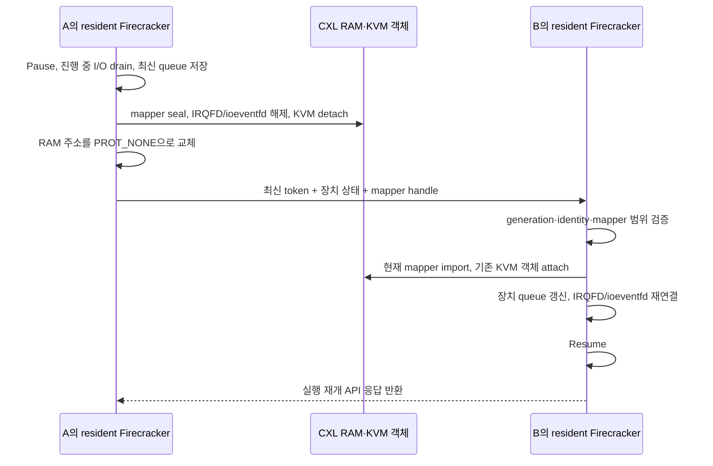

# 목적지 FD와 장치 실행 환경을 유지하는 direct handoff

## 무엇을 바꿨나

기존 direct 경로는 CXL의 KVM VM/vCPU/VMCS/EPT 객체를 인계하면서도, 목적지의 Firecracker 프로세스와 장치 실행 환경은 매번 만들었다. 이번에는 **A와 B에 Firecracker를 하나씩 유지**하고, 목적지를 준비한 뒤 소유권과 최신 장치 상태만 넘기는 `resident direct` 경로를 추가했다.

Guest RAM은 CXL에 그대로 있고 CPU register snapshot도 만들지 않는다. 전달하는 내용은 작은 장치 상태와 mapper 소유권 handle이다. Promotion은 DRAM→CXL 배치 변경, demotion은 CXL→DRAM 복사이며 이 두 비용은 CPU handoff와 분리한다. State-only 경로도 반복 checkpoint와 guest 확인 호출을 제거하고 snapshot load에서 바로 resume하도록 바꿨다. 이 모드의 작은 CPU/device state 전달과 source 종료는 유지한다.

### 2026-11-04 제어 경로 수정

구현 기준은 `0e4f78b58`이다. 기존 HTTP 경로를 유지하고 다음 두 선택지를 추가했다.

- `--resident-native-control`: VMM event loop가 로컬 Unix socket 명령을 직접 처리한다. HTTP 파싱과 API thread 왕복을 생략한다.
- `--resident-memory-control`: native 제어에 더해, 재방문 때 token·최신 장치 상태·mapper handle을 약 566B의 versioned binary packet으로 전달한다. 이때 JSON 임시 파일, manifest hash와 파일 재읽기가 없다. 최초 B 방문은 기존 import 경로로 VM wrapper를 만든다. A/B 사이 전달은 여전히 준비된 TCP 연결이다.

UART 복구 시 `dup()` 때문에 epoll에 등록한 숫자 FD와 새 wrapper의 FD가 달라져 반복 EAGAIN이 발생하던 오류도 수정했다. Buffer eventfd를 `Arc`로 유지해 같은 FD를 사용한다. 반복 시험의 각 100ms idle 관측에서 A/B VMM main thread의 CPU tick 증가가 모두 0이었다. vCPU 실행 시간이나 모든 기간의 CPU 사용률이 0이라는 의미는 아니다.

같은 수정 바이너리로 HTTP→native→binary→binary→native→HTTP 순서의 여섯 fresh pair를 실행했다. 각 24회, **총 144회 handoff가 독립 검증을 통과**했다. 아래는 첫 두 hop을 분리한 각 경로 44개 표본이며, 상세 계측을 켠 상태의 **요청→Resume 응답**이다.

| 경로 | 중앙값 | p95 |
|---|---:|---:|
| HTTP + JSON 파일 | 8.113ms | 8.687ms |
| Native + JSON 파일 | 7.318ms | 8.576ms |
| Native + binary | 6.992ms | 7.621ms |

수정된 HTTP 기준 대비 중앙값은 약 14% 감소했다. UART busy loop가 있던 별도 이전 실행은 6.044ms였으므로, **이번 변경이 그 이전 수치보다 빠르다는 결론은 아니다.** Busy polling 제거 후의 깨우기·스케줄링 비용도 포함된다. 초기 executor의 0.34ms와 같은 범위의 결과도 아니며 sub-ms 목표에 도달하지 않았다. 원시 결과는 로컬 `/tmp/cxl-revision-balanced-20261104`에만 보관한다.

Binary 두 trial의 준비와 첫 방문은 다음과 같이 따로 기록했다. 준비는 source 실행 중 수행하며 아래 handoff 시간에 포함하지 않는다.

| 구간 | 두 trial의 범위 |
|---|---:|
| 목적지 VMM fork→API 준비→이미지 FD·io_uring 준비 | 7.575–8.231ms |
| A/B 제어 서버 준비의 합, peer TCP 준비 포함 | 3.487–4.976ms |
| 위 준비를 호출·회수하는 외부 RPC까지 포함한 전체 준비 | 25.082–25.275ms |
| 최초 B 방문의 요청→Resume 응답 | 9.748–10.493ms |

동일 binary 표본의 평균 7.021ms 중 export 내부는 1.373ms, import 내부는 2.665ms였다. 두 제어 호출 전체는 5.656ms이므로 나머지 1.618ms에는 pause/resume와 로컬 제어·깨우기가 포함된다. 호출 밖 1.365ms에는 요청 전달·노드 간 제어·응답이 포함된다. 이 잔여 시간을 전부 NFS 또는 virtio-blk 비용으로 해석하면 안 된다. `drain_and_save_devices` 평균은 이 idle I/O 조건에서 0.020ms였다.

Binary import도 generation·KVM identity·mapper epoch·주소 범위를 검사한다. I/O drain, 최신 virtqueue 반영, source KVM 소유권 해제와 RAM `PROT_NONE` 전환은 유지한다. 이전 장치 상태를 그대로 재사용하거나 RAM을 전수 비교하지 않는다. `resident-control evidence`는 타이머 뒤에서만 호출하는 선택적 진단이며 마지막 작은 packet을 JSON으로 저장한다. SWE 일반 runtime은 이 진단을 호출하지 않는다.

### 상세 계측을 끈 실제 SWE 반복

`03391a111`의 Gin trace에서 `--resident-memory-control --direct-profile-roundtrips 20`으로 **44회 handoff와 두 번씩 promotion/demotion**을 통과했다. Source fault 시험, guest ping, 이미지 재해시, 상세 profiler는 이 runtime 구간에서 실행하지 않았다. 원시 결과는 로컬 `/tmp/cxl-revision-swe-warm-20261104`이다.

| 요청→Resume 응답 구간 | 결과 |
|---|---:|
| 최초 B 방문 / 최초 A 복귀 | 8.788 / 7.624ms |
| 명시적 반복 40회 중 최초 두 hop 이후, 38개 표본 | 중앙값 **4.092ms**, p95 **5.333ms**, 범위 2.896–5.766ms |
| 반복 후 원격 실행을 시작하는 A→B | 4.929ms |
| 실제 작업을 진행한 뒤 B→A | 10.657ms |
| Demotion→재promotion 직후 A→B | **27.464ms** |
| 그 다음 B→A | 7.099ms |

따라서 모든 작업 조건을 4ms라고 요약하지 않는다. 앞의 144회 표는 상세 계측을 켠 고정 payload 조건의 비교이고, 이 표는 계측을 끈 실제 SWE 조건이므로 두 수치를 그대로 비교해 추가 개선율을 계산하지 않는다.

별도 Gin 계측 실행(`/tmp/cxl-revision-swe-profile-20261104`)에서는 작업 후 source RAM mapping 철회가 4.982ms였고, 재promotion 직후 목적지 attach가 19.225ms였다. 후자의 mapper 연결은 0.502ms, 장치 복구는 0.641ms였다. 이처럼 기존 PTE 철회와 attach 비용은 실제 작업 이후 커질 수 있으며, metadata 파일이나 NFS 이미지 재open으로 일괄 설명할 수 없다.

### EPT와 TLB 계측

`102b00203`은 기존 nested EPT root의 같은 byte를 쓰는 동작을 별도 함수로 분리했다. 동작을 추가하거나 root 전체를 읽은 변경이 아니다. `b129c37d7`은 `vmx_flush_tlb_current`뿐 아니라 `vmx_flush_tlb_all/guest`도 계측한다. 전체 flush가 current 요청을 소거하므로 current 함수가 호출되지 않았다고 TLB 처리가 없었다고 해석하지 않는다.

로컬 `/tmp/cxl-revision-ept3-20261104`의 최초 두 hop 이후 8회에서 nested root 평균은 **542µs**, EPT rebind 전체는 **546.625µs**였다. 일반 TLB all/guest 함수도 관측됐다. 직전 별도 실행의 root 평균은 785.5µs였으므로 이 비용을 상수로 취급하거나 다른 실행의 API 시간에서 빼서 물리 CXL 성능을 예측하지 않는다. 모든 수치는 함수 probe를 켠 coherent nested lab 결과다.

Nested root 동작은 외부 KVM이 다른 L1의 EPT 갱신을 인지하게 하는 shadow-page 무효화 우회이다. 물리 CXL에서 필요한 일반 TLB 무효화와 구분한다. Root helper 자체에는 RAM/EPT leaf walk가 없지만, 외부 KVM에서 발생하는 작업의 비용까지 O(1)이라고 주장하지 않는다.

실제 Gin 작업에 `--restore-timing --kernel-trace`를 적용한 추가 실행(`54725b6fc`, 로컬 `/tmp/cxl-revision-swe-ept-20261104`)에서도 네 번의 handoff와 최종 작업 결과가 통과했다. 각 handoff 때만 probe를 켜고 다음 작업 전에 껐다. 독립적으로 raw trace를 재파싱해 기록된 구간과 일치함을 확인했다.

| Gin의 각 전환, 각 1개 표본 | Nested root | EPT rebind 전체 |
|---|---:|---:|
| 최초 B 방문 | 0.006ms | 0.361ms |
| 작업 후 A 복귀 | 2.293ms | 2.399ms |
| 재promotion 직후 B 방문 | **26.003ms** | **26.021ms** |
| 다음 A 복귀 | 2.186ms | 2.193ms |

재promotion 직후의 큰 attach 비용은 이 실행에서는 nested root 보완 함수가 지배했다. 함수 진입→복귀의 경과 시간이므로 outer KVM 처리와 스케줄링 영향을 포함할 수 있고, 26ms 전체를 순수 shadow EPT 계산으로 단정하지 않는다. EPT metadata의 신규 연결 작업이나 NFS 이미지 열기가 26ms였다는 뜻도 아니다. 이 workaround는 nested 환경에서만 켜며 그대로 제거하면 이 실험 환경의 오래된 변환을 사용할 수 있으므로 유지했다.

### 같은 handoff의 제어별 비용

위 `54725b6fc` 실행의 generation 2/3에서 VMM profile·controller API 시간·kernel trace를 맞췄다. 단위는 ms(0.001초)이며, 각 열은 **하나의 handoff**다. 목적지 준비·promotion/demotion의 RAM 복사는 제외하고 요청→목적지 Resume 응답까지 합산한다. 첫 B 방문이나 반복 중앙값으로 해석하지 않는다.

| 처리 | 작업 후 B→A, generation 2 | 재promotion 완료 후 A→B, generation 3 |
|---|---:|---:|
| I/O drain·장치 상태 저장 | 0.051292 | 0.013322 |
| Event subscriber 중단·mapper seal | 0.037440 | 0.022772 |
| Source I/O·interrupt 연결 해제 | 0.220899 | 0.112666 |
| KVM detach·실행 소유권 해제 | 0.255297 | 0.152220 |
| Source RAM mapping PROT_NONE 교체 | **4.988882** | **0.184509** |
| 작은 metadata 구성·검사·직렬화·해석 | 1.092309 | 0.608477 |
| Destination mapper import | 0.532732 | 0.542834 |
| Nested root 보완 함수 | **2.293000** | **26.003000** |
| KVM attach에서 위 함수를 제외한 나머지 | 0.523798 | 0.329765 |
| Destination 장치 복구·이벤트 재연결 | 0.452268 | 0.362945 |
| Pause/Resume·로컬 IPC·스케줄링 등 API 잔여 | 1.268177 | 1.175480 |
| 외부 제어 요청·노드 간 전달·응답 잔여 | 0.887735 | 1.302155 |
| 진단 로그·profile 내부 미분리 구간 | 0.425979 | 0.246579 |
| **전체** | **13.029808** | **31.056724** |

Nested root는 attach 내부 구간이므로 attach에서 빼고 독립 행으로 표시했다. API 잔여는 send+receive API에서 export/import profile 전체를 뺀 값이다. Binary 경로의 pause/resume 각각은 별도 계측하지 않아 IPC 등과 분리할 수 없다. 외부 제어 잔여도 순수 network 지연을 의미하지 않는다. 이 실행은 상세 계측을 켰으며, 다른 실행의 무계측 4.092ms 중앙값을 이 표로 분해하지 않는다.

두 import 모두 disk open·I/O engine 생성·vCPU thread 생성은 0회다. I/O drain·연결 해제·장치 복구 합계는 각각 0.724459/0.488933ms다. Source mapping 철회는 guest 데이터를 읽는 검사가 아니지만, 커널의 기존 PTE 정리 비용을 포함하며 물리 host에서도 남을 수 있다. 정상 handoff에 guest RAM 전수 검사를 넣지 않았다는 사실과 구분한다.

로컬 원본은 `/tmp/cxl-revision-swe-ept-20261104/gin-gonic__gin-3741-direct/`의 `report.json`, `0209-final-vmm-log.bin`, `0212-final-vmm-log.bin`, `0117-kernel-trace.txt`, `0173-kernel-trace.txt`다. 게시 대상은 이 요약이며 원본 파일은 Git에 포함하지 않는다.

### 물리 host에서는 무엇이 없어지나

현재는 **L0 물리 KVM → L1 A/B 노드 VM → L2 sandbox**다. L0가 L1의 EPT를 반영한 shadow 변환을 유지하므로 다른 L1에서 바뀐 공유 EPT를 반영하도록 보완이 필요하다. 일반 물리 host가 직접 sandbox를 실행하면 outer shadow 계층이 없어 `kvm_dax_nested_root_sync()`는 제외할 수 있다. 코드의 `dax_nested_root_sync` 기본값은 false이며 nested harness가 명시적으로 켠다. 이는 코드·구조에 따른 판단이며 물리 다중 host의 실측 결과가 아니다. [KVM MMU 설명](https://docs.kernel.org/virt/kvm/x86/mmu.html#translation)

`KVM_REQ_TLB_FLUSH_CURRENT`는 이 옵션과 별개로 attach에서 요청한다. 물리 host에서도 필요한 INVEPT/TLB 처리와 destination mapping, single-owner, CXL 데이터의 가시성은 보장해야 한다. `31.056724 - 26.003 = 5.053724ms`를 물리 환경의 handoff 성능으로 발표하지 않는다. [일반 VMX TLB flush 구현](https://github.com/torvalds/linux/blob/master/arch/x86/kvm/vmx/vmx.c)

전체 파일별 변경량과 해당 함수들의 소스 위치는 [구현 지도](cxl-implementation-map.md)에 정리했다.

실험 결과와 재현 입력은 [검증 자료](../implementation/virtual_machine/results/direct-resident-20261102/README.md)에 모았다. 이전 측정 범위와 NFS 병목은 [Direct API 비용 분석](cxl-direct-api-latency.md)을 참고한다.

기존 resident 구현(`620e2d5`)의 시험은 **24회 handoff와 두 번씩 promotion/demotion**을 통과했다. 같은 바이너리의 기존 경로 10회와 비교한 Export+Import API 중앙값은 **9.190→5.316ms**였다. TCP pause→guest 응답 중앙값은 **24.153ms**였으며, 여기에 guest serial ping 응답 구간 약 15ms가 들어갔다.

그때의 목적지 준비 controller 시간 **763.966ms**에는 여러 serial 명령, 파일 전달과 바이너리 hash 검증이 섞여 있었다. 이를 VMM 준비 자체의 비용으로 설명하면 안 된다. 이후 [준비 비용 재검증과 제어 경로 수정](../implementation/virtual_machine/results/direct-resident-preparation-20261102/README.md)에서 각 비용을 분해하고, 노드 내부 bootstrap과 미리 준비한 RPC 제어 경로를 추가했다. Firecracker·커널 바이너리는 동일하게 유지했다.

## 준비 단계와 handoff 단계

### 처음 B를 준비할 때 — A는 계속 실행

1. B에 Firecracker API 프로세스를 띄운다.
2. `DirectPrepare`로 B의 NFS 이미지 FD를 read-only로 열고, 이미지 크기·ID와 Async io_uring을 준비한다.
3. A/B 사이의 작은 metadata 전달용 TCP 제어 프로세스를 준비한다.
4. 기존 제어기는 pause 전에 TCP 연결을 맺는다. 아래 ready-control 경로는 **연결 시간까지 handoff 요청 시간에 포함**한다.

이때 B는 guest RAM에 접근하거나 KVM 소유권을 가져오지 않는다. **최초 방문의 VM/vCPU wrapper, vCPU 스레드와 나머지 장치 객체는 첫 attach에서 만든다.** 따라서 최초 handoff의 모든 준비 비용을 없앴다는 의미는 아니다. 먼저 준비한 디스크 FD와 io_uring은 첫 attach부터 사용한다.

### A→B handoff — 실제 중단 시간에 포함

Source는 block completion을 마무리하고 현재 queue 위치를 기록한다. 과거 방문 때 저장한 queue 상태를 재사용하지 않는다. 목적지는 최신 상태를 기존 객체에 적용하고 실행을 재개한다.

Source process는 종료하지 않는다. 다만 virtio event subscriber를 제거하고 RAM mapping을 `PROT_NONE`으로 바꿔 이전 host PTE 접근을 없앤다. Kernel의 기존 stale-owner 검사는 남겨 둔다. `Resume`, `PoolCache` 같은 parked 상태의 변경 API도 거절한다.

### B→A 및 이후 왕복

A에는 원래 실행하던 VMM, VM/vCPU FD, vCPU thread, block 객체, 이미지 FD, io_uring, eventfd가 남아 있다. 새로운 token과 mapper handle을 확인한 뒤 같은 HVA에 현재 backing을 연결하고, 기존 kernel의 reuse-VM-FD attach ioctl을 사용한다.

이후 B로 다시 갈 때도 같은 방법을 쓴다. FD를 다시 열거나 vCPU thread를 새로 만들지 않는다. 기존 제어기는 준비 API를 다시 호출하여 parked RAM/KVM 접근을 검사했다. 현재 runtime은 이 중복 호출과 handoff별 fence/probe 진단을 모두 생략한다. 실제 KVM 소유권 차단과 PROT_NONE 처리는 유지하며, 접근 실패 시험은 별도 실험 드라이버가 수행한다.

Demotion으로 기존 CXL 할당을 반환한 뒤 다시 promotion하면 allocation generation과 mapper handle은 바뀐다. 과거 handle을 저장해 재사용하지 않고 **해당 전환에서 받은 최신 handle**을 검증·연결한다. KVM 객체 identity와 handoff generation 검증은 별도로 유지한다.

## 유지하는 것과 매번 갱신하는 것

| 대상 | 동작 |
|---|---|
| Guest RAM/CPU 상태 | CXL의 현재 상태를 이어서 사용; handoff에 payload 복사나 CPU snapshot 없음 |
| Guest inode/page-cache metadata | VM 내부 상태로 유지; 다른 VM metadata를 공유하지 않음 |
| Disk FD·io_uring | 최초 준비 이후 같은 host에서 유지 |
| VM/vCPU FD·vCPU thread | 첫 방문 이후 같은 host에서 유지 |
| Virtqueue indices, transport 상태 | source에서 최신 값을 받아 기존 객체에 적용 |
| IRQFD/ioeventfd·event subscriber | 떠날 때 해제, 도착할 때 재연결; stale event counter drain |
| Mapper handle·epoch·generation | 매번 최신 소유권 증거 검증 |
| Source RAM mapping | parked 동안 접근 불가; 재도착 때 현재 mapping으로 교체 |

FD는 로컬 inode 또는 NFS의 열린 파일을 계속 참조한다. 실험에서는 A의 원본 ext4를 read-only로 remount하고 B는 immutable NFS cache 옵션을 쓴다. 실행 도중 같은 경로의 이미지를 교체하는 기능은 지원하지 않는다.

## 시간을 어떻게 쟀나

### 명시적 준비와 상주 제어기 (`--resident-ready-control`)

첫 promotion이 완료되면 B의 VMM을 준비하고 A/B 제어 서버를 띄운다. 이 과정의 전체 외부 제어 시간, VMM의 fork→API 연결 가능 시간, NFS FD·io_uring 준비 시간, 제어 서버 각각의 fork→listen 완료 시간을 별도 기록한다. 준비 단계는 source 실행 중이며, promotion의 데이터 복사 시간과도 구분한다.

`resident_bootstrap.c`가 디렉터리·FIFO·PID 기록·프로세스 실행·API 대기·DirectPrepare를 한 번의 노드 내부 작업으로 처리한다. 고정 20ms shell polling을 없애고 실제 API 연결 가능 여부를 확인한다. 실행 바이너리 hash, 이미지 재해시, FD/TID 감사는 준비 경로에서도 제거했다.

준비된 상태의 handoff는 source 제어 서버에 요청한다. `DirectSend`가 pause와 export를, `DirectReceive`가 import와 resume를 한 번의 VMM dispatch에서 처리한다. 중간 checkpoint와 checkpoint plan 전달은 없다. API Unix socket도 상주 제어기에서 재사용한다. Kernel 소유권·mapper epoch·메모리 범위와 장치 상태의 유효성은 그대로 검사한다.

**요청→Resume 응답**은 목적지 API의 실행 재개 응답 시점이다. Guest의 첫 instruction 실행 시각은 아니다. 기본 runtime은 guest ping이나 source 실패 유도 시험을 수행하지 않는다. 원시 결과의 `controller_command_wall_ns`에는 실험용 serial 명령 전달·결과 회수가 별도로 포함된다. 최초 B 방문에는 VM/vCPU wrapper·스레드·나머지 장치 객체의 생성 비용이 남아 있다.

아래 지표와 진단 절차는 `620e2d5`/`2a015f3`의 **이전 v1 실험 기록**이다. v2의 두 API 시간은 pause/resume까지 포함하므로 이전 Export+Import 두 API 시간과 동일한 범위로 비교하지 않는다.

### 기존 지표와의 관계

시간 범위를 섞지 않기 위해 다음 값을 각각 기록한다.

1. **목적지 준비 API:** 이미지 open/metadata/io_uring 준비. 첫 방문과 재방문 probe를 구분한다.
2. **준비 controller wall time:** 프로세스 실행 및 시험 제어 왕복까지 포함한다. Source는 실행 중이다.
3. **TCP 연결 준비:** source pause 전에 끝낸 연결의 시간이다.
4. **Export+Import API:** 이전 8~12ms API 결과와 같은 범위의 값이다. Pause/resume와 metadata 전달, guest 응답은 제외한다.
5. **실제 pause→guest 응답:** source의 한 monotonic clock으로 pause 요청 직전부터 목적지 guest 응답이 source에 돌아올 때까지 잰다. Pause, I/O drain, export, mapping 차단, metadata 전송, attach, 최신 handle checkpoint, resume와 guest ping을 모두 포함한다.

Guest ping은 boot ID/PID/명령 진행 위치를 출력하는 짧은 shell 명령이다. Cache·열린 삭제 파일·작업 결과의 상세 검사는 타이머 뒤에서 수행한다. TCP 경로는 outer serial console을 통한 Python 왕복을 중단 구간에서 제거한다.

첫 두 resident import는 stale token 등 거부 시험을 중단 구간에서 실행하는 serial 진단 경로를 사용한다. 그 수초짜리 시간은 별도 `serial-diagnostic` 집계에 남긴다. TCP 표본과 합쳐 서비스 중단 시간이라고 발표하지 않는다. 최초 방문과 느린 표본도 삭제하지 않는다.

`--restore-timing` 실행은 내부 단계 원인을 분석하기 위한 것이다. 최종 지연은 상세 계측을 끈 실행을 별도로 남긴다. 단계 평균은 합산할 수 있지만 서로 다른 단계의 중앙값을 더해 전체 중앙값으로 해석하지 않는다.

## 안전성 검증

2026-11-04 재검증에서 다음 항목을 통과했다. Raw report와 바이너리는 모두 로컬에만 보관한다.

| 검증 | 확인한 범위 |
|---|---|
| 같은 바이너리의 144회 handoff | 160MiB cache 유지, 이전 source의 RAM/KVM 접근 차단, parked API 거절, handoff 전체 조사 카운터 증가 0 |
| 지속 block read 중 10회 handoff | 최초 2회 뒤 guest child가 8회 handoff 동안 같은 PID로 187MiB 읽기 진행, 데이터 일치, 최종 demotion; `/tmp/cxl-revision-liveio2-20261104` |
| Gin·PHP 실제 SWE trace × 두 모드 | 총 124개 원래 명령의 반환값·테스트·제출 diff, 열린 삭제 파일의 inode/offset, 각 실행 2회 promotion/demotion; `/tmp/cxl-revision-swe-20261104` |
| 3개 VM, 각 160MiB 실제 cache, state-only | Promotion 9회·demotion 9회·handoff 12회, ACK 후 재사용, 다른 VM으로 프레임 재할당, OverlayFS copy-up; `/tmp/cxl-revision-stress3-20261104/state-only` |
| 3개 VM의 direct 회귀 시험 | Direct 대상 하나와 공유 데이터를 유지하는 독립 peer 둘, promotion 6회·demotion 6회·handoff 4회, 재사용·copy-up; `/tmp/cxl-revision-stress4-20261104` |
| 실행 중인 SWE 명령의 handoff | Gin `go test ./...` 도중 두 번 추가 전환, 동일 PID/starttime·실행 상태와 명령 결과 확인; `/tmp/cxl-revision-swe-live-20261104` |
| 프로토콜 회귀 시험 | UART 복구 32회 후 같은 FD/epoll 소비, native 프레임 분할·크기 초과 거절, 실제 binary packet의 모든 잘린 prefix·trailing byte 거절 |

3-VM 시험은 `--full-audit`를 명시해 host PFN과 guest submit/ACK를 상세 대조한다. 일반 runtime과 지연 비교에서는 이 진단을 켜지 않는다. State-only의 검증 소스는 `909f81ba9`, direct의 검증 소스는 `03391a111`이다. 그 사이 수정은 검증 로그 수집 설정과 오류 메시지뿐이며 측정 VMM은 동일하다. 이 시험은 세 개의 resident direct 제어기를 동시에 이동시킨 결과가 아니다.

지속 읽기는 guest O_DIRECT 요청이 반복되는 동안 전환한 시험이다. 매 pause 순간에 미완료 SQE가 있었다거나 모든 읽기가 실제 NFS RPC를 발생시켰다는 증거는 아니다. SWE에서 공유 대상으로 등록한 lower cache는 Gin 약 49MiB, PHP 약 21MiB이며 전체 guest cache 크기와 구분한다.

- Source의 전체 RAM VA 구간이 `---p`인지 확인하고, `process_vm_readv`로 한 바이트를 읽어 실제 `EFAULT`를 확인한다. Guest RAM 전수 읽기는 하지 않는다.
- Parked vCPU FD에 실제 `KVM_GET_REGS`를 호출하여 kernel이 접근을 거절하는지 확인한다.
- Parked `Resume`/`PoolCache`, 과거 generation, 다른 KVM graph identity, 잘못된 manifest digest를 거절하는지 시험한다.
- 같은 VMM PID/starttime, disk FD, io_uring FD와 vCPU TID가 왕복 동안 유지되는지 `/proc` 증거로 확인한다.
- Boot ID, guest PID, unlink한 열린 파일의 inode/offset, private 파일, 원래 SWE 명령 출력·테스트·제출 diff를 독립 verifier로 확인한다.
- 두 번째 promotion의 새 allocation에서도 A→B→A를 실행한다. 각 handoff에서 mapper의 `full_scan_pages`가 증가하지 않는지 확인한다.
- 원시 증거를 의도적으로 바꾸고 SHA-256까지 다시 계산하는 부정 시험으로, 독립 verifier가 hash 확인 외의 의미 검증도 수행하는지 확인한다.

Ownership 변경을 시작한 뒤 import가 실패하면 `reuse_restore_failed` 상태로 남겨 resume를 막는다. Export의 detach 이후 오류는 process를 중단한다. 부분적으로 연결된 상태에서 계속 실행하지 않는다.

`PROT_NONE` 교체는 실제로 존재하는 host PTE를 해제하는 비용이 있다. RAM 내용이나 모든 GPA를 읽는 전수 조사는 아니지만 workload 이후 PTE가 많으면 시간이 커질 수 있다. Source 프로세스를 살려 두면서 이전 접근을 차단하기 위한 비용이므로 측정에서 제외하지 않는다.

## 현재 범위

이번 실험은 한 coherent 물리 호스트의 두 nested Linux 노드, VM당 1vCPU, read-only Async virtio-blk와 reporting-only balloon 조건이다. 제어 경로 비교와 SWE는 2GiB guest RAM, 3-VM pooling 회귀 시험은 VM당 512MiB를 사용한다. 실제 비일관 다중 호스트 CXL의 cache maintenance나 transport 보장은 검증한 것이 아니다. TCP 제어기는 사설 실험망과 세션 nonce를 사용하는 제한된 lab 도구다.

기본 SWE 전환은 명령 경계에서 수행하고, 위 별도 실행에서 명령 도중의 왕복도 확인했다. 지속 읽기 시험 역시 추가했지만 모든 pause 순간의 미완료 I/O와 NFS 장애 복구까지 검증한 것은 아니다.

Resident 방식은 각 host의 대기 VMM과 FD/thread 메모리를 유지하는 비용이 있다. 처음 방문한 B에는 초기 guest-memory wrapper의 CPM FD 하나가 추가로 남을 수 있어 FD 개수의 최초 변화와 이후 누수를 구분한다. NFS 장애 복구, writable image, 여러 vCPU, virtio-net/MPTCP까지 확대한 검증은 이번 범위에 포함하지 않는다.

PML을 통한 쓰기 추적, MPTCP 연결 유지와 실제 비일관 CXL 적용은 기존 후속 과제다. 우선 이번 경로의 준비/중단 구간을 기준선으로 삼고, 필요하면 남은 mapper remap·PTE 철회·kernel attach와 API 왕복을 각각 최적화한다.
