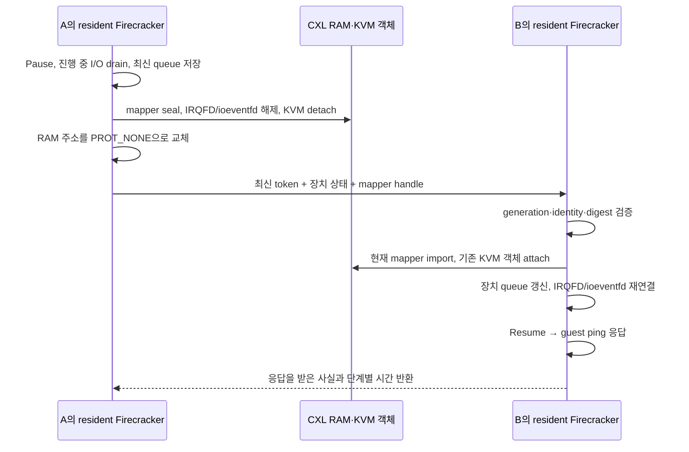

# 목적지 FD와 장치 실행 환경을 유지하는 direct handoff

## 무엇을 바꿨나

기존 direct 경로는 CXL의 KVM VM/vCPU/VMCS/EPT 객체를 인계하면서도, 목적지의 Firecracker 프로세스와 장치 실행 환경은 매번 만들었다. 이번에는 **A와 B에 Firecracker를 하나씩 유지**하고, 목적지를 준비한 뒤 소유권과 최신 장치 상태만 넘기는 `resident direct` 경로를 추가했다.

Guest RAM은 CXL에 그대로 있고 CPU register snapshot도 만들지 않는다. 전달하는 파일은 작은 장치 상태와 mapper 소유권 handle이다. Promotion은 DRAM→CXL 배치 변경, demotion은 CXL→DRAM 복사이며 이 두 비용은 CPU handoff와 분리한다. State-only 경로는 기존 구현을 유지한다.

실험 결과와 재현 입력은 [검증 자료](../implementation/virtual_machine/results/direct-resident-20261102/README.md)에 모았다. 이전 측정 범위와 NFS 병목은 [Direct API 비용 분석](cxl-direct-api-latency.md)을 참고한다.

기존 resident 구현(`620e2d5`)의 시험은 **24회 handoff와 두 번씩 promotion/demotion**을 통과했다. 같은 바이너리의 기존 경로 10회와 비교한 Export+Import API 중앙값은 **9.190→5.316ms**였다. TCP pause→guest 응답 중앙값은 **24.153ms**였으며, 여기에 guest serial ping 응답 구간 약 15ms가 들어갔다.

그때의 목적지 준비 controller 시간 **763.966ms**에는 여러 serial 명령, 파일 전달과 바이너리 hash 검증이 섞여 있었다. 이를 VMM 준비 자체의 비용으로 설명하면 안 된다. 이후 [준비 비용 재검증과 제어 경로 수정](../implementation/virtual_machine/results/direct-resident-preparation-20261102/README.md)에서 각 비용을 분해하고, 노드 내부 bootstrap과 미리 준비한 RPC 제어 경로를 추가했다. Firecracker·커널 바이너리는 동일하게 유지했다.

## 준비 단계와 handoff 단계

### 처음 B를 준비할 때 — A는 계속 실행

1. B에 Firecracker API 프로세스를 띄운다.
2. `DirectPrepare`로 B의 NFS 이미지 FD를 read-only로 열고, 이미지 크기·ID와 Async io_uring을 준비한다.
3. A/B 사이의 작은 metadata 전달용 TCP 제어 프로세스를 준비한다.
4. 기존 제어기는 pause 전에 TCP 연결을 맺는다. 아래 ready-control 경로는 **연결 시간까지 handoff 요청 시간에 포함**한다.

이때 B는 guest RAM에 접근하거나 KVM 소유권을 가져오지 않는다. **최초 방문의 VM/vCPU wrapper, vCPU 스레드와 나머지 장치 객체는 첫 attach에서 만든다.** 따라서 최초 handoff의 모든 준비 비용을 없앴다는 의미는 아니다. 먼저 준비한 디스크 FD와 io_uring은 첫 attach부터 사용한다.

### A→B handoff — 실제 중단 시간에 포함

Source는 block completion을 마무리하고 현재 queue 위치를 기록한다. 과거 방문 때 저장한 queue 상태를 재사용하지 않는다. 목적지는 최신 상태를 기존 객체에 적용하고 실행을 재개한다.

Source process는 종료하지 않는다. 다만 virtio event subscriber를 제거하고 RAM mapping을 `PROT_NONE`으로 바꿔 이전 host PTE 접근을 없앤다. Kernel의 기존 stale-owner 검사는 남겨 둔다. `Resume`, `PoolCache` 같은 parked 상태의 변경 API도 거절한다.

### B→A 및 이후 왕복

A에는 원래 실행하던 VMM, VM/vCPU FD, vCPU thread, block 객체, 이미지 FD, io_uring, eventfd가 남아 있다. 새로운 token과 mapper handle을 확인한 뒤 같은 HVA에 현재 backing을 연결하고, 기존 kernel의 reuse-VM-FD attach ioctl을 사용한다.

이후 B로 다시 갈 때도 같은 방법을 쓴다. FD를 다시 열거나 vCPU thread를 새로 만들지 않는다. 기존 제어기는 준비 API를 다시 호출하여 parked RAM/KVM 접근을 검사했다. Ready-control은 이 중복 호출을 생략하고, 매번 source를 넘긴 뒤 기존 fence/probe 검사로 접근 차단을 검증한다.

Demotion으로 기존 CXL 할당을 반환한 뒤 다시 promotion하면 allocation generation과 mapper handle은 바뀐다. 과거 handle을 저장해 재사용하지 않고 **해당 전환에서 받은 최신 handle**을 검증·연결한다. KVM 객체 identity와 handoff generation 검증은 별도로 유지한다.

## 유지하는 것과 매번 갱신하는 것

| 대상 | 동작 |
|---|---|
| Guest RAM/CPU 상태 | CXL의 현재 상태를 이어서 사용; handoff에 payload 복사나 CPU snapshot 없음 |
| Guest inode/page-cache metadata | VM 내부 상태로 유지; 다른 VM metadata를 공유하지 않음 |
| Disk FD·io_uring | 최초 준비 이후 같은 host에서 유지 |
| VM/vCPU FD·vCPU thread | 첫 방문 이후 같은 host에서 유지 |
| Virtqueue indices, transport 상태 | source에서 최신 값을 받아 기존 객체에 적용 |
| IRQFD/ioeventfd·event subscriber | 떠날 때 해제, 도착할 때 재연결; stale event counter drain |
| Mapper handle·epoch·generation | 매번 최신 소유권 증거 검증 |
| Source RAM mapping | parked 동안 접근 불가; 재도착 때 현재 mapping으로 교체 |

FD는 로컬 inode 또는 NFS의 열린 파일을 계속 참조한다. 실험에서는 A의 원본 ext4를 read-only로 remount하고 B는 immutable NFS cache 옵션을 쓴다. 실행 도중 같은 경로의 이미지를 교체하는 기능은 지원하지 않는다.

## 시간을 어떻게 쟀나

### 명시적 준비와 상주 제어기 (`--resident-ready-control`)

첫 promotion이 완료되면 B의 VMM을 준비하고 A/B 제어 서버를 띄운다. 이 과정의 전체 외부 제어 시간, VMM의 fork→API 연결 가능 시간, NFS FD·io_uring 준비 시간, 제어 서버 각각의 fork→listen 완료 시간을 별도 기록한다. 준비 단계는 source 실행 중이며, promotion의 데이터 복사 시간과도 구분한다.

`resident_bootstrap.c`가 디렉터리·FIFO·PID 기록·프로세스 실행·API 대기·DirectPrepare를 한 번의 노드 내부 작업으로 처리한다. 고정 20ms shell polling을 없애고 실제 API 연결 가능 여부를 확인한다. 실행 바이너리 hash와 FD/TID 감사는 외부 제어 시간에 남긴다.

준비된 상태의 handoff는 이미 실행 중인 source 제어 서버에 요청한다. 제어 서버는 peer에 연결하고 pause/export/상태 전송/import/checkpoint/resume를 수행한다. 목적지의 다음 checkpoint plan도 작은 요청 필드로 전달해 목적지에서 작성한다. 전환 직전 serial 파일 업로드, DirectPrepare 재호출이나 제어 서버 생성은 없다. 준비가 없으면 요청을 실패시키며 숨겨진 초기화를 수행하지 않는다.

두 완료 시점을 측정한다. **요청→Resume 응답**은 API가 실행 재개를 수락한 시점이며 guest의 첫 instruction 실행 시각은 아니다. **요청→guest ACK**는 기존 serial ping의 실제 응답이 돌아온 시점이다. 두 값 모두 로컬 및 peer TCP 연결을 포함한다. 최초 B 방문에서 만드는 VM/vCPU wrapper와 장치 객체 비용도 포함한다. 원시 결과의 `controller_command_wall_ns`는 별도로 serial 실행·결과 회수 시간을 포함한다.

### 기존 지표와의 관계

시간 범위를 섞지 않기 위해 다음 값을 각각 기록한다.

1. **목적지 준비 API:** 이미지 open/metadata/io_uring 준비. 첫 방문과 재방문 probe를 구분한다.
2. **준비 controller wall time:** 프로세스 실행 및 시험 제어 왕복까지 포함한다. Source는 실행 중이다.
3. **TCP 연결 준비:** source pause 전에 끝낸 연결의 시간이다.
4. **Export+Import API:** 이전 8~12ms API 결과와 같은 범위의 값이다. Pause/resume와 metadata 전달, guest 응답은 제외한다.
5. **실제 pause→guest 응답:** source의 한 monotonic clock으로 pause 요청 직전부터 목적지 guest 응답이 source에 돌아올 때까지 잰다. Pause, I/O drain, export, mapping 차단, metadata 전송, attach, 최신 handle checkpoint, resume와 guest ping을 모두 포함한다.

Guest ping은 boot ID/PID/명령 진행 위치를 출력하는 짧은 shell 명령이다. Cache·열린 삭제 파일·작업 결과의 상세 검사는 타이머 뒤에서 수행한다. TCP 경로는 outer serial console을 통한 Python 왕복을 중단 구간에서 제거한다.

첫 두 resident import는 stale token 등 거부 시험을 중단 구간에서 실행하는 serial 진단 경로를 사용한다. 그 수초짜리 시간은 별도 `serial-diagnostic` 집계에 남긴다. TCP 표본과 합쳐 서비스 중단 시간이라고 발표하지 않는다. 최초 방문과 느린 표본도 삭제하지 않는다.

`--restore-timing` 실행은 내부 단계 원인을 분석하기 위한 것이다. 최종 지연은 상세 계측을 끈 실행을 별도로 남긴다. 단계 평균은 합산할 수 있지만 서로 다른 단계의 중앙값을 더해 전체 중앙값으로 해석하지 않는다.

## 안전성 검증

- Source의 전체 RAM VA 구간이 `---p`인지 확인하고, `process_vm_readv`로 한 바이트를 읽어 실제 `EFAULT`를 확인한다. Guest RAM 전수 읽기는 하지 않는다.
- Parked vCPU FD에 실제 `KVM_GET_REGS`를 호출하여 kernel이 접근을 거절하는지 확인한다.
- Parked `Resume`/`PoolCache`, 과거 generation, 다른 KVM graph identity, 잘못된 manifest digest를 거절하는지 시험한다.
- 같은 VMM PID/starttime, disk FD, io_uring FD와 vCPU TID가 왕복 동안 유지되는지 `/proc` 증거로 확인한다.
- Boot ID, guest PID, unlink한 열린 파일의 inode/offset, private 파일, 원래 SWE 명령 출력·테스트·제출 diff를 독립 verifier로 확인한다.
- 두 번째 promotion의 새 allocation에서도 A→B→A를 실행한다. 각 handoff에서 mapper의 `full_scan_pages`가 증가하지 않는지 확인한다.
- 원시 증거를 의도적으로 바꾸고 SHA-256까지 다시 계산하는 부정 시험으로, 독립 verifier가 hash 확인 외의 의미 검증도 수행하는지 확인한다.

Ownership 변경을 시작한 뒤 import가 실패하면 `reuse_restore_failed` 상태로 남겨 resume를 막는다. Export의 detach 이후 오류는 process를 중단한다. 부분적으로 연결된 상태에서 계속 실행하지 않는다.

`PROT_NONE` 교체는 실제로 존재하는 host PTE를 해제하는 비용이 있다. RAM 내용이나 모든 GPA를 읽는 전수 조사는 아니지만 workload 이후 PTE가 많으면 시간이 커질 수 있다. Source 프로세스를 살려 두면서 이전 접근을 차단하기 위한 비용이므로 측정에서 제외하지 않는다.

## 현재 범위

이번 실험은 한 coherent 물리 호스트의 두 nested Linux 노드, 1vCPU, 2GiB guest RAM, read-only Async virtio-blk와 reporting-only balloon 조건이다. 실제 비일관 다중 호스트 CXL의 cache maintenance나 transport 보장은 검증한 것이 아니다. TCP 제어기는 사설 실험망과 세션 nonce를 사용하는 제한된 lab 도구다.

SWE 전환은 명령 경계에서 수행했다. 실제 workload의 queue 상태와 NFS read 이후 왕복은 확인했지만, 지속적으로 많은 I/O를 제출하는 도중 임의 시점에 끊는 별도 stress 결과는 아니다.

Resident 방식은 각 host의 대기 VMM과 FD/thread 메모리를 유지하는 비용이 있다. 처음 방문한 B에는 초기 guest-memory wrapper의 CPM FD 하나가 추가로 남을 수 있어 FD 개수의 최초 변화와 이후 누수를 구분한다. NFS 장애 복구, writable image, 여러 vCPU, virtio-net/MPTCP까지 확대한 검증은 이번 범위에 포함하지 않는다.

PML을 통한 쓰기 추적, MPTCP 연결 유지와 실제 비일관 CXL 적용은 기존 후속 과제다. 우선 이번 경로의 준비/중단 구간을 기준선으로 삼고, 필요하면 남은 mapper remap·PTE 철회·kernel attach와 API 왕복을 각각 최적화한다.
