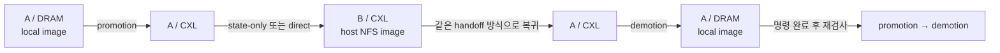

# 실제 SWE trace에서 CXL pooling과 왕복 이전 실험

264개 SWE trace 중 이미 rootfs를 준비한 Gin, PHP-CS-Fixer, MicroPython을 사용한다. 기존의 synthetic 파일 읽기 대신, 기록된 개발 명령을 그대로 microVM에서 실행하면서 현재 guest metadata 기반 page pooling과 두 handoff 경로를 확인하는 실험이다.

[완료한 실행 결과](../implementation/virtual_machine/results/swe-pool-traces-20261030/README.md)는 9개 조건·315개 명령·36회 전환의 원시 증거와 독립 재검증을 포함한다.

| Trace | 명령 수 | Immutable rootfs | A → B 이전 직전 명령 index | B → A 복귀 직전 index |
|---|---:|---:|---:|---:|
| `gin-gonic__gin-3741` | 27 | 4GiB | 12 | 25 |
| `php-cs-fixer__php-cs-fixer-8331` | 35 | 3GiB | 21 | 33 |
| `micropython__micropython-13039` | 43 | 4GiB | 26 | 41 |

Index는 0부터 시작한다. 예를 들어 Gin에서는 0~11번 명령이 끝난 뒤 이전하고, 12~24번은 B에서 실행한다. 각 명령의 내용과 원래 timeout은 유지하며, 모델의 추론 대기 시간은 재생하지 않는다. 기록된 nonzero 종료 코드도 기대값으로 검증한다. 성공은 원본 작업 결과의 재현을 뜻하며, SWE 문제의 정답 채점 결과는 아니다.

## 실행 흐름

각 trace마다 새 sandbox를 만드는 세 조건을 둔다. 모두 같은 patched Firecracker, guest kernel, 1 vCPU, 2GiB guest RAM을 사용한다.

- **Baseline:** A의 DRAM과 local image에서 모든 명령을 실행한다.
- **State-only:** A/DRAM에서 시작해 A/CXL로 promotion한 뒤 B/CXL로 이전한다. RAM은 CXL에 남고 CPU·장치 상태만 저장·전달한다. 이후 A/CXL로 돌아와 DRAM으로 demotion한다.
- **Direct:** 동일한 tier·노드 순서를 따르되, CXL의 같은 KVM/vCPU 객체를 detach/attach한다. CPU 상태 snapshot을 만들지 않는다.

두 lifecycle 조건은 모든 명령이 끝난 뒤에도 promotion/demotion을 한 번 더 수행한다. 따라서 각 실행은 promotion 2회, demotion 2회, A↔B handoff 2회를 포함한다. 전환은 명령 사이에 수행한다. 실행 중인 build/test를 중간에 정지·이전하는 시험은 아니다.



Guest는 항상 read-only ext4 lower와 virtio-blk를 본다. 파일 수정과 build 산출물은 guest tmpfs upper에 남아 RAM과 함께 이동한다. B host의 Firecracker가 NFS로 A의 같은 이미지 파일을 열며, guest에는 NFS mount를 만들지 않는다. CXL에 있다는 이유만으로 NFS를 사용하는 것이 아니라 **이미지 고향 A를 떠나 B에서 실행할 때** NFS를 사용한다.

## 실제 캐시를 선택하는 방법

Trace별로 최대 16개 lower 파일의 inode, generation, ext4 UUID와 extent를 준비 단계에서 고정한다. Promotion 시 guest helper가 그 파일의 **이미 resident인 clean 4KiB folio**를 등록한다. 데이터를 미리 읽어 후보 수를 늘리지 않는다. 파일을 찾거나 ext4 extent를 확인하는 metadata I/O는 발생할 수 있다.

파일의 전체 크기나 guest의 `Cached` 값은 실제 공유된 크기가 아니다. 등록된 페이지 수, promotion에서 canonical backing으로 연결한 바이트, 이후 현재 file-cache GPA에 실제로 설치된 shared PTE를 각각 기록한다. PTE 검사는 실제 backing을 확인하는 것이며 guest cache-hit 횟수 측정은 아니다. 선택 파일은 trace마다 총 약 45~56MiB이므로, 이 실험을 이전 synthetic 160MiB cache 시험과 혼동하지 않는다.

등록부터 remap 완료까지 guest가 folio lock과 ACTIVE status를 유지한다. Host는 정지된 guest의 현재 status, 등록 목록 digest, immutable image와 extent를 검증한다. 파일 데이터 전체를 매번 비교하는 admission 경로를 사용하지 않는다. 자세한 안전 조건은 [guest metadata 기반 pooling 문서](cxl-guest-pool-handoff.md)에 있다.

이번 trace 실험은 조건별 VM 하나를 사용한다. 반복 promotion에서 CXL에 남은 자신의 Bloom slot과 정확한 canonical index를 조회한다. 여러 VM의 동시 중복 제거율은 이 시험의 측정 대상이 아니다. Canonical 영역은 각 rootfs 전체 3~4GiB를 미리 적재하므로, 선택된 shared cache 바이트만 비용으로 계산해서 메모리 절감으로 해석하면 안 된다.

## 검증과 시간의 의미

독립 검증기는 controller와 admission parser를 import하지 않고 원시 serial log, guest 결과 archive, API 응답, kernel mapping과 source fence를 다시 읽는다.

- 원본 command byte/hash·순서·종료 코드·test 결과와 최종 제출 패치를 대조한다.
- Guest boot ID, controller PID, 수정된 상태 파일, unlink 후 열린 FD의 내용과 offset이 이어지는지 확인한다.
- 현재 guest 등록 목록과 frozen inode/extent를 대조하고, canonical PTE가 read-only이며 실제 PFN이 일치하는지 확인한다.
- State-only의 작은 CPU·장치 상태와 direct의 동일 KVM 객체 유지를 각각 검증한다. 두 경우 모두 RAM snapshot/transfer 바이트는 0이어야 한다.
- Demotion의 전체 논리 RAM 복사, private frame grant 반환, VMM/QEMU 종료 fence, immutable 이미지와 canonical 데이터의 최종 불변성을 확인한다.
- B 실행 구간의 실제 NFS READ counter와 guest block I/O를 남긴다. Counter가 0인 구간을 cold miss로 주장하지 않는다.

`guest_duration_s`는 guest가 각 명령을 실행한 시간의 합이다. `controller_replay_ns`에는 전환, serial 제어, 중간 cache 검사와 결과 export가 포함된다. 초기 이미지 준비와 마지막 canonical 전수 검사는 이 시간에 포함하지 않는다. API 응답 시간은 L1의 Unix socket 호출 범위이며, handoff 전체 blackout과 다르다. 조건별 1회 실행은 기능 검증과 관측치이며 안정적인 성능 분포나 인과적 speedup을 의미하지 않는다. Baseline 역시 같은 patched VMM이므로 순수 upstream Firecracker 대조군은 아니다.

환경은 한 physical host의 coherent shared memory를 사용하는 nested KVM이다. 실제 다중 호스트의 비일관 CXL 장비에서 publication/invalidation을 검증한 결과가 아니다.

## 재현

현재 pooling kernel·VMM을 포함한 pool asset과 기존 세 trace asset을 먼저 준비한다. 입력 생성 절차는 [pooling 결과 문서](../implementation/virtual_machine/results/guest-pool-handoff-20261030/README.md) 및 [microVM 실행 안내](../implementation/virtual_machine/README.md)에 있다.

```bash
cd implementation/virtual_machine
python3 swe_pool_prepare.py \
  --pool-assets /absolute/path/to/current-pool-assets \
  --trace-assets /absolute/path/to/prepared-three-trace-assets \
  --assets /absolute/path/to/new-swe-pool-assets

python3 swe_pool_run.py \
  --assets /absolute/path/to/new-swe-pool-assets \
  --qemu /absolute/path/to/qemu-system-x86_64 \
  --qemu-root /absolute/path/to/qemu-runtime-root \
  --session swe-pool-new \
  --cpus 0-7 \
  --output /absolute/path/to/new-swe-pool-results

python3 verify_swe_pool.py \
  --suite /absolute/path/to/new-swe-pool-results/report.json \
  --output /absolute/path/to/new-swe-pool-results/reverified.json
```

Runner는 조건마다 새 A/B pair, private storage copy, 16GiB CXL 영역을 만든다. `--names`와 `--modes`로 일부만 실행할 수 있다. 실행 중 source 변경을 감지하면 중단한다. 성공한 실행의 private disk는 독립 검증과 QEMU fence 후에만 지우며 실패 기록과 disk는 남긴다. `--defer-verification`은 성공 판정을 하지 않고 검증 전 상태로 보존한다.
