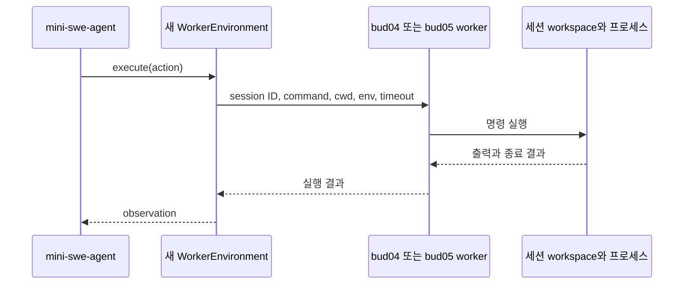

# Agent 논문에서 사용하는 harness와 새 CXL worker 연결 가능성

> 초기 조사/실험 기록이다. 현재 실행 설정과 완료 결과는 [최신 README](../README.md)를 따른다.

확인일: 2026-10-07. 논문 원문, 저자·프로젝트의 공식 저장소, 라이선스 파일, 명령 실행 인터페이스를 조사했다. 설치와 모델을 포함한 전체 실행은 수행하지 않았다. 현재 공개 저장소의 조사 커밋은 `evidence/harness-sources.json`에 기록했다. 이 커밋들이 논문 실험 당시의 커밋이라는 뜻은 아니다.

새 worker를 처음 연결할 대상으로 **mini-swe-agent**를 권장한다. agent loop는 공개 harness를 사용하고, 명령 실행 backend만 새 worker로 연결하면 된다. DSec의 구성과 관련 있는 harness를 추가하려면 **DeepSeek Harness**, 여러 reasoning 방식의 비교에는 **VIA-AgentBench**가 적합하다. 이 판단은 실행 인터페이스를 읽은 결과이며, 아직 통합 실험으로 검증하지 않았다.

## 논문과 공개 코드의 대응

| 논문 | 확인한 harness / workload | 공개 코드와 사용 가능성 |
|---|---|---|
| [Towards Understanding, Analyzing, and Optimizing Agentic AI Execution: A CPU-Centric Perspective, v3](https://arxiv.org/html/2511.00739v3) | 여러 workload 중 코딩 workload를 Figure 2에서 Mini-SWE-Agent로 표기. Haystack, Toolformer, LangChain, ChemCrow도 다룬다. | [mini-swe-agent](https://github.com/SWE-agent/mini-swe-agent), MIT. 실행 backend를 교체할 수 있다. 이 확인은 해당 논문의 전체 profiling artifact 공개 여부와는 별개다. |
| [The Cost of Dynamic Reasoning, v2](https://arxiv.org/html/2506.04301v2) | ReAct, Reflexion, LATS, LLMCompiler. HotpotQA, WebShop, MATH, HumanEval. | 저자 공식 [VIA-Research/AgentBench](https://github.com/VIA-Research/AgentBench), MIT. 네 agent 구현이 공개되어 있다. THUDM의 동명 AgentBench와 다른 저장소다. |
| [DeepSeek Elastic Compute (DSec)](https://arxiv.org/html/2609.22978v1) | §6.2에서 agent sandbox 안에 scaffold, 예를 들어 DeepSeek Harness, 와 tools를 배치하고 별도의 worker container가 sandbox를 관리한다고 설명. | [DeepSeek Harness](https://github.com/deepseek-ai/deepseek-harness), MIT. 공개 harness를 사용할 수 있다. 이를 설치한다고 논문의 DSec 전체 서비스가 생기는 것은 아니다. |
| [Memory Compression for High-Fanout Agent Sandboxes (AgentZip)](https://arxiv.org/html/2609.11294v1) | §5.2 R2E-Gym 기반 Python repository workload, §5.3 기록한 tool action과 LLM 대기 시간을 재생하여 평가. | [R2E-Gym](https://github.com/R2E-Gym/R2E-Gym)은 Apache-2.0. 논문은 trajectory 생성에 사용한 별도 harness의 이름·커밋을 명확히 특정하지 않는다. R2E-Gym workload 사용을 특정 harness 사용과 동일시할 수 없다. |
| [SWE-agent: Agent-Computer Interfaces Enable Automated Software Engineering](https://arxiv.org/abs/2405.15793) | SWE-agent의 repository 탐색·편집·테스트 ACI. | [SWE-agent](https://github.com/SWE-agent/SWE-agent), MIT. 조사한 현재 코드의 실행 backend는 [SWE-ReX](https://github.com/SWE-agent/SWE-ReX), MIT. 원논문 당시의 구현과 현재 코드의 구조를 구분해야 한다. |
| [R2E-Gym: Procedural Environments and Hybrid Verifiers for Scaling Open-Weights SWE Agents](https://arxiv.org/abs/2504.07164) | Agent와 실행 가능한 repository 환경, verifier와 test-time scaling. | [R2E-Gym](https://github.com/R2E-Gym/R2E-Gym), Apache-2.0. 학습·평가까지 포함한 코드이며 Docker runtime 의존 부분의 수정이 필요하다. |
| [The OpenHands Software Agent SDK](https://arxiv.org/abs/2511.03690) | 구성 가능한 agent, tools, local/remote conversation과 실행 환경. | [software-agent-sdk](https://github.com/OpenHands/software-agent-sdk), MIT. custom tool executor를 통해 worker RPC를 호출할 수 있다. 초기 OpenHands 논문과 이 SDK 논문은 구분한다. |

MIT 후보들의 실제 라이선스 파일: [mini](https://github.com/SWE-agent/mini-swe-agent/blob/04d809ceab9df28f9adaed044884180159172930/LICENSE.md), [DSH](https://github.com/deepseek-ai/deepseek-harness/blob/5badb15009ae1756c3afe0ae0cef1faafc290ccc/LICENSE), [VIA](https://github.com/VIA-Research/AgentBench/blob/ef5b195f69048865abceed472971237805bb9bc8/LICENSE), [SWE-agent](https://github.com/SWE-agent/SWE-agent/blob/3ea751c087f32b16e039a2233dd6eefecef325d5/LICENSE), [SWE-ReX](https://github.com/SWE-agent/SWE-ReX/blob/5c995c365dfb1fd5bc56fda688be5d8538f9931f/LICENSE.txt), [OpenHands SDK](https://github.com/OpenHands/software-agent-sdk/blob/8ba966d1d3af49f08e04349c055009e1614b48d6/LICENSE). R2E-Gym의 [LICENSE](https://github.com/R2E-Gym/R2E-Gym/blob/0d94c4eb9431cd195c55a7ea3abd54006c9a1735/LICENSE)는 Apache-2.0이다. 변경·배포 시 각 파일의 조건을 유지한다. 모델, 데이터셋, 실행 이미지와 의존 패키지는 별도의 사용 조건을 가진다.

## 실제 연결 지점

### mini-swe-agent — 첫 실험 대상으로 권장

조사 커밋의 패키지 버전은 2.4.6이다. agent loop가 environment를 통해 명령을 실행하므로 모델 호출과 trajectory 기록을 유지한 채 실행 위치를 바꿀 수 있다.

- [Environment protocol](https://github.com/SWE-agent/mini-swe-agent/blob/04d809ceab9df28f9adaed044884180159172930/src/minisweagent/__init__.py#L61): `execute(action: dict, cwd: str = "")`, `get_template_vars()`, `serialize()`.
- [agent의 실행 호출](https://github.com/SWE-agent/mini-swe-agent/blob/04d809ceab9df28f9adaed044884180159172930/src/minisweagent/agents/default.py#L154): model action을 `self.env.execute(action)`으로 넘긴다.
- [LocalEnvironment](https://github.com/SWE-agent/mini-swe-agent/blob/04d809ceab9df28f9adaed044884180159172930/src/minisweagent/environments/local.py#L24): action의 command를 실행하고 output, returncode, exception_info를 돌려준다. timeout과 제출 완료 처리도 이 계층에 있다.
- [환경 선택 문서](https://github.com/SWE-agent/mini-swe-agent/blob/04d809ceab9df28f9adaed044884180159172930/docs/advanced/environments.md): environment class를 설정으로 선택한다.

새 `WorkerEnvironment`는 action의 command를 session ID, cwd, env, timeout과 함께 worker로 보낸다. worker의 stdout/stderr와 종료 결과를 harness가 기대하는 observation으로 변환한다. 제출 완료 marker, timeout 예외, template 변수, serialization도 맞춰야 한다. 현재 API는 command 문자열을 직접 받는 형태가 아니라 **action dictionary를 받는다**.

이 harness의 Bash 경로를 사용하면 파일 탐색·수정도 shell 명령으로 같은 workspace에서 수행할 수 있어 초기 연결 범위가 작다. 파일과 설치된 의존성은 세션 동안 유지하되, 명령마다 새 shell을 시작하는 기본 동작에서 `cd`나 shell 변수까지 호출 사이에 유지된다고 가정해서는 안 된다.

### DeepSeek Harness — 실행 서비스를 넓게 교체하는 후보

[공식 README](https://github.com/deepseek-ai/deepseek-harness/blob/5badb15009ae1756c3afe0ae0cef1faafc290ccc/README.md)는 plugin 기반 harness이며 developer preview라고 명시한다. API 변경 가능성이 있어 커밋을 고정하는 편이 좋다.

- [architecture의 capability seams](https://github.com/deepseek-ai/deepseek-harness/blob/5badb15009ae1756c3afe0ae0cef1faafc290ccc/docs/architecture.md): filesystem과 subprocess provider를 같은 원격 실행 환경으로 교체하는 구조를 설명한다.
- [SubprocessRuntime](https://github.com/deepseek-ai/deepseek-harness/blob/5badb15009ae1756c3afe0ae0cef1faafc290ccc/packages/subprocess/subprocess/src/index.ts#L117): executable 조회, 실행 환경 조회, `spawn()`, `spawnTerminal()`을 제공하는 abstract service.
- [LocalBashExecutor](https://github.com/deepseek-ai/deepseek-harness/blob/5badb15009ae1756c3afe0ae0cef1faafc290ccc/packages/shell/bash-local/src/index.ts#L97): shell command를 subprocess service로 실행한다.
- [process 계약](https://github.com/deepseek-ai/deepseek-harness/blob/5badb15009ae1756c3afe0ae0cef1faafc290ccc/packages/subprocess/subprocess/src/types.ts#L169): output, 완료 결과, terminate와 process 범위의 종료 관측을 포함한다.

새 worker의 원격 subprocess provider와 filesystem provider를 plugin으로 작성할 수 있다. Bash만 먼저 연결한다면 shell executor 교체도 검토할 수 있다. 전체 tool을 원격화하려면 파일 읽기·편집, PTY, background process, 취소·종료 관측까지 같은 worker 세션으로 연결해야 한다. mini보다 요구되는 실행 계약이 넓다.

### VIA-AgentBench — reasoning 및 병렬 호출 비교

논문의 네 agent가 실제로 공개되어 있어 여러 reasoning 구조를 비교하는 데 유용하다. [README](https://github.com/VIA-Research/AgentBench/blob/ef5b195f69048865abceed472971237805bb9bc8/README.md)는 Python 3.13.9와 OpenAI-compatible LLM server를 전제로 한다. workload에 따라 WebShop 서비스나 외부 tool API도 필요하다.

[HumanEval PyExecutor](https://github.com/VIA-Research/AgentBench/blob/ef5b195f69048865abceed472971237805bb9bc8/src/tools/humaneval_tools/executors/py_executor.py#L10)는 생성한 Python 코드와 테스트를 `exec`로 실행한다. 일반적인 remote shell environment 계약은 아니다. worker의 Python 실행 요청으로 바꾸면서 test 결과와 feedback 형식을 유지해야 한다. HumanEval의 작은 함수 실행이 CXL 메모리 이점을 대표한다고 가정하지 말고, 실제 메모리 수요를 측정해야 한다.

### 다른 공개 후보

| 후보 | 확인한 연결 지점 | 새 worker에서 맞춰야 할 범위 |
|---|---|---|
| SWE-agent / SWE-ReX | [SWEEnv.communicate](https://github.com/SWE-agent/SWE-agent/blob/3ea751c087f32b16e039a2233dd6eefecef325d5/sweagent/environment/swe_env.py#L197), [RemoteRuntime](https://github.com/SWE-agent/SWE-ReX/blob/5c995c365dfb1fd5bc56fda688be5d8538f9931f/src/swerex/runtime/remote.py#L44) | Bash session 실행·interrupt, 일반 command 실행, read/write/upload, session 생성·종료. Runtime/Deployment adapter를 만들거나 해당 프로토콜을 구현한다. 단일 exec endpoint만으로 호환되지는 않는다. |
| OpenHands SDK | [ToolExecutor](https://github.com/OpenHands/software-agent-sdk/blob/8ba966d1d3af49f08e04349c055009e1614b48d6/openhands-sdk/openhands/sdk/tool/tool.py#L283) | action을 worker RPC로 보내고 observation을 반환하는 custom executor를 작성한다. terminal과 file tool을 함께 연결한다. 기존 remote Workspace는 OpenHands agent-server의 프로토콜을 기대하며 agent loop도 원격에서 실행할 수 있어, 임의의 worker 주소만 넣으면 되는 구조가 아니다. |
| R2E-Gym | [RepoEnv](https://github.com/R2E-Gym/R2E-Gym/blob/0d94c4eb9431cd195c55a7ea3abd54006c9a1735/src/r2egym/agenthub/environment/env.py#L47), [DockerRuntime.run](https://github.com/R2E-Gym/R2E-Gym/blob/0d94c4eb9431cd195c55a7ea3abd54006c9a1735/src/r2egym/agenthub/runtime/docker.py#L689) | DockerRuntime을 worker adapter로 교체한다. command 실행 외에도 workspace 초기화, tool 설치, repository/test/reward 처리에 필요한 runtime 동작을 맞춰야 한다. |

Claude Code는 별도로 구분한다. [공개 저장소의 LICENSE](https://github.com/anthropics/claude-code/blob/765f236fe1bfcc678e0ec59af9170fb7d6771a3a/LICENSE.md)는 Commercial Terms 적용을 명시한다. MIT harness 소스로 분류할 수 없고, 공개 저장소를 받는다고 core harness 전체를 수정할 수 있는 것은 아니다. 새 실행 backend를 소스 수준에서 연결하는 첫 대상으로는 위의 공개 후보가 더 적합하다.

## bud04 / bud05에 적용할 첫 연결

worker 구현은 독립적으로 작성한다. 초기 연결은 일반 RPC로 수행하며, CXL은 worker의 메모리·상태 backend에서 관리한다. harness를 연결하는 것만으로 프로세스 checkpoint, 공유 메모리 visibility 또는 bud04↔bud05 재개가 구현되지는 않는다.

첫 확인은 모델 없이 adapter 계약을 점검하고, 이후 같은 task·model·harness를 사용해 local execution과 worker execution의 결과를 비교하는 방식이 적절하다. 세션 안에서 수정한 파일의 다음 호출 가시성, timeout 후 프로세스 정리, background process의 수명, observation 반환, 실제 worker를 통과한 호출 기록을 확인한다. CXL 관련 성능 평가는 이 연결 검증 이후 별도로 수행한다.

## 이번 조사에서 확인한 범위

논문에 기재된 harness/workload 대응, 공식 공개 코드의 존재, 저장소 최상위 라이선스, 현재 커밋의 실행 인터페이스를 확인했다. 패키지 설치, dependency resolution, 컨테이너 이미지 준비, LLM 호출과 통합 benchmark는 아직 수행하지 않았다. AgentZip의 특정 harness 및 DSec 전체 인프라의 공개 소스 위치는 이번 조사에서 확정하지 못했다.
