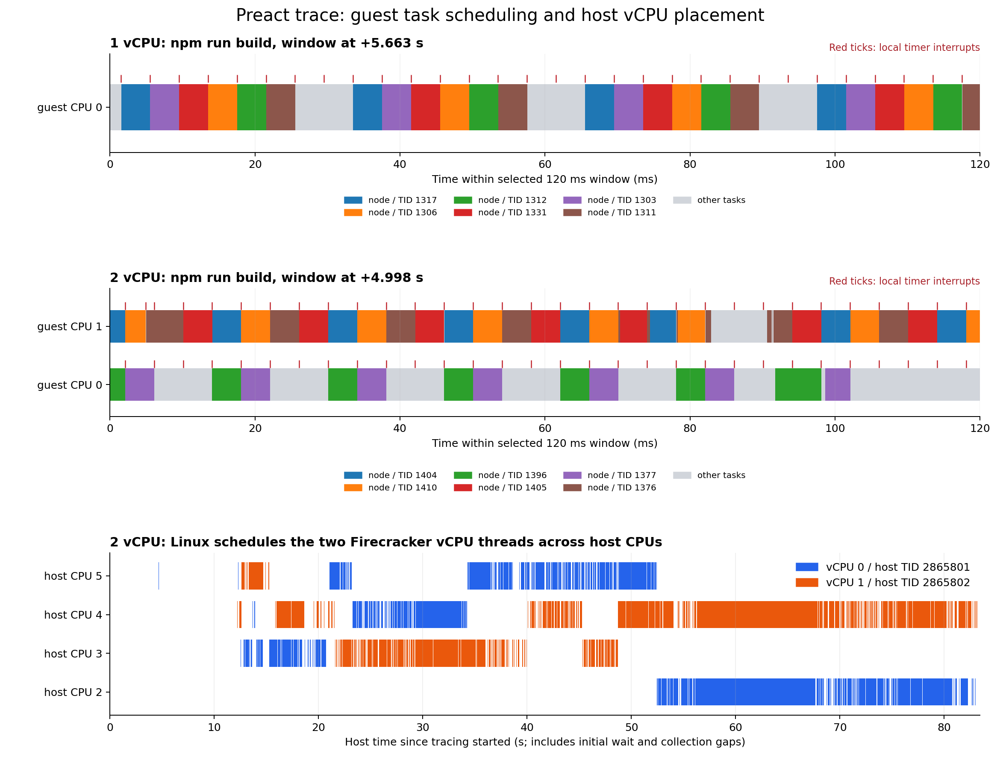

# SWE trace를 이용한 microVM CPU scheduling 관측

2026년 10월 14일

이 문서는 **2026년 10월 14일에 수행한 1·2 vCPU scheduling 실험 기록**이다. 아래 수치는
그 실행의 관측값으로 보존한다. 2026년 10월 21일 기준 공유 DAX·microVM 전환·cache 관리의
현재 구현과 실행 방법은 [구현 README](../implementation/virtual_machine/README.md)에 있다.
이 문서에서 사용한 `.local/` runner와 원시 trace는 Git에 포함되지 않는다.

**microVM 안의 작업 스케줄링과 host의 vCPU 스레드 스케줄링을 모두 관측했다.** 1 vCPU에서도 timer interrupt와 실행 중인 작업의 선점이 발생했다. 2 vCPU에서는 guest CPU 사이의 작업 이동과 reschedule IPI가 추가로 관측됐다. Firecracker vCPU 스레드도 host의 물리 CPU 사이에서 이동했다.

## 실험 구성

기존 Gin trace는 27개 명령과 짧은 Go 테스트였다. 이번에는 `preactjs__preact-3010`의 55개 명령을 사용했다. Mocha 테스트, Chrome 기반 Karma 테스트, `npm run build`가 포함된다. 원본 trace는 기존 inventory의 고정 commit에서 받아 크기와 SHA-256을 검증했다.

| 설정 | 값 |
| --- | --- |
| Firecracker | 공식 v1.17.0 소스 빌드 |
| 비교 조건 | 1 vCPU와 2 vCPU 각각 한 번, 순차 실행 |
| Guest RAM | 두 조건 모두 8GiB, host memory node 1 |
| Host CPU affinity | 두 조건 모두 CPU 2–5, NUMA node 0 |
| Guest kernel | tracing을 켠 Ubuntu 5.15.0-191-generic 사본 |
| Root disk | 같은 Preact 이미지에서 만든 깨끗한 디스크를 매 실행 복제 |
| 외부 네트워크 | 없음, guest loopback만 사용 |
| 재생 방식 | 원본 명령 유지, 명령 간 기록된 대기 생략 |
| 명령 timeout | 작은 vCPU 조건을 관찰하기 위해 원본 60초에서 180초로 연장, 실제 timeout 없음 |

이전의 최소 6.1.188 guest kernel에는 `CONFIG_FTRACE`가 꺼져 있었다. 이번에는 host에 설치된 kernel과 일치하는 `virtio_blk` 모듈을 **별도 guest 부팅 이미지로 복사**했다. Host kernel이나 시스템 설정을 교체한 것은 아니다. 따라서 이전 Gin 실험과의 실행 시간 비교가 아니라, 동일한 계측용 kernel을 사용한 1·2 vCPU 비교다. Host CPU는 다른 workload와 공유하고 있다.

사용한 이미지 digest는 `sha256:e8aa1e355221d42235e7beb1d83c902b1ca9f40112af090d4d87e60b3f69366d`다. 실행별 manifest에 바이너리 해시, 소스 commit, 이미지와 trace 정보, 환경변수를 남겼다.

## 무엇을 측정했는가

Guest에서는 각 명령 앞뒤로 tracing을 켜고 껐다. `sched_switch`, `sched_migrate_task`, `sched_wakeup`, local timer interrupt와 reschedule interrupt의 진입·종료를 기록했다. `/proc/interrupts`, `/proc/stat`, `/proc/schedstat` 전후 차이로 IRQ, CPU 사용, 누적 runqueue 대기도 확인했다. 비교용으로 처음에 5초간 idle 상태를 측정했다.

Host에서는 별도의 tracefs instance를 만들고 해당 Firecracker의 vCPU TID만 필터링했다. Guest 실행과 host vCPU 실행을 별개의 계층으로 측정했으며, 종료 시 instance를 제거했다. Guest의 합계는 55개 명령의 계측 구간을 더한 값이다. Host 합계에는 최초 대기와 idle, guest 결과 저장 구간도 포함된다. 두 계층의 수치를 서로 나눠 비율로 해석하지 않는다.

IRQ, context switch, CPU migration은 서로 다른 사건이다. Timer interrupt가 발생해도 같은 작업이 계속 실행될 수 있고, 작업이 잠들면 timer와 무관하게 context switch가 발생한다. CPU migration은 작업이 실행될 CPU를 바꾸는 사건이다. `sched_switch`의 `R`과 `R+`는 이전 작업이 runnable 상태였음을 나타내며, `R+`는 trace의 preempt 표시까지 있는 경우다. `R` 전체를 timer에 의한 선점으로 계산하지 않았다. [Linux ftrace 설명](https://docs.kernel.org/trace/ftrace.html), [Event tracing 설명](https://docs.kernel.org/trace/events.html).

## 관측 결과

| 관측값 | 1 vCPU | 2 vCPU |
| --- | ---: | ---: |
| 완료 명령 | 55 | 55 |
| 명령 계측 구간 합계 | 86.72초 | 66.52초 |
| Guest CPU 사용량 | 84.37 CPU초 | 103.90 CPU초 |
| 할당 vCPU 용량 대비 평균 사용률 | 97.3% | 78.1% |
| Guest non-idle 작업의 switch-out | 546,160회 | 389,356회 |
| 위 전환 중 runnable 상태 R 또는 R+ | 208,322회 | 137,525회 |
| 위 전환 중 preempt 표시 R+ | 12,980회 | 11,081회 |
| Guest local timer interrupt LOC 증가 | 77,864회 | 64,627회 |
| Guest reschedule IPI RES 증가 | 0회 | 27,500회 |
| Guest CPU 이동 이벤트 | 0회 | 9,350회 |
| 같은 guest TID의 다른 CPU 재실행 관측 | 0회 | 8,838회 |
| Guest 누적 runqueue 대기 | 185.83초 | 115.78초 |
| Host vCPU 스레드 CPU 이동 이벤트 | 6회 | 31회 |
| Guest·host trace buffer 손실 | 0 | 0 |

LOC와 RES 행은 `/proc/interrupts` 전후 차이다. 더 좁은 tracing 창의 진입 이벤트 합계는 local timer가 각각 77,846·64,514회, reschedule이 0·27,338회였다. Counter 전후 읽기와 tracing on/off의 경계가 달라 조금 차이가 나므로 두 값을 혼용하지 않는다. Local APIC timer는 주기적 scheduler tick뿐 아니라 high-resolution timer도 처리하므로, LOC 전체를 scheduler tick 횟수라고 부르지 않는다.

1 vCPU guest에는 다른 guest CPU가 없으므로 guest migration과 reschedule IPI가 0인 것이 자연스럽다. 그 상태에서도 runnable switch-out과 preempt 표시가 충분히 관측됐다. **Reschedule IPI가 없다고 scheduling이 없는 것은 아니다.**

2 vCPU의 평균 사용량은 약 1.56 core에 해당한다. 작업들이 두 vCPU를 동시에 사용했고, 같은 TID가 CPU 0과 CPU 1 사이를 옮겨 실행된 것도 확인했다. Migration 이벤트와 다른 CPU에서의 재실행 횟수는 정의가 다르다. Runqueue 이동 후 실행 전에 다시 이동할 수도 있고, trace 창의 첫 실행에는 직전 CPU를 알 수 없기 때문이다.

## 실제 timer interrupt와 작업 전환 예

1 vCPU의 `npm run build` trace에서 다음 순서를 관측했다. 시간 단위는 guest monotonic clock의 초다.

```text
66.808009 CPU0 node TID1192  local_timer_exit  dNh..
66.808011 CPU0 sched_switch prev=node/TID1192 state=R -> next=node/TID1191
```

Timer interrupt 종료 기록에 `N`, 즉 need-resched 표시가 있고, 2µs 뒤 runnable 상태의 Node 작업에서 다른 Node 작업으로 전환됐다. Timer 처리 직후 스케줄러가 작업을 바꾸는 구체적인 사례다. 이 시간적 연결을 근거로 모든 context switch가 timer 때문에 발생했다고 확대하지는 않는다.

2 vCPU의 같은 빌드에서는 다음과 같은 guest CPU 이동도 기록됐다.

```text
57.485517 sched_migrate_task comm=node pid=1258 orig_cpu=0 dest_cpu=1
57.485529 sched_migrate_task comm=node pid=1257 orig_cpu=1 dest_cpu=0
```



위쪽 두 그림은 빌드 중 선택한 120ms 구간이다. 각 색은 서로 다른 guest TID이고, 빨간 눈금은 local timer interrupt다. 아래 그림은 2 vCPU 실험의 host 전체 관측 구간이다. 색은 각 vCPU 스레드를, 세로 위치는 실행된 물리 CPU를 나타낸다. Guest와 host 그림의 시간축은 서로 다르다.

## 작은 vCPU 수가 만든 대기

`npm run build`만 떼어 보면 1 vCPU에서는 약 14.16초 동안 CPU가 거의 포화됐고, 작업들의 runqueue 대기 합계는 101.78초였다. 이 대기는 여러 runnable 작업의 대기를 더한 값이라 wall time보다 클 수 있다. 해당 구간에 평균 약 7.2개 작업이 runqueue에서 기다린 수준으로 해석할 수 있다.

2 vCPU 빌드는 12.50초, 24.22 CPU초를 사용했고 누적 runqueue 대기는 69.96초였다. 두 CPU 용량의 약 96.9%를 사용했으며, 이 빌드 안에서만 guest migration 1,234회와 reschedule IPI 825회가 발생했다. 작은 CPU 용량에서 여러 Node 작업과 worker가 실행 기회를 나눠 갖는 상황을 확인한 것이다. [Runqueue 대기의 누적 의미](https://docs.kernel.org/scheduler/sched-stats.html).

5초 idle 대조 구간의 guest 사용량은 두 조건 모두 약 0.01 CPU초였다. 1 vCPU idle에서는 local timer가 41회, 빌드에서는 약 14.16초 동안 3,563회로 증가했다. Idle과 부하 상태의 동작 차이도 관측됐지만, 부하별 high-resolution timer 사용량이 다르므로 IRQ 개수 자체를 CPU 포화도의 대용으로 사용하지 않는다.

## Host에서 vCPU를 옮기는 과정의 의미

1 vCPU 스레드는 host CPU 2·3·4·5에서 실제로 실행됐다. 총 6회 이동 중 3회는 최초 workload marker 이전이었고, 나머지는 명령 재생이 진행되는 동안 관측됐다. 2 vCPU에서는 vCPU 0이 CPU 2·3·4·5, vCPU 1이 CPU 3·4·5에서 실행됐다. Affinity를 강제로 바꾼 결과가 아니라 host Linux scheduler가 허용된 CPU 집합 안에서 옮긴 것이다.

이 이동은 하나의 host kernel이 같은 KVM VM/vCPU 객체를 유지한 채 스레드를 스케줄링한 것이다. Guest RAM을 다른 host로 복사하거나 Firecracker snapshot을 만들어 넘긴 적은 없다. **따라서 microVM의 실행 CPU가 고정돼 있지 않다는 증거이며, 서로 다른 host 사이의 CXL handoff 구현을 검증한 결과는 아니다.** Host 측 계측에서는 vCPU가 실행 중일 때 local timer와 reschedule interrupt도 관측됐지만, 모든 host interrupt가 vCPU descheduling을 일으킨다고 해석하지 않는다.

## 재생 결과와 해석 범위

1 vCPU는 최종 patch가 원본과 일치했으나 Karma 테스트 세 번에서 focus assertion이 실패해 원본 종료 코드와 달랐다. 2 vCPU는 비교 가능한 54개 종료 코드가 모두 원본과 일치했고 최종 patch도 일치했다. 두 실행 모두 timeout이나 guest OOM 기록은 없었다. 테스트 결과 차이의 원인이 vCPU 수만이라고 단정하려면 반복 실험이 필요하다.

각 조건 한 번의 관측이며 tracing 오버헤드가 있다. 명령에 따라 worker 수가 CPU 개수에 맞춰 달라질 수 있고 host CPU도 독점하지 않았다. 실행 시간과 CPU초는 관측값으로 제시하며, 고정 작업량의 성능 향상 비율이나 일반적인 scheduler overhead로 해석하지 않는다. Guest 사용률은 USER_HZ counter와 계측 구간으로 계산한 근사치여서 짧은 구간에서는 100%를 조금 넘을 수 있다.

## 당시 실행 명령과 원시 자료

아래는 로컬 스크립트·이미지·kernel이 준비된 호스트에서 사용한 명령이다. `.local/`은
Git에서 제외하므로 새 clone에서 이 명령만으로 재실행할 수 없다. 이 scheduling trace
runner는 현재의 `lab.py`에 통합하지 않았다.

```bash
cd /home/ijkim/agent-sandbox-cxl
python3 .local/microvm/sched-preact/run.py --vcpus 1
python3 .local/microvm/sched-preact/run.py --vcpus 2
```

당시 KVM과 host tracing을 사용할 수 있는 환경 및 `sudo -n` 권한을 사용했다. 같은 CPU 집합에서 순차 실행했고, 실행마다 깨끗한 root disk를 복제했다.

- 1 vCPU 자료: `.local/microvm/sched-preact/run-1vcpu-8qim_v1q/`
- 2 vCPU 자료: `.local/microvm/sched-preact/run-2vcpu-lgjd82r5/`
- `summary.json`: 재생 종료 코드, 시간, 최종 제출 비교
- `scheduling-summary.json`: guest·host 이벤트 집계와 명령별 분석
- `guest/results/046.trace`: 빌드의 guest trace, 다른 번호는 해당 trace 명령
- `guest/results/*.trace-stats`: guest buffer 손실 확인
- `host.trace`, `host.trace-stats`, `host-trace-config.json`: host trace와 필터·손실 기록
- `prepare.py`, `run.py`, `host_trace.py`, `analyze.py`, `plot.py`: 이번 계측에 사용한 로컬 스크립트

원시 trace의 크기는 guest 약 154MB·125MB, host 약 6.5MB·19.9MB다. 이 자료는 로컬에
보관하고 본문의 집계와 그림을 배포한다. 코드는 기존 replay parser와 제출 fingerprint를
재사용했으며, 측정용 스크립트를 범용 replay harness에 통합한 것은 아니다.
