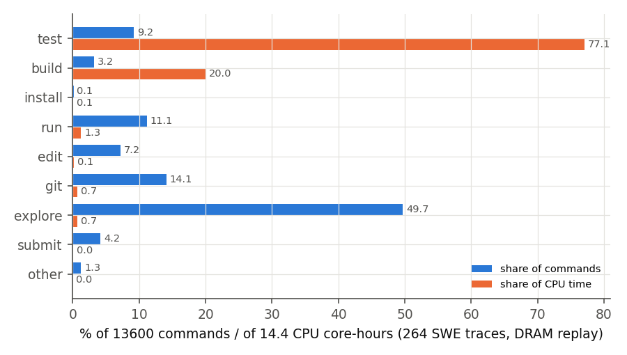
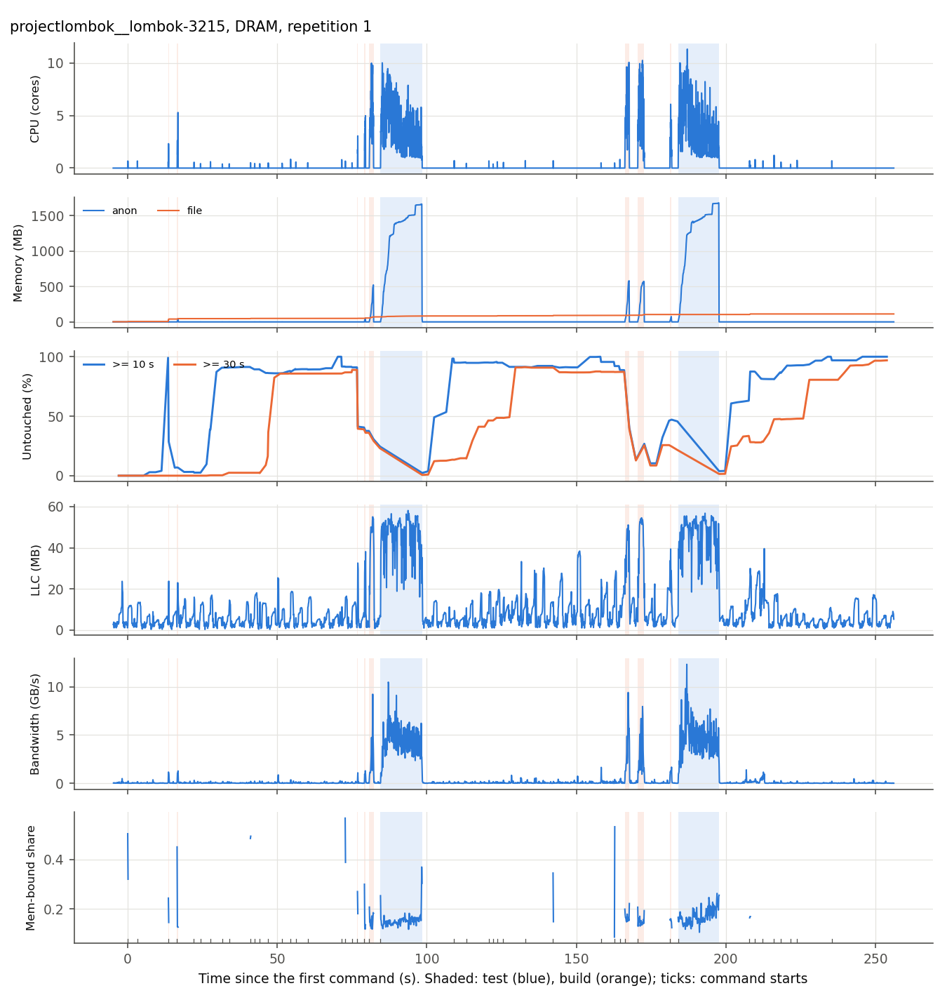
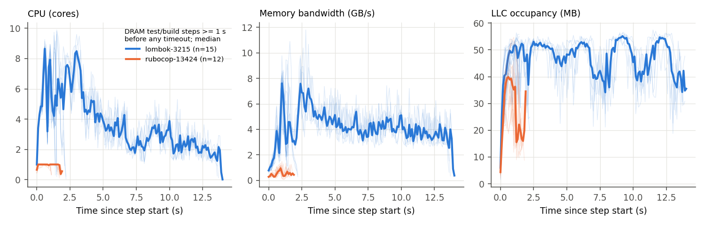
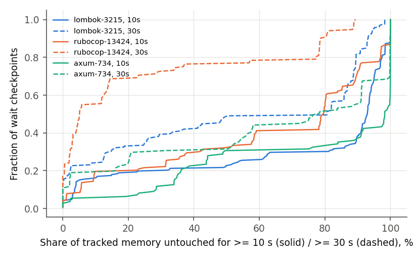
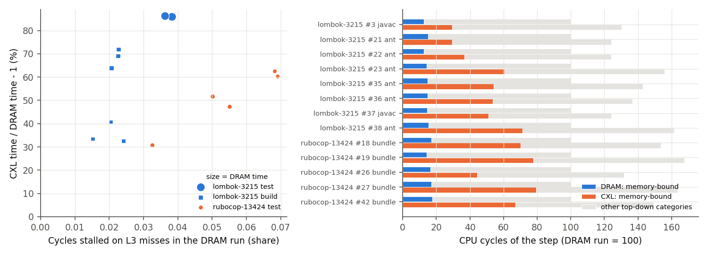

# agent workload 측정 파일럿: SWE trace 3개, DRAM과 CXL (2026-11-12)

agent 종류별 workload 계획(bud05 `~/agent-sandbox-cxl/docs/agent-workload-plan.md`, git 밖) 8장 2단계를 했다. 측정 도구를 SWE trace(W0) 3개로 시험하고, CXL tax(T3)도 같은 trace로 먼저 쟀다. 4장 설계의 CPU·메모리·cache 지표를 단계(명령) 단위로 모았다. 그전에 264개 trace가 어떤 명령을 쓰는지 다시 나눴다(1절).

실행은 bud05에서 했다. CPU는 NUMA node 0만 쓰고, 메모리는 node 0(DRAM)과 node 2(DCD, CXL)만 썼다. node 1의 CPU와 메모리는 쓰지 않았다.

## 0. 결론

1. **CPU는 test·build 명령 몇 개에 몰려 있다(1절).**
   - 명령의 9.2%인 test가 CPU의 77%를, 3.2%인 build가 20%를 쓴다.
   - CPU를 10초 이상 쓰는 명령은 4.9%뿐인데, 이들이 CPU의 93%다. trace 하나에 중앙값 2개 있다.
   - 이 중 34%는 같은 trace에서 앞서 돌린 명령을 그대로 다시 돌린 것이다.
2. **측정 도구는 돈다(3절).**
   - 명령 시작 지연은 중앙값 0.003~0.23초다. perf와 cgroup CPU의 시각을 맞추면 상관이 0.99 이상이다.
   - 함정이 하나 있었다. 이 커널은 MGLRU를 쓰므로 read()로 읽은 page cache가 idle bit에 잡히지 않는다. kprobe로 따로 잡았다.
3. **LLM을 기다리는 동안 sandbox는 거의 아무것도 하지 않는다(5절).**
   - 배경 CPU는 0.001코어 미만이다.
   - 남는 메모리는 50~76 MB(대부분 page cache)다.
   - 대기 시점의 중앙값에서 그 78~98%가 10초 넘게 쓰이지 않았다. 계획 7장의 "70% 이상"을 넘는다.
   - 단 Docker에서는 명령이 끝나면 process와 anon 메모리가 사라진다. microVM에서는 guest 메모리가 남으므로 따로 재야 한다.
4. **무거운 단계의 모양은 언어마다 다르다(4절).**
   - lombok `ant test`: 14초 동안 평균 3.7코어(최대 11)를 쓴다. JVM anon이 1.7 GB까지 오른다. LLC를 50 MB 넘게 차지하고, 대역폭은 4~10 GB/s다.
   - rubocop test: 1~2초 동안 1코어를 쓰고, LLC는 40 MB까지 찬다.
   - axum `cargo test`(timeout 뒤라 참고값): 30코어까지 쓰고, 대역폭은 최대 100 GB/s, 메모리는 10 GB다.
5. **이 DCD에서 CXL tax는 무거운 단계에서 크다(6절).**
   - test·build 단계는 +31~86%(13단계, 중앙값 +60%)다. 가벼운 단계는 +3~9%다.
   - CXL에서 늘어난 cycle의 중앙값 94%가 topdown memory-bound다. 그 밖의 cycle은 거의 그대로다.
   - 장치가 느리다. 직접 재 보니 지연이 661 ns(DRAM 119 ns), 읽기 대역폭이 10.3 GB/s(DRAM 116 GB/s)였다.
   - 같은 단계의 10-14 측정(lombok test +40%, rubocop test +14%)보다 크다. DRAM 쪽이 1.7배 빨라졌고(clock 설정), 이번에는 page cache도 CXL에 올렸다.
6. **DRAM에서 잰 counter로 tax를 가늠하기는 아직 어렵다(6절).** L3 miss로 멈춘 cycle 비율은 한 trace 안에서는 tax와 같이 움직인다. 그러나 trace 사이에는 맞지 않는다. lombok build는 그 비율이 0.02인데 tax가 +33~72%다.
7. **JVM은 CXL에서 heap을 50% 더 키웠다(6절).** `ant test`의 anon peak가 1.67 GB에서 2.5 GB로 늘었다. 메모리 traffic 합계는 같았다(60 GB). GC가 느려지자 JVM이 heap을 키운 것으로 보인다(추정).
8. **axum은 tax 비교에서 뺐다(3절).**
   - cargo가 의존성을 받고 compile하느라 60초 timeout을 넘었다.
   - mini처럼 timeout된 명령은 container 안에서 계속 돌아 다음 단계와 겹친다.
   - 3번 중 1번은 의존성 받기가 멈춰 compile이 시작되지도 않았다.
9. **LLC를 비우고 시작해도 단계 시간은 그대로였다(7절).** 옮긴 직후처럼 단계 직전에 LLC를 비웠다. 0.3초 이상 단계의 시간 차이는 중앙값 −0.8%(−6.3~+2.4%)였다.
   - 단계가 시작할 때 sandbox가 LLC에 갖고 있던 양이 중앙값 2.3 MB뿐이었다. 대기 1초 안에 LLC가 이미 비기 때문이다.
   - 그래서 이 host에서는 hand-off가 LLC 쪽으로 잃는 것이 거의 없다. L2·TLB·page cache 위치는 이 시험에 들어 있지 않다.
   - JVM 단계의 처음 200 ms IPC가 낮은 것(0.71~0.76배)은 LLC를 비워도 같았다. cache가 아니라 JVM 시작 비용이다.

## 1. 명령 분석 (264 trace, 명령 13,600개)

`experiments/workload-char/cmdmix.py`. CPU와 시간은 10-14 DRAM 재생(대기 없이 연속 실행)에서 명령마다 잰 값이다.

**분류를 고쳤다.** 이전 분류(`experiments/contention/trace_kinds.py`)는 단어가 명령줄 어디에 있든 잡았다. 그래서 `find . -name Once.php`를 PHP 실행으로, `cat Foo.java`를 build로 셌다. 새 분류(`cmdkind.py`)는 다음처럼 나눈다.
- 셸 명령을 `&&`, `||`, `;`, `|`, 줄바꿈에서 단계로 쪼갠다(따옴표 안은 쪼개지 않고, heredoc 본문은 뺀다).
- 각 단계를 실행 위치의 프로그램과 첫 인자로 분류한다.
- 명령의 종류는 가장 높은 단계의 종류다. 순서는 submit > test > install > build > run > edit > git > explore > other다.

| 종류 | 명령 | 시간 | CPU | 명령당 CPU(초) | 시간 p50 / p90(초) | 일을 하는 프로그램(종류 안 CPU 몫) |
|---|---|---|---|---|---|---|
| test | 9.2% | 69.5% | **77.1%** | 32.1 | 3.3 / 28.0 | mvn 21%, go test 15%, cargo test 15%, ant 14%, gradlew 14%, npm run 8% |
| build | 3.2% | 18.4% | **20.0%** | 24.2 | 1.9 / 24.9 | make 20%, gradlew 17%, npm run 14%, yarn build 11%, ant 9%, go build 8% |
| run | 11.1% | 3.3% | 1.3% | 0.43 | 0.14 / 1.2 | bundle exec 35%, python3 24%, java 9% |
| install | 0.1% | 0.7% | 0.1% | 2.5 | 1.0 / 24.2 | apt-get, go mod |
| edit | 7.2% | 0.9% | 0.1% | 0.08 | 0.11 / 0.16 | ruby -e, git, perl -pi, cat heredoc |
| git | 14.1% | 1.9% | 0.7% | 0.19 | 0.11 / 0.18 | git diff, git status |
| explore | 49.7% | 4.7% | 0.7% | 0.05 | 0.10 / 0.12 | grep, sed -n, find, cat |
| submit, other | 5.5% | 0.4% | 0.0% | – | – | echo, rm |



- **무거운 명령(CPU 10초 이상)**: 672개(명령의 4.9%), CPU의 93%다. test 515개, build 148개다.
- **trace당 개수**: 중앙값 2개, p90 6개다. 264개 중 72개 trace에는 하나도 없다.
- **반복**: 672개 중 231개(34%)는 같은 trace에서 앞서 실행한 명령과 글자 하나까지 같다. 고친 뒤 같은 test를 다시 돌리는 경우다.
- **위치**: CPU를 trajectory 10등분 위치로 나누면 60~90% 구간에 46%가 있다. 마지막 10%에는 3%뿐이다(제출 직전).

## 2. 실험 설정

**재생**
- 수집기 `wlchar.py run`이 trace마다 새 container를 만들고, 기록된 시각에 명령을 실행한다. 명령 사이의 LLM 대기를 그대로 넣는다.
- 명령은 `docker exec`로 실행한다. CXL 조건에서는 MPOL_BIND helper로 node 2에 묶는다. 명령 timeout은 60초이고, timeout 뒤의 동작은 mini와 같다(Docker CLI만 끊고 명령은 계속 돈다).
- **page cache도 묶은 node에 올린다.** 실행 전에 image의 모든 파일에 `posix_fadvise(DONTNEED)`를 걸어 page cache를 비운다. 그러면 파일 page가 sandbox cgroup에 잡히고, 처음 읽는 process의 정책을 따라 묶은 node에 올라간다. CXL 실행에서 anon과 file page가 모두 node 2에 있음을 `memory.numa_stat`으로 확인했다(node 0 쪽 2 MB 이하). 10-14 측정은 anon만 CXL에 두었다.

**자원**
- sandbox: CPU 2-31(NUMA 0, SMT sibling은 쓰지 않음). 측정 process는 CPU 0, 1, 64, 65에서 돈다.
- 메모리: DRAM 조건은 node 0, CXL 조건은 node 2다.
- DCD: host 2(bud05), region 0에 16 GB를 할당했다(`dcdctl add -H 2 -R 0 -c 8`, tag `...0206`). 3 GB 쓰기·읽기 검증에서 불일치는 0개였다. 아직 해제하지 않았다.
- governor는 performance, turbo는 켜져 있다(약 4 GHz).

**측정** (계획 4.2절에서 정한 것)

| 대상 | 도구 | 주기 |
|---|---|---|
| CPU(user, system) | cgroup `cpu.stat` | 20 ms |
| 메모리 구성, node별 anon·file, PSI, I/O | cgroup `memory.stat`, `memory.numa_stat`, `*.pressure`, `io.stat` | 100 ms |
| LLC 점유, 메모리 대역폭 | resctrl monitor group(CPU 2-31), `llc_occupancy`, `mbm_total_bytes` | 100 ms |
| IPC, topdown(retiring, bad-spec, front-end, back-end, memory-bound), L3·L2 miss, L3 miss stall, page walk | `perf stat -I 100 --for-each-cgroup` | 약 114 ms |
| 실행한 프로그램과 그 CPU | bpftrace exec·fork·exit(종료 때 `sum_exec_runtime`) | 이벤트마다 |
| 단계마다 쓴 page | idle page tracking(단계 시작에 sandbox page를 idle로 표시하고 끝에 읽음), 대기 중 2초마다 | 단계마다 |
| read()로 읽은 page cache | bpftrace kprobe `folio_mark_accessed`(아래) | 이벤트마다 |
| sandbox page 목록 | `/proc/kpagecgroup`, `/proc/kpageflags`를 배경 thread가 3초마다 훑음 | 3초 |

- **MGLRU 함정.** bud05 커널은 MGLRU를 쓴다(`lru_gen` 0x0007). 이때 read()·write()로 접근한 page cache는 `folio_mark_accessed`를 거치지만 PG_idle이 지워지지 않는다. 그래서 idle tracking만으로는 파일을 읽어도 "쓰이지 않음"으로 나온다.
  - MGLRU를 끄는 것은 전역 설정이라 하지 않았다.
  - 대신 kprobe로 sandbox cgroup의 `folio_mark_accessed`를 잡아 pfn을 기록한다. mmap으로 접근한 page는 idle bit로 잡힌다.
- **THP.** 머리 page만 추적하고, 꼬리 page는 머리 page의 값으로 판단한다.
- **perf 시각 맞춤.** `perf stat -I`의 구간 끝 시각은 실제보다 약 130~150 ms 늦게 찍힌다. cycles와 cgroup CPU 사용량의 상관이 가장 큰 지연을 찾아 옮겼다(상관 0.99 이상). event 묶음은 multiplexing 없이(100%) 읽혔다.

**trace** (264개 중 3개)

| trace | 언어 | 명령 수 | 무거운 단계 |
|---|---|---|---|
| projectlombok/lombok-3215 | Java | 47 | `ant test` 2번(각 14초), `ant` build 6번 |
| rubocop/rubocop-13424 | Ruby | 52 | `bundle exec rspec` 5번(각 1~2초) |
| tokio-rs/axum-734 | Rust | 36 | `cargo test` 6번, `cargo build` 2번 |

**순서**: (trace, node) 6개 조합을 반복마다 섞어 3번 돌렸다(seed = 반복 번호). 모두 18번, 1시간 22분이다.

**장치 측정**: `memlat.c`. CPU 2-17, 2 GB buffer, 4 KB page로 node 0과 node 2를 두 번씩 쟀다.

| | 지연(무작위 pointer chase) | 읽기 대역폭(16 thread) |
|---|---|---|
| node 0 (DRAM) | 119 ns | 116 GB/s |
| node 2 (DCD) | 661 ns | 10.3 GB/s |

## 3. 측정 품질

| trace | node | 시작 지연 p50 / 최대(초) | 종료 코드 불일치 | perf 상관 |
|---|---|---|---|---|
| lombok | DRAM | 0.15~0.23 / 0.68 | 0 | 0.999 |
| lombok | CXL | 0.003~0.03 / 1.96 | 0 | 0.997~0.998 |
| rubocop | DRAM | 0.15~0.16 / 0.47 | 0 | 0.993~0.995 |
| rubocop | CXL | 0.005~0.03 / 0.05 | 0 | 0.995~0.996 |
| axum | DRAM | 0.02 / 12.5~212 | 1~6 | 0.991~0.996 |
| axum | CXL | 0.003~0.014 / 53~190 | 2~6 | 0.997~0.998 |

- **시작 지연**은 기록된 시각보다 명령이 늦게 시작한 정도다. 단계 시간은 실제 시작부터 재므로 지연이 단계 시간에 들어가지는 않는다.
  - DRAM 실행이 CXL보다 늘 0.1~0.2초 늦다. 단계 경계에서 page를 읽고 표시하는 시간 차이다. page 수는 같은데(약 1.8만 개) node 0에서는 0.15초, node 2에서는 0.003초 걸렸다.
  - node 0은 오래 쓴 128 GB라 sandbox page가 넓게 흩어져 있다. 그래서 idle bitmap을 짧은 조각으로 여러 번 읽고 쓴다. 비어 있던 node 2에서는 page가 몰려 있어 몇 번이면 된다. 사이의 다른 page 몫을 0으로 채워 한 번에 쓰면 줄일 수 있다(다음에 고칠 것).
- **axum.** 첫 `cargo test`(18번째 명령)가 의존성을 받고 compile하느라 3번 모두 60초 timeout에 걸렸다.
  - 그 뒤 cargo가 container 안에서 계속 돌아, 다음 명령과 CPU를 나눴다. 탐색 명령(`cat`)인데 2.6 CPU초를 쓴 경우도 있다.
  - 3번째 반복에서는 두 node 모두 cargo가 거의 CPU를 쓰지 않고 timeout을 이어 갔다. 의존성 받기가 멈춘 것으로 본다.
  - 그래서 timeout이 처음 난 명령부터는 tax 비교와 단계 정렬 그림에서 뺐다(`tax.csv`의 `clean`). axum은 남는 무거운 단계가 없다.
- lombok과 rubocop은 모든 명령의 종료 코드가 원본과 같았다.

## 4. 단계 모양 (DRAM)



lombok DRAM 1회다. 위에서부터 CPU, anon·file 메모리, 10초·30초 넘게 쓰이지 않은 메모리 비율, LLC 점유, 메모리 대역폭, memory-bound 비율이다. 파랑 구간은 test, 주황 구간은 build다.



DRAM의 test·build 단계(1초 이상, timeout 전)를 시작 시각에 맞췄다. 굵은 선이 중앙값이다.

| | lombok (15단계) | rubocop (12단계) |
|---|---|---|
| 단계 시간 중앙값 | 2.2초(test는 14초) | 1.7초 |
| CPU 중앙값 | 11.5 CPU초(test는 52초) | 1.6 CPU초 |
| 평균 / 최대 코어 | 5.0 / 11.3 | 1.0 / 1.0 |
| anon peak | 중앙값 580 MB, 최대 1.68 GB | 92 MB |
| LLC 점유 peak | 56 MB | 45 MB |
| 대역폭 peak | 중앙값 9.6 GB/s, 최대 12.3 GB/s | 1.3 GB/s |
| IPC / memory-bound | 1.91 / 0.15 | 1.79 / 0.17 |
| 처음 200 ms IPC ÷ 나머지 IPC | 0.74 | 1.06 |

- **JVM 단계는 시작부터 코어를 넓게 쓴다.** 처음 3초에 6~9코어까지 오르고(JIT compile과 class loading), 이후 2~4코어로 내려간다. LLC는 1초 안에 50 MB를 넘는다.
- **처음 200 ms의 IPC는 lombok에서 나머지의 0.74배다.** LLC를 비우고 시작해도 같았으므로(7절) cache가 아니라 JVM 시작(class loading, interpreter, JIT) 비용이다.
- **axum(참고, timeout 뒤)**: cargo가 crate를 병렬로 compile할 때 30코어를 다 썼다. 메모리 대역폭은 100 ms 구간 최대 61~100 GB/s, cgroup 메모리는 10 GB까지 올랐다. 2.5 GB의 파일 page를 건드렸다.

## 5. LLM 대기

| | lombok | rubocop | axum |
|---|---|---|---|
| 대기 수(3회) / 길이 중앙값 | 138 / 2.8초 | 153 / 2.0초 | 105 / 1.9초 |
| 배경 CPU 중앙값 | 0.0005코어 | 0.0008코어 | 0.0006코어 |
| 대기 중 남은 sandbox 메모리 | 76 MB | 50 MB | 6 MB |
| 대기 중 건드린 메모리 | 0 MB | 0 MB | 0 MB |
| LLC 점유: 단계 끝 → 1초 → 10초 | 8.4 → 2.9 → 3.6 MB | 8.2 → 2.8 → 2.4 MB | 5.4 → 2.3 → 2.1 MB |
| 10초 넘게 쓰이지 않은 비율(대기 시점 중앙값) | 93% | 80% | 98% |
| 30초 넘게 쓰이지 않은 비율 | 81% | 5% | 78% |

DRAM 실행의 값이다. CXL 실행도 비슷했다(`summary.json`).



- **기다리는 동안 CPU는 사실상 0이다.** 계획 7장의 기준(0.05코어 미만)보다 훨씬 작다.
- **남는 메모리는 작고 대부분 page cache다.** 명령 process가 끝나면 anon 메모리가 반납되기 때문이다. container에서 대기 중 sandbox 메모리는 수십 MB였다.
- **rubocop은 30초 기준에서는 대부분 쓰였다.** 대기가 짧고(2초) 명령마다 같은 Ruby gem 파일을 읽기 때문이다. 같은 page를 되풀이해 읽는 sandbox는 짧은 대기로는 식지 않는다.
- **LLC 점유는 단계가 끝나고 1초 안에 3 MB 안팎으로 빠진다.** 측정 process와 다른 host 작업이 LLC를 덮는다. 다음 단계는 대부분 비어 있는 LLC에서 시작한다. LLC를 일부러 비운 조건(7절)에서도 단계 시간이 달라지지 않았다.

## 6. CXL tax



왼쪽은 단계마다 CXL 시간 ÷ DRAM 시간 − 1과, DRAM 실행에서 L3 miss로 멈춘 cycle 비율이다. 오른쪽은 단계의 CPU cycle을 DRAM = 100으로 놓고 memory-bound 몫을 칠한 것이다.

0.3초 이상이고 timeout 전인 단계, 반복 3회의 중앙값이다.

| trace | 단계 | 종류 | 프로그램 | DRAM(초) | CXL(초) | 시간 tax | cycle tax | 늘어난 cycle 중 memory-bound | memory-bound DRAM → CXL | anon peak DRAM → CXL(MB) |
|---|---|---|---|---|---|---|---|---|---|---|
| lombok | 3 | build | javac | 0.34 | 0.45 | +33% | +30% | 56% | 0.13 → 0.23 | 44 → 41 |
| lombok | 21 | build | ant | 0.39 | 0.52 | +33% | +24% | 59% | 0.15 → 0.24 | 61 → 53 |
| lombok | 22 | build | ant | 1.45 | 2.37 | +64% | +24% | 100% | 0.12 → 0.30 | 521 → 501 |
| lombok | 23 | test | ant | 13.95 | 25.93 | +86% | +56% | 83% | 0.14 → 0.39 | 1670 → 2526 |
| lombok | 35 | build | ant | 1.54 | 2.65 | +72% | +43% | 91% | 0.15 → 0.38 | 541 → 523 |
| lombok | 36 | build | ant | 2.20 | 3.73 | +69% | +37% | 106% | 0.15 → 0.39 | 575 → 589 |
| lombok | 37 | build | javac | 0.63 | 0.89 | +41% | +24% | 153% | 0.15 → 0.41 | 75 → 74 |
| lombok | 38 | test | ant | 13.69 | 25.50 | +86% | +62% | 91% | 0.15 → 0.44 | 1638 → 2491 |
| rubocop | 18 | test | bundle | 1.84 | 2.79 | +52% | +54% | 99% | 0.17 → 0.46 | 93 → 95 |
| rubocop | 19 | test | bundle | 0.96 | 1.56 | +62% | +68% | 94% | 0.14 → 0.46 | 75 → 78 |
| rubocop | 26 | test | bundle | 1.66 | 2.16 | +31% | +32% | 89% | 0.17 → 0.34 | 91 → 91 |
| rubocop | 27 | test | bundle | 1.13 | 1.82 | +60% | +64% | 98% | 0.17 → 0.49 | 83 → 84 |
| rubocop | 42 | test | bundle | 1.71 | 2.52 | +47% | +49% | 100% | 0.18 → 0.45 | 93 → 91 |

DRAM 반복 사이 차이는 단계 시간의 0.3~7%였다(`wall_spread`).

**종류별** (timeout 전 모든 단계, 단계별 시간 tax의 중앙값)

| 종류 | 단계 수 | 시간 tax | DRAM 시간 중앙값 |
|---|---|---|---|
| explore | 61 | +3.6% | 0.05초 |
| git | 28 | +4.9% | 0.06초 |
| edit | 5 | +4.8% | 0.05초 |
| run | 3 | +8.7% | 0.05초 |
| build | 8 | +38% | 0.51초 |
| test | 8 | +56% | 1.7초 |

가벼운 단계의 시간에는 `docker exec` 자체(약 50 ms)가 들어 있어 tax가 묽어진다.

**읽은 것**
- **tax는 memory stall이다.** CXL에서 늘어난 cycle의 중앙값 94%가 topdown memory-bound다. front-end(명령어 가져오기)와 core-bound는 거의 늘지 않았다. page walk cycle도 거의 그대로다.
- **시간 tax가 cycle tax보다 큰 단계가 있다.** lombok `ant test`는 cycle이 +56~62% 늘었는데 시간은 +86% 늘었다. 여러 thread 중 critical path에 있는 thread가 더 memory-bound인 것으로 보인다(추정). Ruby처럼 1코어인 단계는 둘이 같다.
- **DRAM의 L3 miss stall 비율은 trace 안에서만 tax를 따라간다.** rubocop은 0.03일 때 +31%, 0.07일 때 +60%다. lombok build는 0.02인데 +33~72%다. 장치가 대역폭 10 GB/s, 지연 5.5배라서, 지연뿐 아니라 쓰기·대역폭 쪽 stall도 커지는 것으로 보인다. 단계 수가 13개뿐이라 예측식은 만들지 않았다.
- **10-14 측정보다 tax가 크다.** 같은 단계를 비교했다.
  - lombok 23: 10-14에서 DRAM 24.3초 → CXL 34.0초(+40%), 이번에 13.9초 → 25.9초(+86%)
  - rubocop 18: 10-14에서 3.08초 → 3.51초(+14%), 이번에 1.84초 → 2.79초(+52%)
  - DRAM 시간이 1.7배 줄었는데 CXL에서 늘어난 초는 비슷하다(lombok +9.7초 → +12초). 10-14는 governor가 schedutil이었다. 이번에는 page cache도 CXL에 있다.
- **JVM heap이 CXL에서 커졌다.** `ant test`의 anon peak가 1.67 GB에서 2.5 GB로 늘었다(3번 모두). MBM으로 잰 메모리 traffic 합계는 같은 60 GB였다. 다른 단계는 anon이 같았다.
- **MBM은 CXL traffic도 센다.** 같은 단계의 `mbm_total_bytes` 합계가 두 node에서 같았다. CXL에서 100 ms 구간 대역폭은 6~7 GB/s를 넘지 않았다(장치 읽기 대역폭 10.3 GB/s).

## 7. LLC를 비우고 시작한 조건

sandbox를 다른 노드로 옮기면 그 노드의 LLC에는 sandbox의 data가 없다. 이 상황을 흉내 내려고 각 단계 직전에 측정용 코어(CPU 1)에서 LLC를 비웠다(`--flush-llc`). lombok과 rubocop을 DRAM·CXL에서 3번씩, 모두 12번 돌려 6절의 실행(비우지 않음)과 단계별로 비교했다(`flush.csv`).

**비우는 방법을 먼저 시험했다.** 50 MB를 LLC에 올려 두고 잠든 process를 대상으로 했다.
- LLC(60 MB)보다 훨씬 큰 buffer는 LLC가 흘려보낸다. 미리 만들어 둔 256 MB나 1 GB buffer를 읽거나 써도 28~52 MB가 남았다.
- 처음 두 방식(256 MB 무작위 읽기, 1 GB 쓰기)은 이 때문에 실제 실행에서 거의 비우지 못했다. 그 실행은 버렸다.
- LLC보다 조금 큰 72 MB buffer를 8번 읽으면 30 ms에 0 MB가 됐다. DRAM과 CXL 메모리 모두 같았다. 이 방식을 썼다.

**실제로 비운 양.** 단계 594개에서 비우기 전 sandbox의 LLC 점유는 중앙값 2.3 MB(p90 5.2 MB, 최대 14.8 MB)였다. 비운 뒤에는 중앙값 0.06 MB였다. 한 번 비우는 데 25 ms 걸렸다. 8 MB 넘게 남아 있던 단계는 24개뿐이었고, 모두 앞 명령이 바로 전에 끝난 경우였다.

**종류별 단계 시간 차이** (비움 ÷ 그대로 − 1, 3회 중앙값끼리)

| node | 종류 | 단계 수 | 시간 차이 중앙값 | 범위 | 비운 LLC 중앙값 |
|---|---|---|---|---|---|
| DRAM | explore | 43 | +1.5% (+0.8 ms) | −11.0~+19.1% | 1.6 MB |
| DRAM | git | 28 | +0.1% (+0.0 ms) | −10.8~+13.2% | 1.6 MB |
| DRAM | build | 8 | −0.4% (−1.4 ms) | −2.3~+3.1% | 2.5 MB |
| DRAM | test | 8 | −0.3% (−5.4 ms) | −1.1~+2.1% | 2.2 MB |
| CXL | explore | 43 | −1.3% (−0.7 ms) | −15.9~+10.8% | 2.2 MB |
| CXL | git | 28 | +2.1% (+1.4 ms) | −9.2~+11.6% | 2.2 MB |
| CXL | build | 8 | −0.8% (−4.2 ms) | −4.2~+7.4% | 3.5 MB |
| CXL | test | 8 | −0.9% (−17.3 ms) | −6.3~+5.1% | 3.0 MB |

가벼운 단계(약 50 ms)의 범위가 넓은 것은 `docker exec` 시간의 흔들림이다. 중앙값은 ±2% 안이다.

**1초 이상 단계**

| trace | node | 단계 | 프로그램 | 그대로(초) | 비움(초) | 시간 차이 | cycle 차이 | 처음 200 ms IPC ÷ 나머지: 그대로 → 비움 |
|---|---|---|---|---|---|---|---|---|
| lombok | DRAM | 22 | ant | 1.45 | 1.48 | +2.4% | −3.1% | 0.76 → 0.75 |
| lombok | DRAM | 23 | ant | 13.95 | 14.00 | +0.4% | −1.6% | 0.71 → 0.70 |
| lombok | DRAM | 35 | ant | 1.54 | 1.53 | −0.4% | −0.3% | 0.74 → 0.75 |
| lombok | DRAM | 36 | ant | 2.20 | 2.22 | +0.8% | −0.7% | 0.76 → 0.77 |
| lombok | DRAM | 38 | ant | 13.69 | 13.66 | −0.3% | +1.8% | 0.71 → 0.71 |
| lombok | CXL | 22 | ant | 2.37 | 2.35 | −0.9% | +2.0% | 0.65 → 0.66 |
| lombok | CXL | 23 | ant | 25.93 | 26.01 | +0.3% | +1.8% | 0.76 → 0.77 |
| lombok | CXL | 35 | ant | 2.65 | 2.65 | +0.3% | −1.7% | 0.68 → 0.70 |
| lombok | CXL | 36 | ant | 3.73 | 3.73 | +0.2% | +4.9% | 0.70 → 0.68 |
| lombok | CXL | 38 | ant | 25.50 | 25.52 | +0.1% | +2.1% | 0.75 → 0.77 |
| rubocop | DRAM | 18 | bundle | 1.84 | 1.88 | +2.1% | +0.3% | 1.03 → 1.04 |
| rubocop | DRAM | 26 | bundle | 1.66 | 1.64 | −0.9% | −1.2% | 1.07 → 1.04 |
| rubocop | DRAM | 27 | bundle | 1.13 | 1.12 | −0.9% | −2.4% | 0.98 → 1.00 |
| rubocop | DRAM | 42 | bundle | 1.71 | 1.70 | −1.1% | −1.2% | 1.12 → 1.13 |
| rubocop | CXL | 18 | bundle | 2.79 | 2.62 | −6.3% | −2.9% | 1.35 → 1.33 |
| rubocop | CXL | 19 | bundle | 1.56 | 1.55 | −0.9% | −2.2% | 1.35 → 1.34 |
| rubocop | CXL | 26 | bundle | 2.16 | 2.13 | −1.6% | −1.7% | 1.17 → 1.15 |
| rubocop | CXL | 27 | bundle | 1.82 | 1.77 | −2.5% | −1.8% | 1.36 → 1.34 |
| rubocop | CXL | 42 | bundle | 2.52 | 2.50 | −0.8% | +0.3% | 1.38 → 1.35 |

0.3초 이상 단계 26개에서 시간 차이는 중앙값 −0.8%(−6.3~+2.4%), cycle 차이는 중앙값 −0.1%(−3.1~+8.2%)다. 6절의 DRAM 반복 사이 차이(0.3~7%) 안에 든다.

**읽은 것**
- **LLC는 단계 사이에 이어지지 않는다.** 다음 단계가 시작할 때 sandbox의 LLC 점유는 이미 2~3 MB다. LLM 대기가 2초 안팎으로 짧은 이 trace에서도 그렇다. 측정 process와 다른 host 작업만으로도 1초 안에 밀려나는 것으로 보인다.
- **그래서 옮긴 직후의 LLC 손실은 이 host에서 보이지 않는다.** 여러 sandbox가 같이 도는 노드에서는 LLC가 더 빨리 비므로, 옮기지 않아도 이미 같은 상태일 것이다.
- **JVM 단계의 낮은 시작 IPC는 cache 때문이 아니다.** 비워도 0.71~0.77배로 같았다. class loading, interpreter, JIT 같은 시작 비용이다.
- **이 시험이 다루지 않는 것.**
  - 코어마다 있는 L2(2 MB)와 TLB는 다른 코어에서 비울 수 없어 그대로 두었다. 다만 명령마다 새 process라 TLB는 원래 비어서 시작한다.
  - 옮긴 뒤 메모리가 멀어지는 효과(다른 노드의 CXL이나 DRAM)는 6절의 tax로 본다.

## 8. 한계

- **Docker container다.** 명령마다 process가 새로 뜨고 끝나서 anon 메모리가 단계 안에서 생기고 사라진다. microVM에서는 guest 메모리가 남고, page cache도 guest 안에 있다. 대기 중 메모리 모양은 microVM에서 다시 재야 한다.
- **단계마다 쓴 메모리는 단계 끝에 살아 있는 page만 센다.** 3초 사이에 생기고 사라진 page는 놓친다. 그래서 lombok build처럼 JVM이 단계 안에서 끝나면 `touched_anon_mb`가 작게 나온다(anon peak 580 MB, 건드린 anon 17 MB). 단계 중 메모리 양은 `memory.stat`의 peak를 본다.
- **DCD 하나에서 잰 tax다.** 지연 661 ns, 대역폭 10.3 GB/s인 장치다. 흔한 CXL 확장 메모리보다 느릴 수 있다.
- **trace 3개, 반복 3회다.** 단계 tax와 counter의 관계는 경향만 본다.
- **LLC 점유와 대역폭은 CPU 2-31 전체의 값이다.** `docker exec`로 만든 process는 우리가 먼저 group에 넣을 수 없어서, monitor group을 CPU 기준으로 만들었다. 그래서 CPU 2-31에서 잠깐 돈 host process(`docker exec`의 runc·shim 등)도 들어간다. 탐색 명령 하나에 LLC가 20~30 MB까지 튀는 것에는 이 몫이 섞여 있을 수 있다. perf counter는 cgroup 기준이라 이 문제가 없다.
- **perf는 100 ms 구간이다.** 0.1초보다 짧은 단계의 counter는 앞뒤 구간과 섞인다. 그래서 가벼운 단계의 cycle tax는 쓰지 않았다.
- **DRAM 실행의 시작 지연이 CXL보다 0.1~0.2초 크다.** page 표시 비용 때문이다(3절). 단계 시간에는 들어가지 않지만 다음 대기가 그만큼 짧아진다.

## 9. 재현

```bash
cd experiments/workload-char
python3 cmdmix.py --out .local/cmdrows.json > .local/cmdmix.txt
bash run_pilot.sh                                     # 3 trace x DRAM/CXL x 3회, sudo -n 필요
OUT=$PWD/.local/flush-20261112 TRACES="projectlombok__lombok-3215 rubocop__rubocop-13424" EXTRA=--flush-llc bash run_pilot.sh
python3 wlreport.py .local/pilot-20261112 --out .local/report-pilot
python3 wlplot.py .local/pilot-20261112 .local/report-pilot --out .local/fig-pilot --mix .local/cmdrows.json
gcc -O2 -fopenmp -o .local/memlat memlat.c
numactl --physcpubind=2-17 --membind=2 .local/memlat 2048 16
```

CXL 실행 전에 DCD 용량을 할당해야 한다(node 2가 0 MB면 실패한다).

## 파일

| 파일 | 내용 |
|---|---|
| `steps.csv` | 실행 × 단계마다 시간, CPU, 코어, 메모리, 건드린 page, counter, LLC, 대역폭, 실행한 프로그램 |
| `waits.csv` | 단계 사이 대기마다 길이, 배경 CPU, 건드린 메모리, LLC 점유 변화 |
| `cold.csv` | 단계 경계와 대기 시점마다 sandbox 메모리 중 2~120초 쓰이지 않은 비율 |
| `tax.csv` | (trace, 단계)마다 DRAM과 CXL의 중앙값, tax, 늘어난 cycle의 topdown 나눔 |
| `procs.csv` | 단계 종류별로 실행한 프로그램의 process 수와 CPU |
| `runs.csv` | 실행마다 시작 지연, 종료 코드 불일치, perf 시각 맞춤 |
| `flush.csv` | (trace, node, 단계)마다 LLC를 비운 실행과 비우지 않은 실행의 중앙값 비교, 비운 LLC 양 |
| `flush-runs.csv`, `flush-summary.json` | LLC를 비운 12회의 실행 품질과 요약 |
| `summary.json` | 위 절의 요약 수치 |
| `cmdmix.txt` | 1절 명령 분석 출력 |
| `*.png` | 그림 |

코드는 bud05 `~/agent-sandbox-cxl/experiments/workload-char/`에 있다(옛 checkout, git 밖). `wlchar.py`(수집기), `proc.bt`·`pages.bt`(bpftrace), `cmdkind.py`(명령 분류), `cmdmix.py`, `wlreport.py`, `wlplot.py`, `run_pilot.sh`, `memlat.c`.
