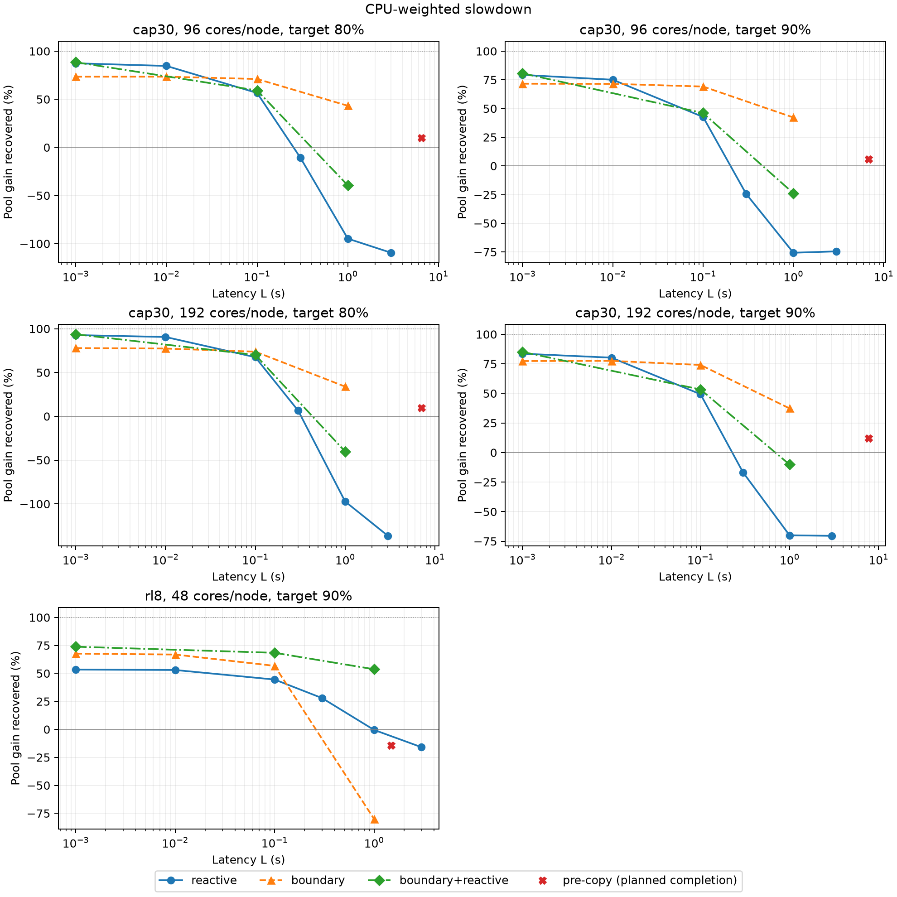
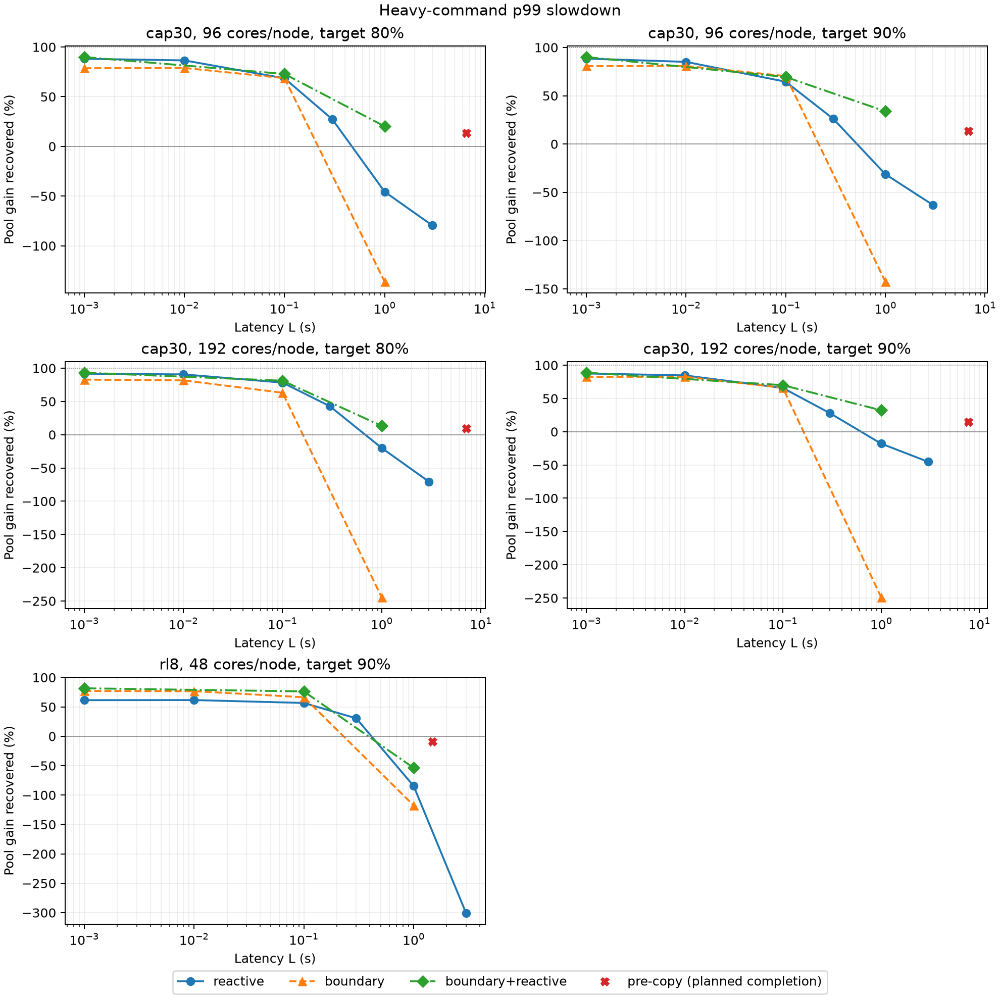
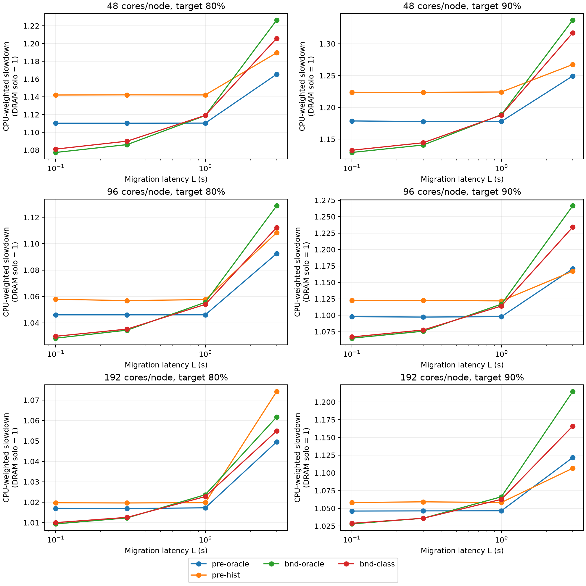
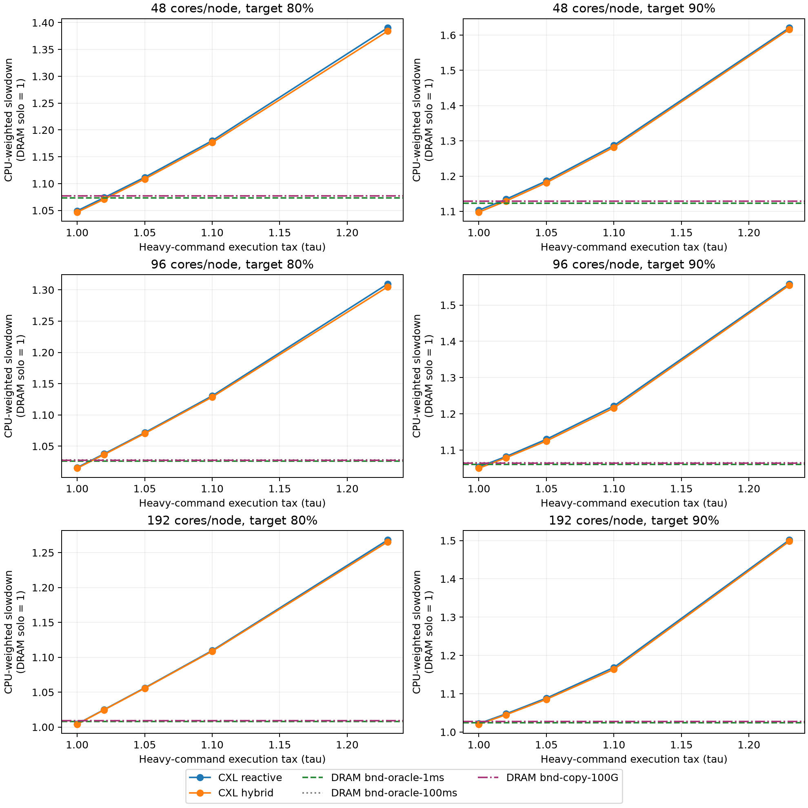

# 명령 경계 배치 대 실행 중 hand-off, 같은 tail의 사용률 (2026-11-13)

simulator 분석이다. 다언어 264 trace의 10 ms CPU profile과 기록된 LLM 간격을 재생했다. 실측 VM·lab·Docker를 새로 실행하지 않았다. 전체 수치는 [summary.json](summary.json), 모든 작업량·코어·사용률·변형의 표는 [tables.md](tables.md)에 있다.

## 0. 결론

- **경계 배치가 pool 이득의 대부분을 가져간다.** cap30·목표 80%에서 oracle 경계 1 ms의 CPU 가중 slowdown은 48/96/192코어 순으로 1.0732 / 1.0260 / 1.0079다. pool 이득의 68.8~77.9%를 가져가고, reactive를 더하면 11.9~13.7%p를 추가로 가져간다.
- **작은 노드에서는 reactive가 최대 사용률을 더 올린다.** 48코어·CPU 가중 slowdown ≤ 1.10의 최대 실제 사용률은 none 62.5%, oracle 경계 84.4%, reactive 87.5%, 결합 88.1%다. none 대비 노드 절감은 경계 26.0%, reactive 28.6%, 결합 29.1%다. 경계만 쓸 때와 비교한 결합 정책의 추가 노드 절감은 4.2%다.
- **192코어의 같은 SLO에서는 경계 배치와 reactive의 최대 사용률 차이가 아직 식별되지 않는다.** none은 87.7%이고 두 정책은 모두 측정 상단 약 94%까지 통과했다. 이때 none 대비 노드 절감의 확인된 하한은 약 7%다. 측정 밖의 최대점은 외삽하지 않는다.
- **정지 시간이 길면 CPU 가중 평균과 tail의 판단이 갈린다.** 192코어·목표 90%의 경계 L=1 s는 CPU 가중 1.066이지만 heavy p99 3.09로, none의 1.61보다 나쁘다.
- **class 예측도 oracle에 가까운 회수율을 보인다.** 목표 80%에서 class 경계 1 ms는 pool의 CPU 가중 이득 67.5~76.5%를 가져간다. 명령 recall 84.7%, precision 77.6%, CPU 가중 recall 98.5%다.
- **Python RL의 최대 사용률은 짧은 구간만으로 확정하지 않았다.** 1 vCPU·48코어·목표 90%·gap 1의 none은 측정 900초에서 실제 U 62.9%·CPU 가중 1.007, 4,500초에서 U 86.7%·CPU 가중 1.281다. 긴 구간은 이상적 pool도 1.188으로 지연이 남았다. ramp를 3,600초로 넓힌 추가 검증은 none U 88.0%·CPU 가중 1.055로 초기조건에도 민감했다. 목표 90%의 밀도 약 41 sandbox/코어·9.1 GiB/코어는 사용자 기준 bud05의 4 GB/코어도 넘는다.

**12번 추가 결론([7절](#7-llm-대기-중-이동-경계-복사와-cxl-tax-12번)): 위 hand-off 수치는 CXL 실행 tax를 제외한 경합 비교다.** 대기 중 pre-hist 1초는 목표90%에서 pool CPU 가중 이득의 38.5/39.6/45.1%(48/96/192코어)를 회수했다. heavy +23% tax를 낸 CXL 결합의 CPU 가중 slowdown은 1.616/1.555/1.498로 DRAM 경계보다 나빴다. 100G 경계 복사는 container 상태·전용 대역폭을 가정한 유리한 하한이며, 이 가정에서는 경계1ms에 가까운 이득을 얻는다.

## 1. 질문

1. 명령 시작 때 무거운 CPU를 예측해 한 번 옮기면, 실행 중 reactive hand-off와 이상적 공유의 이득을 얼마나 대체하는가?
2. CPU 가중 slowdown ≤ 1.05/1.10, heavy 명령 p99 ≤ 1.5/2.0을 유지하는 최대 실제 사용률과 필요한 노드 수는 얼마인가?
3. 경계 배치 뒤 남는 손실은 시작 때의 자리 부족, 이후의 겹침, 가벼운 명령 중 어디에 있는가?

## 2. 방법

| 항목 | 설정 |
|---|---|
| simulator | [`fleet.py`](../../../experiments/contention/fleet.py)의 fluid thread water-filling, carry=True, kernel_wait 없음. 기본 경계 배치는 꺼져 있고 기존 지표를 유지한다 |
| 다언어 입력 | 10-14 Docker DRAM 264 trace / 13,600 명령. 현재 checkout에 원본이 없어 옛 checkout을 읽기 전용으로 사용. [`cap_sweep.py`](../../../experiments/contention/cap_sweep.py)의 같은 10 ms profile과 cap stretch |
| cluster | 16노드 × 48/96/192코어. 새 sandbox는 floating power-of-2, 정책 쌍에 같은 seed와 안정적인 placement RNG |
| 경계 | heavy 명령의 첫 step에 한 번. boot 제외. 직전 수요, margin=1코어, 모든 목적지 중 최선(JSQ). 목적지에 폭을 예약해 같은 step의 중복 예약 방지. 이동 중 reactive 선택 제외 |
| 예측 | oracle: profile CPU ≥ 1 s, 폭=CPU/solo 길이. class: 옛 `cmdkind.kind()`로 test/build/install, 폭은 같은 repo의 다른 trace의 class-heavy 평균 폭 중앙값. 없으면 다른 모든 trace의 중앙값. 자기 trace를 학습에서 제외 |
| 반응 | hand-off 실제 정지 10 ms, detect 50 ms, hold 1 s, max_batch=8. strict_handoff=True로 step 말 결정의 경계를 보정하고 source CPU 2 ms도 정확한 budget으로 계산. 기본 False는 기존 결과를 보존. pre-copy는 detect 500 ms / hold 5 s, 100 Gb/s NIC와 trace별 guest 메모리 |
| 경계 비용 | L=1/10/100/1000 ms. source CPU 입력은 1 ms(10 ms 변형은 2 ms). 100/1000 ms는 지연 효과를 보기 위해 CPU 비용을 1 ms로 고정. 경계 정지는 부분 step으로 반영하며 명령 종료 step의 남는 시간도 보간 |
| 시간·seed | cap30/cap16: ramp 600 + 측정 5,400 s, seed 2. 새 RL 비교: RL1 600+900 s, RL8 600+300 s. 정상적인 기존 RL1 none/pool/bnd100의 4,500 s 결과는 긴 구간 control로 보존. 동기 step: 1,800+7,200 s. 총 1448개 완료 설정. 미완료 seed 쌍 0개는 표에서 제외 |
| 지표 | 측정 구간 안에서 시작하고 끝난 명령. solo는 해당 정책의 segment 길이, CPU 가중 평균은 profile CPU-s로 가중. 분위수는 seed별 분위수 두 개의 산술평균. lost=(대기+정지 중 못 한 CPU)/실행 CPU |
| timeout | main은 기존 cap sweep처럼 timeout 비활성(1e6 s). 기본 simulator의 pause 후 timeout 확인 동작을 보존하고, strict_timeout=True인 60 s 절단을 192코어·80/90%에서 별도 비교. strict 모드는 정지 중에도 60 s에서 자른다. 잘린 명령의 전체 solo 분모는 유지하므로 slowdown이 낮게 편향될 수 있음 |
| SLO | x=run_cores_per_node/cores, 측정점 사이 선형 보간. 노드 비=N_X/N_none=U_none/U_X. 최고점 통과는 최대 사용률의 하한, 이에 따른 노드 비는 상한. 최저점도 실패하면 구간 내 최대점을 산출하지 않음 |

[`boundary.py`](../../../experiments/contention/boundary.py)는 grid 생성·재개·부하 검사를 담당한다. 입력과 코드 SHA256은 summary의 metadata에 남겼다. 수정의 영향을 받지 않아 보존한 기존 행의 config ID와 당시 metadata는 retained_input_provenance에 따로 보존했다. cap16의 단독 tool 시간 비는 **1.017698**이며 contention slowdown과 별도다. 이동/s는 16노드 전체의 측정 구간 합이다.

약 4시간의 grid 예산에서 지연 보정의 재계산과 seed 2를 유지하기 위해 RL 측정 구간을 줄였다. 긴 구간의 정상 control을 함께 보존했지만, 짧은 구간과 일치한다고 가정하지 않는다. 최초 단일 설정 wall은 다언어 81.44초, RL의 600초 측정 benchmark는 360.51초였다(입력 준비 제외, JIT가 발생하면 포함).

## 3. 결과

### 3.1 같은 목표 사용률 80%의 명령 지연과 손실

| 코어 | 정책 | 실제 U % | CPU 가중 | heavy p99 | 잃은 CPU % | 경계 이동/s | reactive 이동/s |
|---|---|---|---|---|---|---|---|
| 48 | none | 77.3 | 1.230 | 2.294 | 34.40 | 0.00 | 0.00 |
| 48 | pool | 80.4 | 1.002 | 1.038 | 0.35 | 0.00 | 0.00 |
| 48 | bnd-oracle-1ms | 79.4 | 1.073 | 1.330 | 13.10 | 6.94 | 0.00 |
| 48 | bnd-class-1ms | 79.3 | 1.076 | 1.407 | 13.57 | 7.32 | 0.00 |
| 48 | reactive | 79.7 | 1.048 | 1.223 | 7.99 | 0.00 | 43.03 |
| 48 | bnd-oracle-1ms+reactive | 79.7 | 1.046 | 1.195 | 7.65 | 6.07 | 41.15 |
| 96 | none | 78.4 | 1.098 | 1.669 | 14.70 | 0.00 | 0.00 |
| 96 | pool | 79.7 | 1.000 | 1.003 | 0.02 | 0.00 | 0.00 |
| 96 | bnd-oracle-1ms | 79.4 | 1.026 | 1.145 | 4.60 | 9.04 | 0.00 |
| 96 | bnd-class-1ms | 79.3 | 1.028 | 1.181 | 4.89 | 9.62 | 0.00 |
| 96 | reactive | 79.6 | 1.015 | 1.092 | 2.55 | 0.00 | 31.93 |
| 96 | bnd-oracle-1ms+reactive | 79.6 | 1.014 | 1.079 | 2.39 | 6.29 | 30.22 |
| 192 | none | 79.4 | 1.036 | 1.324 | 5.43 | 0.00 | 0.00 |
| 192 | pool | 79.8 | 1.000 | 1.000 | 0.00 | 0.00 | 0.00 |
| 192 | bnd-oracle-1ms | 79.8 | 1.008 | 1.056 | 1.39 | 9.85 | 0.00 |
| 192 | bnd-class-1ms | 79.8 | 1.008 | 1.068 | 1.47 | 10.71 | 0.00 |
| 192 | reactive | 79.8 | 1.003 | 1.030 | 0.61 | 0.00 | 18.30 |
| 192 | bnd-oracle-1ms+reactive | 79.8 | 1.003 | 1.025 | 0.55 | 4.44 | 17.39 |

전체 사용률 점 및 cap16/Python RL은 [metrics.csv](metrics.csv)에 있다. CPU 가중 평균, heavy p99, lost CPU는 서로 다른 가중 방식의 지표다.

### 3.2 pool 이득 중 되찾은 비율

각 cell은 **CPU 가중 / heavy p99 회수율(%)**이다. (none − X)/(none − pool)로 계산했다. 음수나 100% 초과를 자르지 않고, 분모가 거의 없으면 산출하지 않는다.

| 코어 | 목표 U % | bnd-oracle-1ms | bnd-class-1ms | reactive | bnd-oracle-1ms+reactive |
|---|---|---|---|---|---|
| 48 | 80 | 68.8 / 76.8 | 67.5 / 70.6 | 79.7 / 85.3 | 80.8 / 87.5 |
| 48 | 90 | 68.6 / 80.0 | 67.7 / 73.9 | 74.6 / 86.2 | 76.1 / 89.1 |
| 96 | 80 | 73.5 / 78.7 | 71.7 / 73.2 | 84.7 / 86.5 | 85.8 / 88.5 |
| 96 | 90 | 71.6 / 80.7 | 70.9 / 76.5 | 75.1 / 85.0 | 77.2 / 88.0 |
| 192 | 80 | 77.9 / 82.9 | 76.5 / 79.2 | 90.6 / 90.7 | 91.6 / 92.4 |
| 192 | 90 | 77.4 / 82.5 | 76.5 / 79.1 | 80.2 / 84.7 | 82.1 / 86.9 |


### 3.3 SLO를 지키는 최대 실제 사용률과 노드 수

cell은 **최대 실제 U / none 대비 필요한 노드 수 비**다. `≥U / ≤비`는 grid 상단까지 통과한 하한/상한이다. 둘 다 최대점을 찾지 못한 비교의 노드 비는 비워 뒀다. 네 SLO 전체와 cap16/RL은 [slo.csv](slo.csv)에 있다.

| SLO | 코어 | none | pool | bnd-oracle-1ms | bnd-class-1ms | reactive | bnd-oracle-1ms+reactive | pre-hist-1s | pre-hist-1s+bnd-class-1ms | pre-hist-1s+bnd-class-100ms | bnd-copy-25G | bnd-copy-100G |
|---|---|---|---|---|---|---|---|---|---|---|---|---|
| CPU 가중 ≤ 1.05 | 48 | 51.2% / 1.000 | ≥93.5% / ≤0.548 | 72.2% / 0.710 | 71.0% / 0.722 | 80.0% / 0.641 | 80.5% / 0.636 | 구간 내 없음 | 70.5% / 0.727 | 구간 내 없음 | 구간 내 없음 | 71.3% / 0.719 |
| CPU 가중 ≤ 1.05 | 96 | 70.0% / 1.000 | ≥94.6% / ≤0.739 | 86.8% / 0.806 | 86.4% / 0.810 | 88.5% / 0.790 | 89.3% / 0.783 | 76.5% / 0.915 | 84.2% / 0.831 | 81.5% / 0.858 | 84.1% / 0.832 | 86.0% / 0.814 |
| CPU 가중 ≤ 1.05 | 192 | 82.0% / 1.000 | ≥95.1% / ≤0.862 | 94.2% / 0.870 | 94.0% / 0.872 | 93.5% / 0.876 | 94.3% / 0.869 | 미실험 | 미실험 | 미실험 | 미실험 | 미실험 |
| CPU 가중 ≤ 1.05 | 256 | 85.4% / 1.000 | ≥95.0% / ≤0.899 | ≥94.5% / ≤0.904 | 미실험 | ≥94.4% / ≤0.905 | 미실험 | 미실험 | 미실험 | 미실험 | 미실험 | 미실험 |
| CPU 가중 ≤ 1.1 | 48 | 62.5% / 1.000 | ≥93.5% / ≤0.668 | 84.4% / 0.740 | 84.0% / 0.743 | 87.5% / 0.714 | 88.1% / 0.709 | 71.8% / 0.870 | 80.8% / 0.773 | 79.4% / 0.786 | 81.7% / 0.765 | 83.9% / 0.745 |
| CPU 가중 ≤ 1.1 | 96 | 78.6% / 1.000 | ≥94.6% / ≤0.831 | ≥93.3% / ≤0.842 | ≥93.3% / ≤0.843 | ≥93.4% / ≤0.842 | ≥93.4% / ≤0.841 | 85.6% / 0.918 | 90.7% / 0.866 | ≥88.7% / ≤0.886 | 91.2% / 0.861 | 93.0% / 0.845 |
| CPU 가중 ≤ 1.1 | 192 | 87.7% / 1.000 | ≥95.1% / ≤0.923 | ≥94.3% / ≤0.930 | ≥94.3% / ≤0.930 | ≥94.3% / ≤0.931 | ≥94.3% / ≤0.930 | 미실험 | 미실험 | 미실험 | 미실험 | 미실험 |
| CPU 가중 ≤ 1.1 | 256 | 90.5% / 1.000 | ≥95.0% / ≤0.952 | ≥94.5% / ≤0.958 | 미실험 | ≥94.4% / ≤0.958 | 미실험 | 미실험 | 미실험 | 미실험 | 미실험 | 미실험 |
| heavy p99 ≤ 1.5 | 48 | 52.8% / 1.000 | ≥93.5% / ≤0.565 | 88.7% / 0.596 | 85.1% / 0.621 | 91.6% / 0.577 | ≥91.8% / ≤0.576 | 구간 내 없음 | 82.5% / 0.640 | 80.9% / 0.653 | 구간 내 없음 | 82.3% / 0.642 |
| heavy p99 ≤ 1.5 | 96 | 72.3% / 1.000 | ≥94.6% / ≤0.764 | ≥93.3% / ≤0.774 | ≥93.3% / ≤0.775 | ≥93.4% / ≤0.774 | ≥93.4% / ≤0.774 | 85.3% / 0.847 | ≥92.9% / ≤0.778 | ≥88.7% / ≤0.815 | 79.5% / 0.909 | 92.1% / 0.785 |
| heavy p99 ≤ 1.5 | 192 | 85.6% / 1.000 | ≥95.1% / ≤0.900 | ≥94.3% / ≤0.907 | ≥94.3% / ≤0.908 | ≥94.3% / ≤0.908 | ≥94.3% / ≤0.907 | 미실험 | 미실험 | 미실험 | 미실험 | 미실험 |
| heavy p99 ≤ 1.5 | 256 | 89.5% / 1.000 | ≥95.0% / ≤0.941 | ≥94.5% / ≤0.947 | 미실험 | ≥94.4% / ≤0.948 | 미실험 | 미실험 | 미실험 | 미실험 | 미실험 | 미실험 |
| heavy p99 ≤ 2 | 48 | 70.3% / 1.000 | ≥93.5% / ≤0.752 | ≥91.5% / ≤0.769 | ≥91.4% / ≤0.769 | ≥91.7% / ≤0.767 | ≥91.8% / ≤0.766 | 86.6% / 0.812 | ≥90.9% / ≤0.774 | ≥87.0% / ≤0.808 | 83.3% / 0.844 | ≥91.4% / ≤0.770 |
| heavy p99 ≤ 2 | 96 | 86.5% / 1.000 | ≥94.6% / ≤0.914 | ≥93.3% / ≤0.927 | ≥93.3% / ≤0.927 | ≥93.4% / ≤0.927 | ≥93.4% / ≤0.926 | ≥92.0% / ≤0.940 | ≥92.9% / ≤0.931 | ≥88.7% / ≤0.976 | 89.1% / 0.972 | ≥93.3% / ≤0.928 |
| heavy p99 ≤ 2 | 192 | ≥92.4% | ≥95.1% | ≥94.3% | ≥94.3% | ≥94.3% | ≥94.3% | 미실험 | 미실험 | 미실험 | 미실험 | 미실험 |
| heavy p99 ≤ 2 | 256 | ≥92.8% | ≥95.0% | ≥94.5% | 미실험 | ≥94.4% | 미실험 | 미실험 | 미실험 | 미실험 | 미실험 | 미실험 |


### 3.4 이동 지연, view, 폭, power-of-2

목표 90%, oracle 경계만 비교했다.

| 코어 | L | CPU 가중 | heavy p99 |
|---|---|---|---|
| 48 | 1ms | 1.124 | 1.471 |
| 48 | 10ms | 1.123 | 1.469 |
| 48 | 100ms | 1.129 | 1.575 |
| 48 | 1s | 1.189 | 3.564 |
| 96 | 1ms | 1.060 | 1.256 |
| 96 | 10ms | 1.061 | 1.256 |
| 96 | 100ms | 1.065 | 1.354 |
| 96 | 1s | 1.117 | 3.366 |
| 192 | 1ms | 1.025 | 1.123 |
| 192 | 10ms | 1.024 | 1.123 |
| 192 | 100ms | 1.028 | 1.222 |
| 192 | 1s | 1.066 | 3.090 |

192코어에서 기본 view=0/평균 폭/JSQ를 한 요소씩 바꾼 결과다.

| 목표 U % | 정책 | CPU 가중 | heavy p99 |
|---|---|---|---|
| 80 | bnd-oracle-1ms | 1.008 | 1.056 |
| 80 | bnd-oracle-1ms-view1 | 1.007 | 1.047 |
| 80 | bnd-oracle-1ms-peak | 1.007 | 1.055 |
| 80 | bnd-oracle-1ms-k2 | 1.009 | 1.061 |
| 90 | bnd-oracle-1ms | 1.025 | 1.123 |
| 90 | bnd-oracle-1ms-view1 | 1.021 | 1.105 |
| 90 | bnd-oracle-1ms-peak | 1.024 | 1.126 |
| 90 | bnd-oracle-1ms-k2 | 1.028 | 1.126 |


### 3.5 경계 배치 뒤 남는 잃은 CPU

다음 표는 cap30 oracle 1 ms에서 전체 lost CPU를 분모로 한 비율이다. (a)는 선택된 노드에 **실제 평균 폭**만큼 시작 여유가 있었고, 이후 그 노드에서 다른 명령 시작이 관측된 경우, (b)는 시작 때 그 폭이 들어갈 노드가 하나도 없던 경우, (c)는 CPU < 1 s 명령이다. boot, margin 때문에 맞는 노드가 있어도 못 들어간 경우, 후속 시작이 아직 관측되지 않은 시작 여유 명령은 잔차에 보존했다. (a)+(b)+(c)+잔차=100%다.

| 코어 | 목표 U % | (a) 이후 명령 시작 관측 % | (b) 맞는 노드 없음 % | (c) light % | 잔차 % | 시작 여유 전체 % |
|---|---|---|---|---|---|---|
| 48 | 80 | 97.62 | 1.60 | 0.72 | 0.06 | 97.68 |
| 48 | 90 | 90.80 | 8.32 | 0.81 | 0.07 | 90.84 |
| 96 | 80 | 99.28 | 0.03 | 0.67 | 0.02 | 99.30 |
| 96 | 90 | 96.88 | 2.32 | 0.78 | 0.01 | 96.89 |
| 192 | 80 | 99.36 | 0.00 | 0.63 | 0.01 | 99.37 |
| 192 | 90 | 98.84 | 0.41 | 0.75 | 0.01 | 98.85 |

(a)는 관측에 따른 분류다. 후속 명령이 해당 손실 step까지 계속 실행 중인지를 추적한 counterfactual 분해가 아니므로 이후 도착의 인과 효과를 단독으로 증명하지 않는다. 같은 명령의 수요가 평균 폭보다 커지는 효과도 함께 있다. 마지막 열은 후속 시작 여부와 무관한 시작 여유 전체다. 모든 작업량의 분해는 [causes.csv](causes.csv)에 있다. heavy 명령의 폭 변화와 class 오차는 다음과 같다. 폭 오차는 class-heavy 예측 명령에 대해 계산했고, 비율 오차는 실제 평균 폭이 양수인 명령을 사용했다.

| 항목 | p10 | p50 | p90 | p99 |
|---|---|---|---|---|
| 예측 폭 / 실제 평균 폭 | 0.487 | 1.002 | 1.960 | 11.017 |
| 예측 폭 − 실제 평균 폭 (코어) | -1.994 | 0.002 | 1.236 | 4.439 |
| heavy 수요 p90 / 평균 | 1.103 | 1.644 | 2.650 | 4.174 |
| heavy 수요 CV | 0.186 | 0.572 | 1.352 | 3.117 |
| rl1 heavy 수요 p90 / 평균 | 1.014 | 1.018 | 1.483 | 3.427 |
| rl1 heavy 수요 CV | 0.015 | 0.030 | 0.596 | 1.901 |
| rl8 heavy 수요 p90 / 평균 | 1.078 | 1.161 | 1.708 | 3.045 |
| rl8 heavy 수요 CV | 0.070 | 0.183 | 0.656 | 1.157 |

class의 leave-one-trace-out fallback은 4 trace였다. 실제 heavy 명령은 1,552개로 CPU의 98.4%다.

### 3.6 cap16

cap16은 solo tool 시간을 1.77% 늘린다. contention 지표와 SLO는 cap16 solo를 기준으로 한다. cap30과의 총 지연 비교에서는 별도로 보고한 cap 비용도 함께 고려해야 한다. 96/192코어 × 70/80/85/90/95% × 여섯 정책 × 두 seed는 [tables.md](tables.md)에 모두 있다.

### 3.7 Python RL과 메모리 밀도

지정된 `20261026T114153Z-solo-kx2i0s5k/run.json`은 **1 vCPU jq 단일 trace**다. 확인된 iter2 run `20261026T133107Z-solo-5i8p_9nm`(440 trace)에서 `candidates-rl.json`과 기존 usable 기준으로 **420개**를 읽었다. 8 vCPU rollout `20261104T092752Z-solo-pdkup4sy`는 같은 candidates와 **5개**만 겹친다. `20261109T015041Z`는 reward 평가용이라 사용하지 않았다. 1/8 vCPU는 같은 표본의 대조 실험이 아니다.

다음은 192코어의 밀도다. 48/96코어의 반올림 차이와 모든 정책의 실제 U는 [density.csv](density.csv)에 있다. GiB/코어 = sandbox/코어 × 228 MiB / 1024이며 [10-27 메모리 측정](../virtual-node-rl-20261026/guest-memory/README.md)의 VM 평균을 사용했으며 host cache 등은 더하지 않았다. bud05의 사용자 기준은 4 GB/코어다.

| 입력 | LLM gap 배수 | 목표 U % | 실제 U % | sandbox/코어 | GiB/코어 |
|---|---|---|---|---|---|
| rl1 | 0.25 | 50 | 49.4 | 6.15 | 1.37 |
| rl1 | 0.25 | 60 | 59.3 | 7.38 | 1.64 |
| rl1 | 0.25 | 70 | 69.4 | 8.61 | 1.92 |
| rl1 | 0.25 | 80 | 79.2 | 9.84 | 2.19 |
| rl1 | 0.25 | 90 | 89.4 | 11.07 | 2.46 |
| rl1 | 1 | 50 | 35.0 | 22.75 | 5.07 |
| rl1 | 1 | 60 | 42.1 | 27.30 | 6.08 |
| rl1 | 1 | 70 | 49.2 | 31.85 | 7.09 |
| rl1 | 1 | 80 | 56.3 | 36.40 | 8.10 |
| rl1 | 1 | 90 | 63.3 | 40.95 | 9.12 |
| rl8 | 0.25 | 50 | 48.2 | 7.24 | 1.61 |
| rl8 | 0.25 | 60 | 57.8 | 8.69 | 1.93 |
| rl8 | 0.25 | 70 | 67.3 | 10.14 | 2.26 |
| rl8 | 0.25 | 80 | 77.0 | 11.58 | 2.58 |
| rl8 | 0.25 | 90 | 86.6 | 13.03 | 2.90 |
| rl8 | 1 | 50 | 34.6 | 27.09 | 6.03 |
| rl8 | 1 | 60 | 41.4 | 32.51 | 7.24 |
| rl8 | 1 | 70 | 48.3 | 37.93 | 8.45 |
| rl8 | 1 | 80 | 55.1 | 43.35 | 9.65 |
| rl8 | 1 | 90 | 62.1 | 48.77 | 10.86 |

목표 90%에서의 contention 결과:

| 입력 | gap | 코어 | none 실제 U % | none CPU 가중 | pool CPU 가중 | bnd1ms CPU 가중 | reactive CPU 가중 |
|---|---|---|---|---|---|---|---|
| rl1 | 1 | 48 | 62.9 | 1.007 | 1.000 | 1.001 | 1.002 |
| rl1 | 1 | 96 | 63.0 | 1.001 | 1.000 | 1.000 | 1.000 |
| rl1 | 1 | 192 | 63.3 | 1.000 | 1.000 | 1.000 | 1.000 |
| rl1 | 0.25 | 48 | 88.6 | 1.050 | 1.000 | 1.008 | 1.013 |
| rl1 | 0.25 | 96 | 89.3 | 1.020 | 1.000 | 1.003 | 1.006 |
| rl1 | 0.25 | 192 | 89.4 | 1.008 | 1.000 | 1.001 | 1.002 |
| rl8 | 1 | 48 | 62.6 | 1.003 | 1.000 | 1.001 | 1.001 |
| rl8 | 1 | 96 | 62.4 | 1.000 | 1.000 | 1.000 | 1.000 |
| rl8 | 1 | 192 | 62.1 | 1.000 | 1.000 | 1.000 | 1.000 |
| rl8 | 0.25 | 48 | 86.8 | 1.028 | 1.000 | 1.010 | 1.015 |
| rl8 | 0.25 | 96 | 86.9 | 1.007 | 1.000 | 1.002 | 1.005 |
| rl8 | 0.25 | 192 | 86.6 | 1.001 | 1.000 | 1.000 | 1.001 |

1 vCPU·gap 1·48코어·목표 90%의 oracle 경계 1 ms / reactive는 CPU 가중 1.001 / 1.002, heavy p99 1.02 / 1.04다. 새 구간 pool의 CPU 가중은 1.000다. 기존 긴 구간 control과도 함께 비교해야 한다. 원인을 초기 상태나 특정 LLM phase 하나로 확정할 추가 시계열 계측은 하지 않았다. 실제 U와 목표의 차이도 그대로 보여 준다. 측정 상단까지 SLO를 만족하면 최대 사용률의 하한만 알 수 있으며, 그 경우 추가 노드 절감을 확정하지 않았다. 8 vCPU는 표본 5개와 짧은 측정 구간의 보조 결과다.

gap 0.25·48코어의 목표 90%에서는 CPU 가중 slowdown이 none 1.050, 경계 1 ms 1.008, reactive 1.013다. 이 조건은 경계 배치가 reactive보다 좋다. 이동 지연이 다른 두 정책의 비교이며, reactive가 모든 작업량에서 우세하다는 결론은 내리지 않는다.

긴 구간에서 변하지 않는 정책(none/pool/bnd100)의 정상 결과도 보존했다. 서로 다른 측정 길이를 섞어서 SLO를 보간하지 않았다.

| 코어 | 측정 s | 정책 | 실제 U % | CPU 가중 | heavy p99 |
|---|---|---|---|---|---|
| 48 | 900 | none | 62.9 | 1.007 | 1.154 |
| 48 | 900 | pool | 62.9 | 1.000 | 1.000 |
| 48 | 900 | bnd-oracle-100ms | 62.9 | 1.002 | 1.068 |
| 48 | 4500 | none | 86.7 | 1.281 | 3.259 |
| 48 | 4500 | pool | 86.5 | 1.188 | 2.524 |
| 48 | 4500 | bnd-oracle-100ms | 86.9 | 1.205 | 2.582 |
| 192 | 900 | none | 63.3 | 1.000 | 1.006 |
| 192 | 900 | pool | 63.3 | 1.000 | 1.000 |
| 192 | 900 | bnd-oracle-100ms | 63.3 | 1.000 | 1.001 |
| 192 | 4500 | none | 86.4 | 1.195 | 2.665 |
| 192 | 4500 | pool | 86.3 | 1.173 | 2.428 |
| 192 | 4500 | bnd-oracle-100ms | 86.4 | 1.177 | 2.478 |


초기조건 추가 검증: 같은 48코어·목표 90%·gap 1, 측정 900초에서 ramp를 600→3600초로 바꿨다. ramp는 sandbox 최초 출발의 분산 범위와 측정 시작을 함께 정한다. 단일 측정점이므로 최대 사용률은 외삽하지 않는다.

| 정책 | 실제 U % | CPU 가중 | heavy p99 |
|---|---|---|---|
| bnd-oracle-1ms | 88.1 | 1.007 | 1.046 |
| none | 88.0 | 1.055 | 1.520 |
| pool | 87.7 | 1.000 | 1.001 |
| reactive | 88.1 | 1.013 | 1.097 |


### 3.8 동기 RL step

cap sweep 4절의 설정: 192코어, async 밀도 목표 200%, batch16×group8, train 30 s, 같은 trace를 group 안에서 복제했다.

| 정책 | 실제 U % | step p50 | step p99 |
|---|---|---|---|
| bnd-oracle-100ms | 75.1 | 1.004 | 1.023 |
| bnd-oracle-1ms | 75.1 | 1.004 | 1.023 |
| bnd-oracle-1ms+reactive | 75.2 | 1.002 | 1.018 |
| none | 74.4 | 1.012 | 1.082 |
| pool | 75.3 | 1.001 | 1.013 |
| reactive | 75.2 | 1.003 | 1.020 |


### 3.9 60초 timeout 민감도

192코어의 절단된 명령을 포함한 지표다. main SLO 산정에는 이 표를 사용하지 않았다.

| 목표 U % | 정책 | 실제 U % | timeout 명령 % | CPU 가중 | heavy p99 |
|---|---|---|---|---|---|
| 80 | bnd-oracle-1ms | 79.7 | 0.548 | 1.007 | 1.057 |
| 80 | bnd-oracle-1ms+reactive | 79.8 | 0.544 | 1.003 | 1.024 |
| 80 | none | 79.2 | 0.562 | 1.031 | 1.326 |
| 80 | reactive | 79.8 | 0.544 | 1.003 | 1.030 |
| 90 | bnd-oracle-1ms | 89.4 | 0.558 | 1.021 | 1.121 |
| 90 | bnd-oracle-1ms+reactive | 89.5 | 0.554 | 1.017 | 1.095 |
| 90 | none | 87.7 | 0.593 | 1.079 | 1.556 |
| 90 | reactive | 89.4 | 0.556 | 1.019 | 1.109 |


## 4. 한계

- CPU runqueue 경합을 나타내는 fluid simulator다. cache·주파수·메모리 대역폭·CXL tax·실제 restore 비용·고밀도 생성 비용은 들어 있지 않다. VM·Docker 실측 검증을 이번 작업에서 새로 하지 않았다.
- 기존 reactive 경로는 10 ms 입력이 추가 정지 0 step으로 계산되는 경계 양자화가 있었다. 이번 표의 반응 정책은 strict_handoff=True로 실제 1-step(10 ms) 정지를 적용했다. 기본 False는 이전 결과 보존용이다. 이전의 낙관적인 reactive 행은 최종 집계에서 제외했다.
- cap30은 관측할 수 있었던 최대 30코어를 뜻한다. 더 큰 host에서 명령의 병렬 폭이 더 커지는 효과는 외삽하지 않았다.
- 수요·배치 결정은 10 ms 격자다. 1 ms 경계 정지는 step CPU 예산에서 부분 정지로 반영하고 마지막 step을 보간하지만, 뒤 segment의 시작은 계속 격자에 맞춘다.
- 경계와 strict reactive의 source CPU 비용은 같은 부분 step budget으로 처리했다. 기존 기본값에서만 원래의 CPU task 양자화를 유지한다. 실제 overhead/run은 metrics.csv에 보존했다.
- L=100 ms/1 s는 정지 지연의 민감도이며 특정 restore 구현의 전체 CPU 비용을 재현한 값은 아니다. source CPU를 1 ms로 고정한 이 비교는 CPU 비용이 큰 restore에 유리하다.
- heavy의 평균 폭 oracle도 이후 다른 명령 도착과 자기 명령의 폭 변화를 모른다. (a)/(b)/(c)는 admission 시점 관측에 따른 분류이며 인과적 counterfactual 분해가 아니다.
- 측정 구간 양 끝에서 미완료 명령을 제외하는 선택 효과와 seed 2개의 표본 오차가 있다. seed별 최소/최대는 summary/metrics에 보존했다. 분위수를 모든 seed의 원시 명령으로 합친 값과 구분해야 한다.
- 같은 사용률을 얻는 sandbox 밀도는 CPU 모델에서 정했다. 메모리 수용 가능성과는 별도다. 228 MiB 추정은 1 vCPU 측정에서 왔고 8 vCPU의 실측 평균 메모리를 대신하지 않는다.
- 이전 checkout은 읽기 전용 입력이다. `/Serverless`, `~/cxl-page-cache`, node 1/2 실행을 사용하지 않았다. 모든 simulator 실행은 node 0 bind/nice 19, worker 최대 24였다.

## 5. 재현

Python 3.12, numpy 2.5.4, numba 0.68.1, llvmlite 0.50.0을 현재 checkout의 `.venv`에 설치했다. 기존 raw 입력은 옛 checkout에 있어야 한다. 생성 JSONL은 git 밖 `.local/boundary/`에 두고 요약만 commit했다.

```bash
export PYTHONDONTWRITEBYTECODE=1 OPENBLAS_NUM_THREADS=1 OMP_NUM_THREADS=1 NUMBA_NUM_THREADS=1
boundary_python=.venv/bin/python
boundary_out=experiments/contention/.local/boundary
run0() { numactl --cpunodebind=0 --membind=0 nice -n 19 "$@"; }
run0 "$boundary_python" experiments/contention/fleet.py test
run0 "$boundary_python" experiments/contention/cap_sweep.py test
run0 "$boundary_python" experiments/contention/boundary.py grid --priorities 1 2 --duration-s 5400 --timeout-s 1000000 --grid "$boundary_out/grid.json" --output "$boundary_out/results.jsonl"
run0 "$boundary_python" experiments/contention/boundary.py run --grid "$boundary_out/grid.json" --output "$boundary_out/results.jsonl" --jobs 24
run0 "$boundary_python" experiments/contention/boundary.py grid --priorities 3 --duration-s 900 --timeout-s 1000000 --grid "$boundary_out/rl-grid.json" --output "$boundary_out/rl.jsonl"
run0 "$boundary_python" -c 'import json,pathlib;p=pathlib.Path("experiments/contention/.local/boundary/rl-grid.json");cs=json.loads(p.read_text());[c.update(duration_s=300.0) for c in cs if c["workload"]=="rl8"];p.write_text(json.dumps(cs,indent=1))'
run0 "$boundary_python" experiments/contention/boundary.py run --grid "$boundary_out/rl-grid.json" --output "$boundary_out/rl.jsonl" --jobs 24
run0 "$boundary_python" experiments/contention/boundary.py grid --priorities 4 --ramp-s 1800 --duration-s 7200 --timeout-s 1000000 --grid "$boundary_out/step-grid.json" --output "$boundary_out/step.jsonl"
run0 "$boundary_python" experiments/contention/boundary.py run --grid "$boundary_out/step-grid.json" --output "$boundary_out/step.jsonl" --jobs 24
run0 "$boundary_python" -c 'import json,pathlib;d=pathlib.Path("experiments/contention/.local/boundary");cs=json.loads((d/"grid.json").read_text());cs=[dict(c,timeout_s=60.0,strict_timeout=True) for c in cs if c["priority"]==1 and c["cores"]==192 and c["target_util"] in (80,90)];(d/"timeout-grid.json").write_text(json.dumps(cs,indent=1))'
run0 "$boundary_python" experiments/contention/boundary.py run --grid "$boundary_out/timeout-grid.json" --output "$boundary_out/timeout.jsonl" --jobs 24
# 보존한 긴 RL control 162개도 같은 config ID로 재현한다.
run0 "$boundary_python" - <<'PYCONTROL'
import json
from pathlib import Path
import sys
sys.path.insert(0, "experiments/contention")
from boundary import config_id
root = Path("experiments/contention/.local/boundary")
ids = set(json.loads(Path("docs/results/boundary-vs-handoff-20261113/summary.json").read_text())["long_control_config_ids"])
configs = [dict(c, duration_s=4500.0) for c in json.loads((root / "rl-grid.json").read_text())]
configs = [c for c in configs if config_id(c) in ids]
assert len(configs) == len(ids)
(root / "long-grid.json").write_text(json.dumps(configs, indent=1))
PYCONTROL
run0 "$boundary_python" experiments/contention/boundary.py run --grid "$boundary_out/long-grid.json" --output "$boundary_out/long.jsonl" --jobs 24
# 초기조건 민감도 8설정.
run0 "$boundary_python" - <<'PYWARM'
import json
from pathlib import Path
root = Path("experiments/contention/.local/boundary")
configs = [dict(c, ramp_s=3600.0) for c in json.loads((root / "rl-grid.json").read_text())
           if c["workload"] == "rl1" and c["gap_scale"] == 1 and c["cores"] == 48 and c["target_util"] == 90
           and c["variant"] in ("none", "pool", "reactive", "bnd-oracle-1ms")]
(root / "warm-grid.json").write_text(json.dumps(configs, indent=1))
PYWARM
run0 "$boundary_python" experiments/contention/boundary.py run --grid "$boundary_out/warm-grid.json" --output "$boundary_out/warm.jsonl" --jobs 8
run0 "$boundary_python" docs/results/boundary-vs-handoff-20261113/analyze.py --readme --widths --final
```

run은 config SHA256으로 이미 완료한 설정을 건너뛰고 한 줄마다 flush한다. 큰 grid 전마다 uptime/상위 CPU process를 기록하고, 외부 node 0 사용이 4코어를 넘으면 10분 대기 후 재검사한다. 여전히 바쁘면 exit 75로 후속 grid도 멈춘다. 합성 입력에서 기본값을 보존한 6설정의 이전 버전 대조, self-test, SLO 보간 및 요약 percentile 일치를 검증했다. 실행 시간·서버 시작/종료 기록은 `.codex-runs/10.last.md`에 있다.


## 6. 11번 후속: 이동 지연·상관된 group·외부 용량·256코어

추가 완료 설정 738개. A 112/112, B-pilot 12/12, B 96/96, C 312/312, C-rl 156/156, D 50/50. 표는 완료한 두 seed의 요약 평균이며 미완료 seed 쌍 0개는 제외했다. 10번의 원래 결과는 유지하고 후속 데이터는 summary.followup에 보존했다. 모든 상세 수치는 [followup.csv](followup.csv), [전체 후속 표](followup-tables.md)에 있다.

### 6.1 A — 실행 중 이동 지연 곡선

cap30 192코어·목표90%에서 경계1 ms / reactive1 ms / 병합의 CPU 가중 pool 이득 회수율은 각각 77.4 / 83.6 / 85.1%다.

rl8 48코어·목표90%에서 경계1 ms / reactive1 ms / 병합의 CPU 가중 pool 이득 회수율은 각각 67.6 / 53.4 / 73.8%다.

같은 cap30 조건에서 reactive L=100/300/1000 ms의 회수율은 각각 49.3 / -16.7 / -70.0%다. 긴 정지는 실행 중 재배치의 이득을 없애고 역효과를 낸다.

reactive의 정지 L=1/10/100/300/1000/3000 ms, source CPU=2 ms 고정, detect=50 ms, hold=max(1 s,2L)다. 경계+reactive는 경계1 ms에 reactive L=1/100/1000 ms를 더했다. 1 ms reactive도 부분 step을 사용한다. cap30은 ramp600+측정5400초이고, RL8은 gap0.25·48코어·목표90%, ramp1800+측정3600초다. seed는 모두2개다. A/C/D의 새 sandbox 배치는10번의 floating power-of-2를 유지했다. cap30의 경계 선과 none/pool 기준은 같은 밀도·시간·seed인 10번 결과를 그대로 썼다.



[CPU 그림 PDF](latency-cpu.pdf). y=(none−X)/(none−pool), x는 초 단위 log다. 음수 회수율도 그대로 표시한다. pre-copy 점의 x는 측정 구간 이동의 **평균 예약 완료 지연**(dump+전송+NIC 대기)이다. 이동 결정 시 예약한 지연이므로 완료 전에 rollout이 끝나는 이동도 포함될 수 있다. pre-copy는 그 동안 계속 실행하므로 정지 L인 다른 선과 의미가 다르다. pre-copy는 detect500ms/hold5초/NIC100Gbps이며 source CPU도 dump 비용을 사용한다.



[tail 그림 PDF](latency-tail.pdf), [곡선 데이터](latency.csv). 다음은 목표90%의 수치다. 80%를 포함한 모든 점은 CSV에 있다.

| 입력 | 코어 | 선 | L ms | CPU 회수 % | heavy p99 회수 % |
|---|---|---|---|---|---|
| cap30 | 96 | boundary+reactive | 1.0 | 80.7 | 90.0 |
| cap30 | 96 | boundary+reactive | 100.0 | 46.1 | 69.4 |
| cap30 | 96 | boundary+reactive | 1000.0 | -23.8 | 33.8 |
| cap30 | 96 | pre-copy | 6758.4 | 5.9 | 13.8 |
| cap30 | 96 | reactive | 1.0 | 79.3 | 88.4 |
| cap30 | 96 | reactive | 10.0 | 75.1 | 85.0 |
| cap30 | 96 | reactive | 100.0 | 42.7 | 64.5 |
| cap30 | 96 | reactive | 300.0 | -24.3 | 26.1 |
| cap30 | 96 | reactive | 1000.0 | -75.7 | -31.3 |
| cap30 | 96 | reactive | 3000.0 | -74.5 | -63.1 |
| cap30 | 192 | boundary+reactive | 1.0 | 85.1 | 88.8 |
| cap30 | 192 | boundary+reactive | 100.0 | 53.3 | 70.0 |
| cap30 | 192 | boundary+reactive | 1000.0 | -10.1 | 32.2 |
| cap30 | 192 | pre-copy | 7670.1 | 12.1 | 15.0 |
| cap30 | 192 | reactive | 1.0 | 83.6 | 87.5 |
| cap30 | 192 | reactive | 10.0 | 80.2 | 84.7 |
| cap30 | 192 | reactive | 100.0 | 49.3 | 65.7 |
| cap30 | 192 | reactive | 300.0 | -16.7 | 28.0 |
| cap30 | 192 | reactive | 1000.0 | -70.0 | -17.9 |
| cap30 | 192 | reactive | 3000.0 | -70.4 | -45.2 |
| rl8 | 48 | boundary | 100.0 | 56.7 | 66.4 |
| rl8 | 48 | boundary | 10.0 | 66.8 | 76.7 |
| rl8 | 48 | boundary | 1.0 | 67.6 | 77.1 |
| rl8 | 48 | boundary+reactive | 1.0 | 73.8 | 81.6 |
| rl8 | 48 | boundary+reactive | 100.0 | 68.4 | 76.3 |
| rl8 | 48 | boundary+reactive | 1000.0 | 53.7 | -53.7 |
| rl8 | 48 | boundary | 1000.0 | -80.0 | -117.5 |
| rl8 | 48 | pre-copy | 1474.4 | -14.1 | -8.9 |
| rl8 | 48 | reactive | 1.0 | 53.4 | 61.4 |
| rl8 | 48 | reactive | 10.0 | 53.0 | 61.6 |
| rl8 | 48 | reactive | 100.0 | 44.5 | 56.7 |
| rl8 | 48 | reactive | 300.0 | 28.0 | 30.6 |
| rl8 | 48 | reactive | 1000.0 | -0.5 | -84.5 |
| rl8 | 48 | reactive | 3000.0 | -15.9 | -300.6 |
| cap30 | 96 | boundary | 100.0 | 69.2 | 70.4 |
| cap30 | 96 | boundary | 10.0 | 71.5 | 80.8 |
| cap30 | 96 | boundary | 1.0 | 71.6 | 80.7 |
| cap30 | 96 | boundary | 1000.0 | 42.2 | -142.7 |
| cap30 | 192 | boundary | 100.0 | 74.1 | 65.9 |
| cap30 | 192 | boundary | 10.0 | 77.5 | 82.6 |
| cap30 | 192 | boundary | 1.0 | 77.4 | 82.5 |
| cap30 | 192 | boundary | 1000.0 | 37.3 | -249.1 |

### 6.2 B — 같은 task 사본 G=8을 pack/spread

cap30 목표80%의 같은 sandbox 밀도에서 step p99는 spread none 1.076배, pack none / 경계1 ms / reactive10 ms / 조합은 각각 1.488 / 1.076 / 1.056 / 1.050배다.

rl8 목표80%의 같은 sandbox 밀도에서 step p99는 spread none 1.000배, pack none / 경계1 ms / reactive10 ms / 조합은 각각 1.010 / 1.002 / 1.004 / 1.002배다.

여러 독립 job의 각 step이 batch×G=8×8이며, 16×192코어, train30초, jitter0이다. RL8은 gap0.25를 쓴다. floating=False로 초기 배치를 고정해 placement=pack은 G개를 같은 노드에, spread는 node round-robin으로 둔다. 경계와 reactive는 이후 이동할 수 있다. 두 배치는 같은 task draw·sandbox 밀도·출발 시각을 쓴다. 이 조건은 10번 floating 배치와 구분한다.

RL8의 usable trace는5개이고 서로 다른 group에 하나씩 있어 실제 G=8 전체 묶음은0개다. 따라서 두 작업량 모두 **동일 trace 8개 사본**이다. 실제 서로 다른 rollout의 상관 정도를 측정한 결과가 아니라 강한 상관을 가정한 검사다. 세 밀도의 spread none pilot(seed2)에서 실제U를 보간해 목표70/80% 밀도를 정하고, 각 정책과 pack에 같은 밀도를 적용했다. 실제U와 pilot 보간/외삽 여부는 아래와 summary.followup.density_calibration에 남겼다. 초기 RL pilot의160/220%는 둘 다 포화되어 최종 보정에서 제외하고,80/100/110%의 포화 전 점으로 다시 보정했다. 밀도 순서로 보간해 포화점의 수치 오차로 순서가 뒤집히지 않게 했다. 제외한4설정과 재사용 입력의 코드 해시는 summary.followup에 보존했다. ramp1800초, cap30 측정5400초/RL8 3600초다.

| 입력 | 목표U% | 배치 | 정책 | 실제U% | step p50 | step p99 | CPU 가중 | heavy p99 |
|---|---|---|---|---|---|---|---|---|
| cap30 | 70 | pack | bnd-oracle-100ms | 70.1 | 1.011 | 1.053 | 1.063 | 1.382 |
| cap30 | 70 | pack | bnd-oracle-1ms | 70.1 | 1.011 | 1.054 | 1.061 | 1.329 |
| cap30 | 70 | pack | bnd-oracle-1ms+reactive | 70.9 | 1.003 | 1.014 | 1.014 | 1.139 |
| cap30 | 70 | pack | none | 67.3 | 1.042 | 1.314 | 1.352 | 2.988 |
| cap30 | 70 | pack | pool | 71.0 | 1.001 | 1.007 | 1.004 | 1.078 |
| cap30 | 70 | pack | reactive | 70.9 | 1.004 | 1.017 | 1.017 | 1.163 |
| cap30 | 70 | spread | bnd-oracle-100ms | 71.0 | 1.002 | 1.010 | 1.009 | 1.151 |
| cap30 | 70 | spread | bnd-oracle-1ms | 71.0 | 1.002 | 1.010 | 1.009 | 1.100 |
| cap30 | 70 | spread | bnd-oracle-1ms+reactive | 70.9 | 1.002 | 1.012 | 1.010 | 1.121 |
| cap30 | 70 | spread | none | 70.9 | 1.002 | 1.020 | 1.018 | 1.230 |
| cap30 | 70 | spread | pool | 71.0 | 1.001 | 1.007 | 1.004 | 1.078 |
| cap30 | 70 | spread | reactive | 71.0 | 1.002 | 1.013 | 1.010 | 1.120 |
| cap30 | 80 | pack | bnd-oracle-100ms | 81.6 | 1.017 | 1.077 | 1.092 | 1.524 |
| cap30 | 80 | pack | bnd-oracle-1ms | 81.6 | 1.017 | 1.076 | 1.091 | 1.456 |
| cap30 | 80 | pack | bnd-oracle-1ms+reactive | 82.4 | 1.007 | 1.050 | 1.047 | 1.335 |
| cap30 | 80 | pack | none | 76.3 | 1.070 | 1.488 | 1.540 | 3.607 |
| cap30 | 80 | pack | pool | 82.7 | 1.003 | 1.037 | 1.030 | 1.312 |
| cap30 | 80 | pack | reactive | 82.3 | 1.008 | 1.056 | 1.051 | 1.394 |
| cap30 | 80 | spread | bnd-oracle-100ms | 82.6 | 1.005 | 1.042 | 1.041 | 1.385 |
| cap30 | 80 | spread | bnd-oracle-1ms | 82.6 | 1.004 | 1.043 | 1.039 | 1.314 |
| cap30 | 80 | spread | bnd-oracle-1ms+reactive | 82.5 | 1.006 | 1.046 | 1.042 | 1.335 |
| cap30 | 80 | spread | none | 82.2 | 1.008 | 1.076 | 1.069 | 1.527 |
| cap30 | 80 | spread | pool | 82.7 | 1.003 | 1.037 | 1.030 | 1.312 |
| cap30 | 80 | spread | reactive | 82.5 | 1.006 | 1.049 | 1.042 | 1.344 |
| rl8 | 70 | pack | bnd-oracle-100ms | 70.0 | 1.000 | 1.001 | 1.004 | 1.081 |
| rl8 | 70 | pack | bnd-oracle-1ms | 70.0 | 1.000 | 1.001 | 1.003 | 1.043 |
| rl8 | 70 | pack | bnd-oracle-1ms+reactive | 70.0 | 1.000 | 1.001 | 1.002 | 1.033 |
| rl8 | 70 | pack | none | 70.0 | 1.001 | 1.003 | 1.008 | 1.128 |
| rl8 | 70 | pack | pool | 69.8 | 1.000 | 1.000 | 1.000 | 1.000 |
| rl8 | 70 | pack | reactive | 70.0 | 1.000 | 1.002 | 1.004 | 1.074 |
| rl8 | 70 | spread | bnd-oracle-100ms | 69.8 | 1.000 | 1.000 | 1.000 | 1.000 |
| rl8 | 70 | spread | bnd-oracle-1ms | 69.8 | 1.000 | 1.000 | 1.000 | 1.000 |
| rl8 | 70 | spread | bnd-oracle-1ms+reactive | 69.8 | 1.000 | 1.000 | 1.000 | 1.000 |
| rl8 | 70 | spread | none | 69.8 | 1.000 | 1.000 | 1.000 | 1.000 |
| rl8 | 70 | spread | pool | 69.8 | 1.000 | 1.000 | 1.000 | 1.000 |
| rl8 | 70 | spread | reactive | 69.8 | 1.000 | 1.000 | 1.000 | 1.000 |
| rl8 | 80 | pack | bnd-oracle-100ms | 80.0 | 1.001 | 1.002 | 1.015 | 1.132 |
| rl8 | 80 | pack | bnd-oracle-1ms | 80.1 | 1.001 | 1.002 | 1.012 | 1.101 |
| rl8 | 80 | pack | bnd-oracle-1ms+reactive | 80.0 | 1.001 | 1.002 | 1.009 | 1.081 |
| rl8 | 80 | pack | none | 80.0 | 1.002 | 1.010 | 1.034 | 1.399 |
| rl8 | 80 | pack | pool | 79.8 | 1.000 | 1.000 | 1.000 | 1.004 |
| rl8 | 80 | pack | reactive | 80.0 | 1.002 | 1.004 | 1.018 | 1.211 |
| rl8 | 80 | spread | bnd-oracle-100ms | 79.8 | 1.000 | 1.000 | 1.000 | 1.018 |
| rl8 | 80 | spread | bnd-oracle-1ms | 79.8 | 1.000 | 1.000 | 1.000 | 1.008 |
| rl8 | 80 | spread | bnd-oracle-1ms+reactive | 79.8 | 1.000 | 1.000 | 1.000 | 1.009 |
| rl8 | 80 | spread | none | 79.8 | 1.000 | 1.000 | 1.000 | 1.012 |
| rl8 | 80 | spread | pool | 79.8 | 1.000 | 1.000 | 1.000 | 1.004 |
| rl8 | 80 | spread | reactive | 79.8 | 1.000 | 1.000 | 1.000 | 1.011 |

### 6.3 C — 외부 용량 감소의 가정에 따른 민감도

cap30 목표80%, a=50%, T=10 s, duty20%에서 none의 추가 손실은 23.28%p다. 경계1 ms / reactive10 ms / reactive1 s / 경계+reactive10 ms의 추가 손실 회수율은 각각 73.1 / 82.7 / 16.0 / 83.9%다.

rl8 목표90%, a=50%, T=10 s, duty20%에서 none의 추가 손실은 83.99%p다. 경계1 ms / reactive10 ms / reactive1 s / 경계+reactive10 ms의 추가 손실 회수율은 각각 53.8 / 41.4 / 20.2 / 57.1%다.

**실제 다른 tenant나 harvest 사건의 측정이 아닌, 가정한 사건 모양에 대한 민감도 분석이다.** 각 노드의 사건 시작은 독립 Poisson, 각 사건 길이는 평균T의 지수분포다. 겹친 사건은 하나의 on 상태로 합치고 감소 폭을 중첩하지 않는다. λ=−log(1−duty)/T로 stationary 기대 on 비율을 duty에 맞췄다. 초기 활성 사건 수도 Poisson(λT)로 시작하며 잔여 수명은 지수분포다. T는 개별 사건의 길이이며 겹침으로 합쳐진 on 기간은 더 길 수 있다.

현재 core capacity만 water-fill, reactive excess/목적지, 경계 여유 계산에 반영하고 pool은 용량 합을 공유한다. 미래 사건은 정책에 보이지 않는다. cap30은192코어·목표70/80%·ramp600+측정5400초, RL8은 A와 같은48코어·목표90%·gap0.25·1800+3600초다. 같은 seed·사건 조건은 모든 정책에 같은 용량 시계열이며 SHA256과 노드별 실제 duty를 raw JSONL에 보존한다. workload의 sandbox 밀도는 사건 유무와 정책 사이에 고정했다. 실제U의 분모는 사건 전 명목 코어 수이며, CSV의 available_cores_per_node에 사건 중 평균 가용 코어를 보존했다.

Δ_X=lost_X(사건)−lost_X(무사건), 회수율=(Δ_none−Δ_X)/Δ_none다. lost의 분모는 실행 CPU이며 Δ는 %p로 표시한다. Δ_none≤0이면 회수율을 산출하지 않는다. 음수나100% 초과를 자르지 않는다. 정책별 진행 궤적과 실행 CPU 분모가 달라 작은 Δ의 회수율은 민감하다. 다음은 cap30 목표80%와 완료된 RL 조건이다. cap30 목표70% 및 CPU 가중/heavy p99는 [capacity.csv](capacity.csv)에 모두 있다.

| 입력 | 목표U% | a | T s | duty% | 관측duty% | none 추가lost %p | pool 회수% | bnd-oracle-1ms 회수% | reactive 회수% | reactive-L1.0 회수% | bnd-oracle-1ms+reactive 회수% |
|---|---|---|---|---|---|---|---|---|---|---|---|
| cap30 | 80 | 0.25 | 1 | 5 | 5.0 | 1.18 | 99.9 | 53.8 | 76.6 | -94.5 | 78.9 |
| cap30 | 80 | 0.25 | 1 | 20 | 19.7 | 5.12 | 99.6 | 54.6 | 71.8 | -88.7 | 73.5 |
| cap30 | 80 | 0.25 | 10 | 5 | 5.3 | 1.89 | 99.9 | 83.7 | 90.1 | -5.9 | 91.0 |
| cap30 | 80 | 0.25 | 10 | 20 | 20.0 | 6.70 | 99.6 | 78.8 | 85.3 | -14.6 | 86.5 |
| cap30 | 80 | 0.25 | 60 | 5 | 5.6 | 2.02 | 99.9 | 86.8 | 90.8 | 12.3 | 91.6 |
| cap30 | 80 | 0.25 | 60 | 20 | 20.0 | 8.04 | 99.7 | 86.2 | 88.0 | 7.9 | 88.9 |
| cap30 | 80 | 0.5 | 1 | 5 | 5.0 | 3.45 | 99.8 | 40.1 | 73.5 | -55.6 | 75.9 |
| cap30 | 80 | 0.5 | 1 | 20 | 19.7 | 15.72 | 96.7 | 36.7 | 61.0 | -56.6 | 63.3 |
| cap30 | 80 | 0.5 | 10 | 5 | 5.3 | 5.69 | 99.8 | 78.4 | 90.9 | 28.4 | 91.6 |
| cap30 | 80 | 0.5 | 10 | 20 | 20.0 | 23.28 | 96.5 | 73.1 | 82.7 | 16.0 | 83.9 |
| cap30 | 80 | 0.5 | 60 | 5 | 5.6 | 8.22 | 99.7 | 90.6 | 93.5 | 52.6 | 94.2 |
| cap30 | 80 | 0.5 | 60 | 20 | 20.0 | 32.21 | 96.5 | 85.7 | 86.9 | 44.5 | 87.6 |
| rl8 | 90 | 0.25 | 1 | 5 | 5.0 | 3.53 | 99.3 | 59.5 | 46.7 | 10.6 | 70.1 |
| rl8 | 90 | 0.25 | 1 | 20 | 19.7 | 16.33 | 95.8 | 56.5 | 44.8 | 9.0 | 65.9 |
| rl8 | 90 | 0.25 | 10 | 5 | 4.8 | 4.97 | 99.5 | 82.1 | 73.3 | 32.0 | 86.3 |
| rl8 | 90 | 0.25 | 10 | 20 | 20.4 | 24.46 | 95.7 | 77.9 | 68.1 | 32.6 | 81.6 |
| rl8 | 90 | 0.25 | 60 | 5 | 6.5 | 11.18 | 99.6 | 91.5 | 88.4 | 67.7 | 92.8 |
| rl8 | 90 | 0.25 | 60 | 20 | 21.2 | 38.09 | 94.8 | 84.7 | 80.5 | 62.2 | 86.2 |
| rl8 | 90 | 0.5 | 1 | 5 | 5.0 | 10.62 | 97.6 | 42.3 | 35.4 | 6.9 | 55.4 |
| rl8 | 90 | 0.5 | 1 | 20 | 19.7 | 56.85 | 63.6 | 38.7 | 28.5 | 8.1 | 43.6 |
| rl8 | 90 | 0.5 | 10 | 5 | 4.8 | 16.16 | 97.3 | 66.5 | 54.8 | 20.3 | 80.1 |
| rl8 | 90 | 0.5 | 10 | 20 | 20.4 | 83.99 | 65.0 | 53.8 | 41.4 | 20.2 | 57.1 |
| rl8 | 90 | 0.5 | 60 | 5 | 6.5 | 33.13 | 96.8 | 87.4 | 82.2 | 35.6 | 90.4 |
| rl8 | 90 | 0.5 | 60 | 20 | 21.2 | 118.75 | 62.8 | 60.0 | 53.0 | 31.4 | 60.8 |

a=50%, T=10 s, duty20%의 절대 지표도 함께 제시한다. 추가 손실 회수율과 별도로 각 정책의 총 손실과 tail을 확인할 수 있다.

| 입력 | 정책 | 실제U% | CPU 가중 | heavy p99 | 총lost% | 추가lost%p |
|---|---|---|---|---|---|---|
| cap30 | bnd-oracle-1ms | 79.0 | 1.053 | 1.376 | 7.66 | 6.27 |
| cap30 | bnd-oracle-1ms+reactive | 79.4 | 1.029 | 1.192 | 4.29 | 3.74 |
| cap30 | none | 76.5 | 1.220 | 3.010 | 28.71 | 23.28 |
| cap30 | pool | 79.8 | 1.006 | 1.101 | 0.82 | 0.82 |
| cap30 | reactive | 79.4 | 1.032 | 1.228 | 4.63 | 4.02 |
| cap30 | reactive-L1.0 | 77.4 | 1.205 | 1.962 | 33.30 | 19.56 |
| rl8 | bnd-oracle-1ms | 88.4 | 1.358 | 2.821 | 40.83 | 38.78 |
| rl8 | bnd-oracle-1ms+reactive | 88.6 | 1.334 | 2.719 | 37.73 | 36.02 |
| rl8 | none | 85.3 | 1.821 | 7.818 | 90.21 | 83.99 |
| rl8 | pool | 88.9 | 1.259 | 2.227 | 29.38 | 29.37 |
| rl8 | reactive | 87.6 | 1.477 | 5.772 | 52.18 | 49.21 |
| rl8 | reactive-L1.0 | 86.4 | 1.658 | 6.786 | 73.88 | 67.01 |

### 6.4 D — 16×256코어

CPU 가중 SLO≤1.05에서 none의 최대 실제U는 85.4%, reactive10 ms는 최소 94.4%다. none 대비 노드 절감은 최소 9.5%다.

CPU 가중 SLO≤1.1에서 none의 최대 실제U는 90.5%, reactive10 ms는 최소 94.4%다. none 대비 노드 절감은 최소 4.2%다.

경계100 ms도 실제U 최소 94.4%를 통과하고 none 대비 노드 절감은 최소 4.2%다. 경계와 reactive 모두 측정 상단을 통과해 그 이상에서의 최대U 우열은 식별되지 않는다.

cap30, 목표70/80/85/90/95%, ramp600+측정5400초, seed2다. 명령 수요의 관측 최대30코어는 그대로다. 3.3절과 slo.csv에도256코어 행을 추가했다. cell=최대 실제U / none 대비 노드 비이며 grid 상단 통과는 하한/상한이다.

| SLO | none | pool | reactive | bnd-oracle-1ms | bnd-oracle-100ms |
|---|---|---|---|---|---|
| CPU 가중 ≤ 1.05 | 85.4% / 1.000 | ≥95.0% / ≤0.899 | ≥94.4% / ≤0.905 | ≥94.5% / ≤0.904 | ≥94.4% / ≤0.905 |
| CPU 가중 ≤ 1.1 | 90.5% / 1.000 | ≥95.0% / ≤0.952 | ≥94.4% / ≤0.958 | ≥94.5% / ≤0.958 | ≥94.4% / ≤0.958 |
| heavy p99 ≤ 1.5 | 89.5% / 1.000 | ≥95.0% / ≤0.941 | ≥94.4% / ≤0.948 | ≥94.5% / ≤0.947 | ≥94.4% / ≤0.948 |
| heavy p99 ≤ 2 | ≥92.8% | ≥95.0% | ≥94.4% | ≥94.5% | ≥94.4% |

### 6.5 후속 재현·한계

후속 그림은 matplotlib 3.11.2(Agg)로 PNG/PDF를 생성했다. 원본은 `experiments/contention/.local/boundary11/`에 있고 같은 config ID는 재개 때 건너뛴다. `boundary.py grid --followup`만 새 설정을 켜며 10번 기본값은 그대로다. 매 큰 grid 전후 부하 검사와 최대24worker, node0 bind/nice19를 유지했다.

```bash
export PYTHONDONTWRITEBYTECODE=1 OPENBLAS_NUM_THREADS=1 OMP_NUM_THREADS=1 NUMBA_NUM_THREADS=1
run0() { numactl --cpunodebind=0 --membind=0 nice -n 19 "$@"; }
r11=experiments/contention/.local/boundary11
p11=.venv/bin/python3
run0 "$p11" experiments/contention/fleet.py test
run0 "$p11" experiments/contention/cap_sweep.py test
for stage in A B-pilot; do
 stem=${stage,,}
 run0 "$p11" experiments/contention/boundary.py grid --followup "$stage" --grid "$r11/$stem-grid.json" --output "$r11/$stem.jsonl"
 run0 "$p11" experiments/contention/boundary.py run --grid "$r11/$stem-grid.json" --output "$r11/$stem.jsonl" --jobs 24
done
run0 "$p11" experiments/contention/boundary.py calibrate --output "$r11/b-pilot.jsonl"
for stage in B C C-rl D; do
 stem=${stage,,}
 run0 "$p11" experiments/contention/boundary.py grid --followup "$stage" --grid "$r11/$stem-grid.json" --output "$r11/$stem.jsonl"
 run0 "$p11" experiments/contention/boundary.py run --grid "$r11/$stem-grid.json" --output "$r11/$stem.jsonl" --jobs 24
done
run0 "$p11" docs/results/boundary-vs-handoff-20261113/analyze.py --followup
```

기존 fluid 모델/명령 완료 선택/10ms 결정 격자/seed2의 한계가 이어진다. RL8은5 trace와 사본 group에 한정된다. B의 목표U는 pilot 보정치로 실제U와 차이가 날 수 있다. pack의 image cache 이득과 이동으로 깨지는 locality 비용은 포함하지 않았다. C는 사건 분포·겹침·독립성·감소 폭 가정에 의존한다. L100ms/1s 경계의 source CPU는10번처럼1ms이고, reactive는 전 지연에서2ms여서 실제 restore CPU를 재현한 비교는 아니다. 실행 시간·서버 기록·기본값 호환 검사는 `.codex-runs/11.last.md`에 있다. bind0 아래 기존 공유 라이브러리 파일 페이지 N1 약2 MiB가 관측됐고, heap/익명 메모리는 N0이었다는 기록도 포함했다.

## 7. LLM 대기 중 이동, 경계 복사와 CXL tax (12번)

### 7.0 숫자로 보는 결론

목표90%에서 pool의 CPU 가중 이득 중 회수한 비율(%):

| 코어 | pre-oracle-1s | pre-hist-1s | pre-hist-1s+bnd-class-1ms | bnd-copy-100G | bnd-oracle-1ms | reactive |
|---|---|---|---|---|---|---|
| 48 | 52.3 | 38.5 | 59.4 | 67.0 | 68.6 | 74.6 |
| 96 | 52.1 | 39.6 | 62.4 | 69.6 | 71.6 | 75.1 |
| 192 | 56.3 | 45.1 | 69.1 | 74.7 | 77.4 | 80.2 |


48/96/192코어·목표90%에서 pre-hist 1초는 pool 이득의 38.5/39.6/45.1%, 미래를 아는 pre-oracle 1초도 52.3/52.1/56.3%를 회수했다. pre-hist 이동의 73.7/73.7/73.7%는 헛이동이다. 이력을 oracle로 바꿨을 때 추가 회수는 13.9/12.5/11.3%p다. Oracle도 미리 옮긴 heavy의 43.9/39.9/31.3%는 실행 시작 때 목적지에 평균 폭만큼 여유가 없었다. pre-hist 뒤 시작 시점에 class 경계를 더해도, class1ms 단독보다 CPU 가중 slowdown이 각각 0.0278/0.0164/0.0078 높았다. τ=1.23의 CXL 결합은 CPU 가중 1.616/1.555/1.498, DRAM oracle 경계1ms는 1.124/1.060/1.025다. CXL 결합이 DRAM 경계1ms와 같아지는 heavy tax는 측정 τ 사이 보간으로 약 +1.6/+0.7/+0.4%였다. +23%를 감당할 여유는 보이지 않았다. 100G 복사 하한은 경계1ms가 가져간 CPU 가중 이득의 97.7/97.2/96.5%를 가져갔다.

### 7.1 질문과 방법

LLM 대기 중 몇 초짜리 migration을 숨기면 명령 시작 때 빠른 이동이 필요한지 검사한다. pre-oracle은 다음 명령의 실제 heavy 여부/평균 폭을 알고, pre-hist는 **자기 trace 전체를 뺀** 다른 모든 trace의 이력 빈도를 쓴다. key는 직전 batch의 우선순위가 가장 높은 cmdkind, 직전 실제 heavy 여부, 앞의 heavy 존재다. 미관측 key는 다른 trace 전체 heavy 빈도로 대체한다. 폭은 10번 class와 같은 repo LOO 중앙값이다. 대기 동안 목적지 폭을 예약하고, 이동이 gap을 넘긴 시간만 명령 지연에 넣는다. 결합 정책은 실제 도착 후 명령 시작 때 다시 판단한다.

새 설정 540개, 완료 {'12-A': 144, '12-GAP': 32, '12-HIST30': 4, '12-MATCH': 60, '12-SLO': 48, '12-TAX-SLO': 132, '12-TAX': 120}, 미완료 seed 쌍 0개. 모두 cap30, 16노드, seed 1·2, ramp600초+측정5400초다. 10번 주 비교와 같은 uncensored timeout 10^6초를 쓴다. 기존 none/pool/경계/reactive 결과와 config ID는 재사용했다. 상세 표는 [q3.csv](q3.csv), [전체 표](q3-tables.md), [tax 손익분기](q3-tax-break-even.csv), [tax SLO](q3-tax-slo.csv)와 summary.q3에 있다. p99는 두 seed의 p99 평균이다.

이력 예측 정확도(%):

| 문턱 | recall | precision | cpu_recall | predicted_fraction |
|---|---|---|---|---|
| 0.2 | 54.1 | 26.3 | 51.6 | 23.5 |
| 0.3 | 17.4 | 48.9 | 10.9 | 4.1 |
| 명령 문자열 | 84.7 | 77.6 | 98.5 | 12.5 |


heavy 앞 gap p10/p50/p90=1.25/1.87/6.82초, 앞 gap≥3초인 heavy CPU는 29.4%다. 이력은 실제 heavy 이력을 무료로 알며, 추가 학습/추론 비용은 없다.

### 7.2 같은 이동 지연에서 비교

각 셀은 **CPU 가중 / heavy p99**다. 0.3·3초 경계 및 class 1초도 같은 L 비교를 위해 추가했다. class100ms 등 기존 config는 다시 실행하지 않았다.

| 코어 | 목표U% | L(s) | pre-oracle | pre-hist | bnd-oracle | bnd-class |
|---|---|---|---|---|---|---|
| 48 | 80 | 0.1 | 1.110 / 1.596 | 1.142 / 1.757 | 1.077 / 1.430 | 1.081 / 1.423 |
| 48 | 80 | 0.3 | 1.110 / 1.588 | 1.142 / 1.756 | 1.086 / 1.666 | 1.090 / 1.541 |
| 48 | 80 | 1 | 1.110 / 1.586 | 1.142 / 1.763 | 1.119 / 3.128 | 1.119 / 2.475 |
| 48 | 80 | 3 | 1.165 / 3.353 | 1.190 / 2.994 | 1.226 / 7.646 | 1.206 / 5.512 |
| 48 | 90 | 0.1 | 1.179 / 1.760 | 1.224 / 1.973 | 1.129 / 1.575 | 1.133 / 1.571 |
| 48 | 90 | 0.3 | 1.178 / 1.764 | 1.224 / 1.990 | 1.141 / 1.838 | 1.144 / 1.684 |
| 48 | 90 | 1 | 1.178 / 1.757 | 1.224 / 1.976 | 1.189 / 3.564 | 1.188 / 2.617 |
| 48 | 90 | 3 | 1.249 / 3.604 | 1.267 / 3.104 | 1.337 / 9.058 | 1.317 / 5.805 |
| 96 | 80 | 0.1 | 1.046 / 1.312 | 1.058 / 1.377 | 1.028 / 1.212 | 1.030 / 1.202 |
| 96 | 80 | 0.3 | 1.046 / 1.312 | 1.057 / 1.370 | 1.034 / 1.469 | 1.035 / 1.375 |
| 96 | 80 | 1 | 1.046 / 1.316 | 1.058 / 1.380 | 1.056 / 2.576 | 1.054 / 2.168 |
| 96 | 80 | 3 | 1.093 / 3.193 | 1.108 / 2.934 | 1.129 / 6.096 | 1.112 / 4.686 |
| 96 | 90 | 0.1 | 1.098 / 1.449 | 1.122 / 1.567 | 1.065 / 1.354 | 1.067 / 1.320 |
| 96 | 90 | 0.3 | 1.097 / 1.450 | 1.122 / 1.563 | 1.076 / 1.706 | 1.077 / 1.501 |
| 96 | 90 | 1 | 1.098 / 1.453 | 1.122 / 1.563 | 1.117 / 3.366 | 1.114 / 2.555 |
| 96 | 90 | 3 | 1.171 / 3.568 | 1.167 / 3.016 | 1.267 / 8.839 | 1.234 / 5.708 |
| 192 | 80 | 0.1 | 1.017 / 1.153 | 1.020 / 1.171 | 1.009 / 1.120 | 1.010 / 1.110 |
| 192 | 80 | 0.3 | 1.017 / 1.152 | 1.020 / 1.171 | 1.012 / 1.326 | 1.013 / 1.267 |
| 192 | 80 | 1 | 1.017 / 1.154 | 1.020 / 1.173 | 1.024 / 2.118 | 1.023 / 1.909 |
| 192 | 80 | 3 | 1.050 / 2.825 | 1.074 / 2.934 | 1.062 / 4.704 | 1.055 / 3.859 |
| 192 | 90 | 0.1 | 1.046 / 1.254 | 1.058 / 1.313 | 1.028 / 1.222 | 1.029 / 1.188 |
| 192 | 90 | 0.3 | 1.046 / 1.255 | 1.059 / 1.320 | 1.036 / 1.572 | 1.036 / 1.414 |
| 192 | 90 | 1 | 1.046 / 1.257 | 1.058 / 1.320 | 1.066 / 3.090 | 1.063 / 2.383 |
| 192 | 90 | 3 | 1.122 / 3.562 | 1.107 / 2.981 | 1.215 / 8.647 | 1.166 / 5.618 |




주요 정책의 성능과 회수율. 음수 회수율도 그대로 표기한다.

| 코어 | 목표U% | 정책 | CPU 가중 | heavy p99 | pool 회수% | tail 회수% | pre 이동/s | 경계 이동/s | reactive 이동/s | 헛이동% |
|---|---|---|---|---|---|---|---|---|---|---|
| 48 | 80 | none | 1.230 | 2.294 | 0.0 | 0.0 | — | 0.00 | 0.00 | — |
| 48 | 80 | pool | 1.002 | 1.038 | 100.0 | 100.0 | — | 0.00 | 0.00 | — |
| 48 | 80 | bnd-oracle-1ms | 1.073 | 1.330 | 68.8 | 76.8 | — | 6.94 | 0.00 | — |
| 48 | 80 | bnd-class-1ms | 1.076 | 1.407 | 67.5 | 70.6 | — | 7.32 | 0.00 | — |
| 48 | 80 | reactive | 1.048 | 1.223 | 79.7 | 85.3 | — | 0.00 | 43.03 | — |
| 48 | 80 | bnd-oracle-1ms+reactive | 1.046 | 1.195 | 80.8 | 87.5 | — | 6.07 | 41.15 | — |
| 48 | 80 | pre-oracle-1s | 1.110 | 1.586 | 52.5 | 56.4 | 10.36 | 0.00 | 0.00 | 0.0 |
| 48 | 80 | pre-hist-1s | 1.142 | 1.763 | 38.6 | 42.3 | 29.60 | 0.00 | 0.00 | 73.6 |
| 48 | 80 | pre-oracle-3s | 1.165 | 3.353 | 28.4 | -84.3 | 11.17 | 0.00 | 0.00 | 0.0 |
| 48 | 80 | pre-hist-3s | 1.190 | 2.994 | 17.8 | -55.7 | 30.07 | 0.00 | 0.00 | 73.5 |
| 48 | 80 | pre-hist-1s+bnd-class-1ms | 1.089 | 1.434 | 62.0 | 68.5 | 29.75 | 15.77 | 0.00 | 73.6 |
| 48 | 80 | pre-hist-1s+bnd-class-100ms | 1.097 | 1.463 | 58.4 | 66.2 | 29.74 | 15.73 | 0.00 | 73.7 |
| 48 | 80 | bnd-copy-25G | 1.086 | 1.880 | 63.2 | 33.0 | 0.00 | 7.06 | 0.00 | — |
| 48 | 80 | bnd-copy-100G | 1.077 | 1.435 | 67.3 | 68.5 | 0.00 | 6.94 | 0.00 | — |
| 48 | 90 | none | 1.353 | 2.646 | 0.0 | 0.0 | — | 0.00 | 0.00 | — |
| 48 | 90 | pool | 1.019 | 1.176 | 100.0 | 100.0 | — | 0.00 | 0.00 | — |
| 48 | 90 | bnd-oracle-1ms | 1.124 | 1.471 | 68.6 | 80.0 | — | 11.07 | 0.00 | — |
| 48 | 90 | bnd-class-1ms | 1.126 | 1.560 | 67.7 | 73.9 | — | 11.69 | 0.00 | — |
| 48 | 90 | reactive | 1.104 | 1.380 | 74.6 | 86.2 | — | 0.00 | 61.39 | — |
| 48 | 90 | bnd-oracle-1ms+reactive | 1.098 | 1.337 | 76.1 | 89.1 | — | 11.00 | 58.37 | — |
| 48 | 90 | pre-oracle-1s | 1.178 | 1.757 | 52.3 | 60.5 | 16.18 | 0.00 | 0.00 | 0.0 |
| 48 | 90 | pre-hist-1s | 1.224 | 1.976 | 38.5 | 45.6 | 35.95 | 0.00 | 0.00 | 73.7 |
| 48 | 90 | pre-oracle-3s | 1.249 | 3.604 | 30.9 | -65.2 | 16.60 | 0.00 | 0.00 | 0.0 |
| 48 | 90 | pre-hist-3s | 1.267 | 3.104 | 25.5 | -31.2 | 34.94 | 0.00 | 0.00 | 73.6 |
| 48 | 90 | pre-hist-1s+bnd-class-1ms | 1.154 | 1.610 | 59.4 | 70.5 | 36.33 | 19.19 | 0.00 | 73.7 |
| 48 | 90 | pre-hist-1s+bnd-class-100ms | 1.161 | 1.623 | 57.5 | 69.6 | 36.18 | 19.09 | 0.00 | 73.8 |
| 48 | 90 | bnd-copy-25G | 1.144 | 2.399 | 62.5 | 16.8 | 0.00 | 11.31 | 0.00 | — |
| 48 | 90 | bnd-copy-100G | 1.129 | 1.653 | 67.0 | 67.6 | 0.00 | 11.09 | 0.00 | — |
| 96 | 80 | none | 1.098 | 1.669 | 0.0 | 0.0 | — | 0.00 | 0.00 | — |
| 96 | 80 | pool | 1.000 | 1.003 | 100.0 | 100.0 | — | 0.00 | 0.00 | — |
| 96 | 80 | bnd-oracle-1ms | 1.026 | 1.145 | 73.5 | 78.7 | — | 9.04 | 0.00 | — |
| 96 | 80 | bnd-class-1ms | 1.028 | 1.181 | 71.7 | 73.2 | — | 9.62 | 0.00 | — |
| 96 | 80 | reactive | 1.015 | 1.092 | 84.7 | 86.5 | — | 0.00 | 31.93 | — |
| 96 | 80 | bnd-oracle-1ms+reactive | 1.014 | 1.079 | 85.8 | 88.5 | — | 6.29 | 30.22 | — |
| 96 | 80 | pre-oracle-1s | 1.046 | 1.316 | 53.0 | 52.9 | 16.49 | 0.00 | 0.00 | 0.0 |
| 96 | 80 | pre-hist-1s | 1.058 | 1.380 | 41.1 | 43.3 | 64.88 | 0.00 | 0.00 | 73.7 |
| 96 | 80 | pre-oracle-3s | 1.093 | 3.193 | 5.4 | -228.7 | 19.12 | 0.00 | 0.00 | 0.0 |
| 96 | 80 | pre-hist-3s | 1.108 | 2.934 | -10.8 | -189.8 | 64.40 | 0.00 | 0.00 | 73.6 |
| 96 | 80 | pre-hist-1s+bnd-class-1ms | 1.030 | 1.193 | 69.1 | 71.4 | 64.64 | 33.93 | 0.00 | 73.7 |
| 96 | 80 | pre-hist-1s+bnd-class-100ms | 1.038 | 1.236 | 61.0 | 65.0 | 64.38 | 33.79 | 0.00 | 73.7 |
| 96 | 80 | bnd-copy-25G | 1.034 | 1.486 | 65.8 | 27.4 | 0.00 | 9.16 | 0.00 | — |
| 96 | 80 | bnd-copy-100G | 1.028 | 1.212 | 71.9 | 68.5 | 0.00 | 8.99 | 0.00 | — |
| 96 | 90 | none | 1.198 | 2.019 | 0.0 | 0.0 | — | 0.00 | 0.00 | — |
| 96 | 90 | pool | 1.006 | 1.074 | 100.0 | 100.0 | — | 0.00 | 0.00 | — |
| 96 | 90 | bnd-oracle-1ms | 1.060 | 1.256 | 71.6 | 80.7 | — | 19.00 | 0.00 | — |
| 96 | 90 | bnd-class-1ms | 1.062 | 1.296 | 70.9 | 76.5 | — | 20.23 | 0.00 | — |
| 96 | 90 | reactive | 1.054 | 1.216 | 75.1 | 85.0 | — | 0.00 | 63.33 | — |
| 96 | 90 | bnd-oracle-1ms+reactive | 1.050 | 1.187 | 77.2 | 88.0 | — | 18.42 | 59.74 | — |
| 96 | 90 | pre-oracle-1s | 1.098 | 1.453 | 52.1 | 59.9 | 34.87 | 0.00 | 0.00 | 0.0 |
| 96 | 90 | pre-hist-1s | 1.122 | 1.563 | 39.6 | 48.3 | 75.14 | 0.00 | 0.00 | 73.7 |
| 96 | 90 | pre-oracle-3s | 1.171 | 3.568 | 14.2 | -164.0 | 35.64 | 0.00 | 0.00 | 0.0 |
| 96 | 90 | pre-hist-3s | 1.167 | 3.016 | 16.1 | -105.6 | 72.80 | 0.00 | 0.00 | 73.7 |
| 96 | 90 | pre-hist-1s+bnd-class-1ms | 1.078 | 1.340 | 62.4 | 71.9 | 75.75 | 39.74 | 0.00 | 73.8 |
| 96 | 90 | pre-hist-1s+bnd-class-100ms | 1.085 | 1.372 | 58.5 | 68.5 | 75.33 | 39.51 | 0.00 | 73.7 |
| 96 | 90 | bnd-copy-25G | 1.076 | 1.972 | 63.4 | 5.0 | 0.00 | 19.68 | 0.00 | — |
| 96 | 90 | bnd-copy-100G | 1.064 | 1.394 | 69.6 | 66.2 | 0.00 | 19.10 | 0.00 | — |
| 192 | 80 | none | 1.036 | 1.324 | 0.0 | 0.0 | — | 0.00 | 0.00 | — |
| 192 | 80 | pool | 1.000 | 1.000 | 100.0 | 100.0 | — | 0.00 | 0.00 | — |
| 192 | 80 | bnd-oracle-1ms | 1.008 | 1.056 | 77.9 | 82.9 | — | 9.85 | 0.00 | — |
| 192 | 80 | bnd-class-1ms | 1.008 | 1.068 | 76.5 | 79.2 | — | 10.71 | 0.00 | — |
| 192 | 80 | reactive | 1.003 | 1.030 | 90.6 | 90.7 | — | 0.00 | 18.30 | — |
| 192 | 80 | bnd-oracle-1ms+reactive | 1.003 | 1.025 | 91.6 | 92.4 | — | 4.44 | 17.39 | — |
| 192 | 80 | pre-oracle-1s | 1.017 | 1.154 | 51.8 | 52.5 | 20.94 | 0.00 | 0.00 | 0.0 |
| 192 | 80 | pre-hist-1s | 1.020 | 1.173 | 44.8 | 46.8 | 136.25 | 0.00 | 0.00 | 73.7 |
| 192 | 80 | pre-oracle-3s | 1.050 | 2.825 | -38.4 | -462.7 | 26.75 | 0.00 | 0.00 | 0.0 |
| 192 | 80 | pre-hist-3s | 1.074 | 2.934 | -107.1 | -496.2 | 131.81 | 0.00 | 0.00 | 73.7 |
| 192 | 80 | pre-hist-1s+bnd-class-1ms | 1.008 | 1.073 | 77.0 | 77.4 | 136.43 | 71.48 | 0.00 | 73.7 |
| 192 | 80 | pre-hist-1s+bnd-class-100ms | 1.016 | 1.191 | 54.5 | 41.2 | 135.84 | 71.01 | 0.00 | 73.7 |
| 192 | 80 | bnd-copy-25G | 1.012 | 1.247 | 66.6 | 23.9 | 0.00 | 10.12 | 0.00 | — |
| 192 | 80 | bnd-copy-100G | 1.009 | 1.091 | 75.0 | 72.0 | 0.00 | 9.83 | 0.00 | — |
| 192 | 90 | none | 1.105 | 1.613 | 0.0 | 0.0 | — | 0.00 | 0.00 | — |
| 192 | 90 | pool | 1.001 | 1.020 | 100.0 | 100.0 | — | 0.00 | 0.00 | — |
| 192 | 90 | bnd-oracle-1ms | 1.025 | 1.123 | 77.4 | 82.5 | — | 27.58 | 0.00 | — |
| 192 | 90 | bnd-class-1ms | 1.025 | 1.143 | 76.5 | 79.1 | — | 29.76 | 0.00 | — |
| 192 | 90 | reactive | 1.022 | 1.111 | 80.2 | 84.7 | — | 0.00 | 55.01 | — |
| 192 | 90 | bnd-oracle-1ms+reactive | 1.020 | 1.097 | 82.1 | 86.9 | — | 24.46 | 51.27 | — |
| 192 | 90 | pre-oracle-1s | 1.046 | 1.257 | 56.3 | 59.9 | 73.26 | 0.00 | 0.00 | 0.0 |
| 192 | 90 | pre-hist-1s | 1.058 | 1.320 | 45.1 | 49.4 | 152.43 | 0.00 | 0.00 | 73.7 |
| 192 | 90 | pre-oracle-3s | 1.122 | 3.562 | -15.8 | -328.7 | 73.70 | 0.00 | 0.00 | 0.0 |
| 192 | 90 | pre-hist-3s | 1.107 | 2.981 | -1.3 | -230.7 | 147.65 | 0.00 | 0.00 | 73.7 |
| 192 | 90 | pre-hist-1s+bnd-class-1ms | 1.033 | 1.180 | 69.1 | 73.1 | 153.12 | 80.27 | 0.00 | 73.7 |
| 192 | 90 | pre-hist-1s+bnd-class-100ms | 1.041 | 1.232 | 61.3 | 64.2 | 152.33 | 79.78 | 0.00 | 73.7 |
| 192 | 90 | bnd-copy-25G | 1.035 | 1.781 | 67.3 | -28.4 | 0.00 | 28.91 | 0.00 | — |
| 192 | 90 | bnd-copy-100G | 1.027 | 1.225 | 74.7 | 65.4 | 0.00 | 27.85 | 0.00 | — |


### 7.3 오래된 view와 남은 정지

목적지 폭 부족은 **pre로 옮긴 실제 heavy 명령** 중 실제 명령 실행 시작 직전, 직전 step의 물리 수요를 뺀 여유가 예측 폭보다 작은 비율이다. 실제 평균 폭 부족도 따로 보인다. 다른 gap의 예약까지 뺀 값은 별도 pre_reserved_unfit_fraction이다. 초기 충분→부족은 선택 당시 그 폭을 수용했던 목적지만 분모로 한다. 따라서 선택 때부터 불충분했던 partial-fit을 오래된 view 탓으로 세지 않는다. L>gap이면 gap 끝 명목 시점 대신 이동 후 실행 가능 시점에서 검사한다. 명령까지 넘긴 이동은 모든 이동 명령 admission 중 L이 gap을 넘긴 비율, 평균 초과는 0초도 포함한다. 이동 수/헛이동은 측정 중 결정한 cohort, admission 지표는 측정 중 명령이 시작한 cohort라 경계에서 다를 수 있다.

| 코어 | 목표U% | 정책 | 목적지 폭 부족% | 실제 평균 폭 부족% | 타 예약도 반영한 부족% | 초기 충분→부족% | 명령까지 넘긴 이동% | 평균 초과(s) |
|---|---|---|---|---|---|---|---|---|
| 48 | 80 | pre-oracle-0.1s | 29.9 | 29.9 | 52.1 | 28.2 | 0.0 | 0.000 |
| 48 | 80 | pre-oracle-1s | 29.8 | 29.8 | 51.6 | 28.3 | 0.7 | 0.001 |
| 48 | 80 | pre-oracle-3s | 32.6 | 32.6 | 61.8 | 30.5 | 70.3 | 0.925 |
| 48 | 80 | pre-hist-0.1s | 27.5 | 28.4 | 87.2 | 22.5 | 0.0 | 0.000 |
| 48 | 80 | pre-hist-1s | 27.3 | 28.2 | 87.0 | 22.1 | 0.5 | 0.000 |
| 48 | 80 | pre-hist-3s | 28.4 | 29.3 | 92.0 | 23.3 | 64.6 | 0.756 |
| 48 | 90 | pre-oracle-0.1s | 43.8 | 43.8 | 81.0 | 37.6 | 0.0 | 0.000 |
| 48 | 90 | pre-oracle-1s | 43.9 | 43.9 | 80.9 | 37.5 | 0.8 | 0.001 |
| 48 | 90 | pre-oracle-3s | 44.5 | 44.5 | 87.3 | 37.1 | 70.5 | 0.927 |
| 48 | 90 | pre-hist-0.1s | 40.6 | 41.7 | 99.1 | 29.7 | 0.0 | 0.000 |
| 48 | 90 | pre-hist-1s | 40.4 | 41.5 | 99.1 | 27.1 | 0.5 | 0.000 |
| 48 | 90 | pre-hist-3s | 40.2 | 41.2 | 99.5 | 27.8 | 64.5 | 0.756 |
| 96 | 80 | pre-oracle-0.1s | 21.1 | 21.1 | 43.9 | 20.3 | 0.0 | 0.000 |
| 96 | 80 | pre-oracle-1s | 21.1 | 21.2 | 44.6 | 20.3 | 0.7 | 0.001 |
| 96 | 80 | pre-oracle-3s | 23.5 | 23.5 | 57.5 | 22.4 | 70.2 | 0.924 |
| 96 | 80 | pre-hist-0.1s | 19.5 | 20.1 | 95.4 | 14.2 | 0.0 | 0.000 |
| 96 | 80 | pre-hist-1s | 19.5 | 20.0 | 96.0 | 14.2 | 0.5 | 0.000 |
| 96 | 80 | pre-hist-3s | 20.0 | 20.5 | 97.9 | 14.7 | 64.4 | 0.752 |
| 96 | 90 | pre-oracle-0.1s | 39.9 | 39.9 | 89.6 | 32.3 | 0.0 | 0.000 |
| 96 | 90 | pre-oracle-1s | 39.9 | 39.9 | 89.4 | 32.0 | 0.8 | 0.001 |
| 96 | 90 | pre-oracle-3s | 39.5 | 39.5 | 94.6 | 30.4 | 70.2 | 0.922 |
| 96 | 90 | pre-hist-0.1s | 38.0 | 38.7 | 100.0 | 21.9 | 0.0 | 0.000 |
| 96 | 90 | pre-hist-1s | 38.0 | 38.6 | 100.0 | 20.5 | 0.5 | 0.000 |
| 96 | 90 | pre-hist-3s | 36.2 | 36.9 | 100.0 | 20.2 | 64.3 | 0.751 |
| 192 | 80 | pre-oracle-0.1s | 12.5 | 12.6 | 30.7 | 12.1 | 0.0 | 0.000 |
| 192 | 80 | pre-oracle-1s | 12.2 | 12.3 | 30.6 | 11.9 | 0.7 | 0.001 |
| 192 | 80 | pre-oracle-3s | 15.0 | 15.0 | 47.3 | 14.4 | 70.0 | 0.920 |
| 192 | 80 | pre-hist-0.1s | 12.1 | 12.4 | 99.8 | 6.9 | 0.0 | 0.000 |
| 192 | 80 | pre-hist-1s | 12.1 | 12.4 | 99.8 | 7.0 | 0.5 | 0.000 |
| 192 | 80 | pre-hist-3s | 11.8 | 12.1 | 99.9 | 7.3 | 64.4 | 0.751 |
| 192 | 90 | pre-oracle-0.1s | 31.3 | 31.3 | 95.4 | 22.9 | 0.0 | 0.000 |
| 192 | 90 | pre-oracle-1s | 31.3 | 31.3 | 95.5 | 23.0 | 0.8 | 0.001 |
| 192 | 90 | pre-oracle-3s | 30.4 | 30.4 | 98.7 | 20.3 | 70.3 | 0.922 |
| 192 | 90 | pre-hist-0.1s | 31.5 | 32.0 | 100.0 | 0.0 | 0.0 | 0.000 |
| 192 | 90 | pre-hist-1s | 31.4 | 32.0 | 100.0 | 50.0 | 0.5 | 0.000 |
| 192 | 90 | pre-hist-3s | 28.3 | 28.7 | 100.0 | — | 64.3 | 0.751 |


### 7.4 CXL 없는 경계 복사의 유리한 하한

CSV의 batch를 정렬한 command_start 순서와 결합했다. 명령별 정지는 `(anon+file+cum_write)/(Gbps×10^9/8)+5ms`, 출발 CPU는 복사 초×1코어다. CSV에서 빠진 boot 264개는 복사 대상에서 제외했다. 그중 heavy는2개이며 전체 heavy CPU의 0.0091%다. 상태 크기는 추정하지 않았다. container 자료라 guest kernel/page cache를 빠뜨리고, 미리 띄운 VMM·전용 링크·동시 복사 대역폭 공유 없음·정지 중 추가 dirty 없음으로 **복사 방식에 유리한 하한**이다. CSV 해시는 summary.q3.inputs.state_sha256에 기록했다.

heavy CPU로 가중한 명령 시작 직전 상태와 정지 시간의 분위수:

| 항목 | p10 | p50 | p90 | p99 |
|---|---|---|---|---|
| anon+file (MiB) | 0.5 | 131.1 | 1986.6 | 5029.8 |
| anon+file+cum_write (MiB) | 0.5 | 153.7 | 2630.1 | 6397.4 |
| 25G 정지 (ms) | 5.2 | 56.6 | 887.5 | 2151.6 |
| 100G 정지 (ms) | 5.0 | 17.9 | 225.6 | 541.7 |


위 주요 정책 표의 bnd-copy 행이 성능 비교다. 새 DRAM 정책에는 3.3절의 네 SLO를 모두 계산했다. 결합100ms는 80/90% 두 점만 있어, 그 범위를 벗어나는 최대점은 하한으로만 표시한다. CPU 가중≤1.10에서 pre-hist/결합/복사 정책의 최대 실제 사용률을 3.3절 표에도 추가했다. 측정 범위 밖은 외삽하지 않는다.

### 7.5 CXL 실행 tax의 손익분기

heavy 수요 폭을 유지하고 시간과 CPU를 τ배, light는1.02배로 늘렸다. slowdown 분모와 heavy 판정은 **원래 DRAM 길이/CPU**다. CPU 가중의 가중치는 실제 tax가 포함된 CPU이며 DRAM CPU 가중도 q3.csv에 따로 기록한다. 10ms profile 끝부분은 올림하므로 시간축에 최대10ms의 추가 이산화 오차가 있다. heavy τ=1도 light1.02 tax를 내는 보간 기준점이다.

입력 명령 전체를 한 번씩 완료하고 시간축 올림을 무시한 CPU 가중 solo 하한은 아래와 같다. 실제 grid의 완료 명령 모집단과는 다르다. τ=1.23에서는 이 입력 혼합 자체가1.10을 넘으므로 부하 분산만으로 tax를 제거할 수 없다.

| tau | cpu_weighted_solo_floor |
|---|---|
| 1 | 1 |
| 1.02 | 1.02 |
| 1.05 | 1.05 |
| 1.1 | 1.099 |
| 1.23 | 1.227 |


같은 목표 U에서는 DRAM 기준 sandbox 밀도를 고정했다. 물리 CPU 사용률은 tax 때문에 높아질 수 있다. 노드 수/SLO x축에는 각 segment의 served CPU를 tax로 나눈 **유효 DRAM 작업량 사용률**을 쓴다. 추가 CPU 소비를 처리량 증가로 세지 않는다. 노드 비는 U_none/U_X이며 ≥endpoint이면 노드 비는 상한이다. 제공 부하가 같아도 정책의 실제 사용률은 다르다.



목표90%에서 tax를 포함한 실제 slowdown과 두 사용률:

| 코어 | 정책 | τ | 물리U% | 유효U% | CPU 가중 | heavy p99 |
|---|---|---|---|---|---|---|
| 48 | reactive | 1 | 87.8 | 87.8 | 1.103 | 1.379 |
| 48 | reactive | 1.02 | 88.9 | 87.2 | 1.134 | 1.439 |
| 48 | reactive | 1.05 | 90.5 | 86.2 | 1.186 | 1.521 |
| 48 | reactive | 1.1 | 92.8 | 84.5 | 1.287 | 1.692 |
| 48 | reactive | 1.23 | 97.5 | 79.5 | 1.621 | 2.271 |
| 48 | hybrid | 1 | 87.9 | 87.8 | 1.098 | 1.335 |
| 48 | hybrid | 1.02 | 89.0 | 87.2 | 1.129 | 1.388 |
| 48 | hybrid | 1.05 | 90.5 | 86.2 | 1.181 | 1.479 |
| 48 | hybrid | 1.1 | 92.9 | 84.5 | 1.282 | 1.642 |
| 48 | hybrid | 1.23 | 97.5 | 79.5 | 1.616 | 2.168 |
| 96 | reactive | 1 | 89.1 | 89.1 | 1.054 | 1.213 |
| 96 | reactive | 1.02 | 90.3 | 88.5 | 1.082 | 1.264 |
| 96 | reactive | 1.05 | 92.0 | 87.6 | 1.130 | 1.339 |
| 96 | reactive | 1.1 | 94.4 | 85.9 | 1.222 | 1.492 |
| 96 | reactive | 1.23 | 99.0 | 80.7 | 1.559 | 2.157 |
| 96 | hybrid | 1 | 89.2 | 89.1 | 1.050 | 1.185 |
| 96 | hybrid | 1.02 | 90.3 | 88.6 | 1.079 | 1.234 |
| 96 | hybrid | 1.05 | 92.0 | 87.7 | 1.125 | 1.307 |
| 96 | hybrid | 1.1 | 94.5 | 86.0 | 1.216 | 1.460 |
| 96 | hybrid | 1.23 | 99.0 | 80.7 | 1.555 | 1.978 |
| 192 | reactive | 1 | 89.4 | 89.4 | 1.022 | 1.107 |
| 192 | reactive | 1.02 | 90.7 | 88.9 | 1.047 | 1.152 |
| 192 | reactive | 1.05 | 92.4 | 88.1 | 1.088 | 1.214 |
| 192 | reactive | 1.1 | 95.1 | 86.6 | 1.169 | 1.337 |
| 192 | reactive | 1.23 | 99.6 | 81.2 | 1.502 | 2.017 |
| 192 | hybrid | 1 | 89.4 | 89.4 | 1.020 | 1.095 |
| 192 | hybrid | 1.02 | 90.7 | 88.9 | 1.045 | 1.134 |
| 192 | hybrid | 1.05 | 92.5 | 88.1 | 1.085 | 1.195 |
| 192 | hybrid | 1.1 | 95.2 | 86.6 | 1.164 | 1.312 |
| 192 | hybrid | 1.23 | 99.7 | 81.3 | 1.498 | 1.812 |


아래는 reactive 단독 손익분기다. 결합의 동일 계산도 CSV/summary에 있다. 표는 sampled τ에서 처음 이득을 잃는 구간의 선형 보간이며, 범위 밖은 부등호로 적는다. 소수점 세 자리는 보간 위치이지 측정 정밀도가 아니다.

| 코어 | 목표U% | DRAM 기준 | 지표 | 손익분기 τ |
|---|---|---|---|---|
| 48 | 80 | bnd-oracle-1ms | cpu_weighted_slowdown | 1.020 |
| 48 | 80 | bnd-oracle-1ms | heavy_command_slowdown_p99 | 1.055 |
| 48 | 80 | bnd-oracle-100ms | cpu_weighted_slowdown | 1.023 |
| 48 | 80 | bnd-oracle-100ms | heavy_command_slowdown_p99 | 1.102 |
| 48 | 80 | bnd-copy-100G | cpu_weighted_slowdown | 1.022 |
| 48 | 80 | bnd-copy-100G | heavy_command_slowdown_p99 | 1.104 |
| 48 | 90 | bnd-oracle-1ms | cpu_weighted_slowdown | 1.013 |
| 48 | 90 | bnd-oracle-1ms | heavy_command_slowdown_p99 | 1.032 |
| 48 | 90 | bnd-oracle-100ms | cpu_weighted_slowdown | 1.017 |
| 48 | 90 | bnd-oracle-100ms | heavy_command_slowdown_p99 | 1.066 |
| 48 | 90 | bnd-copy-100G | cpu_weighted_slowdown | 1.017 |
| 48 | 90 | bnd-copy-100G | heavy_command_slowdown_p99 | 1.088 |
| 96 | 80 | bnd-oracle-1ms | cpu_weighted_slowdown | 1.009 |
| 96 | 80 | bnd-oracle-1ms | heavy_command_slowdown_p99 | 1.034 |
| 96 | 80 | bnd-oracle-100ms | cpu_weighted_slowdown | 1.011 |
| 96 | 80 | bnd-oracle-100ms | heavy_command_slowdown_p99 | 1.074 |
| 96 | 80 | bnd-copy-100G | cpu_weighted_slowdown | 1.011 |
| 96 | 80 | bnd-copy-100G | heavy_command_slowdown_p99 | 1.075 |
| 96 | 90 | bnd-oracle-1ms | cpu_weighted_slowdown | 1.005 |
| 96 | 90 | bnd-oracle-1ms | heavy_command_slowdown_p99 | 1.017 |
| 96 | 90 | bnd-oracle-100ms | cpu_weighted_slowdown | 1.008 |
| 96 | 90 | bnd-oracle-100ms | heavy_command_slowdown_p99 | 1.055 |
| 96 | 90 | bnd-copy-100G | cpu_weighted_slowdown | 1.007 |
| 96 | 90 | bnd-copy-100G | heavy_command_slowdown_p99 | 1.068 |
| 192 | 80 | bnd-oracle-1ms | cpu_weighted_slowdown | 1.003 |
| 192 | 80 | bnd-oracle-1ms | heavy_command_slowdown_p99 | 1.013 |
| 192 | 80 | bnd-oracle-100ms | cpu_weighted_slowdown | 1.005 |
| 192 | 80 | bnd-oracle-100ms | heavy_command_slowdown_p99 | 1.065 |
| 192 | 80 | bnd-copy-100G | cpu_weighted_slowdown | 1.004 |
| 192 | 80 | bnd-copy-100G | heavy_command_slowdown_p99 | 1.043 |
| 192 | 90 | bnd-oracle-1ms | cpu_weighted_slowdown | 1.002 |
| 192 | 90 | bnd-oracle-1ms | heavy_command_slowdown_p99 | 1.007 |
| 192 | 90 | bnd-oracle-100ms | cpu_weighted_slowdown | 1.005 |
| 192 | 90 | bnd-oracle-100ms | heavy_command_slowdown_p99 | 1.053 |
| 192 | 90 | bnd-copy-100G | cpu_weighted_slowdown | 1.004 |
| 192 | 90 | bnd-copy-100G | heavy_command_slowdown_p99 | 1.055 |


CPU 가중≤1.10의 최대 유효 사용률과 none 대비 필요한 노드:

| 코어 | 정책 | 최대 유효U% | none 대비 노드 | 상태 |
|---|---|---|---|---|
| 48 | bnd-copy-100G | 83.9 | 0.745 | interpolated |
| 48 | bnd-copy-25G | 81.7 | 0.765 | interpolated |
| 48 | pre-hist-1s | 71.8 | 0.870 | interpolated |
| 48 | pre-hist-1s+bnd-class-100ms | 79.4 | 0.786 | interpolated |
| 48 | pre-hist-1s+bnd-class-1ms | 80.8 | 0.773 | interpolated |
| 96 | bnd-copy-100G | 93.0 | 0.845 | interpolated |
| 96 | bnd-copy-25G | 91.2 | 0.861 | interpolated |
| 96 | pre-hist-1s | 85.6 | 0.918 | interpolated |
| 96 | pre-hist-1s+bnd-class-100ms | ≥88.7 | ≤0.886 | at_least |
| 96 | pre-hist-1s+bnd-class-1ms | 90.7 | 0.866 | interpolated |
| 48 | cxl-hybrid-1 | 88.0 | 0.710 | interpolated |
| 48 | cxl-hybrid-1.02 | 84.0 | 0.743 | interpolated |
| 48 | cxl-hybrid-1.05 | 76.1 | 0.821 | interpolated |
| 48 | cxl-hybrid-1.1 | 최저점에서도 실패 | ≥0.908 (더 낮은 U에서 가능할 때) | below_grid |
| 48 | cxl-hybrid-1.23 | 최저점에서도 실패 | ≥0.939 (더 낮은 U에서 가능할 때) | below_grid |
| 48 | cxl-reactive-1 | 87.4 | 0.715 | interpolated |
| 48 | cxl-reactive-1.02 | 83.5 | 0.748 | interpolated |
| 48 | cxl-reactive-1.05 | 75.4 | 0.828 | interpolated |
| 48 | cxl-reactive-1.1 | 최저점에서도 실패 | ≥0.908 (더 낮은 U에서 가능할 때) | below_grid |
| 48 | cxl-reactive-1.23 | 최저점에서도 실패 | ≥0.939 (더 낮은 U에서 가능할 때) | below_grid |
| 96 | cxl-hybrid-1 | ≥93.3 | ≤0.843 | at_least |
| 96 | cxl-hybrid-1.02 | 90.3 | 0.871 | interpolated |
| 96 | cxl-hybrid-1.05 | 84.5 | 0.930 | interpolated |
| 96 | cxl-hybrid-1.1 | 최저점에서도 실패 | ≥1.149 (더 낮은 U에서 가능할 때) | below_grid |
| 96 | cxl-hybrid-1.23 | 최저점에서도 실패 | ≥1.185 (더 낮은 U에서 가능할 때) | below_grid |
| 96 | cxl-reactive-1 | ≥93.2 | ≤0.843 | at_least |
| 96 | cxl-reactive-1.02 | 89.9 | 0.874 | interpolated |
| 96 | cxl-reactive-1.05 | 84.1 | 0.935 | interpolated |
| 96 | cxl-reactive-1.1 | 최저점에서도 실패 | ≥1.149 (더 낮은 U에서 가능할 때) | below_grid |
| 96 | cxl-reactive-1.23 | 최저점에서도 실패 | ≥1.185 (더 낮은 U에서 가능할 때) | below_grid |
| 192 | cxl-hybrid-1 | ≥94.2 | ≤0.932 | at_least |
| 192 | cxl-hybrid-1.02 | ≥93.5 | ≤0.938 | at_least |
| 192 | cxl-hybrid-1.05 | 89.2 | 0.984 | interpolated |
| 192 | cxl-hybrid-1.1 | 최저점에서도 실패 | ≥1.289 (더 낮은 U에서 가능할 때) | below_grid |
| 192 | cxl-hybrid-1.23 | 최저점에서도 실패 | ≥1.327 (더 낮은 U에서 가능할 때) | below_grid |
| 192 | cxl-reactive-1 | ≥94.1 | ≤0.932 | at_least |
| 192 | cxl-reactive-1.02 | ≥93.4 | ≤0.939 | at_least |
| 192 | cxl-reactive-1.05 | 88.9 | 0.987 | interpolated |
| 192 | cxl-reactive-1.1 | 최저점에서도 실패 | ≥1.289 (더 낮은 U에서 가능할 때) | below_grid |
| 192 | cxl-reactive-1.23 | 최저점에서도 실패 | ≥1.327 (더 낮은 U에서 가능할 때) | below_grid |


노드 수 기준 τ 손익분기는 양쪽 SLO 최대 사용률이 범위 안에서 식별된 점만 보간한다. 범위 끝(≥) 둘을 나눠 점 추정하지 않는다. 각 τ에서 DRAM 경계 대비 노드 비와 상·하한은 summary.q3.tax_slos.DRAM_node_comparisons에 있다.

| 코어 | 정책 | DRAM 기준 | 노드 수 손익분기 τ | 상태 |
|---|---|---|---|---|
| 48 | reactive | bnd-oracle-1ms | 1.015 | interpolated |
| 48 | reactive | bnd-oracle-100ms | 1.019 | interpolated |
| 48 | reactive | bnd-copy-100G | 1.018 | interpolated |
| 48 | hybrid | bnd-oracle-1ms | 1.018 | interpolated |
| 48 | hybrid | bnd-oracle-100ms | 1.021 | interpolated |
| 48 | hybrid | bnd-copy-100G | 1.021 | interpolated |
| 96 | reactive | bnd-oracle-1ms | τ ≤ 1.020 | bounded |
| 96 | reactive | bnd-oracle-100ms | 1.000 < τ ≤ 1.020 | bounded |
| 96 | reactive | bnd-copy-100G | 1.000 < τ ≤ 1.020 | bounded |
| 96 | hybrid | bnd-oracle-1ms | τ ≤ 1.020 | bounded |
| 96 | hybrid | bnd-oracle-100ms | 1.000 < τ ≤ 1.020 | bounded |
| 96 | hybrid | bnd-copy-100G | 1.000 < τ ≤ 1.020 | bounded |
| 192 | reactive | bnd-oracle-1ms | τ ≤ 1.050 | bounded |
| 192 | reactive | bnd-oracle-100ms | τ ≤ 1.050 | bounded |
| 192 | reactive | bnd-copy-100G | 범위 끝 제약 | censored_or_insufficient |
| 192 | hybrid | bnd-oracle-1ms | τ ≤ 1.050 | bounded |
| 192 | hybrid | bnd-oracle-100ms | τ ≤ 1.050 | bounded |
| 192 | hybrid | bnd-copy-100G | 범위 끝 제약 | censored_or_insufficient |


### 7.6 긴 LLM gap 민감도와 한계

gap4는 목표 사용률을 유지하도록 밀도를 다시 정했다. 더 긴 idle에 정지를 숨기기 쉬운 효과와 오래된 view/예약 효과를 함께 포함한다.

| 목표U% | 정책 | gap 배수 | 실제U% | sandbox/코어 | CPU 가중 | heavy p99 | CPU 회수% | 목적지 부족% | 늦음% |
|---|---|---|---|---|---|---|---|---|---|
| 80 | none | 1 | 78.4 | 1.04 | 1.098 | 1.669 | 0.0 | — | — |
| 80 | none | 4 | 80.7 | 3.35 | 1.143 | 1.962 | 0.0 | — | — |
| 80 | pool | 1 | 79.7 | 1.04 | 1.000 | 1.003 | 100.0 | — | — |
| 80 | pool | 4 | 81.2 | 3.35 | 1.001 | 1.029 | 100.0 | — | — |
| 80 | pre-oracle-1s | 1 | 79.1 | 1.04 | 1.046 | 1.316 | 53.0 | 21.1 | 0.7 |
| 80 | pre-oracle-1s | 4 | 80.9 | 3.35 | 1.083 | 1.524 | 42.4 | 34.8 | 0.0 |
| 80 | pre-oracle-3s | 1 | 78.2 | 1.04 | 1.093 | 3.193 | 5.4 | 23.5 | 70.2 |
| 80 | pre-oracle-3s | 4 | 80.9 | 3.35 | 1.082 | 1.521 | 42.8 | 34.8 | 0.0 |
| 80 | pre-hist-1s | 1 | 78.9 | 1.04 | 1.058 | 1.380 | 41.1 | 19.5 | 0.5 |
| 80 | pre-hist-1s | 4 | 80.8 | 3.35 | 1.109 | 1.667 | 24.2 | 35.4 | 0.0 |
| 80 | pre-hist-3s | 1 | 76.6 | 1.04 | 1.108 | 2.934 | -10.8 | 20.0 | 64.4 |
| 80 | pre-hist-3s | 4 | 80.8 | 3.35 | 1.108 | 1.663 | 24.6 | 35.9 | 0.0 |
| 80 | bnd-class-1ms | 1 | 79.3 | 1.04 | 1.028 | 1.181 | 71.7 | — | — |
| 80 | bnd-class-1ms | 4 | 81.1 | 3.35 | 1.033 | 1.213 | 77.3 | — | — |
| 80 | reactive | 1 | 79.6 | 1.04 | 1.015 | 1.092 | 84.7 | — | — |
| 80 | reactive | 4 | 81.2 | 3.35 | 1.021 | 1.144 | 86.1 | — | — |
| 90 | none | 1 | 87.0 | 1.18 | 1.198 | 2.019 | 0.0 | — | — |
| 90 | none | 4 | 89.4 | 3.77 | 1.344 | 2.713 | 0.0 | — | — |
| 90 | pool | 1 | 90.0 | 1.18 | 1.006 | 1.074 | 100.0 | — | — |
| 90 | pool | 4 | 91.1 | 3.77 | 1.021 | 1.340 | 100.0 | — | — |
| 90 | pre-oracle-1s | 1 | 88.5 | 1.18 | 1.098 | 1.453 | 52.1 | 39.9 | 0.8 |
| 90 | pre-oracle-1s | 4 | 90.3 | 3.77 | 1.188 | 1.841 | 48.3 | 57.9 | 0.0 |
| 90 | pre-oracle-3s | 1 | 86.9 | 1.18 | 1.171 | 3.568 | 14.2 | 39.5 | 70.2 |
| 90 | pre-oracle-3s | 4 | 90.3 | 3.77 | 1.187 | 1.824 | 48.7 | 57.8 | 0.0 |
| 90 | pre-hist-1s | 1 | 88.2 | 1.18 | 1.122 | 1.563 | 39.6 | 38.0 | 0.5 |
| 90 | pre-hist-1s | 4 | 90.0 | 3.77 | 1.239 | 2.046 | 32.5 | 57.7 | 0.0 |
| 90 | pre-hist-3s | 1 | 85.7 | 1.18 | 1.167 | 3.016 | 16.1 | 36.2 | 64.3 |
| 90 | pre-hist-3s | 4 | 90.0 | 3.77 | 1.239 | 2.047 | 32.5 | 57.9 | 0.0 |
| 90 | bnd-class-1ms | 1 | 89.1 | 1.18 | 1.062 | 1.296 | 70.9 | — | — |
| 90 | bnd-class-1ms | 4 | 90.8 | 3.77 | 1.084 | 1.454 | 80.6 | — | — |
| 90 | reactive | 1 | 89.2 | 1.18 | 1.054 | 1.216 | 75.1 | — | — |
| 90 | reactive | 4 | 90.8 | 3.77 | 1.078 | 1.418 | 82.5 | — | — |


문턱0.3 비교(96코어, L=1초):

| 목표U% | 문턱 | CPU 가중 | heavy p99 | 이동/s | 헛이동% |
|---|---|---|---|---|---|
| 80 | 0.2 | 1.058 | 1.380 | 64.88 | 73.7 |
| 80 | 0.3 | 1.075 | 1.505 | 3.79 | 52.4 |
| 90 | 0.2 | 1.122 | 1.563 | 75.14 | 73.7 |
| 90 | 0.3 | 1.151 | 1.752 | 7.49 | 51.9 |


이 분석은 관측한 264개 trace를 반복한 simulator 결과다. pre 이동 CPU는 1ms로, 기존 migration의 실제 CPU 비용보다 유리하게 설정했다. Oracle은 미래 명령을 아는 상한이다. 10ms 수요/profile 및 직전 step view의 한계, seed2의 불확실성, config별 완료 명령 모집단 차이도 남는다. τ는 CPU 폭을 바꾸지 않는 시간 팽창 가정이며 실제 CXL 메모리 계층을 모사하지 않는다. heavy에 대한 tax를 특정 하드웨어 수치로 그대로 일반화하지 않는다.

### 7.7 재현

단일 설정 benchmark는 55.97초였다. 실제 stage별 wall은 다음과 같고, 모든 seed/측정 길이를 유지했다. 첫 TAX 시도는 보간 잔차로0개 완료 후 중단됐으며 수정 후 재개했다. `boundary.py test`가 작업량 보존과 DRAM 분모/유효 CPU를 검사한다. 기본 13조건의 이전 버전 지표 완전 일치와 fleet/cap self-test도 확인했다.

| stage | 입력 준비 제외 wall(s) |
|---|---|
| a | 336.9 |
| slo | 74.8 |
| tax.failed | — |
| tax | 310.9 |
| tax-slo | 300.0 |
| match | 142.4 |
| hist30 | 45.9 |
| gap | 210.1 |


실행별 코드 해시와 NUMA/부하 기록은 summary.q3.metadata/execution, 자세한 서버 시작·종료와 한계는 `.codex-runs/12.last.md`에 기록했다. 모든 명령은 node0 bind/nice19 아래에서 실행했다. 익명 메모리는N0만 관측했지만 기존 공유 시스템 라이브러리 file page 일부는N1에 남아 있었으며, 이를 옮기거나 다른 프로세스에 개입하지 않았다.

```bash
export PYTHONDONTWRITEBYTECODE=1 OPENBLAS_NUM_THREADS=1 OMP_NUM_THREADS=1 NUMBA_NUM_THREADS=1
run0() { numactl --cpunodebind=0 --membind=0 nice -n 19 "$@"; }
r12=experiments/contention/.local/boundary12
for stage in A SLO TAX TAX-SLO MATCH HIST30 GAP; do
  stem=${stage,,}
  run0 .venv/bin/python3 experiments/contention/boundary.py grid --q3 "$stage" --grid "$r12/$stem-grid.json" --output "$r12/$stem.jsonl"
  run0 .venv/bin/python3 experiments/contention/boundary.py run --grid "$r12/$stem-grid.json" --output "$r12/$stem.jsonl" --jobs 24
done
run0 .venv/bin/python3 docs/results/boundary-vs-handoff-20261113/q3.py
run0 .venv/bin/python3 experiments/contention/fleet.py test
run0 .venv/bin/python3 experiments/contention/cap_sweep.py test
run0 .venv/bin/python3 experiments/contention/boundary.py test
```
