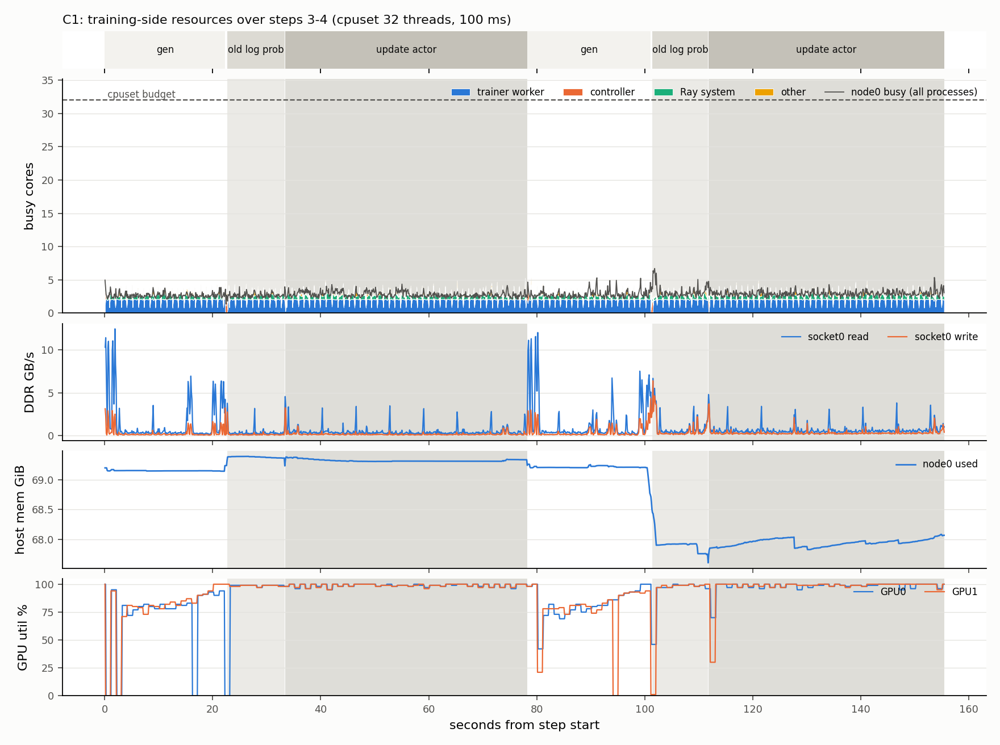
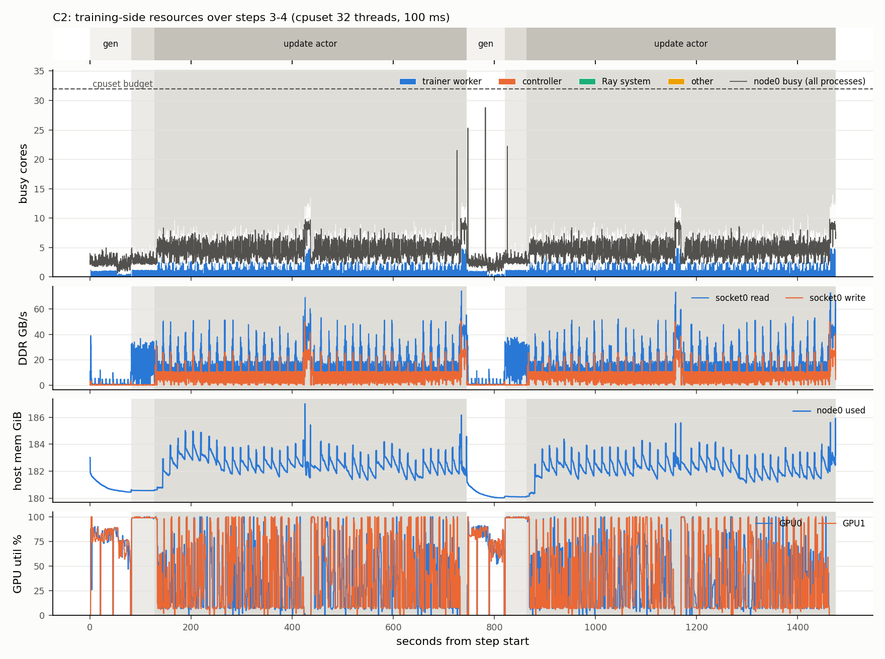

# GPU 노드 harvest: A6000 × 2에서 본 학습·추론 쪽 CPU 수요와 sandbox 간섭 (2026-11-03 ~ 11-05)

[GPU 노드 harvest 설계](../../gpu-node-harvest-design.md)는 GPU 노드의 남는 CPU에 sandbox를 올리고, 학습이 CPU를 원하면 hand-off로 CPU를 비우는 시나리오다. 이 문서는 [A6000 실행 계획](../../gpu-node-harvest-a6000-plan.md)의 G1(학습 노드는 언제 CPU를 원하나)을 돌린 결과다. 그 뒤 G1에서 나온 질문 두 개를 추가로 쟀다.
- GPU당 1 core를 계속 쓰는 thread의 정체는 무엇인가(4절)
- 추론 엔진이 CPU와 왕복하는 방식을 바꾸면 그 core가 비는가(5절)

G2(sandbox가 GPU 작업을 얼마나 늦추나)와 G3는 G1 결과를 보고 정하기로 해서 돌리지 않았다. 5.5절의 실제 sandbox 명령 재생이 G2의 작은 부분을 대신한다.

## 0. 결론

1. **일반적인 학습 구성에서 학습 쪽 CPU 수요는 평평하고 작다.** GPU당 약 1 core에 GPU 수와 무관한 약 0.8 core(Ray, controller, dataloader)가 붙는다(C1, C1o, C1s, C3s). 관문 1 기준(step 안 p99 − 평균 ≥ 3.2 core)을 넘는 구성은 8B 전체 파라미터를 CPU Adam으로 학습하는 C2뿐이었다. C2는 GPU 메모리가 모자랄 때만 쓰는 흔하지 않은 구성이고, 그 구간에서도 병목은 core가 아니라 DDR 대역폭이었다. thread를 4배로 늘리면(OMP=16) step이 오히려 13% 느려졌다.
2. **실제 agentic RL(C4, Qwen3-32B LoRA, R2E-Gym SWE)에서도 학습은 CPU를 거의 원하지 않았다.**
   - 학습 쪽 CPU는 중앙값 2.25 core, p99 5.1 core였다. 8 core를 넘은 시간은 0.11%다.
   - 가장 큰 수요는 checkpoint 저장으로, 약 40초 동안 13 core 이하였다.
   - node0 32 thread 중 약 27개가 99%의 시간 동안 비어 있었다.
   - sandbox 22개가 3.5시간 동안 쓴 CPU는 합계 77 core·초였다.
3. **"GPU당 1 core"의 대부분은 CUDA 기본 spin-wait다.** 명령어 수로 gen 77%, logprob 96%, update 91%가 spin이었다.
   - blocking sync로 바꾸면 이 서버에서는 step이 23% 느려졌다. 원인은 깨어나는 지연이 아니라 CPU 주파수 하락이다(schedutil이 core를 한가하다고 보고 0.8~1.5 GHz로 내린다).
   - core를 SCHED_IDLE pause loop로 깨어 있게 두면 손해가 +5%로 준다.
   - GPU thread는 초당 약 95번, 예측할 수 없는 시점에 깨어나고 그때 바로 core를 받아야 한다. 이 시간 규모는 hand-off가 아니라 같은 core 안의 우선순위(SCHED_IDLE)로 나눌 일이다.
4. **vLLM decode에서 core를 붙잡는 것은 kernel launch가 아니다.** launch는 step의 1~3%다.
   - batch 320에서 step 17.1 ms 중 scheduler, sampling 준비, 출력 처리, detokenize가 약 5.7 ms다.
   - 나머지는 GPU를 기다리는 spin이다.
   - 같은 core에 busy loop를 붙이면 decode가 18~50% 느려졌다.
5. **CPU 개입을 K step에 한 번으로 바꾸면 core가 거의 빈다.**
   - K step을 CUDA graph 하나로 묶은 decode 엔진(K=4~16)은 step당 CPU가 0.2~1.6 ms였다. busy loop를 붙여도 느려지지 않았다.
   - 경계 작업(detokenize, stop 검사, 끝난 요청을 새 요청으로 교체)까지 넣은 continuous batching 엔진(K=8)은 0.08 core를 썼다.
   - 경계 작업을 다음 K step과 겹치면 GPU 유휴가 7.3%에서 0이 된다. 대가로 버려지는 decode 슬롯이 1.2%에서 3.8%로 는다.
6. **C4의 실제 sandbox 명령을 같은 코어에서 재생하면 양쪽 손해는 대부분 noise 수준이다.**
   - 엔진 처리량 변화는 −4%(vLLM sync)에서 0 사이였다.
   - sandbox 명령은 K-step 엔진 옆에서 noise 범위 안이었다.
   - vLLM async 옆에서는 중앙값 +6%, p90 ×1.19~1.25로 느려졌다. async가 CPU를 3.1 core 쓰기 때문이다.
7. **연구 방향으로 보면 harvest는 근거가 있고, hand-off는 근거가 약하다.**
   - GPU 노드의 CPU는 지금도 대부분 비어 있다. 엔진 설계를 바꾸면 더 빈다.
   - 학습·추론 쪽 CPU 수요는 작고 예측할 수 있는 덩어리(checkpoint, CPU Adam)이거나, μs 단위라 우선순위로 처리할 수 있는 것이다. 어느 쪽도 sandbox를 급히 다른 노드로 옮겨야 하는 상황을 만들지 않는다.
   - hand-off가 필요할 수 있는 경우는 따로 있다. async RL에서 rollout과 학습이 겹치는 경우, 여러 job이 노드를 나눠 쓰는 경우, sandbox가 큰 빌드처럼 CPU를 많이 쓰는 경우다.

## 1. 환경

| 항목 | 값 |
|---|---|
| CPU | Xeon Gold 6326 × 2, SMT on. GPU 노드 역할은 node0(CPU 0-15, 32-47, 32 thread) |
| GPU | RTX A6000 × 2 (NVLink bridge) |
| 메모리 | 소켓0 DDR4-3200 6채널(이론 최대 153.6 GB/s), 소켓1 4채널 |
| 서버 설정 | 공유 서버. governor `schedutil`, SMT, resctrl, GPU clock은 바꾸지 않았다 |
| 소프트웨어 | verl 0.6.1, vLLM 0.11 (V1), torch 2.8 (cu128), Ray 2.49, FSDP/FSDP2. C4는 rllm `train.py` |
| model | `/mnt/ssd1/Qwen/` 아래 Qwen2.5-1.5B·3B-Instruct, Qwen3-8B, Qwen3-32B |
| 측정 | `sampler.py`: 100 ms마다 core별·thread별 CPU(owner로 묶음), NVML, 메모리. `perf stat` uncore로 소켓별 DDR. `hook/sitecustomize.py`: verl phase 시작·끝 기록 |

## 2. G1: 학습의 CPU 수요

### 2.1 구성

C1~C3과 C1s, C3s는 verl GRPO로 GSM8K를 실제로 학습한다(single-turn, 규칙 보상). C4만 agentic 학습이다.

| ID | model | 구성 | optimizer가 도는 곳 |
|---|---|---|---|
| C1 | Qwen2.5-3B 전체 FT | colocated sync, offload 없음 | GPU |
| C1o | Qwen2.5-3B 전체 FT | C1 + verl `param_offload`, `optimizer_offload` | GPU (상태는 CPU 메모리에 두고 step 직전에 올림) |
| C1s | Qwen2.5-1.5B 전체 FT | C1과 같음. 1 GPU 비교용(3B는 GPU 한 장에 안 들어감) | GPU |
| C2 | Qwen3-8B 전체 FT | FSDP2 `CPUOffloadPolicy` | CPU (CPU Adam, OMP_NUM_THREADS=4) |
| C3s | Qwen2.5-1.5B | one-step-off-policy async: GPU0 생성, GPU1 학습 | GPU |
| C4 | Qwen3-32B LoRA rank 8 | rllm `train.py`, R2E-Gym Docker sandbox, B=4·G=2·동시 2 | CPU (LoRA라 상태가 작음) |

3B 모델로 C3를 돌리면 GPU 한 장에 안 들어가서 실패했다. 그래서 1.5B로 바꾼 C3s를 돌렸다.

### 2.2 결과

demand는 100 ms 구간마다 학습 쪽 프로세스 트리의 thread CPU 합이다. 진폭은 step 안의 p99 − 평균이고 step 사이 중앙값이다. 앞 2 step은 warmup으로 뺐다.

| run | GPU | 학습 thread | step 수 | step (s) | demand 평균 | demand p99 | 진폭 |
|---|---|---|---|---|---|---|---|
| C1 | 2 | 32 | 18 | 71.5 | 2.79 | 4.62 | 1.79 |
| C1o | 2 | 32 | 18 | 73.7 | 2.83 | 4.78 | 1.85 |
| C1s | 2 | 32 | 8 | 42.4 | 2.82 | 4.73 | 1.86 |
| C1s | 1 | 32 | 8 | 38.6 | 1.84 | 3.42 | 1.40 |
| C3s | 2 | 32 | 10 | 51.5 | 2.14 | 4.14 | 1.92 |
| **C2** | 2 | 32 | 8 | 732.9 | 4.35 | 8.93 | **4.58** |
| C2 | 1 | 32 | 2 | 1,201.5 | 2.47 | 4.97 | 2.50 |
| C2, OMP=16 | 2 | 32 | 2 | 831.9 | 8.85 | 28.66 | 19.79 |
| C1 | 2 | 16 | 4 | 76.1 | 2.80 | 4.38 | 1.54 |
| C1 | 2 | 8 | 4 | 76.3 | 2.70 | 4.54 | 1.85 |
| C2 | 2 | 16 | 2 | 789.1 | 4.25 | 8.95 | 4.70 |
| C2 | 2 | 8 | 2 | 847.0 | 3.56 | 8.01 | 4.45 |

`g1/*.json`의 `gate1_swing_pass`는 기준을 학습 thread의 10%로 잡는다. 그래서 8 thread run(기준 0.8)은 true로 나온다. 위 해석은 32 thread 기준(3.2)으로 했다.

**소켓0 DDR 대역폭** (평균 / 최대, GB/s)

| run | 평균 | 최대 | 이론 최대 대비 |
|---|---|---|---|
| C1 | 1~2 | 17 (checkpoint 저장) | 11% |
| C1o | 2~4 | 53 | 35% |
| C2 | 21 | 105 | 68% |
| C2, OMP=16 | 18 | 117 | 76% |

**C2 phase별** (8 step 평균)

| phase | 길이 | 평균 core | p95 core | DDR 평균 / 최대 |
|---|---|---|---|---|
| gen | 76 s | 2.5 | 3.9 | 2 / 52 GB/s |
| old_log_prob | 44 s | 2.9 | 4.0 | 16 / 41 GB/s |
| update_actor | 613 s | 4.7 | 7.6 | 21 / 105 GB/s |

### 2.3 읽는 법

- **C1 계열은 평평하다.** 100 ms 구간의 79%에서 GPU 프로세스 하나가 0.9~1.1 core를 쓴다. 생성, logprob, update 모두 평균 1.01~1.02 core다. 주 thread(0.63)와 backward thread(0.38)가 나눠 쓰고, 합은 늘 1.0이다.
- **GPU 수에 따라 크기만 바뀐다.** C1s 1 GPU → 2 GPU에서 평균이 1.84 → 2.82 core로, GPU 하나에 약 1 core가 늘었다.
- **C2의 진폭은 update_actor 안의 CPU optimizer step에서 나온다.** 이때 GPU 사용률은 0%다. GPU가 늘면 이 구간은 높고 짧아진다(1 GPU 1,061초 → 2 GPU 613초).
- **C2는 메모리 대역폭에 묶여 있다.** OMP=16으로 thread를 늘리면 p99가 28.7 core로 오르지만 step은 13% 느려진다(C2 step 사이 편차 약 1%). 학습 thread를 16, 8로 줄여도 7%, 16% 느려진다.
- **C1의 코어 축소는 원인을 모르는 손해가 있다.** 3 core도 안 쓰는데 16, 8 thread에서 약 6% 느려졌다. SMT 짝을 나눠 쓰는 영향이거나 4 step 측정의 noise일 수 있다.
- **노드 절반(16 core)을 넘는 수요는 거의 없다.** C2 8 step 동안 0.1초뿐이었다.

### 2.4 관문 1 판단

C2만 통과했다. 하지만 optimizer를 CPU에서 돌리는 것은 GPU 메모리가 모자랄 때 쓰는 구성이고, 실제 workload인 C4는 같은 `CPUOffloadPolicy`를 쓰지만 LoRA라 상태가 작다(3절). 일반적인 구성(C1, C1o, C3s)은 모두 실패다. phase에 따라 크게 출렁이는 것은 core가 아니라 DDR 대역폭이다(offload 전송, checkpoint 저장, CPU Adam).

## 3. C4: 실제 agentic RL

C4는 deadline까지 3.5시간 돌았다. step 2개가 끝났고 세 번째 step은 rollout 도중 끊겼다.

**step 시간 구성 (초)**

| | step | rollout | old_log_prob | update_actor | save |
|---|---|---|---|---|---|
| step 1 | 4,183 | 3,813 (91%) | 81 | 244 | 44 |
| step 2 | 5,348 | 4,843 (91%) | 76 | 229 | 38 |

trajectory 하나는 15~19분이었다. 그중 LLM 시간이 873~1,049초이고, sandbox(env) 시간은 평균 3초였다.

**학습 쪽 CPU** (100 ms 샘플, init 464초 제외)

| phase | 평균 / p99 / 최대 (core) | 빌려줄 수 있는 core (최악 1%) | GPU 사용률 |
|---|---|---|---|
| rollout | 2.4 / 5.0 / 11 | 27 | 66~71% |
| old_log_prob | 2.4 / 4.4~5.0 / 5.4 | 27 | 97~99% |
| update_actor | 2.6 / 5.1 / 6.5 | 27 | 100% |
| save_checkpoint | 5.5 / 12.4 / 12.9 | 19.6 | 9~16% |

- 평소의 약 2 core는 FSDP worker 2개의 CUDA spin이다.
- CPU offload가 켜져 있어도 update_actor는 2.6 core였다. LoRA라 optimizer 상태가 작다.
- DDR 대역폭도 checkpoint 저장 때 약 20 GB/s로 가장 높았다(rollout 중 0.8 GB/s).

**sandbox 쪽 CPU** (Docker container 22개, cgroup별)
- 3.5시간 합계 77 core·초. 같은 시간 학습 프로세스는 29,765 core·초를 썼다.
- 동시에 떠 있던 container는 최대 2개, 순간 최대 4.3 core였다.
- 0.5 core를 넘는 burst의 길이는 중앙값 0.1초, p99 1.0초, 최대 2.1초였다.

**주의**: 이 run은 `phases.jsonl`이 비어 있어 phase 구간을 worker.log의 `timing_s`와 checkpoint 저장 시각으로 역산했다(오차 약 1초). init 구간 최대값 84 core는 새 프로세스의 누적 CPU가 첫 샘플에 몰린 것이라 뺐다. Qwen3-32B를 A6000 2장에서 FSDP와 vLLM이 나눠 쓰느라 turn당 LLM 시간이 약 65초로 매우 길다. 큰 GPU에서는 sandbox CPU 비중이 지금보다 커진다.

## 4. "GPU당 1 core"의 정체: spin-wait

### 4.1 코드와 마이크로벤치마크

torch 2.8, vLLM 0.11, verl 0.6.1, NCCL 어디서도 대기 방식을 바꾸는 API(`cudaSetDeviceFlags`, `cuDevicePrimaryCtxSetFlags`)를 부르지 않는다. 그래서 CUDA 기본값 `cudaDeviceScheduleAuto`가 적용되고, GPU context 수가 CPU 수보다 적으면 spin한다.

GPU1에 약 3초짜리 행렬곱 400번을 넣고 기다린 결과다(`bench/spin_test.py`).

| 대기 방식 | 걸린 시간 | 기다리는 thread의 CPU |
|---|---|---|
| 기본값, `synchronize` | 2.74 s | 2.74 s (100%) |
| 기본값, `.item()` | 2.51 s | 2.51 s (100%) |
| blocking sync, `synchronize` | 2.56 s | 0.07 s (3%) |
| blocking sync, `.item()` | 2.52 s | 0.02 s (1%) |

spin 실행의 worker를 perf로 5초 샘플링하면 CPU 시간의 55~65%가 CUDA driver(`libcuda`), 12%가 시각 읽기(`vdso`, polling 반복)였다. Python 실행은 7~22%다.

### 4.2 spin, blocking, blocking + 빈 core 채움 (C1s, 1.5B, GPU 2장, 4 step)

`HARVEST_CUDA_BLOCKING=1`(`hook/sitecustomize.py`)로 blocking sync를 켠다. "빈 core 채움"은 학습 cpuset의 32 core마다 SCHED_IDLE pause loop(`bench/pause.c`)를 하나씩 올려 core가 잠들지 못하게 한 것이다.

| | spin | blocking | blocking + 채움 |
|---|---|---|---|
| step | 45.4 s | 55.9 s (+23%) | 47.8 s (+5%) |
| gen | 16.2 s | 24.4 s (+50%) | 17.9 s (+10%) |
| GPU thread 실효 주파수, gen | 3.24 GHz | 1.45 GHz | 3.28 GHz |
| 같은 값, logprob | 3.15 GHz | 0.80 GHz | 3.24 GHz |
| 같은 값, update | 3.02 GHz | 1.03 GHz | 3.26 GHz |

GPU를 10 ms 기다린 직후의 Python 작업은 1.05 ms에서 4.84 ms로 늘었다(`bench/micro_sync.py`). 4.6배로, 최고·최저 주파수 비 3.5/0.8 = 4.4와 거의 같다. 빈 core를 채우면 1.05 ms로 돌아왔다(`g1/bench-sync.txt`).

**spin이 차지한 비율** (GPU worker 주 thread의 명령어 수, `bench/pstat_phase.py`)

| phase | spin일 때 | blocking일 때 (= 실제 작업) | spin 비율 |
|---|---|---|---|
| gen | 98 G | 23 G | 77% |
| logprob | 38 G | 1.7 G | 96% |
| update | 135 G | 12.8 G | 91% |

빈 core를 채운 조건에서 GPU thread가 실제로 CPU 위에 있던 비율은 gen 42%, update 24%, logprob 13%다.

### 4.3 blocking일 때 GPU thread의 리듬

blocking run(채움 없음)에서 node0의 `sched_switch`, `sched_wakeup`을 10초 기록했다(`bench/sched_watch.sh`, `bench/sched_gaps.py`). 생성 4.3초와 update 5.7초에 걸친 구간이다.

| thread | CPU 위 비율 | 한 번 일하는 시간 | 한 번 쉬는 시간 |
|---|---|---|---|
| 주 thread | 45% | 중앙값 0.25 ms, p90 7 ms | 중앙값 9 μs. 쉬는 시간 합의 96%는 10 ms 이상인 휴식 |
| backward thread | 26% | 약 14 ms | 약 7 ms |

주 thread는 초당 약 95번 깨어난다. 10 ms 이상 비는 구간은 있지만 언제 끝날지는 GPU 작업에 달려 있어서 미리 알 수 없다. 이 run은 주파수가 떨어진 상태라 일하는 시간이 실제보다 길게 잡혔다.

### 4.4 의미

- spin 시간의 대부분(update, logprob에서 90% 이상)은 우선순위가 가장 낮은 다른 작업에 넘길 수 있다. 손해는 pause loop로 쟀을 때 step +5%다.
- 깨어나는 시점이 μs 단위라 이 core를 나누는 방법은 hand-off가 아니라 SCHED_IDLE 같은 같은 core 안의 우선순위다. 0.5 ms짜리 hand-off라도 깨어날 때마다 끼어들면 손해다.
- 주파수를 고정한 서버(performance governor)에서는 blocking 비용 자체가 처음부터 작을 수 있다.

## 5. 추론(decode) 쪽 CPU

4절의 gen 구간에서 채움 조건에도 GPU thread가 42% 일했다. 이 몫이 무엇이고, 엔진 구조를 바꾸면 줄어드는지 vLLM 단독으로 쟀다. 조건은 Qwen2.5-1.5B, A6000 1장(GPU0), 엔진을 CPU 4-7번에 고정한 것이다.

### 5.1 vLLM decode step의 CPU (`decode/prof_vllm.py`)

in-process 엔진, FULL CUDA graph, 고정 batch, ignore_eos. 엔진 함수를 감싸 wall과 thread CPU를 쟀다. 단위는 ms/step이다(`decode/vllm-step-profile.txt`).

| | batch 320 | batch 16 |
|---|---|---|
| step 전체 | 17.1 | 7.3 |
| GPU를 기다리는 시간(`to_list` D2H 대기) | 11.4 | 6.0 |
| 실제 CPU 작업 | 약 5.7 (33%) | 약 1.3 (18%) |
| └ scheduler | 1.25 | 0.16 |
| └ sampling kernel 준비와 launch | 1.25 | 0.23 |
| └ 출력 정리(대기 제외) | 1.4 | 0.19 |
| └ detokenize, 상태 갱신, 입력 준비 | 1.4 | 0.4 |
| └ graph launch | 0.20 (1.2%) | 0.23 (3%) |

- sync scheduling에서는 이 CPU 작업이 끝날 때까지 GPU가 논다.
- context를 blocking으로 설정해도 vLLM은 spin했다. 대기용 CUDA event를 blocking 플래그 없이 만들기 때문이다.
- async scheduling(multiprocess 엔진)은 CPU 작업을 GPU 계산 뒤에 숨긴다. batch 320에서 35 → 27 ms/step, batch 16에서 7.6 → 6.6 ms/step이었다. 대신 프로세스 트리 CPU가 1.1에서 3.1 core로 는다(`decode/async_bench.py`). multiprocess 모드 자체가 batch 320에서 in-process(17.1 ms)보다 느린 이유는 확인하지 않았다.

### 5.2 K step을 CUDA graph 하나로 (`decode/msdecode.py`)

forward, sampling, 다음 입력으로 token을 넘기는 과정을 K step 묶어 graph 하나에 담았다. flash-attn과 vLLM의 fused kernel을 쓴다. HF transformers와 greedy 출력을 비교하면 32 token 중 32개, 30개가 같았다(bf16 오차). batch 고정, prompt 길이 동일, EOS 없음인 decode만 재는 microbenchmark다(`decode/kstep-cpu.txt`).

| K | 1 | 4 | 16 | 64 |
|---|---|---|---|---|
| step당 CPU, batch 320 | 1.1 ms | 0.33 ms | 1.47 ms | 17.9 ms |
| step당 CPU, batch 16 | 0.56 ms | 0.27 ms | 0.23 ms | 4.7 ms |

K가 너무 크면 graph 하나의 kernel이 1,000개를 넘어 GPU 명령 queue가 찬다. 그러면 CPU가 graph 제출 함수 안에서 spin한다. 적당한 K는 4~16이다. CPU를 완전히 비우려면 반복 자체를 GPU로 옮겨야 한다(CUDA graph conditional WHILE node, persistent kernel·megakernel).

### 5.3 같은 core에 busy loop (`decode/run_hog.sh`)

CPU 4-7번 core마다 일반 우선순위 pause loop를 0~2개 붙였다. 단위는 ms/step이다(`decode/busyloop-colocation.txt`, 두 번째 run).

| | 0개 | 1개/core | 2개/core |
|---|---|---|---|
| vLLM, batch 320 | 17.15 | 21.71 (+27%) | 25.70 (+50%) |
| K=4, batch 320 | 22.88 | 22.81 | 22.79 |
| vLLM, batch 16 | 7.33 | 8.66 (+18%) | 9.08 (+24%) |
| K=4, batch 16 | 6.82 | 6.73 | 6.79 |

batch 320에서 이 엔진의 GPU 경로는 vLLM보다 느리다(22.8 vs 17.1 ms, attention·GEMM 최적화 차이). 그래서 절대 속도가 아니라 busy loop를 붙였을 때 느려지는 비율로 비교한다. K-step 엔진이 busy loop 옆에서 조금 빨라진 것은 core가 바빠서 주파수가 유지되기 때문으로 보인다.

### 5.4 경계 작업까지 넣은 continuous batching (`decode/msengine.py`)

5.2의 엔진에 K step마다 실제 서비스가 하는 일을 넣었다.
- token을 host로 복사한다(pinned buffer 두 벌).
- `tokenizers` DecodeStream으로 incremental detokenize한다. vLLM의 fast detokenizer와 같은 방식이다.
- stop token을 검사한다(길이는 vLLM과 같게 고정하므로 기록만 한다).
- 끝난 요청을 새 요청으로 바꾼다. 새 요청의 prefill은 행 수 32/16/8/4/2/1별로 미리 capture한 CUDA graph를 이진 분해로 replay해 그 KV 슬롯에 채운다.

모든 대기는 blocking event다. 두 모드를 비교했다.
- **sync**: chunk n replay → 대기 → 경계 작업 → chunk n+1 replay. 경계 작업 동안 GPU가 논다.
- **overlap**: chunk n+1을 먼저 넣고 chunk n의 경계 작업을 한다. 끝난 슬롯은 한 chunk를 헛돈다.

요청 stream은 vLLM과 같다(`decode/cbreq.py`): GSM8K chat prompt 96 token, 출력 길이 64~512 균등(seed 0), batch 256을 계속 채운다. vLLM은 `LLMEngine.add_request`/`step`으로 같은 방식으로 돌렸다(`decode/vllm_cb.py`). 조건마다 120초, 2회, 순서는 섞었다(`decode/run_cb.sh`).

| 엔진 | 처리량 (tok/s) | CPU (core) | GPU 유휴 | 버려진 슬롯 |
|---|---|---|---|---|
| vLLM sync | 7,200 | 1.01 | – | – |
| vLLM async | 9,100 | 3.14 | – | – |
| K8 sync | 12,700 | 0.081 | 7.3% | 1.2% |
| K8 overlap | 13,200 | 0.086 | ≈0% | 3.8% |

- 경계 작업은 8 step chunk당 12.1 ms(p99 13.2 ms)다. token 처리(detokenize 포함) 약 10 ms, 요청 교체 약 1.2 ms다. GPU는 chunk당 decode 118 ms, prefill 약 23 ms를 쓴다. 경계 작업은 chunk 시간의 약 1/10이다.
- overlap은 GPU 유휴를 없애고 처리량을 4% 올린다.
- 새 요청을 pageable 메모리에서 GPU로 복사하면 CPU가 앞선 graph가 끝날 때까지 기다린다. 이것만으로 경계 작업이 overlap에서 135 ms까지 늘었다. pinned staging과 prefill graph로 바꾸자 1.2 ms가 됐다. 경계 작업을 늦게 해도 되려면 이런 동기화 지점이 하나도 없어야 한다.
- vLLM의 처리량은 K-step 엔진과 절대값으로 비교하면 안 된다. 이 측정에서 vLLM은 prefill과 decode가 섞인 step에 piecewise graph를 써서 batch 256에서 step당 약 36 ms였다.

### 5.5 C4의 실제 sandbox 명령을 같은 core에서 재생 (`decode/sbreplay.py`)

C4 trace의 `events.jsonl`에서 rollout을 그대로 다시 만든다. container 설정(inspect), 복사한 파일, 명령의 argv·cwd·env를 쓰고, setup, tool call, grading 명령을 모두 포함한다. 이 서버에 image가 있는 8개 rollout(tornado, coveragepy), 288개 명령이다. LLM 대기는 없애고 2개 stream으로 연달아 돌렸다. container 제한은 C4와 같다(`--cpus 2 --memory 4g --network none`). 엔진과 같은 CPU 4-7번에 고정했다. sandbox는 rollout당 container CPU 중앙값 4.3초, 4개 core 중 약 1.1~1.35 core를 썼다.

**엔진 쪽** (처리량 변화, 2회 평균. 회차별 값은 `decode/colocation-engine.jsonl`)

| vLLM sync | vLLM async | K8 sync | K8 overlap |
|---|---|---|---|
| −4.0% (2회 모두) | +0.1% | +3.1% | 0.0% |

K8의 경계 작업 p99는 sandbox가 있어도 13.3 ms로 같았다.

**sandbox 쪽** (명령 시간 / 단독 실행. 엔진 측정 구간 안에 끝난 명령만, 명령별 중앙값끼리 비교)

| 같이 돈 엔진 | 합계 | 중앙값 | p90 | 회차별 범위 (합계 / 중앙값 / p90) |
|---|---|---|---|---|
| vLLM async | 1.034 | 1.062 | 1.193 | 1.03~1.05 / 1.05~1.06 / 1.22~1.25 |
| K8 overlap | 1.009 | 1.020 | 1.094 | 0.98~1.06 / 0.99~1.07 / 1.09~1.16 |
| K8 sync | 0.994 | 1.001 | 1.081 | 0.96~1.04 / 0.97~1.04 / 1.08~1.13 |
| vLLM sync | 0.937 | 0.962 | 1.050 | 0.92~0.95 / 0.95~0.97 / 1.06~1.08 |

- noise: 단독 실행 두 번끼리도 합계 ±2%, p90 1.09~1.10만큼 달랐다.
- K-step 엔진 옆의 sandbox 손해는 noise 범위 안이다.
- vLLM async 옆에서는 중앙값 +5~6%, p90 ×1.19~1.25로 noise를 넘는다.
- vLLM sync 옆에서는 sandbox가 5~7% 빨라졌다. vLLM이 한 core를 계속 spin해서 주파수가 유지되기 때문으로 추정한다. 확인하지는 않았다.
- 5.3의 busy loop(core마다 1~2개)는 실제 sandbox보다 훨씬 무거운 부하다. 실제 명령은 LLM 대기를 없애도 약 1.3 core라 vLLM도 4%만 느려졌다.

## 6. 해석 범위와 한계

- GPU는 PCIe A6000 2장이고 모델이 작다(4·5절은 1.5B). 둘 다 CPU 간섭을 실제보다 크게 보이게 하는 쪽이다. 8 GPU 노드의 NCCL, TP=8 효과는 보지 못했다.
- C2 계열 축소·OMP run과 C4는 step이 2개뿐이다. C1s spin/blocking 비교는 4 step이다.
- 공유 서버라 governor `schedutil`, SMT on 상태다. 4절의 주파수 효과는 이 설정에서 나온 것이다. 다른 사용자 부하가 섞였을 수 있다(C4 동안 node1 평균 0.5 core).
- 4.2의 채움 부하와 5.3의 busy loop는 pause loop라 cache와 메모리 대역폭을 거의 쓰지 않는다. 5.5의 실제 sandbox 명령도 2 stream이라 고부하 조건은 재지 않았다.
- K-step 엔진은 직접 만든 단순한 구현이다. vLLM과의 처리량 절대값 비교는 의미가 없다. megakernel(Mirage MPK)은 빌드에 필요한 Rust 설치를 진행하지 않아 돌려 보지 않았다.
- C1의 코어 축소 손해(약 6%)와 C1s gen에 남은 +10%(채움 조건)의 원인은 나누지 못했다.
- sandbox 재생은 Docker다. microVM의 vCPU exit, EPT 동작은 다르다.

## 7. 파일과 재현

**이 폴더**

| 파일 | 내용 |
|---|---|
| `g1/g1-*.json` | G1 run별 `analyze_g1.py` 결과(step별 demand, phase별 요약, 관문 1 값) |
| `g1/C4-analysis.json` | C4 phase별 CPU, sandbox CPU, borrowable core, GPU, DDR(`bench/c4_analyze.py`) |
| `g1/bench-sync.txt` | spin/blocking/채움의 micro·vLLM 단독 벤치마크(4.2) |
| `fig-C1-timeline.png`, `fig-C2-timeline.png` | phase timeline(owner별 busy core, DDR, 메모리, GPU) |
| `decode/vllm-step-profile.txt` | vLLM step 분해(5.1). `p-spin-*`, `p-blkfill-*` |
| `decode/kstep-cpu.txt` | K-step 엔진 step당 CPU(5.2) |
| `decode/busyloop-colocation.txt` | busy loop 옆 vLLM과 K-step(5.3) |
| `decode/colocation-engine.jsonl` | 5.4·5.5 엔진 run별 결과(`run` 이름 = 엔진-sandbox stream 수-회차) |
| `decode/colocation-summary.txt` | `decode/analyze_cb.py` 출력(5.5) |

**코드** (`experiments/gpu-harvest/`, 설명은 그 폴더의 README)
- G1: `run_g1.sh`(C1~C3), `run_c4.sh`(C4), `sampler.py`, `hook/sitecustomize.py`, `analyze_g1.py`
- spin과 주파수: `bench/`
- decode: `decode/`

원자료(sampler csv, phase jsonl, trace, sandbox 명령별 기록)는 서버의 `experiments/gpu-harvest/results/<run>/`에 있고 git에 넣지 않았다.
