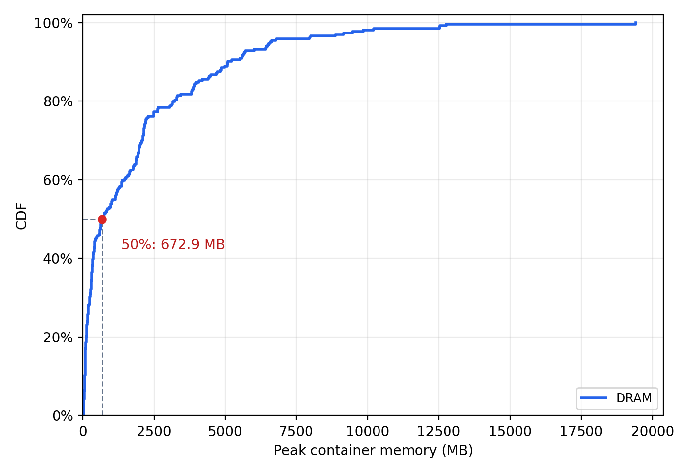

# DRAM / CXL 재생 결과 (2026-10-14)

같은 264개 trace를 node 0 CPU + node 0 DRAM에서 실행한 뒤 node 0 CPU + node 2 CXL에서 실행했다. 두 조건 모두 CPU 2-31, 작업당 메모리 32GiB, 부모 상한 33GiB, PID 16384, swap 0이다. timestamp/gap 대기만 제거하고 명령 내부 sleep·I/O·timeout은 유지했다.

총 528회, 27,200개 명령을 완료했고 MPKI 계측은 전부 유효했다. OOM·PID 제한·시작/종료 NUMA 배치 오류는 없었다. 원본 Submitted 260개는 두 조건 모두 정규화한 제출 내용이 일치했다. 원본 LimitsExceeded 3개와 InternalServerError 1개는 제출 비교 대상이 아니다.

| 지표 | 결과 |
|---|---:|
| 비교 가능한 trace 쌍 | 211 / 264 |
| CXL latency 증가: 비율 기하평균 / 시간 합계 | 13.15% / 17.38% |
| 중앙값 / p95 / p99 / 최대 증가율 | 11.16% / 42.79% / 53.75% / 79.85% |
| 전체 instructions로 가중한 LLC MPKI: DRAM / CXL | 1.5357 / 1.4836 |
| 최대 메모리 GiB: DRAM / CXL | 18.08 / 20.27 |


## 컨테이너별 최대 메모리 CDF

각 조건의 전체 264개 컨테이너를 사용했다. latency 비교에서 제외한 timeout·종료 코드 차이 trace도 포함한 **관측된 최대 사용량**이다. DRAM 39개, CXL 50개 trace에 명령 timeout이 있어, 제한 없이 실행했을 때의 메모리 수요를 의미하지는 않는다.

| 최대 메모리 분포 (MB) | DRAM | CXL |
|---|---:|---:|
| 중앙값 | 672.9 | 702.6 |
| p95 | 6,571.3 | 6,605.4 |
| p99 | 12,517.9 | 12,474.0 |
| 최대 | 19,417.7 | 21,768.4 |

아래 메모리 CDF는 DRAM 264개 컨테이너만 표시하며 선형 축을 사용한다. 위 표는 두 조건의 원래 측정 요약이다.



그림과 CDF 데이터는 MB(1 MB = 1,000,000 bytes) 단위다. 원본 CSV의 `peak_memory_gib`는 컨테이너 cgroup의 `memory.peak`를 GiB로 변환한 값이다. 익명 메모리 외에 해당 cgroup에 과금된 파일 cache와 커널 메모리도 포함하며, 컨테이너 생성 후 측정한 최대값이다. 프로세스 RSS나 여러 컨테이너의 동시 메모리 합계를 뜻하지 않는다. 공유 cache의 과금 위치·실행 순서 영향을 받으므로 두 곡선의 차이를 CXL 자체의 메모리 증가 효과로 단정할 수 없다. 익명 메모리·파일 cache의 개별 최대값은 최대 시점이 달라 합산하지 않는다.

재생성: `python harness/trace-replay/analyze.py --memory-cdf docs/results/numa-immediate-20261014`. `memory-cdf.{png,pdf,csv,json}`에 그림, CDF 데이터와 요약 통계를 보관했다.

## 측정 해석과 제한

timeout이 있는 50개 쌍과 종료 코드가 다른 3개 쌍은 대표 latency 비교에서 제외했다. 39개 trace는 두 조건 모두, 11개는 CXL에서만 timeout이 있었다. 나머지 3개는 Preact focus 이벤트 테스트 두 건과 Caddy ACME 테스트 한 건의 성공/실패 차이다. 제외된 결과도 CSV에 남아 있다.

latency는 Docker exec 시작부터 종료까지의 호스트 monotonic 시간이다. timeout 뒤 컨테이너 내부 작업이 살아 있을 수 있어 후속 명령과 겹칠 수 있다. 각 조건 1회·고정 DRAM→CXL 순서이며 공유 cache를 비우거나 다른 호스트 작업을 중지하지 않았다. 따라서 순서·cache·경합을 분리한 인과 추정은 아니다. MPOL_BIND로 payload 익명 메모리를 지정했지만 모든 공유 파일 cache 접근을 CXL로 강제한 것은 아니다.

## 보관 자료

- `paired-traces.csv`, `paired-commands.csv`: 전체 비교값과 제외 사유. 대표 비교는 `eligible=True`만 사용한다.
- `node0/traces.csv`, `node2/traces.csv`: CPU·메모리·MPKI·IPC·NUMA·I/O 요약.
- `summary.json`, `monitor-final-validation.json`: 집계와 전체 실행 검증.
- `run.json`: 당시 설정·커널·PMU 정의·측정 코드 hash·실제 trace 순서.
- `image-lock.json`: 실제 사용한 image ID와 export 시 로컬에서 확인한 registry digest. 원본 trace 수집 당시 digest는 알려져 있지 않다.
- `slowdown-cdf.{png,pdf,csv,json}`, `comparison.png`, `report.md`: 그림·그림 데이터·상세 비교표.

원시 events/metrics/perf/task 로그, 다운로드한 trace와 Docker 이미지는 제외했다. 원시 결과는 측정 서버의 `harness/trace-replay/results/numa-immediate-20261014/`에 남아 있다. 이 export로 CDF는 다시 그릴 수 있지만 원시 계측을 다시 요약할 수는 없다.

## 다른 머신에서 이어가기

저장소 최상위에서 실행한다. CDF 재생성에는 Python과 matplotlib만 필요하다.

```bash
python -m pip install matplotlib
python harness/trace-replay/analyze.py --cdf docs/results/numa-immediate-20261014
```

새 실험은 [최상위 README](../../../README.md)의 호스트 준비·trace 다운로드·비교 실행 절차를 따른다. 기록한 순서가 필요하면 `run.json`의 `trace_order`를 사용한다. 각 파일 경로는 `harness/trace-replay/data/native/<name>.traj.json`이고 SHA-256도 함께 기록돼 있다. 이미지는 `image-lock.json`의 registry digest로 pull하고, image ID 일치를 확인한 뒤 원래 reference로 tag한다. CXL node와 CPU 번호, perf binary 경로는 새 호스트에서 확인한다.

`run.json`의 코드 hash는 측정 당시 버전을 가리킨다. 현재 분석 코드에는 측정 후 CDF 재생성 기능이 추가됐다.

## MPKI와 대기 시간 검증 (2026-10-21)

264개 × 두 조건의 원시 PMU 구간 37,352개를 다시 집계했다. 실험은 `schedule=immediate`이며 LLM 호출이나 model wait 재현은 하지 않았다. 명령 내부의 sleep·I/O·동기화·timeout은 남아 있다. 명령 실행 구간이 차지하는 비율은 DRAM 99.983%, CXL 99.985%다. 이 비율 자체가 CPU 사용률은 아니다.

MPKI는 `1,000 × sum(cache-misses) / sum(instructions)`다. instruction이 발생하지 않는 대기는 분모에도 더해지지 않으므로, 대기 구간의 MPKI를 0으로 간주해 시간 평균하는 방식의 희석은 없다. 대기 중 polling·background 실행이 있으면 그 instruction은 집계될 수 있어, CPU 사용량에 따라 구간을 골라 다시 계산했다.

| 약 1초 구간 선택 조건 | DRAM LLC MPKI | CXL LLC MPKI | DRAM instruction 유지 비율 | CXL instruction 유지 비율 |
|---|---:|---:|---:|---:|
| 전체 | 1.536 | 1.484 | 100.00% | 100.00% |
| 평균 CPU ≥ 0.5코어 | 1.538 | 1.486 | 99.23% | 99.32% |
| 평균 CPU ≥ 1코어 | 1.622 | 1.564 | 90.84% | 91.27% |
| 평균 CPU ≥ 4코어 | 1.868 | 1.811 | 63.55% | 62.69% |

CPU ≥ 0.5코어 구간만 남겨도 MPKI는 DRAM 약 0.15%, CXL 약 0.16%만 변한다. timeout이나 종료 코드 차이가 없는 211개 쌍에서도 전체→CPU ≥ 0.5코어 MPKI는 DRAM 1.442→1.445, CXL 1.360→1.362로 거의 같다.

LLC MPKI ≥ 5인 구간의 시간 비율은 DRAM 2.02%, CXL 2.81%이고 instruction 비율은 각각 1.95%, 2.08%다. LLC MPKI ≥ 10인 구간의 시간 비율은 DRAM 0.33%, CXL 0.68%다. 5와 10은 분포를 살펴보기 위한 임의 경계이며 메모리 병목을 정의하는 기준은 아니다. 1초보다 짧은 burst는 이 분석으로 분리할 수 없다.

따라서 model wait 때문에 낮게 보였다는 설명은 이 결과에 부합하지 않는다. CPU가 실제로 실행되는 구간에서도 instruction 대비 LLC miss가 적다. 다만 낮은 MPKI와 높은 CPU 사용량만으로 연산 병목이라고 단정할 수는 없다. stall cycles·메모리 bandwidth·동시 outstanding miss 등을 추가로 측정해야 계산, cache hit, 분기·프런트엔드, 메모리 지연 병목을 구분할 수 있다.

검증: 두 조건 모두 interval counter 합계가 trace 요약의 instructions·cycles·LLC misses·retired load L3 misses와 일치했다. CPU는 20 ms 누적 사용량을 PMU 구간 경계에 보간했다. perf 시작 clock에는 최대 약 125 ms의 불확실성이 있어 시작 handshake만큼 경계를 이동해도 확인했다. CPU ≥ 0.5코어 MPKI는 DRAM 1.538→1.538, CXL 1.486→1.486이다. CPU 시각을 맞추기 어려운 경계 구간은 CPU 조건 집계에서 제외하며 전체 집계에는 유지했다. 모든 컨테이너는 원래 상한 30코어이므로 4코어 사용이 전체 CPU 포화를 뜻하지는 않는다.

[집계 CSV](mpki-audit.csv) · [검증·집계 JSON](mpki-audit.json). `all`은 timeout을 포함한 264개, `latency_eligible`은 기존 latency 비교의 211개다. 각 구간 MPKI를 단순 평균하지 않고 선택된 counter를 합산한다.

재현(원시 계측 파일 필요): `python harness/trace-replay/analyze.py --mpki-audit harness/trace-replay/results/numa-immediate-20261014`.
