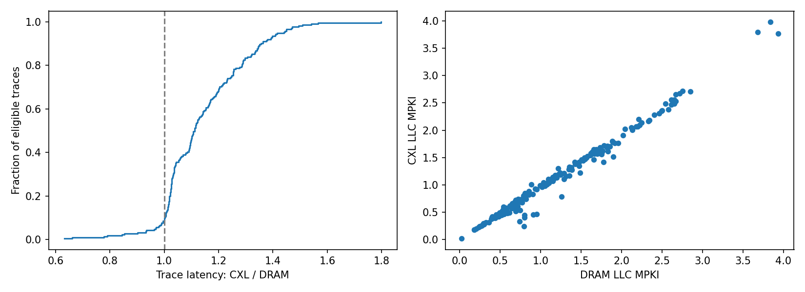

# 대기 없는 SWE 실행: DRAM / CXL 메모리 비교

상태 **complete**. node 0 memory 종료 264/264, node 2 memory 종료 264/264.
동일 trace 비교 264개, 비교 조건 통과 211개, 제외 53개.

전체 trace를 node 0 CPU + node 0 memory에서 한 번씩 실행한 뒤, 같은 순서로 node 0 CPU + node 2(CXL) memory에서 한 번씩 실행한다. trace와 명령은 순차 실행하며 timestamp/gap 대기를 추가하지 않는다. 명령 내부 sleep과 timeout은 유지한다.
latency는 호스트 monotonic clock으로 측정한 Docker exec 시작→종료 시간이다. Docker 제어 경로와 I/O 대기도 포함하며 CPU 실행 시간과 다르다. 종료 감지는 pidfd를 사용한다.
비율은 CXL / DRAM으로, 1보다 크면 CXL run이 더 느리다. 같은 image·trace·CPU·자원 상한, 완료된 명령 수, 두 run의 종료 코드와 원본 제출 내용 일치를 확인한다. 자원/NUMA/PMU 실패와 timeout을 포함한 trace는 대표 latency 비교에서 제외하고 원시 결과를 보존한다.
trace latency 비율 분포: {'max': 1.7984839062582636, 'p50': 1.1115884410803532, 'p95': 1.427897001684642, 'p99': 1.5374597347849939}
trace별 비율 기하평균: 1.131499310689582; 비교 trace 시간 합계 비율: 1.1737950677372417
비교 가능한 명령 10807개; 명령 latency 비율 분포: {'max': 3.539276645658915, 'p50': 1.0184376598628864, 'p95': 1.214547789591557, 'p99': 1.474295709024904}

## 해석 범위

각 payload를 정적 numa-bind helper의 set_mempolicy/get_mempolicy로 MPOL_BIND한 뒤 exec한다. node 2가 ZONE_MOVABLE만 제공하므로 cpuset은 0,2를 허용해 파이프 등 비이동 커널 메모리가 node 0을 사용할 수 있게 한다. 두 조건 모두 같은 helper·SYS_NICE capability·기본 seccomp를 사용한다. runc 초기화 중 일시적 node 0 익명 메모리는 최대값으로 기록하고 payload 시작/종료의 배치를 별도로 검증한다.
기존 공유 image/file cache가 다른 node에 남을 수 있고 memory.numa_stat은 해당 cgroup에 과금된 페이지만 센다. 따라서 모든 파일 접근이 CXL을 거친다는 의미는 아니다. 파일 cache의 배치와 메모리 사용량을 함께 기록한다.
node 0 run 후 node 2 run을 각각 한 번 수행한다. 전역 cache를 비우지 않고 다른 호스트 작업을 유지하므로 실행 순서·cache·시간에 따른 경합 영향을 분리한 인과 추정이나 반복 신뢰구간은 제공하지 않는다.

## trace별 비교

| trace | DRAM 초 | CXL 초 | CXL/DRAM | DRAM MPKI | CXL MPKI | 비교 유효 | 제외 이유 |
|---|---:|---:|---:|---:|---:|---|---|
| laravel__framework-53949 | 4.457380542997271 | 4.413963876897469 | 0.9902596007495903 | 1.1779872145458248 | 1.1733916637394746 | True |  |
| gin-gonic__gin-3741 | 12.474893064936623 | 14.208644540049136 | 1.138979265480487 | 1.5458218745829497 | 1.4722141616020483 | True |  |
| prometheus__prometheus-13845 | 15.587990632047877 | 19.544016164029017 | 1.2537867532360338 | 1.6580278790815477 | 1.4657760708970702 | True |  |
| gin-gonic__gin-4003 | 14.875844501890242 | 17.42514925589785 | 1.1713721028532984 | 1.5792716591686655 | 1.523021491784016 | True |  |
| preactjs__preact-3454 | 33.369226046837866 | 38.13832674711011 | 1.1429191283483238 | 1.3460433605555877 | 1.2803510276514758 | True |  |
| laravel__framework-51890 | 17.827438057865947 | 11.276736605912447 | 0.6325494762236376 | 0.6202300888274349 | 0.6124813519771055 | True |  |
| laravel__framework-48636 | 5.8102609468624 | 5.236573902890086 | 0.9012631189512907 | 1.0512827728275491 | 0.9780675243439364 | True |  |
| jqlang__jq-2598 | 23.390881245955825 | 23.97866505291313 | 1.025128758543842 | 0.5144830267509866 | 0.45053892885425223 | True |  |
| jqlang__jq-2728 | 29.56556890695356 | 30.827180868014693 | 1.0426716619264653 | 0.4912649571164005 | 0.43797347377811613 | True |  |
| fluent__fluentd-4598 | 28.622359957080334 | 28.946314736036584 | 1.0113182413833808 | 0.2914826042726038 | 0.2950800383462664 | True |  |
| gohugoio__hugo-12768 | 13.34006917104125 | 15.899086821824312 | 1.191829413923745 | 2.539408599564181 | 2.4890959590194157 | True |  |
| laravel__framework-52680 | 7.700054474873468 | 7.666217576013878 | 0.995605628639381 | 0.9901705416292267 | 0.9934168106384024 | True |  |
| rubocop__rubocop-13503 | 9.474932575132698 | 10.70025096507743 | 1.1293221223716805 | 0.6372930083724658 | 0.6299752739148589 | True |  |
| micropython__micropython-13039 | 10.179062532028183 | 10.138569585047662 | 0.9960219374963941 | 0.7458501093955269 | 0.5365427832779989 | True |  |
| prometheus__prometheus-10633 | 7.046046803938225 | 7.7068144681397825 | 1.0937784948905303 | 1.8892360592310986 | 1.77881785570339 | True |  |
| rubocop__rubocop-13705 | 22.210816476959735 | 24.58321230392903 | 1.1068126347102227 | 0.7566351267318913 | 0.6918326056247331 | True |  |
| jordansissel__fpm-1850 | 14.031896041007712 | 14.369359120959416 | 1.0240497135216424 | 0.45053049286766955 | 0.45313299032846943 | True |  |
| fastlane__fastlane-19765 | 11.201333832927048 | 12.487223492003977 | 1.1147979051652734 | 0.7186819163128796 | 0.738122224002978 | True |  |
| phpoffice__phpspreadsheet-3570 | 6.188692063093185 | 5.953819208778441 | 0.9620480625113941 | 0.8858894410408493 | 1.0120387613031672 | True |  |
| gin-gonic__gin-2121 | 12.367562864907086 | 13.749014341039583 | 1.1116995717929488 | 1.502458169879536 | 1.4579071810354651 | True |  |
| gin-gonic__gin-2755 | 12.855576764792204 | 14.585445128846914 | 1.1345617077867973 | 1.5396541932928207 | 1.4989282871532343 | True |  |
| rubocop__rubocop-13479 | 8.375793203013018 | 9.176116548012942 | 1.095551946615877 | 0.6778782777624145 | 0.6857834203092515 | True |  |
| laravel__framework-52684 | 59.37760974490084 | 60.479748842073604 | 1.0185615268433303 | 1.2900666321771599 | 1.1032862305502524 | True |  |
| tokio-rs__tokio-4898 | 34.115192418918014 | 50.20259233796969 | 1.4715611661076453 | 2.6697040998466006 | 2.5301878180811475 | True |  |
| php-cs-fixer__php-cs-fixer-8331 | 8.148821318987757 | 8.171389602124691 | 1.0027695150321123 | 1.2588088487200975 | 0.7897175591912805 | True |  |
| google__gson-2134 | 55.43360465602018 | 69.16029130411334 | 1.2476239229483777 | 0.6898154567309306 | 0.7161198865729826 | True |  |
| fastlane__fastlane-20958 | 23.032108661020175 | 24.362886049086228 | 1.0577792249790083 | 0.8098485739580963 | 0.8020897986630676 | True |  |
| laravel__framework-53914 | 7.242363535100594 | 7.3360989559441805 | 1.0129426561355683 | 1.1493929118531474 | 1.1381146639408757 | True |  |
| google__gson-1100 | 20.11820347304456 | 25.95133239799179 | 1.289942833750676 | 0.774540933515612 | 0.7327077568361935 | True |  |
| tokio-rs__tokio-6838 | 22.864393372787163 | 29.35516113997437 | 1.2838810398929026 | 2.6712694348180626 | 2.6593830180890285 | True |  |
| fastlane__fastlane-20642 | 11.159903465071693 | 12.948977669002488 | 1.160312695314099 | 0.8079212535463116 | 0.8463364644115886 | True |  |
| fluent__fluentd-3641 | 11.258638539118692 | 11.554029538994655 | 1.0262368312873367 | 0.5392748242096774 | 0.5990957905290862 | True |  |
| fastlane__fastlane-19304 | 26.39666810585186 | 29.731667450163513 | 1.1263416780836943 | 0.629805912312011 | 0.6282279030719349 | True |  |
| phpoffice__phpspreadsheet-3659 | 17.40593214193359 | 19.117913007037714 | 1.0983561725476165 | 0.5445549725963719 | 0.5517988769495331 | True |  |
| redis__redis-10764 | 124.91916937590577 | 122.69741391693242 | 0.9822144553948509 | 0.3260891181436722 | 0.3124354390724024 | True |  |
| laravel__framework-53696 | 52.11856547999196 | 63.37567822402343 | 1.2159904563826305 | 1.3142298068492146 | 1.159886797894201 | True |  |
| laravel__framework-46234 | 5.514563785865903 | 5.685608973028138 | 1.0310169931483306 | 1.1800034097458065 | 1.1401898131789985 | True |  |
| tokio-rs__tokio-6724 | 13.902881626971066 | 15.933566462947056 | 1.1460621539089089 | 2.755509140590626 | 2.7162976811046744 | True |  |
| briannesbitt__carbon-3103 | 35.536759596085176 | 36.85553197795525 | 1.0371100909835165 | 0.23198977213983818 | 0.22894608912089293 | True |  |
| laravel__framework-52866 | 59.11429908592254 | 60.477518322877586 | 1.0230607358631387 | 1.3573492225825885 | 1.1658423244272098 | True |  |
| google__gson-1093 | 28.14382363995537 | 36.29437990183942 | 1.2896037285535298 | 0.7861195913594701 | 0.8013748342003184 | True |  |
| axios__axios-5892 | 55.243884986964986 | 55.965173771139234 | 1.013056445692486 | 1.4213151589224344 | 1.4185568348496496 | True |  |
| rubocop__rubocop-13431 | 35.54696014500223 | 40.083255593897775 | 1.1276141597028608 | 0.5349644281931103 | 0.541083585326607 | True |  |
| rubocop__rubocop-13375 | 59.18242023908533 | 66.15086409100331 | 1.1177451652664228 | 0.5241119193143698 | 0.5105127465931393 | True |  |
| caddyserver__caddy-5404 | 8.696016120025888 | 9.47527454700321 | 1.0896109685425701 | 1.6407861030844606 | 1.6011102138318587 | True |  |
| caddyserver__caddy-6051 | 60.68066491303034 | 40.14039268204942 | 0.6615021891994763 | 2.2473559365758033 | 2.1359601024844044 | True |  |
| jqlang__jq-2919 | 21.78333643008955 | 22.34664754802361 | 1.0258597262977565 | 0.5563448363959952 | 0.48668736700498305 | True |  |
| redis__redis-11279 | 20.0519755280111 | 20.777242343174294 | 1.0361693447186813 | 1.3737423821706227 | 1.309089172271742 | True |  |
| projectlombok__lombok-3602 | 16.857372332829982 | 20.766158804064617 | 1.231874007055193 | 0.688184889976448 | 0.6955925965375466 | True |  |
| laravel__framework-48573 | 12.218699346994981 | 12.732791851973161 | 1.0420742413229616 | 1.2137693086765882 | 1.2988204230684945 | True |  |
| redis__redis-12472 | 56.21745773893781 | 58.11539420299232 | 1.033760624197347 | 0.2895710841389243 | 0.2748326359893958 | True |  |
| laravel__framework-52451 | 5.967816119082272 | 6.225322240032256 | 1.043149137944549 | 0.9493508922935086 | 0.9171107157856839 | True |  |
| redis__redis-10095 | 39.00125413713977 | 39.206047436920926 | 1.0052509413943727 | 0.8092864849373304 | 0.775157034792881 | True |  |
| jqlang__jq-2658 | 24.599467769032344 | 25.380279852077365 | 1.0317410153087931 | 0.5456567744055995 | 0.49640083147245534 | True |  |
| fastlane__fastlane-20975 | 14.500911844195798 | 16.85903756902553 | 1.1626191338976801 | 0.651747674666029 | 0.6632509798436927 | True |  |
| fluent__fluentd-3917 | 8.88427200797014 | 9.209239472867921 | 1.036577838297415 | 0.4638100673029743 | 0.43963775767573987 | True |  |
| jekyll__jekyll-8047 | 34.58976294007152 | 50.77303363196552 | 1.467863012531549 | 0.4172311678160064 | 0.4151482436900397 | True |  |
| immutable-js__immutable-js-2006 | 89.37259865179658 | 108.12947443197481 | 1.2098727805068827 | 1.9568196838126117 | 1.7625864873213102 | True |  |
| briannesbitt__carbon-2813 | 53.822542482055724 | 45.43205052916892 | 0.8441082199770817 | 0.24630244463649675 | 0.23908751270478706 | True |  |
| apache__druid-16875 | 83.39677396300249 | 89.91581740509719 | 1.0781690122088745 | 1.0956525569109927 | 1.1074910321671225 | True |  |
| jekyll__jekyll-8761 | 66.15763178979978 | 67.32024967297912 | 1.0175734507376757 | 0.47280325891272545 | 0.4527982109943007 | True |  |
| tokio-rs__tokio-6752 | 42.05020245607011 | 65.874155275058 | 1.566559764935182 | 3.9344194026574817 | 3.7650527259421374 | True |  |
| gin-gonic__gin-3820 | 16.450897836126387 | 17.859736449783668 | 1.0856390105689826 | 1.6208138618497736 | 1.5810460912635413 | True |  |
| micropython__micropython-15898 | 13.97857713396661 | 14.478806803002954 | 1.0357854497093866 | 0.6889757219503717 | 0.5222200185257032 | True |  |
| sharkdp__bat-2393 | 43.04064515605569 | 56.74395534885116 | 1.31838068744347 | 2.4936893730585443 | 2.3524771969512774 | True |  |
| sharkdp__bat-2650 | 39.44204268208705 | 52.7137741020415 | 1.336486918969385 | 2.8468350077062983 | 2.7126380582188876 | True |  |
| hashicorp__terraform-34580 | 47.07116516097449 | 65.8218906361144 | 1.3983484456145494 | 2.210147211292749 | 2.1990117208917965 | True |  |
| sharkdp__bat-562 | 50.15539573295973 | 46.81514402991161 | 0.933401947004217 | 1.706077454277875 | 1.6053747598132897 | True |  |
| sharkdp__bat-2260 | 34.10542115196586 | 47.50569489784539 | 1.3929074409071514 | 2.341167838058808 | 2.179840468524766 | True |  |
| phpoffice__phpspreadsheet-4114 | 64.5557004599832 | 64.50688169919886 | 0.9992437730450372 | 0.20145234001138868 | 0.20111175860444905 | False | timeout-censored latency |
| gin-gonic__gin-1805 | 10.364111548988149 | 11.322615939890966 | 1.0924830253294984 | 1.663331041239091 | 1.56689551151294 | True |  |
| rubocop__rubocop-13653 | 23.572947609005496 | 25.758502785116434 | 1.0927145477248674 | 0.3949191259659731 | 0.4059890065775584 | True |  |
| caddyserver__caddy-5761 | 22.564467068063095 | 27.53656503208913 | 1.220350782007316 | 1.8163828871739522 | 1.6809345886001068 | True |  |
| fmtlib__fmt-3272 | 76.2630976580549 | 77.70853701792657 | 1.0189533261073747 | 0.9328156130524237 | 0.9242633159724053 | True |  |
| php-cs-fixer__php-cs-fixer-8367 | 31.01067798701115 | 31.449909759918228 | 1.0141638880998038 | 0.7970413233580177 | 0.4490030826504396 | True |  |
| preactjs__preact-2927 | 74.30758124706335 | 88.36439489596523 | 1.1891706527516317 | 1.6859299774241072 | 1.5549527732432569 | False | different return codes |
| redis__redis-11510 | 77.64250908396207 | 79.3538281719666 | 1.0220410070230204 | 0.2971386077180615 | 0.2783565352184528 | True |  |
| php-cs-fixer__php-cs-fixer-7998 | 18.72513592801988 | 19.238862519850954 | 1.0274351328506162 | 0.8000535255006904 | 0.40187458935831943 | True |  |
| redis__redis-11734 | 97.45791088417172 | 100.32976530585438 | 1.0294676378308154 | 0.27110803430546176 | 0.2555465633530291 | True |  |
| fastlane__fastlane-21857 | 16.11256996798329 | 17.678238064050674 | 1.097170600293961 | 0.8055609238213357 | 0.8109678757604543 | True |  |
| caddyserver__caddy-6115 | 17.137038042070344 | 22.045825216919184 | 1.2864431509574803 | 2.043044537588953 | 2.0232345690277285 | True |  |
| phpoffice__phpspreadsheet-4186 | 64.28536869212985 | 64.28770494204946 | 1.0000363418607863 | 0.2577177517237293 | 0.22218330625225524 | False | timeout-censored latency |
| tokio-rs__axum-682 | 120.08201858191751 | 170.90231287595816 | 1.4232131912353896 | 3.840343724436195 | 3.76000136027009 | False | timeout-censored latency |
| rubocop__rubocop-13579 | 28.78057796205394 | 24.55968629894778 | 0.8533423592579955 | 0.4643391552309499 | 0.42165462641063345 | True |  |
| phpoffice__phpspreadsheet-3463 | 64.19178719213232 | 64.3761514769867 | 1.0028720852451507 | 0.8047076811997784 | 0.6442616030452678 | False | different return codes; timeout-censored latency |
| hashicorp__terraform-34814 | 23.307541967835277 | 23.731570617994294 | 1.0181927657040877 | 1.7817281974362769 | 1.7191122951975653 | True |  |
| projectlombok__lombok-3312 | 39.23566629807465 | 52.87233368190937 | 1.3475579407836866 | 1.0179085951417375 | 0.9667771664493887 | True |  |
| rubocop__rubocop-13424 | 18.287682194961235 | 20.166606324957684 | 1.1027426061961063 | 0.6220675667479134 | 0.602836016510982 | True |  |
| php-cs-fixer__php-cs-fixer-8256 | 68.77516686497256 | 68.8359132099431 | 1.0008832598703803 | 0.5308642150497819 | 0.22039634511090683 | False | timeout-censored latency |
| redis__redis-10068 | 34.92547197686508 | 36.32467970298603 | 1.0400626719389159 | 0.43695086446059966 | 0.39594485719159733 | True |  |
| phpoffice__phpspreadsheet-4214 | 15.295641484903172 | 15.645855074981228 | 1.0228962996042839 | 0.47869173735363585 | 0.4186279362481004 | True |  |
| prometheus__prometheus-10720 | 21.77451065601781 | 23.137821320211515 | 1.062610392753737 | 1.3834296918083964 | 1.2770480165220561 | True |  |
| jqlang__jq-2839 | 31.28266829904169 | 32.008066850947216 | 1.0231885127244005 | 0.4888639015784159 | 0.43600001810413475 | True |  |
| caddyserver__caddy-5870 | 41.620285224867985 | 47.55139816598967 | 1.142505341063301 | 2.501445567267319 | 2.3645734717515605 | True |  |
| rubocop__rubocop-13560 | 19.192674219841138 | 21.345460284035653 | 1.112167071640751 | 0.5665377827201772 | 0.5775072877278316 | True |  |
| fmtlib__fmt-3248 | 73.51047380897216 | 91.54971921700053 | 1.2453969410523187 | 0.7524863765777857 | 0.7477420454590935 | False | different return codes; timeout-censored latency |
| tokio-rs__tokio-6603 | 42.4518872119952 | 76.34903594106436 | 1.7984839062582636 | 3.8406443011781284 | 3.9831869674088844 | True |  |
| preactjs__preact-3062 | 39.79196785320528 | 46.003343504155055 | 1.1560962170522422 | 1.5096319684522015 | 1.4425176289230563 | False | different return codes |
| fluent__fluentd-4655 | 88.91792261903174 | 89.50855009700172 | 1.0066423895270307 | 0.7564971887996215 | 0.7142138281698385 | True |  |
| faker-ruby__faker-2705 | 11.728641971945763 | 12.421645726077259 | 1.0590864446019514 | 0.2520361086348693 | 0.2429115959212666 | True |  |
| fluent__fluentd-4311 | 26.00388384098187 | 26.856485738884658 | 1.0327874829435706 | 0.5853237306746831 | 0.5758714184875647 | True |  |
| redis__redis-12272 | 69.20973123097792 | 72.86655417503789 | 1.052836832032418 | 0.6890303059380438 | 0.7227419024435152 | True |  |
| micropython__micropython-10095 | 17.761117547983304 | 18.99647827190347 | 1.0695542226204362 | 0.6156821879273692 | 0.494926986167839 | True |  |
| php-cs-fixer__php-cs-fixer-8064 | 8.417633451987058 | 8.495869584847242 | 1.009294314525149 | 1.489258788247978 | 1.2220079216430113 | True |  |
| babel__babel-15445 | 74.7238255541306 | 87.2553184889257 | 1.1677041136727826 | 1.7508060883252554 | 1.5564584972401068 | True |  |
| projectlombok__lombok-3422 | 64.5717151639983 | 91.04451574408449 | 1.4099751805082295 | 1.1406783959191986 | 1.0766507726571672 | True |  |
| jqlang__jq-2235 | 24.933411489007995 | 25.62445765105076 | 1.0277156682850006 | 0.5868102666366123 | 0.4854249714227432 | True |  |
| babel__babel-14532 | 36.691874221898615 | 42.88405370293185 | 1.1687616021897729 | 1.4738374211128513 | 1.3474353924786024 | True |  |
| google__gson-2024 | 65.08872795500793 | 75.72244884097017 | 1.1633726947823089 | 0.8225419318651087 | 0.8125090566477133 | True |  |
| faker-ruby__faker-2970 | 33.07946087792516 | 36.23017852893099 | 1.095246946817939 | 0.401179233682766 | 0.4174614638694819 | True |  |
| gohugoio__hugo-12579 | 75.66493747499771 | 95.5290530610364 | 1.2625273508301313 | 2.019053238934188 | 1.9083600109259273 | True |  |
| rubocop__rubocop-13362 | 40.64704297599383 | 44.72480729804374 | 1.1003213031870054 | 0.4624205989923301 | 0.45777792294108666 | True |  |
| phpoffice__phpspreadsheet-3903 | 66.37855427386239 | 66.41731470800005 | 1.0005839300744295 | 0.5446394635587035 | 0.4518633442694024 | False | timeout-censored latency |
| preactjs__preact-2896 | 41.047007049201056 | 45.37576679303311 | 1.1054585962538848 | 1.355782301456691 | 1.2999368782824208 | True |  |
| fluent__fluentd-4030 | 57.07115375297144 | 57.98892602790147 | 1.0160811936429837 | 0.3588326256339991 | 0.3126386124637618 | True |  |
| fmtlib__fmt-3729 | 35.409370843786746 | 48.8172985939309 | 1.3786547863076994 | 1.0344172070704547 | 1.0397256323395316 | True |  |
| php-cs-fixer__php-cs-fixer-8075 | 38.194143204018474 | 38.21662271791138 | 1.000588559187539 | 0.7368893141676448 | 0.33285093682417793 | True |  |
| google__gson-1014 | 44.83008534391411 | 57.22010414511897 | 1.2763773190738943 | 0.8104159127203657 | 0.7730968285614187 | True |  |
| sharkdp__bat-2835 | 57.29703161702491 | 81.08021449600346 | 1.415085776833014 | 2.648626370060584 | 2.558876309361393 | True |  |
| gohugoio__hugo-12204 | 31.310898625990376 | 38.91272161016241 | 1.2427852063582088 | 1.8831873240126826 | 1.802142936654806 | True |  |
| projectlombok__lombok-3042 | 65.65790388104506 | 87.4896532879211 | 1.3325075598884402 | 1.1512661081825126 | 1.0748324598591947 | True |  |
| fastlane__fastlane-19207 | 25.707525799050927 | 30.829368934966624 | 1.1992351646732486 | 0.5664255898304156 | 0.5551982514343974 | True |  |
| google__gson-2061 | 95.64647930208594 | 110.09343314310536 | 1.1510453280291766 | 0.7249742617397563 | 0.7238862306497469 | True |  |
| preactjs__preact-3763 | 29.33493596408516 | 38.32837726804428 | 1.3065778399847134 | 1.857528076687735 | 1.704129783030564 | True |  |
| hashicorp__terraform-35611 | 72.4287782299798 | 93.59428068902344 | 1.2922250378411435 | 1.8231334420930707 | 1.7124815683337251 | True |  |
| briannesbitt__carbon-3073 | 68.57936823298223 | 66.4580090790987 | 0.969067093959269 | 0.1765981800361921 | 0.176210109050732 | True |  |
| tokio-rs__tokio-7139 | 87.25054822396487 | 102.90474317385815 | 1.1794165798214846 | 3.8014685753714073 | 4.105453289637166 | False | different return codes; timeout-censored latency |
| projectlombok__lombok-3479 | 69.94040261604823 | 97.5348172520753 | 1.3945418328160348 | 1.285239859415419 | 1.2107709897769372 | True |  |
| gin-gonic__gin-1957 | 16.173028575023636 | 17.903888966189697 | 1.107021414272344 | 1.6901420170189496 | 1.6197660217652752 | True |  |
| fmtlib__fmt-1683 | 44.606359681813046 | 57.83398390910588 | 1.2965412179260623 | 0.7805777855096706 | 0.7591830927659293 | True |  |
| laravel__framework-53206 | 11.04126503597945 | 11.336204803083092 | 1.0267124977203737 | 0.816898498131871 | 0.7449739276946828 | True |  |
| briannesbitt__carbon-3041 | 9.257743339054286 | 9.490116279106587 | 1.0251003869454907 | 0.7140914924568212 | 0.6116672908115737 | True |  |
| jekyll__jekyll-8167 | 64.47512573702261 | 66.84894476016052 | 1.0368175943203293 | 0.49138909833770633 | 0.4947828692898578 | True |  |
| preactjs__preact-3562 | 23.235025671077892 | 26.076383163919672 | 1.1222876846819496 | 1.355995814856145 | 1.3253853280593444 | True |  |
| jordansissel__fpm-1829 | 13.39647551998496 | 13.495547290891409 | 1.0073953608737352 | 0.6675420962176036 | 0.6030724595787451 | True |  |
| preactjs__preact-3739 | 26.721441606990993 | 29.868002434959635 | 1.1177541569144018 | 1.2378569885211599 | 1.223869843714988 | True |  |
| babel__babel-16130 | 88.51584035600536 | 127.8658396829851 | 1.4445531914820717 | 1.729655395973633 | 1.6071051677406363 | True |  |
| gohugoio__hugo-12171 | 76.66593124810606 | 85.93919100705534 | 1.120956722340451 | 1.7355497237190034 | 1.6889986841638818 | True |  |
| redis__redis-13115 | 84.67689927504398 | 86.27595815411769 | 1.0188842398902647 | 0.2746440848682126 | 0.257164803394521 | True |  |
| caddyserver__caddy-5626 | 37.34061981597915 | 46.559171452187 | 1.2468773063124934 | 2.1172849556888123 | 2.048436872830962 | True |  |
| javaparser__javaparser-4538 | 107.59043661714531 | 138.33317095204256 | 1.2857385405386317 | 1.2401776187736866 | 1.2068099259391318 | False | different return codes; timeout-censored latency |
| fmtlib__fmt-2317 | 71.59867015620694 | 72.68336873594671 | 1.0151497028837728 | 0.5935455713344346 | 0.6219971626803867 | False | timeout-censored latency |
| jqlang__jq-2650 | 28.30357188801281 | 28.94392121513374 | 1.0226243291714052 | 0.5461421609716507 | 0.46914191025731306 | True |  |
| rubocop__rubocop-13393 | 34.24898007907905 | 37.556823718128726 | 1.096582252417796 | 0.492019503132409 | 0.47892276114834326 | True |  |
| apache__druid-15402 | 171.15815273998305 | 184.91222473606467 | 1.080358848093998 | 1.2516874725239315 | 1.2380528422616885 | False | different return codes; timeout-censored latency |
| tokio-rs__tokio-4867 | 22.505299259210005 | 30.40614779293537 | 1.3510661397000552 | 2.7143803937446647 | 2.6705521175081612 | True |  |
| gohugoio__hugo-12343 | 149.82184328883886 | 196.17355953296646 | 1.3093788944697935 | 2.0743889852134134 | 2.0378456191908696 | False | timeout-censored latency |
| burntsushi__ripgrep-2209 | 24.323021654970944 | 31.3369883520063 | 1.2883674074928062 | 1.9174219605473894 | 1.7661993537826486 | True |  |
| projectlombok__lombok-3215 | 65.56491850805469 | 87.50745422299951 | 1.3346688475216997 | 1.1539902986781 | 1.0928820471869005 | True |  |
| fluent__fluentd-3616 | 86.13579151593149 | 86.70563640701585 | 1.0066156574526741 | 0.768494950972309 | 0.6767574626955655 | True |  |
| projectlombok__lombok-3697 | 72.40221776301041 | 99.63143906206824 | 1.3760826966403916 | 1.0439487687099258 | 0.996181973781908 | True |  |
| preactjs__preact-2757 | 70.99945863289759 | 78.04517219006084 | 1.09923615887824 | 1.4774417088572414 | 1.4137408392278592 | True |  |
| laravel__framework-51195 | 6.52215533494018 | 6.526128544006497 | 1.0006091865130888 | 1.0792679937668475 | 1.0094055695709263 | True |  |
| fmtlib__fmt-2457 | 82.05330805294216 | 84.31320896884426 | 1.0275418623517771 | 0.6218203069095128 | 0.6110968320528735 | False | timeout-censored latency |
| google__gson-2158 | 58.363148745149374 | 69.57916464610025 | 1.1921763328761978 | 0.7263658733993839 | 0.6847923101829323 | True |  |
| phpoffice__phpspreadsheet-3469 | 69.84083920787089 | 70.70952775119804 | 1.0124381171987586 | 0.7465028755110718 | 0.8320457093576596 | False | different return codes; timeout-censored latency |
| fmtlib__fmt-3750 | 100.05281056207605 | 128.3000998168718 | 1.28232379576454 | 0.6539138674365118 | 0.6433317727644031 | False | different return codes; timeout-censored latency |
| jqlang__jq-2681 | 24.413861190900207 | 25.251850398955867 | 1.0343243209872923 | 0.5329201699160464 | 0.46532853623614834 | True |  |
| prometheus__prometheus-15142 | 122.75775335798971 | 140.72912388504483 | 1.1463970302115785 | 2.345823805468466 | 2.000327938694572 | False | timeout-censored latency |
| preactjs__preact-4152 | 43.76123312395066 | 51.635168474167585 | 1.1799294669762743 | 1.4255743115813453 | 1.3793316231306483 | True |  |
| apache__druid-13704 | 115.1630392759107 | 137.67017518309876 | 1.1954371476187327 | 1.3599943027035575 | 1.2933927832285 | True |  |
| caddyserver__caddy-4774 | 61.95113011007197 | 74.4501311541535 | 1.2017558198191682 | 2.1341698412825725 | 2.028012414380286 | True |  |
| fmtlib__fmt-3901 | 147.2992568691261 | 174.754150348017 | 1.1863885403256602 | 0.7100821227574403 | 0.71230627747258 | False | different return codes; timeout-censored latency |
| preactjs__preact-3689 | 35.701326079899445 | 44.77149640303105 | 1.2540569586360069 | 1.7780717086201652 | 1.4220883931292132 | True |  |
| briannesbitt__carbon-2762 | 10.92966115893796 | 11.236812362913042 | 1.0281025367125771 | 0.8160646450477052 | 0.831691977461163 | True |  |
| fluent__fluentd-3631 | 69.86464414396323 | 70.34697292395867 | 1.0069037606346574 | 0.05253372858917387 | 0.05391528065441582 | False | timeout-censored latency |
| javaparser__javaparser-4561 | 124.91721595614217 | 142.2346560638398 | 1.1386313325600987 | 1.5681352339174084 | 1.3817973911646344 | False | timeout-censored latency |
| fluent__fluentd-3328 | 69.69692567898892 | 70.20857101608999 | 1.0073410029512293 | 0.5843478469633676 | 0.5710948985282817 | False | timeout-censored latency |
| babel__babel-13928 | 114.31176703609526 | 138.88499782397412 | 1.2149667652335352 | 2.3036182149626683 | 2.3444223902383863 | False | different return codes; timeout-censored latency |
| rubocop__rubocop-13627 | 17.998316099168733 | 20.07267673010938 | 1.1152530392016202 | 0.5504830651736 | 0.5572933723069233 | True |  |
| sharkdp__bat-2201 | 44.494791775010526 | 62.631110701011494 | 1.4076054343103324 | 2.6127494833175726 | 2.4677932300055114 | True |  |
| prometheus__prometheus-14861 | 109.03961213701405 | 127.05669571598992 | 1.165234296287999 | 1.985724046613096 | 1.8795852547247967 | False | timeout-censored latency |
| caddyserver__caddy-6411 | 32.61412084684707 | 47.292907687835395 | 1.4500745830285773 | 2.2242310225463613 | 2.095344659181576 | True |  |
| immutable-js__immutable-js-2005 | 156.463125993032 | 194.927788289031 | 1.2458385133997132 | 1.5542945880236865 | 1.4305507215051432 | False | different return codes; timeout-censored latency |
| preactjs__preact-3010 | 53.75745961093344 | 62.83521987008862 | 1.1688651272745207 | 1.7145404690789547 | 1.573717192754925 | True |  |
| tokio-rs__axum-734 | 140.7596601510886 | 174.9876161289867 | 1.2431659464164555 | 3.2371410216699092 | 3.1179136971484276 | False | different return codes; timeout-censored latency |
| rubocop__rubocop-13680 | 44.44606070104055 | 47.973552256124094 | 1.0793656737952697 | 0.45931371946236776 | 0.4243844420800519 | True |  |
| prometheus__prometheus-11859 | 76.63748120912351 | 79.03712855209596 | 1.0313116676737386 | 1.3525355815235347 | 1.1863945639357372 | False | timeout-censored latency |
| preactjs__preact-4316 | 69.31484718085267 | 91.59089713101275 | 1.3213748692547584 | 1.7365904970692108 | 1.5936750937670645 | True |  |
| phpoffice__phpspreadsheet-3940 | 66.53308821003884 | 66.51304927607998 | 0.9996988125082125 | 0.4621427255509998 | 0.4270174077190147 | False | timeout-censored latency |
| projectlombok__lombok-3052 | 41.78028866904788 | 52.47344675497152 | 1.2559378699038397 | 0.9008150719246873 | 0.8285086928329365 | True |  |
| briannesbitt__carbon-2752 | 11.642004830995575 | 12.084872487001121 | 1.038040497528953 | 1.015020389957358 | 0.9665251086362994 | True |  |
| axios__axios-6539 | 163.3640656338539 | 164.4432536959648 | 1.0066060308790898 | 2.179149952840002 | 2.13552684476574 | False | timeout-censored latency |
| projectlombok__lombok-3486 | 55.06277845799923 | 74.08737856801599 | 1.3455074488209553 | 1.098933243190939 | 1.035728137148827 | True |  |
| reactivex__rxjava-7597 | 287.6730459081009 | 316.6225521741435 | 1.1006333637364507 | 2.529274682271188 | 2.775008024647315 | False | different return codes; timeout-censored latency |
| gohugoio__hugo-12562 | 36.55205640592612 | 44.89867782709189 | 1.2283488876377566 | 2.182429808333115 | 2.0710406096246046 | True |  |
| google__gson-2311 | 117.46820142283104 | 142.66520741488785 | 1.214500653682091 | 0.7336860582433213 | 0.7090935118175231 | True |  |
| tokio-rs__axum-691 | 123.322243175935 | 175.1727858670056 | 1.4204476123346146 | 3.5007485518915624 | 3.5100514551948168 | False | different return codes; timeout-censored latency |
| redis__redis-11631 | 110.78748551290482 | 112.3780729258433 | 1.0143571036527694 | 0.6403240580001979 | 0.5751132116109614 | True |  |
| gin-gonic__gin-3227 | 25.51657461305149 | 29.766070338897407 | 1.1665386436184244 | 1.5255472373754038 | 1.4450790635967734 | True |  |
| projectlombok__lombok-3326 | 42.63462931010872 | 52.47141436301172 | 1.2307228938559267 | 0.6990323986236585 | 0.6363914989337867 | True |  |
| mrdoob__three.js-26589 | 27.85252369195223 | 30.669993546092883 | 1.1011567169029908 | 0.741975255723451 | 0.7288156409589223 | True |  |
| php-cs-fixer__php-cs-fixer-7635 | 24.372743675950915 | 24.48559224186465 | 1.0046301133517883 | 0.9067855203345131 | 0.456765421709037 | True |  |
| php-cs-fixer__php-cs-fixer-7875 | 22.82659608591348 | 22.556845017010346 | 0.9881825977080482 | 0.9528363494908211 | 0.46396924458404193 | True |  |
| briannesbitt__carbon-3005 | 15.461839803960174 | 15.745613999897614 | 1.0183531972608304 | 0.4139506328904385 | 0.39838720393682125 | True |  |
| tokio-rs__tokio-4384 | 65.61355664301664 | 94.52999082789756 | 1.4407082265362696 | 3.682183698619748 | 3.7932535886830316 | True |  |
| rubocop__rubocop-13668 | 44.254616014892235 | 49.69894833792932 | 1.123022925364554 | 0.7488720329058793 | 0.6837129298729384 | True |  |
| nlohmann__json-4237 | 15.640725411009043 | 17.843449788866565 | 1.1408326225270273 | 1.0976053828873782 | 1.0606354311894293 | True |  |
| briannesbitt__carbon-2665 | 43.056004186859354 | 41.767997534014285 | 0.970085318478342 | 0.39068182603901497 | 0.38000051219701114 | True |  |
| projectlombok__lombok-3371 | 49.152993330033496 | 65.9761827790644 | 1.3422617486604136 | 1.099583789183791 | 1.0924880880381687 | True |  |
| briannesbitt__carbon-2981 | 62.27058951999061 | 67.89651421015151 | 1.0903464176833402 | 0.20348617170086616 | 0.19863157424233693 | True |  |
| prometheus__prometheus-12874 | 173.6045940699987 | 157.2622671299614 | 0.9058646631583496 | 0.7663574498119159 | 0.7035557627428491 | False | timeout-censored latency |
| phpoffice__phpspreadsheet-4313 | 15.346005376894027 | 17.11125215003267 | 1.1150297246602374 | 0.7470157450843256 | 0.7313940200637569 | True |  |
| hashicorp__terraform-34900 | 36.103401221102104 | 41.62373233912513 | 1.152903353460129 | 1.6119774842504855 | 1.5378971367175007 | True |  |
| babel__babel-15649 | 98.94949500705115 | 128.29383137007244 | 1.29655872787355 | 1.8328037639125152 | 1.6169184960121572 | True |  |
| tokio-rs__tokio-6551 | 83.35347903193906 | 120.89138520602137 | 1.4503460036706888 | 2.3304003198529943 | 2.164127351521622 | True |  |
| preactjs__preact-3567 | 22.057904226938263 | 24.519311373122036 | 1.1115884410803532 | 1.1329963173371103 | 1.1033773605908748 | True |  |
| sharkdp__bat-3108 | 70.01344024110585 | 104.61035640304908 | 1.494146781572246 | 2.4033260078750125 | 2.280341513663942 | True |  |
| briannesbitt__carbon-3098 | 86.32688435493037 | 88.7639855730813 | 1.028231080460762 | 0.17793646359724719 | 0.1766163187132774 | True |  |
| fluent__fluentd-3608 | 201.62523295287974 | 202.46253609796986 | 1.0041527696351666 | 0.02150577973804965 | 0.02057898193889404 | False | timeout-censored latency |
| jekyll__jekyll-9141 | 66.05891751404852 | 73.10249865800142 | 1.1066257427311759 | 0.43518634477819357 | 0.400812742790522 | True |  |
| fluent__fluentd-3466 | 82.48890486895107 | 85.34984874795191 | 1.034682771986681 | 0.4151999945264311 | 0.4137180507165622 | False | timeout-censored latency |
| caddyserver__caddy-6350 | 69.52442947495729 | 54.93962601199746 | 0.7902204509536712 | 2.6169641291646375 | 2.557208413759364 | True |  |
| tokio-rs__axum-1934 | 94.67070042015985 | 145.86038313200697 | 1.5407130451624549 | 2.464982520037879 | 2.3044367771433145 | True |  |
| projectlombok__lombok-3571 | 44.584152766969055 | 55.97157884808257 | 1.2554142082868083 | 1.246041436618089 | 1.1886380618766064 | True |  |
| tokio-rs__axum-2096 | 65.16682273312472 | 98.28329489007592 | 1.5081799413878418 | 2.653219194734058 | 2.487474288050714 | True |  |
| mrdoob__three.js-25687 | 21.50797102879733 | 22.079736813902855 | 1.026583901584207 | 0.6378396435620052 | 0.5994837436391194 | True |  |
| preactjs__preact-4182 | 112.03699334594421 | 150.39959359099157 | 1.3424101191879771 | 1.7580807704559687 | 1.602534617604118 | True |  |
| fluent__fluentd-3640 | 170.128353767097 | 170.82484167511575 | 1.0040938967114925 | 0.0264337467087736 | 0.024897376153915612 | False | timeout-censored latency |
| redis__redis-9733 | 21.393453747965395 | 21.66085474193096 | 1.0124991970495179 | 0.8569361898959492 | 0.8234051430331372 | True |  |
| caddyserver__caddy-6370 | 70.86433327291161 | 55.08980773482472 | 0.7773982367499841 | 2.2006564562299036 | 2.069317421786173 | True |  |
| fmtlib__fmt-2310 | 104.71989322407171 | 114.73528294800781 | 1.095639800763604 | 0.7684476796359052 | 0.7802643549932027 | False | different return codes; timeout-censored latency |
| projectlombok__lombok-3009 | 52.77592603396624 | 71.58618775499053 | 1.356417464070988 | 1.2248775916727486 | 1.1941883141682375 | True |  |
| projectlombok__lombok-3350 | 36.01629685307853 | 45.175850599072874 | 1.2543169216801762 | 1.0423382410634048 | 1.0296990168927342 | True |  |
| redis__redis-13338 | 34.24827354797162 | 36.04159874795005 | 1.0523624993086589 | 0.8541920546646885 | 0.8807231883517049 | True |  |
| sharkdp__bat-1892 | 99.59799163183197 | 114.84387612319551 | 1.1530742160717515 | 1.7648903591330924 | 1.626252079458928 | True |  |
| caddyserver__caddy-5995 | 32.07734216796234 | 39.50431895907968 | 1.2315334216977343 | 2.4645132549189133 | 2.367545137622133 | False | different return codes |
| apache__lucene-13170 | 319.0835115641821 | 342.7405125340447 | 1.0741404682864788 | 1.30691501415235 | 1.324611561850561 | False | timeout-censored latency |
| fmtlib__fmt-3863 | 82.82853272603825 | 86.82706753187813 | 1.0482748477395507 | 0.6777252792078934 | 0.6982392932473851 | False | timeout-censored latency |
| preactjs__preact-3345 | 74.83169892709702 | 92.0492749218829 | 1.230083991699289 | 1.8949282474911582 | 1.5169393264127355 | True |  |
| apache__lucene-12212 | 222.67476835497655 | 425.11307521304116 | 1.90912099450508 | 1.282565938528466 | 1.4512277925785284 | False | different return codes; timeout-censored latency |
| preactjs__preact-4245 | 123.62129453197122 | 155.11090279906057 | 1.254726407665513 | 1.9291526454829253 | 1.722007014798997 | False | timeout-censored latency |
| hashicorp__terraform-35543 | 97.93654662393965 | 122.84686366305687 | 1.2543515970066696 | 1.6858500534754945 | 1.6520305040141752 | True |  |
| apache__lucene-12626 | 371.0223230828997 | 477.88236846006475 | 1.2880151374430608 | 1.2860499893557766 | 1.2741453966611223 | False | different return codes; timeout-censored latency |
| tokio-rs__axum-1119 | 128.2945051949937 | 199.05278188805096 | 1.5515300642495358 | 4.324375233422971 | 4.3925779829981515 | False | different return codes; timeout-censored latency |
| caddyserver__caddy-6345 | 32.35182817908935 | 44.08094287314452 | 1.3625487446683553 | 2.5788801243918877 | 2.3788312560577998 | True |  |
| rubocop__rubocop-13687 | 58.17713299812749 | 63.6196301439777 | 1.0935504529937112 | 0.522917345542999 | 0.515452651662235 | True |  |
| apache__lucene-11760 | 347.55439554085024 | 342.99589914502576 | 0.9868840778470641 | 1.4417516150829326 | 1.4591399198132027 | False | timeout-censored latency |
| caddyserver__caddy-4943 | 31.902948305010796 | 29.73116923402995 | 0.9319254430588242 | 1.1072303559879046 | 1.0507482304506606 | True |  |
| micropython__micropython-13569 | 15.8460986870341 | 16.203909331932664 | 1.022580362016257 | 0.7020007238988389 | 0.5407132272722648 | True |  |
| apache__druid-14092 | 148.59368245792575 | 178.93222352396697 | 1.2041711367818855 | 1.1446043821424434 | 1.138347908541159 | False | timeout-censored latency |
| projectlombok__lombok-2792 | 103.54742314014584 | 136.69415164599195 | 1.3201115730420814 | 1.0353646631748155 | 1.0097742578399083 | True |  |
| micropython__micropython-12158 | 76.53848601994105 | 76.61942318105139 | 1.001057470108427 | 0.021385120984294438 | 0.01754449169200738 | True |  |
| preactjs__preact-4436 | 72.65697848098353 | 87.4025671989657 | 1.202948003430139 | 1.6956429469117287 | 1.5690401776663327 | True |  |
| fmtlib__fmt-3158 | 58.01338313706219 | 69.03590273112059 | 1.1899996000580872 | 0.8546936545201269 | 0.8408298904039025 | True |  |
| projectlombok__lombok-3674 | 143.37197940400802 | 192.99778159102425 | 1.346133201154848 | 1.0811999596009 | 1.0340786730414977 | True |  |
| facebook__docusaurus-9897 | 84.83848510496318 | 85.114150976995 | 1.003249302149735 | 1.343337200933344 | 1.3503612831617557 | False | timeout-censored latency |
| rubocop__rubocop-13396 | 49.21979491785169 | 54.12892256397754 | 1.099738888679224 | 0.5301918117474943 | 0.5252836611921002 | True |  |
| php-cs-fixer__php-cs-fixer-7663 | 68.17069495492615 | 66.72559296619147 | 0.9788017125292596 | 0.7916846998322785 | 0.24011726270584768 | True |  |
| caddyserver__caddy-6288 | 61.15228466014378 | 78.63232217589393 | 1.285844390162954 | 2.1329013344703647 | 2.0014521153453666 | True |  |
| projectlombok__lombok-3594 | 315.80214168084785 | 430.5668779949192 | 1.3634070868020063 | 1.2004372593701296 | 1.1329494414723047 | True |  |
| astral-sh__ruff-15309 | 75.73733275709674 | 119.14004891202785 | 1.5730689816359316 | 2.342099207625065 | 2.168112065629329 | False | different return codes; timeout-censored latency |
| burntsushi__ripgrep-2576 | 55.76552694104612 | 65.65321981091984 | 1.1773083374667423 | 1.3797192143726813 | 1.3171882413526426 | True |  |
| jekyll__jekyll-8771 | 58.8071625479497 | 70.48676985804923 | 1.1986085844658174 | 0.4860820843134142 | 0.466904157025174 | True |  |
| jqlang__jq-2750 | 34.37568987603299 | 34.95081183104776 | 1.0167304847433984 | 0.5175346122565688 | 0.4582494338335074 | True |  |
| apache__lucene-12196 | 402.5765355580952 | 465.59937356901355 | 1.1565487117214848 | 1.2771465612040953 | 1.2909436520721491 | False | different return codes; timeout-censored latency |
| apache__lucene-13494 | 382.25613426510245 | 294.27770553692244 | 0.7698442985164362 | 1.5356404883547994 | 1.4131189669183541 | False | different return codes; timeout-censored latency |
| prometheus__prometheus-9248 | 53.04982292302884 | 62.7907666019164 | 1.1836187783891552 | 1.5627328556299425 | 1.4964305808805112 | True |  |
| apache__lucene-13301 | 474.48921817191876 | 536.5725987630431 | 1.130842552819883 | 1.5812602239633395 | 1.5943843851163002 | False | timeout-censored latency |
| apache__druid-14136 | 156.96694946987554 | 183.25858495221473 | 1.16749790685959 | 1.2205350318393788 | 1.166166905136721 | False | timeout-censored latency |
| apache__lucene-13704 | 536.7685244530439 | 548.2280463101342 | 1.0213490943209969 | 1.5305909305485186 | 1.5845892549762992 | False | different return codes; timeout-censored latency |
| apache__lucene-12022 | 352.6175510380417 | 356.2539801360108 | 1.0103126718657767 | 1.4461890190970812 | 1.3886923489468472 | False | timeout-censored latency |
| gohugoio__hugo-12448 | 89.50695705087855 | 107.46617491496727 | 1.2006460554108676 | 1.6560974742376102 | 1.6532742994826632 | True |  |
| google__gson-2479 | 66.07282382505946 | 69.73941838997416 | 1.0554932323556008 | 0.6825049865005418 | 0.6663146282308332 | True |  |

`paired-traces.csv`와 `paired-commands.csv`에 latency 비율을 저장한다. 각 run의 `traces.csv`와 개별 trace 디렉토리에는 CPU·메모리·MPKI·IPC·NUMA·page fault·I/O 원시 계측과 보고서를 저장한다.

