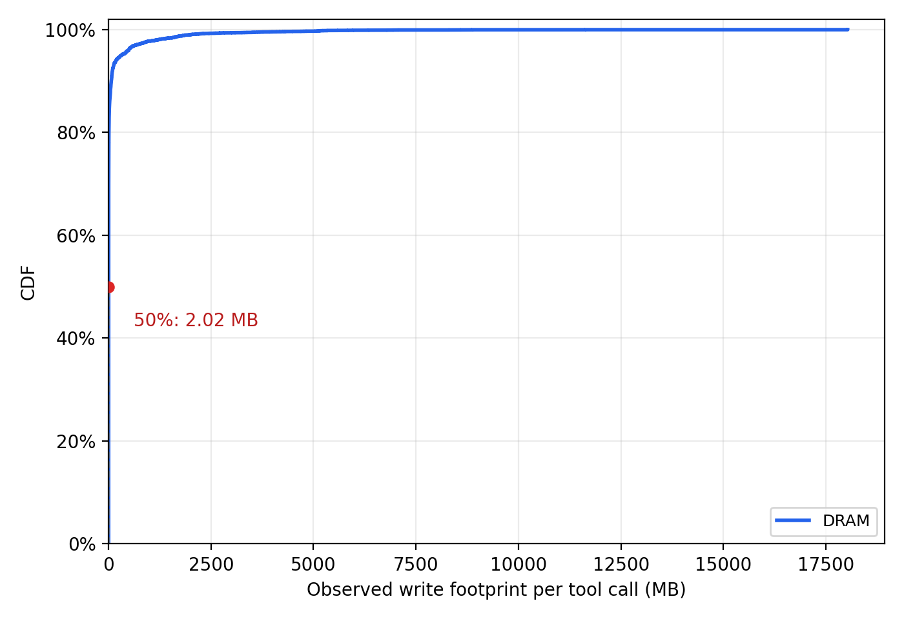
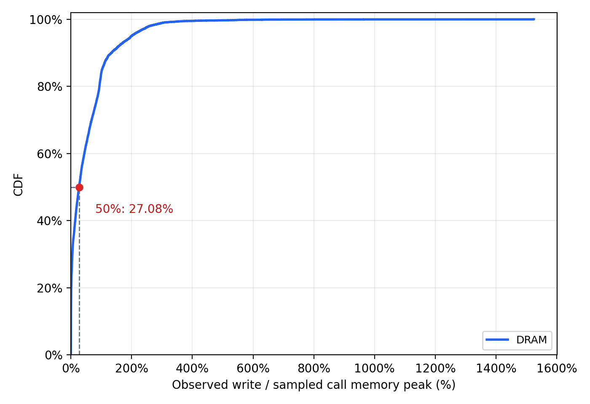

# DRAM tool call write-page observations

측정 trace 264개, tool call 13600개, 계측 검증 통과 13565개, timeout 70개.

배치: CPU node 1, workload CPU 34-63, memory node 1. 유효하지 않은 call 35개는 아래 분포에서 제외하며 CSV에는 관측값과 오류를 보존한다.

4 KiB 물리 페이지 주소를 tool call마다 중복 제거한다. 새 read-only 매핑은 write fault로 세지 않는다. 종료된 프로세스의 관측 페이지도 포함한다.

| Tool call당 관측 write 범위 | MB |
|---|---:|
| max | 18,030.236 |
| p50 | 2.015 |
| p95 | 315.216 |
| p99 | 1,982.827 |



선형 축의 DRAM CDF이며 유효한 call 13,565개를 같은 가중치로 집계했다. timeout은 포함한다. 빨간 점은 중앙값 2.02 MB다. 1 MB = 1,000,000 bytes이며 긴 꼬리와 최대값을 잘라내지 않았다.

계측 오류 합계: `{"map_update_failures": 0, "unresolved_faults": 84, "unsupported_large_pages": 0, "missed_return_probes": 0}`. 전체 관측값 분포(불완전 call 포함)와 페이지 수 분포는 `write-summary.json`에 별도로 저장한다.

이 값은 지원 경로에서 관측한 write 페이지 수다. 커널 내부의 모든 store, DMA, 실제 cache coherence 트래픽이나 경계 시점의 dirty cache line 수를 의미하지 않는다.
write fault는 쓰기 권한을 얻으려는 접근이며, fault 이후 실제 명령의 retire까지 확인하는 방식은 아니다. raw 물리 주소는 결과에 내보내지 않는다.
THP를 이 실행의 컨테이너 프로세스에서 비활성화했고 첫 write fault를 유도하므로 기존 latency 실험과 직접 비교하지 않는다. model wait 길이는 재현하지 않고 call 경계에서 수집한다.
`write-pages.csv`는 call별 값, `write-traces.csv`는 trace별 call 분포다. 서로 다른 call의 페이지 수를 더한 값은 trace 전체의 고유 페이지 수가 아니다.

## 실행 및 검증

264개 trace를 CPU node 1 / memory node 1, workload CPU 34–63, controller CPU 32–33, 컨테이너당 24 GiB, swap 0으로 순차 실행했다. 이전 node 0 측정은 포함하지 않았다. 13,600개 command와 write window가 일대일로 대응하며 중복·누락이 없다. 모든 trace의 관측된 익명 메모리·파일 cache 과금에서 다른 node의 최대값은 0이었다. 이는 기존 공유 image cache의 모든 물리 페이지가 node 1로 이동했다는 뜻은 아니다.

257개 완료 뒤 다음 trace가 컨테이너 생성 전 메모리 예약 검사에서 중단됐다. 활성 파일 cache의 절반을 회수 가능량에 포함하도록 예약 추정식만 수정해 나머지 7개를 실행했다. 24 GiB 한도, NUMA 배치, image ID와 페이지 관측 방식은 동일하다. 전역 cache는 비우지 않았다. 두 실행의 코드 hash와 image ID는 run.json에 보존했다.

35개 불완전 call에서 총 84회의 PFN 해석 실패를 기록했다. 추적 map 용량 초과, 미지원 큰 페이지, return probe 누락은 모두 0이었다. 불완전 call의 관측값은 CSV에 남겨 두었고 기본 분위수에서는 제외했다. timeout 70개는 별도 표시했으며 timeout 제외 분위수도 write-summary.json에 있다. 이 실행의 CPU·메모리·MPKI는 traces.csv에 보관했다. write fault 유도·BPF·THP 비활성화가 latency와 MPKI에 영향을 주므로 기존 무계측 성능 결과와 직접 비교하지 않는다.

원본에 기록된 종료 코드와 다른 명령은 107개였다. 따라서 고정된 tool 명령을 이 서버에서 재실행한 관측값이며, 원본 실행과 동일한 결과를 모두 재현했다는 뜻은 아니다.

| 분위수 (MB) | 계측 검증 통과 | 검증 통과·timeout 제외 | 전체 관측값 (불완전 call 포함) |
|---|---:|---:|---:|
| p50 | 2.015 | 2.015 | 2.019 |
| p95 | 315.216 | 264.360 | 341.634 |
| p99 | 1,982.827 | 1,828.535 | 2,019.346 |
| max | 18,030.236 | 18,030.236 | 18,030.236 |

## 컨테이너 총메모리 대비 write 관측 범위

RSS가 아닌 cgroup 총메모리 기준이다. 구간 기준은 call 시작~종료 사이 새로 수집한 memory.current의 최대값이며 파일 cache·커널 메모리를 포함한다. CPU 샘플에 반복된 메모리 값은 제외했다. 13,600개 중 write 계측 불완전 35개와 구간 내 새 메모리 샘플이 없는 97개를 제외한 **13,468개 call**을 비교했다. timeout은 포함했다.

| 분위수 | call 구간 샘플 최대 메모리 대비 | trace 전체 최대 메모리 대비 (같은 call 집합) |
|---|---:|---:|
| p50 | 27.08% | 0.58% |
| p95 | 199.57% | 50.37% |
| p99 | 303.32% | 96.11% |
| max | 1,524.38% | 393.12% |



그림은 표의 **call 구간 샘플 최대 메모리 대비** 비율이며, 빨간 점은 중앙값 27.08%다. 각 call을 같은 가중치로 집계한다. trace별 중앙값의 분포나 전체 메모리로 가중한 비율은 아니다.

분자는 call 동안 쓴 것으로 관측한 물리 페이지 주소의 누적 집합으로, 종료된 프로세스와 해제된 페이지를 포함한다. 분모는 특정 시점의 cgroup 메모리 사용량이므로 현재 상주 페이지 중 수정된 페이지의 비율은 아니다. 기존 공유 페이지가 다른 cgroup에 과금되는 경우도 있어 분자·분모의 페이지 집합이 일치하지 않을 수 있다. 100ms 샘플은 짧은 피크를 놓칠 수 있다.

구간 샘플 기준 100% 초과 call은 2,162개(16.05%)다. 100%로 잘라 표시하지 않았다. 엄밀한 RSS dirty fraction으로 해석하면 안 된다. trace 전체 최대는 kernel memory.peak 기준이며 짧은 피크의 샘플 누락 영향을 줄이지만 call 시점의 메모리 크기를 나타내지는 않는다.

`write-memory-ratio.csv`에 call별 분자·분모·비율·샘플 개수·시간 범위를 보존했고, `write-memory-ratio.json`에 통계와 분석 코드 hash를 저장했다. `analyze.py <raw-results> --write-memory-ratio`로 재생성한다.

## 다른 머신에서 그림 재생성

저장소 root에서 Python과 matplotlib만으로 실행한다. Docker, 원본 trace, 원시 계측 로그는 그래프 재생성에 필요하지 않다.

```bash
python harness/trace-replay/analyze.py --write-cdf docs/results/write-pages-node1-20261021
```

`write-pages-cdf.{png,pdf}`와 `write-memory-ratio.{png,pdf}`를 만들고 `write-cdf.json`에 입력 CSV SHA-256, 분석 코드 SHA-256, 유효 call 수와 분위수를 기록한다. 측정 당시 코드 hash는 `run.json`, 앞선 메모리 비율 산출 코드 hash는 `write-memory-ratio.json`에 보존한다. 그림을 다시 그리는 것은 측정을 다시 하는 과정이 아니므로 이 과거 hash를 바꾸지 않는다.

## 측정을 다시 실행할 때

이 결과는 2026-10-21에 시작한 **Docker replay**다. 이후 저장소에 추가된 microVM/PML·contention 실험과 실행 환경·측정 대상이 다르다. 현재 목표인 CXL 상태 이동에서 관측 write 집합의 크기를 살펴보는 자료이며, 그 자체로 flush해야 할 cache line 수나 이동 시간을 계산하지 않는다.

기본 호스트 준비와 trace·이미지 준비는 [최상위 README](../../../README.md)를 따른다. 추가로 BCC Python binding, 실행 커널과 일치하는 build headers, gcc·정적 libc, root로 BPF/kprobe와 cgroup freeze·clear_refs를 사용할 권한이 필요하다. 현재 tracker는 x86-64 커널의 page table 및 지원하는 `write_end` 경로에 의존하므로 새 커널에서는 관측 경로를 검증해야 한다. `--perf`를 함께 쓰려면 지원 CPU와 실행 가능한 perf binary도 필요하다.

원래 서버의 node 1 구성에 맞는 예제다. 다른 서버에서는 먼저 보관 `config.json`의 CPU 번호·NUMA node·메모리 상한을 확인한다. 결과 디렉토리는 새 이름을 사용한다.

```bash
python harness/trace-replay/experiment.py \
  --config docs/results/write-pages-node1-20261021/config.json \
  --sequential --schedule immediate --write-pages --perf --keep-going \
  --output harness/trace-replay/results/write-pages-new \
  harness/trace-replay/data/native/*.traj.json
python harness/trace-replay/analyze.py --write-memory-ratio \
  harness/trace-replay/results/write-pages-new
python harness/trace-replay/analyze.py --write-cdf \
  harness/trace-replay/results/write-pages-new
```

glob은 파일명 순서다. 원래 순서와 이미지 ID·입력 SHA-256은 `run.json`에 있다. 현재 메모리 예약 추정식은 clean active file cache의 절반을 포함하며, 원래 첫 257개 실행에서는 이를 포함하지 않았다. 측정마다 코드 hash와 실제 자원 검증 결과를 함께 보관한다.
