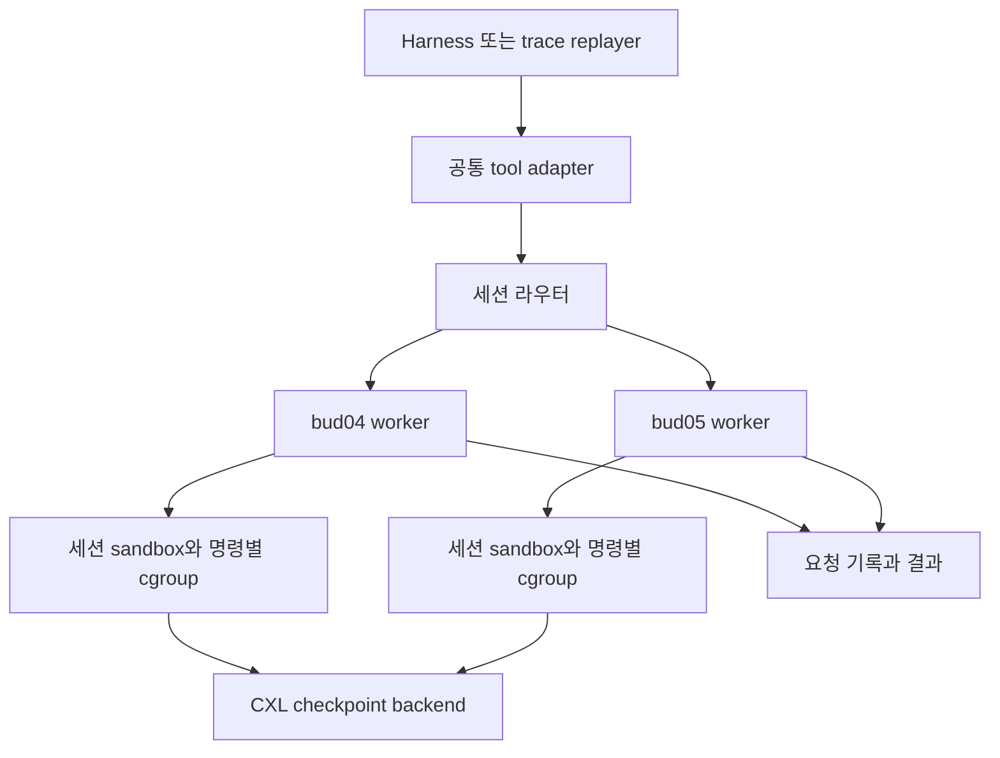

# bud04와 bud05의 CXL sandbox worker 설계안

> 초기 조사/실험 기록이다. 현재 실행 설정과 완료 결과는 [최신 README](../README.md)를 따른다.

새 워커는 harness의 tool 요청을 받아 **세션별 실행 환경을 유지하고, 명령마다 자원을 측정하며, 필요할 때 같은 상태를 다른 노드에서 재개하는 실행 서비스**로 구성합니다. 첫 구현은 일반 cgroup v2를 사용합니다. CXL checkpoint와 CPU scheduling 정책은 교체 가능한 backend로 연결합니다.

현재 baseline은 mini 원본 trace를 사용하는 [node 0 실험](node0-replay-plan.md)입니다. 사용자 요청에 따라 실험은 `experiment.py`, 분석은 `analyze.py` 두 파일에 구현합니다. 아래 실행 서비스·이동 API는 향후 기능 범위를 설명하며, 초기 실험에 이 모듈들을 각각 파일로 만들지는 않습니다. 원격 워커와 상태 이동은 아직 구현하지 않았습니다.

## 왜 명령 실행과 세션 관리를 함께 설계하는가

예를 들어 tool 1이 파일을 수정하고 서버를 띄운 뒤 tool 2가 그 서버에 요청한다고 하겠습니다. 매번 새 프로세스를 실행하는 것만으로는 서버·수정 파일·작업 디렉토리의 연속성을 보장하지 못합니다. bud04에서 tool 1을 실행하고 bud05에서 tool 2를 실행하려면 이 상태가 bud05에서도 관찰되어야 합니다.

따라서 실험을 세 단계로 구분합니다.

| 단계 | 보존 범위 | 검증 가능한 주장 |
|---|---|---|
| 동일 노드의 persistent session | 파일, 환경 구성, 살아 있는 세션 프로세스 | tool 경계와 자원 제어 |
| Workspace 이동 | 수정 파일, 의존성, 실행 디렉토리 | 프로세스 상태가 필요 없는 작업의 이동 |
| Process와 workspace 복원 | 프로세스·메모리·파일·지원되는 OS 자원 | stateful sandbox의 노드 간 재개 |

Workspace만 이동하는 단계에서는 interpreter 변수나 background 서버를 보존한다고 주장하지 않습니다. `bash -c` 호출 사이의 shell 변수·`cd`도 자동 유지되지 않으므로, request의 cwd/env와 persistent shell 지원을 별도로 정의해야 합니다.

## 구성과 요청 경로



| 모듈 | 책임 |
|---|---|
| Harness adapter | Bash·Read·Write·Edit 등 tool 요청을 공통 형식으로 변환 |
| Session router | 현재 owner로 요청 전달, 새 세션 배치, 이동 중 요청 보류 |
| Node worker | 로컬 admission, 요청 기록, 실행·취소·관측 |
| Sandbox runtime | 세션 생성, workspace, namespace, 프로세스 수명 관리 |
| Resource controller | 세션 예산과 tool별 cgroup 설정 |
| State backend | checkpoint·restore와 CXL extent 관리 |
| Metrics collector | queue·exec·restore 시간과 CPU·메모리·pool 사용량 |

초기 control plane은 일반 socket/RPC로 구현하는 편이 단순합니다. CXL은 상태 저장·접근 경로에서 먼저 사용합니다. CXL queue까지 동시에 도입하면 원격 실행기의 문제와 memory visibility 문제를 함께 디버깅해야 합니다.

Harness의 기본 local tool 실행을 자동으로 원격화할 수 있다고 가정하지 않습니다. Claude Code를 선택하더라도 지원하는 tool hook·MCP·custom tool 경로 등을 확인하고, 대상 요청이 실제로 worker를 통과하는 adapter를 만들어야 합니다. `/usr/bin/bash` 교체만으로 전체 tool을 잡는 구조는 피합니다.

## 실행 API의 제안

| 요청 | 동작 |
|---|---|
| `CreateSession` | 이미지·workspace·예산을 지정해 세션 생성 |
| `Exec` | argv 또는 명시적인 shell command 실행 |
| `GetCall` | 상태 조회·이미 완료한 결과 재조회 |
| `CancelCall` | 해당 call의 실행 프로세스와 자식 종료 |
| `ReadFile`, `WriteFile`, `EditFile` | 같은 sandbox 파일시스템에서 파일 tool 실행 |
| `GetSession` | owner·generation·자원 상태 조회 |
| `Checkpoint`, `Restore` | backend가 지원하는 상태 저장·복원 |
| `CloseSession` | 세션 프로세스 종료 후 workspace·extent 정책에 따라 회수 |

첫 `Exec` 요청의 예시는 다음과 같습니다. 값은 설명용입니다.

```json
{
  "session_id": "session-001",
  "call_id": "tool-0007",
  "owner_epoch": 3,
  "operation": "exec",
  "argv": ["python3", "-m", "pytest", "-q"],
  "cwd": "/workspace",
  "env": {},
  "timeout_ms": 120000,
  "resource_hint": {"memory_bytes": 1073741824}
}
```

Shell 문법이 필요하면 별도 `shell_command` 필드를 사용하고 argv와 동시에 받지 않습니다. Session과 call ID는 경로에 직접 이어 붙이지 않습니다. Hint와 별개로 워커가 허용하는 상한을 적용합니다.

결과는 stdout/stderr 또는 stream handle과 다음 값을 반환합니다.

- `status`: queued, running, completed, failed, cancelled, unknown
- `exit_code`, `signal`, `timed_out`, `oom_observed`
- `worker_id`, `owner_epoch`, `state_generation`
- `queue_ms`, `exec_ms`, `checkpoint_ms`, `restore_ms`
- 적용한 자원 한도, `cpu.stat` 차이, `memory.peak`, OOM event 차이
- `cleanup_status`, output truncation 여부, unsupported capability

stdout/stderr는 순서·크기 제한·stream 종료를 정의하고, 결과나 임의 shell 문자열을 JSON으로 직접 이어 붙이지 않습니다.

## cgroup 계층과 프로세스 수명

```text
worker 서비스의 delegated subtree
├── supervisor                  # worker 프로세스와 관측기
└── sessions                    # 내부 프로세스 없음
    └── session_<id>             # 전체 세션 예산, 내부 프로세스 없음
        ├── resident            # sandbox init, persistent shell와 서비스
        └── calls               # 내부 프로세스 없음
            ├── call_<id>       # 해당 명령과 자식 프로세스
            └── call_<id>
```

Supervisor는 세션의 OOM 범위 밖에 두어 종료 사유와 결과를 기록할 수 있게 합니다. Sandbox runtime이 만든 cgroup 계층과 worker의 subtree delegation을 먼저 맞춰야 합니다. 호스트의 `docker exec` client만 call cgroup에 넣어서는 컨테이너 내부 실제 명령이 그 cgroup에 들어가지 않습니다. Runtime 안의 exec helper 또는 runtime API로 실제 프로세스를 배정하고 membership을 확인합니다.

최소 제어는 `cpu.weight`, 필요한 `cpu.max`, 세션의 `memory.max`와 `memory.high`, `pids.max`입니다. Cpuset 사용 시 상위 effective 값·NUMA topology를 확인합니다. 자원 설정 실패를 성공으로 숨기지 않습니다.

명령을 시작한 뒤 PID를 이동하면 실행 초기에 자식 생성·할당이 먼저 일어날 수 있습니다. 실행 전에 cgroup에 들어가는 helper 또는 지원되는 `CLONE_INTO_CGROUP` 경로를 사용합니다. Python의 범용 `preexec_fn`을 다중 thread 서비스의 기본 실행 방식으로 삼지 않습니다.

단기 명령은 완료 후 자식까지 정리합니다. 살아 있어야 하는 background 서비스는 명시적인 session service로 등록해 수명을 세션에 연결합니다. Background process가 남았는데 `rmdir`를 시도하고 성공으로 기록하는 방식은 사용하지 않습니다. 취소·timeout은 단일 PID보다 call의 프로세스 전체를 대상으로 처리합니다.

Tool의 계측과 세션 전체의 계측은 별도로 기록합니다. Persistent interpreter에서 메모리를 할당하는 tool은 ephemeral child process와 다른 측정 범위를 가집니다. 최초 버전은 지원하는 실행 형태를 capabilities로 선언합니다.

## 중복 요청과 이동 중 실행

`session_id + call_id`를 실행 식별자로 사용합니다. 같은 ID와 다른 payload는 conflict입니다. 완료된 요청의 재전송에는 저장된 결과를 반환합니다. Running 요청은 상태나 stream에 다시 연결합니다.

Worker가 파일 수정 후 결과 기록 전에 죽으면 실제 수행 여부를 단정할 수 없습니다. 그런 요청은 `unknown`으로 남기고 자동 재실행하지 않습니다. 일반 shell 명령과 외부 부작용에 대해 exactly-once를 약속하지 않습니다. 요청 journal은 상태 전이와 payload hash를 보존하고, stdout 결과와 checkpoint generation도 연결합니다.

초기에는 세션 내 실행을 직렬화합니다. 병렬 tool 지원은 read/write 충돌과 checkpoint barrier를 정의한 뒤 추가합니다. Trace의 병렬 호출을 직렬화한 실험은 그 차이를 결과에 표시합니다.

## CXL 상태 이동의 조건

아래 기능은 AgentCgroup이 제공하지 않으며 state backend에서 구현해야 합니다.

1. **Extent 식별:** 논리 pool/shard/offset과 노드별 DAX mapping을 관리합니다. bud04와 bud05의 장치 이름·크기가 다르므로 경로·offset의 일치로 판단하지 않습니다.
2. **소유권:** extent와 세션의 owner, quota, generation, 참조 수명을 관리합니다. DAX 용량을 memcg 지표와 별도로 기록합니다.
3. **Checkpoint 범위:** 프로세스 메모리와 수정된 파일, descriptor·mount·namespace·연결의 지원 범위를 정합니다. 같은 파일만 보이는 환경은 full process restore로 표시하지 않습니다.
4. **가시성:** 현재 장비와 backend가 요구하는 flush·invalidate·publication 순서를 지킵니다. Non-coherent 경로에서 C++ acquire/release만으로 원격 가시성을 보장하지 않습니다.
5. **정합성:** process checkpoint와 filesystem generation을 하나의 복원 가능한 세대에 연결합니다. 복원 중 새 쓰기를 허용하지 않습니다.

이동 순서는 `실행 admission 중단 → 진행 중 call 완료 또는 지원되는 freeze → 상태 publication → source 실행 정지 확인 → owner 이전 → destination restore → 다음 call 허용`입니다.

Epoch 값은 오래된 새 요청을 거절하는 데 사용합니다. **Epoch를 바꾸는 것만으로 source의 이미 실행 중인 프로세스가 정지하지는 않습니다.** Source 정지와 쓰기 차단을 확인하지 못하면 destination을 실행하지 않아야 합니다. 네트워크 partition에서 두 노드가 같은 mutable session을 동시에 실행하는 상황을 막아야 합니다.

Freeze는 실행 정지이며 메모리 해제가 아닙니다. DRAM을 줄이려면 checkpoint 이후 프로세스를 종료하거나 backend가 지원하는 reclaim·swap·직접 CXL 접근 경로가 필요합니다. 다른 커널 사이의 복원 호환성도 현재 두 노드 조합에서 검증해야 합니다.

첫 migration backend는 CRIU/기존 Niagara 경로 중 실제 세션 workload를 지원하는 방법으로 정합니다. 설치된 `criu`의 존재나 과거 serverless workload의 복원 성공만으로 임의 agent 환경의 복원을 보장할 수 없습니다. CXL 장치 재구성은 워커 시작 시 자동으로 수행하지 않습니다.

## 디렉토리 구조와 향후 구현 위치

최상위는 `docs/`와 `harness/` 두 디렉토리로 정리합니다. 현재 실험은 아래 두 코드 파일을 사용합니다. 실행·계측·향후 adapter 역할은 우선 `experiment.py`의 함수로 구성합니다.

```text
docs/
    README.md                  # 문서 안내
    evidence/                  # 호스트 관측·커밋 기록
    archive/                   # 이전 AgentCgroup 조사
harness/
    mini-swe-agent/             # 가져온 harness
    SWE-agent/                 # 공식 replay 기능이 있는 harness
    trace-replay/
        experiment.py          # 실행·동시성·NUMA 제한·계측
        analyze.py             # 요약·그래프
        configs/node0.json     # 실행 설정
```

원본 코드를 새 worker의 실행 dependency로 끌어오는 것보다, 실행 경계와 계측을 새로 구현하고 baseline adapter로 분리하는 구성을 권합니다.

## 구현 순서와 완료 조건

| 순서 | 결과물 | 완료 기준 |
|---|---|---|
| 1 | 로컬 persistent session과 공통 API | 연속 호출의 파일 상태 유지, stdout/stderr·exit 전달, ID 재조회 |
| 2 | 실제 cgroup v2와 명령별 계측 | 실제 PID membership, 한도 적용 실패 감지, OOM/timeout 구분, 자식 정리 |
| 3 | 두 노드 worker와 세션 routing | 새 세션 배치, 기존 세션 owner 유지, 로컬 admission과 queue 시간 기록 |
| 4 | 공통 trace replay와 선택한 harness adapter | 모든 대상 tool이 worker 경로 통과, 지원하지 않는 tool 명시 |
| 5 | CXL checkpoint와 복원 | 파일 hash와 process-state 보존, extent ownership, generation·복원 지연 기록 |
| 6 | burst를 고려한 노드 이동 정책 | source 정지 확인, 중복 실행 방지, 고정 배치 대비 효과 측정 |

첫 두 단계가 동작하면 “harness 명령을 실행하는 worker”가 됩니다. 다섯째·여섯째 단계까지 검증해야 “CXL을 통해 stateful sandbox를 다른 노드에서 이어 실행한다”는 연구 주장을 할 수 있습니다.

## 실험에서 분리할 효과

| 비교 | 변경하는 요소 | 확인할 효과 |
|---|---|---|
| 고정 배치와 일반 cgroup | 기준 실행 경로 | 기본 지연과 동시성 |
| 고정 배치와 AgentCgroup 계열 정책 | CPU·메모리 제어 | 노드 내부 burst 제어 |
| CXL 상태 backend와 고정 배치 | 상태 저장·메모리 경로 | DRAM 절감과 복원 비용 |
| 같은 CXL backend와 동적 배치 | 실행 노드 선택 | CPU 경합 회피의 추가 이득 |

현재는 원본 BPF baseline을 지원하는 커널이 준비되지 않았습니다. 일반 cgroup으로 재구현한 정책은 원본 BPF 실행과 구분해서 표시합니다. 커널이 다른 두 서버의 결과는 정책 효과뿐 아니라 플랫폼 차이도 포함하므로, 노드별 기준값과 기능 구성을 함께 기록합니다.

주요 지표는 tool latency p50/p95/p99, 전체 task completion time, queue·exec·restore 시간, local DRAM byte-seconds, peak memory, CXL extent 점유량, migration 횟수, 실패·OOM·timeout 비율입니다. Memory capacity replay는 초기 allocator 실험에 사용하고, 최종 평가는 실제 tool 실행으로 수행합니다.

짧은 모델 대기마다 checkpoint하면 저장·복원 비용이 이득을 넘을 수 있습니다. 이동 정책은 예상 queue 지연 절감과 checkpoint·restore·첫 접근 비용을 비교하고, 같은 세션을 반복 이동시키는 현상을 억제해야 합니다. Pool 용량 효과와 CPU 이동 효과를 각각 측정해야 연구 결과를 설명할 수 있습니다.
