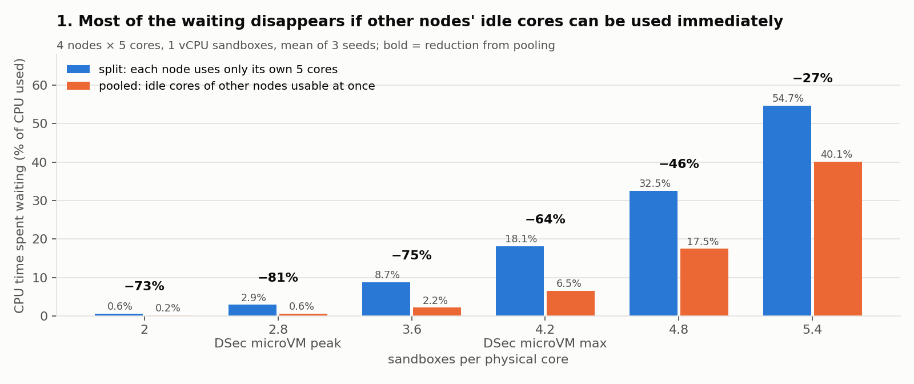
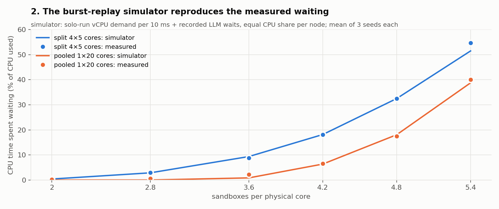
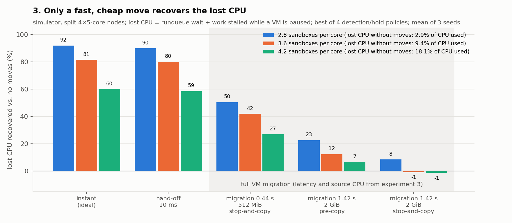

# 실험 2 pilot 결과: 4 node × 5코어, 짧은 SWE trace 67개 (2026-10-20 야간, 2026-10-21 정리)

**결론** (유효한 측정만 사용):

- DSec 수준 밀도(물리 코어당 sandbox 2.8~4.2개)에서 node별 CPU contention이 실제로 생긴다. runqueue 대기가 CPU 사용 시간의 2.9~18%다.
- 같은 부하에서 vCPU가 다른 node의 빈 코어를 즉시 쓸 수 있으면, 그 대기의 **64~81%가 사라진다**. node 사이 재배치로 되찾을 기회가 크다는 뜻이다.
- 밀도가 더 높거나(코어당 5 이상), GRPO처럼 모든 node가 동시에 바빠지면 공유해도 거의 줄지 않는다. 옮길 곳이 없다.

- 실측 burst로 만든 simulator(실측 대기와 일치, 4절)로 이동 지연·비용을 넣어 보면, **10ms hand-off는 즉시 이동과 거의 같게 잃은 CPU의 59~90%를 되찾는다.**
  실제 sandbox 크기(2GiB)의 full VM migration(1.42초)은 정책을 가장 유리하게 골라도 pre-copy 7~23%, stop-and-copy −1~8%만 되찾는다.

contention 구간 길이의 직접 측정은 아직 없다(맨 아래 "철회한 결과").

모든 수치는 한 물리 서버(optane, Xeon Gold 5317 2소켓)에서 잰 motivation용 추세다.

## 구성

| 항목 | 값 |
|---|---|
| node | bare-metal cpuset 4개 × 물리 5코어 (2-6, 7-11, 13-17, 18-22). vCPU thread는 node 코어에, VMM thread는 SMT sibling에, 메모리는 소켓 NUMA에 고정. harness와 측정은 남은 코어 |
| sandbox | Firecracker, 1 vCPU(일부 4 vCPU), 2GiB. task image를 읽기 전용으로 공유하고 sandbox마다 overlay disk를 둔다. host NAT로 외부 네트워크 사용 |
| workload | `candidates.json`의 짧은 trace 67개(비교 가능, peak < 1.6GiB, ≤ 180초, CPU > 5초). 슬롯마다 무작위 trace를 기록된 LLM 간격(배율 1)대로 연속 재생 |
| 밀도 | node당 sandbox 10/14/18/21/24/27개 = 코어당 2.0/2.8/3.6/4.2/4.8/5.4. container 1개를 microVM ½로 보고 DSec 수치를 환산하면 microVM peak 2.7, microVM 최대 4.2, 혼합 peak 5.5, container 최대 8.3 |
| CPU 공유 | 분리(`none`) = node별 5코어. 소켓 공유(`socket`) = 소켓 안 2 node가 10코어 공유. 전체 공유(`all`) = 20코어 공유. 공유해도 메모리와 VMM thread는 원래 node에 둔다. Linux scheduler가 µs~ms 단위로 옮겨 주는 "즉시 이동"의 실측 기준이다 |
| 측정 | node CPU별 `/proc/schedstat` 실행·runqueue 대기 누적값(10분 합계로 사용), serial marker로 명령 시각 |
| 실행 | 조건마다 ramp 60초 + 측정 600초. 총 62회. 기본 조건은 seed 3개, 나머지는 seed 1개 |

단독 실행(네트워크 켬)에서는 명령 2,446개 중 3개만 종료 코드가 원본과 달랐다. 제출 내용은 67개 전부 일치했다.

## 1. contention의 크기와 즉시 공유의 효과 (1 vCPU, seed 3개 평균)



| 코어당 sandbox | 대기 / CPU 사용, 분리 | 소켓 공유 | 전체 공유 | 전체 공유 시 감소 | CPU 사용 (5코어당), 분리 → 전체 공유 |
|---:|---:|---:|---:|---:|---|
| 2.0 | 0.6% | 0.17% | 0.16% | 73% | 1.94 → 2.01 |
| 2.8 (DSec microVM peak) | 2.9% | 0.58% | 0.56% | 81% | 2.64 → 2.78 |
| 3.6 | 8.7% | 2.7% | 2.2% | 75% | 3.37 → 3.59 |
| 4.2 (DSec microVM 최대) | 18.1% | 9.1% | 6.5% | 64% | 3.85 → 4.14 |
| 4.8 | 32.5% | 20.3% | 17.5% | 46% | 4.26 → 4.58 |
| 5.4 | 54.7% | 40.6% | 40.1% | 27% | 4.56 → 4.86 |

- 밀도에 따라 대기가 가파르게 늘어난다. 코어당 2.8에서 4.2로 1.5배 늘면 대기는 6배가 된다.
- 즉시 공유하면 대기의 대부분이 사라진다. 소켓 단위 공유(2 × 10코어)만으로도 효과의 대부분이 난다.
- 공유하면 같은 시간에 쓰인 CPU가 4~8% 늘어난다. 한 node에서 기다리는 동안 다른 node 코어가 놀던 몫이다.
- 밀도가 높을수록 모든 node가 함께 바빠져서, 공유로 줄어드는 몫이 작아진다(코어당 5.4에서 27%).

## 2. 사용자가 느끼는 지연 (단독 실행 대비, 1 vCPU, seed 3개 평균)

| 코어당 sandbox | trace 시간 p50 / p90, 분리 | 전체 공유 | 명령 시간 p99 (0.5초 이상 명령), 분리 | 전체 공유 |
|---:|---|---|---:|---:|
| 2.0 | 1.02 / 1.03 | 1.02 / 1.05 | 1.83 | 2.02 |
| 2.8 | 1.02 / 1.05 | 1.03 / 1.06 | 1.99 | 2.03 |
| 4.2 | 1.04 / 1.11 | 1.03 / 1.08 | 2.48 | 2.11 |
| 4.8 | 1.05 / 1.16 | 1.04 / 1.13 | 3.15 | 2.71 |
| 5.4 | 1.08 / 1.25 | 1.07 / 1.24 | 4.11 | 4.08 |

- trace 전체 시간은 LLM 대기가 대부분이라 크게 늘지 않는다. 명령 하나의 꼬리 지연은 밀도에 따라 2~4배가 된다.
- 코어당 4.2~4.8에서는 공유가 꼬리 지연을 줄인다. 낮은 밀도에서는 오히려 조금 늘어난다. 다른 소켓 코어에서 원래 소켓 메모리를 쓰는 원격 접근 비용으로 보인다.

## 3. 추가 조건 (seed 1개)

| 조건 | 대기 / CPU 사용, 분리 → 전체 공유 | 감소 | 해석 |
|---|---|---:|---|
| 4 vCPU, 2.0/core | 25.3% → 2.0% | 92% | burst가 여러 코어로 넓어져, 같은 밀도에서 contention이 1 vCPU의 40배다. 공유 효과는 더 크다 |
| 4 vCPU, 2.8/core | 47.5% → 6.2% | 87% | |
| 4 vCPU, 4.2/core | 200% → 157% | 21% | 포화 |
| GRPO G=8, 2.8/core | 8.1% → 6.6% | 19% | 같은 task 8개를 node에 고르게 흩어 동시에 시작하면 burst가 모든 node에서 한꺼번에 생긴다. 공유해도 거의 줄지 않는다. step 시간 p90은 1.09 → 1.12 |
| GRPO G=8, 4.0/core | 21.2% → 20.8% | 2% | 옮길 곳이 없다. 배치·용량 문제다 |
| GRPO G=8, 5.2/core | 46.9% → 48.1% | −3% | |
| LLM 대기 0.5배, 2.8/core | 20.3% → 7.6% | 63% | LLM 대기가 짧으면 같은 밀도에서 부하가 커진다 |
| LLM 대기 0.5배, 4.2/core | 103% → 112% | −9% | 포화 |
| LLM 대기 2배, 4.2/core | 2.8% → 1.1% | 61% | 부하가 줄어 저밀도와 같은 양상이다 |

## 4. 이동 지연과 비용: 실측 burst 기반 simulator

`sim.py`는 runqueue 대기를 실측값이 아니라 모델로 구한다.
- 입력은 단독 실행에서 잰 trace별 10ms vCPU 실행 시간(경쟁 없는 원래 burst 모양)과 trace에 기록된 LLM 대기다. 실행 시간은 실행 중에 계속 갱신되므로 run_delay 같은 기록 지연이 없다.
- node마다 5코어를 CFS처럼 공평하게 나눈다(원하는 만큼까지 같은 몫).
- 못 받은 몫이 runqueue 대기다. 그만큼 명령이 늘어나고 다음 명령도 늦어진다. 60초 timeout도 guest agent처럼 적용한다.



검증: 이동 없이 분리·공유 조건을 같은 밀도와 seed로 돌리면 실측 합계와 맞는다.
- 분리: 2.86 / 9.36 / 18.15 / 32.50 / 51.5% 대 실측 2.91 / 8.73 / 18.12 / 32.54 / 54.7% (코어당 2.8~5.4)
- 공유: 코어당 4.2 이상에서 6.4 / 18.1 / 38.8% 대 실측 6.5 / 17.5 / 40.1%
- 저밀도 공유에서는 실측의 작은 잔여 대기(0.2~2%)가 모델에 없다. 모델은 scheduler 지연과 다른 소켓 메모리 비용이 없는 이상적인 공유다.

이동은 분리 node에 reactive 정책으로 넣었다.
- node의 초과 수요가 감지 창 평균 0.1코어 이상이면, 빈 코어가 있는 가장 한가한 node로 최근 수요가 가장 큰 sandbox를 옮긴다.
- 지연 L 뒤부터 목적지에서 실행된다.
- stop-and-copy는 L 동안 sandbox를 정지시키고, 그동안 못 한 일을 손실로 센다.
- 출발 node에는 이동 CPU(2GiB dump 0.616초, 512MiB 0.166초, hand-off 2ms)를 1코어짜리 작업으로 추가해 다른 sandbox와 경쟁시킨다.
- 정책은 감지 창 50ms·0.5초·2초 × 재이동 금지 1초·5초 중 4개를 돌려, 메커니즘마다 가장 유리한 결과를 썼다.



| 코어당 sandbox | 이동 없음 | 즉시 | hand-off 10ms | migration 0.44초 512MiB stop-and-copy | migration 1.42초 2GiB pre-copy | migration 1.42초 2GiB stop-and-copy |
|---:|---:|---:|---:|---:|---:|---:|
| 2.8 | 2.86% | 0.23% | 0.29% | 1.42% | 2.22% | 2.62% |
| 3.6 | 9.36% | 1.74% | 1.87% | 5.45% | 8.20% | 9.43% |
| 4.2 | 18.15% | 7.28% | 7.51% | 13.25% | 16.96% | 18.38% |
| 4.8 | 32.50% | 18.30% | 18.50% | 26.34% | 30.58% | 31.99% |
| 5.4 | 51.5% | 38.3% | 38.3% | 45.1% | 48.9% | 50.1% |

표의 값은 잃은 CPU(대기 + 정지 중 못 한 일)를 CPU 사용량으로 나눈 것이다. 메커니즘마다 정책 4개 중 최솟값이고, seed 3개 평균이다.

- 10ms hand-off는 즉시 이동과 거의 같다(차이 0.1~0.2%p). 이동 지연이 10ms면 burst를 따라잡는 데 충분하다.
- 2GiB full VM migration은 1.42초 늦게 도착하고, 출발 node에서 dump CPU까지 쓴다. pre-copy는 7~23%, stop-and-copy는 −1~8%만 되찾는다.
- migration이 가장 잘 된 경우는 감지를 늦추고 자주 옮기지 않는 정책이었다. 그래도 hand-off의 1/4 이하다.
- 512MiB로 작게 잡아도(0.44초) hand-off 효과의 절반 정도다.

모델의 한계:
- 이동 후 cache·TLB warm-up, 실험 3에서 본 nested 환경의 EPT 재구축, 목적지 수신 CPU, pre-copy의 dirty page 재전송을 넣지 않았다. 모두 migration에 유리한 쪽이다.
- burst 모양은 1 vCPU 단독 실행 기준이다. 4 vCPU나 GRPO는 아직 모델링하지 않았다.

## 해석의 범위

- node가 5코어로 작다. 같은 부하라도 node가 크면 수요가 서로 상쇄되어 contention이 줄어든다. 큰 node는 다른 서버와 simulator로 확인한다.
- trace는 짧은 67개만 썼다. 나머지 trace는 10초 이상 명령의 비중이 더 크다(55% 대 48%).
- "전체 공유"는 이상적인 즉시 이동의 기준이다. 실제 이동 메커니즘의 효과는 4절 simulator 결과이며, 실측이 아니다.
- 고밀도에서는 명령이 60초 timeout에 걸려 원본과 결과가 달라진다(코어당 5.4에서 조건당 timeout 59개).
- turbo와 주파수는 고정하지 않았다. 다른 VM과 container는 껐고 `/dev/shm`도 비웠다.

## 철회한 결과

커널은 runqueue 대기(`schedstat` run_delay)를 기다림이 끝나 CPU를 받는 순간에 한꺼번에 기록한다. 그래서 시간 축의 대기 분포가 늦게, 덩어리로 찍힌다.
- 14 sandbox node의 1ms 데이터에서 칸의 1.3%가 수요 14 vCPU를 넘었고(최대 2,691), 그 칸에 전체 대기의 46%가 몰렸다.
- VM별 10ms 데이터에서 행의 31%가 1 vCPU의 한도를 넘었고, 그 행에 대기의 68%가 몰렸다.

기간 합계(위 1~3절)는 영향을 받지 않는다. 다음 값은 시간 분포에 의존하므로 철회한다.

- contention 구간 길이 분포("1~5ms 폭주가 반복"), 지속성 지표, 구간별 "다른 node 빈 코어" 비율
- 이동 지연별 회수 상한, VM별 수요 replay("10ms 이동이면 35~92%", "migration은 비용 때문에 순효과 음수")
- 이전 10ms sweep(코어당 2~12)의 구간 길이와 회수 상한

## 다음 측정

- `sched_switch`·`sched_wakeup` event 추적으로 vCPU별 runnable 구간을 정확히 복원한다. 구간 길이를 직접 재고, simulator의 시간 구조도 검증한다.
- 지연 L짜리 이동을 실제 실행 중에 흉내 내는 실험(정지 + 출발 node CPU 소모 + 지연 후 affinity 변경)으로 simulator 결과를 실측과 대조한다.
- 이동 비용은 실제 경로로 잰다. 실험 3의 stop-and-copy 외에 live pre-copy와 hand-off.
- trace 264개 전체, seed 추가, 큰 node(다른 서버).

## 재현

```bash
python3 experiments/contention/sandbox.py pilot --per-node 21 --pool none --seed 1   # 조건 하나
python3 experiments/contention/sandbox.py episodes <run> --solo <solo-run>              # contention-1ms.json (합계 값만 유효)
.local/microvm/analysis-env/bin/python experiments/contention/report.py --no-figures   # summary-1ms.csv
.local/microvm/analysis-env/bin/python experiments/contention/plot_story.py            # figures/1-lost-cpu.png
```

야간 계획과 로그: `.local/overnight/{plan.txt,run.sh,log.txt}`. 실행별 원자료: `.local/runs/*-pilot-*`. 집계: `.local/report/summary-1ms.csv`.
