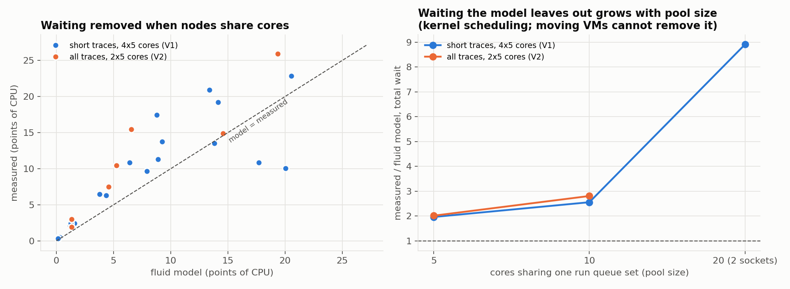
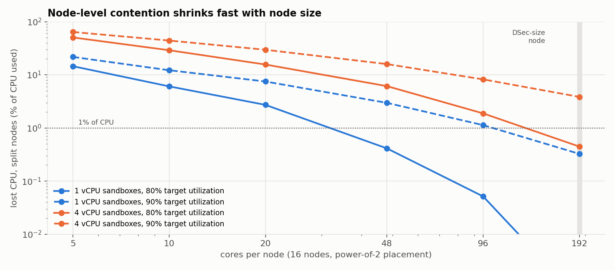
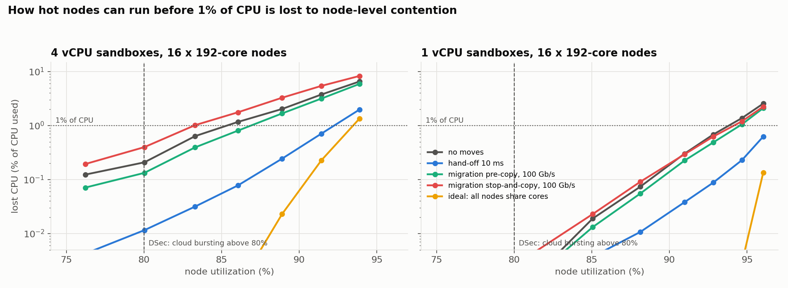
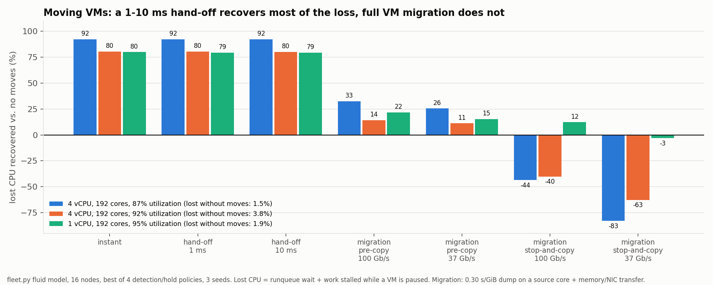

# DSec 규모 simulation 결과: trace 264개, 192코어 node 16개 (2026-10-21)

계획과 판정 기준은 [PLAN-fleet.md](PLAN-fleet.md)에 실행 전에 고정했다. 이 문서는 그 기준대로 판정한다. 기준에서 벗어난 곳은 해당 절에 적었다.

**결론**

- **Q1 (DSec 규모 node에도 node별 contention이 있는가): 독립 rollout은 사용률 80% 이하에서 없다. RL rollout(4 vCPU)은 80%에서 1% 남짓으로 경계에 있다.**
  192코어 node, 사용률 80%에서 독립 rollout의 잃은 CPU는 1 vCPU 0.001%, 4 vCPU 0.21~0.45%다. 실측 보정(×1.5)을 해도 1% 미만이다. node가 크면 sandbox 수백 개의 burst가 서로 상쇄된다. 4 vCPU RL rollout은 같은 사용률에서 1.06%(GRPO B8 G8), 2.34%(B64)로 PLAN의 1% 선을 조금 넘고, LLM 대기가 2배면 독립 rollout도 0.95%가 된다. 그 밖에는 사용률 85~90% 이상이거나 node가 48코어 이하일 때만 생긴다.
- **Q2 (migration은 못 따라가고 hand-off는 따라가는가): 성립한다.**
  contention이 있는 모든 독립 rollout 조건에서 10ms hand-off는 잃은 CPU의 79~96%를 되찾아 즉시 이동과 거의 같다. RL에서는 cluster 전체가 함께 바쁜 몫이 있어 되찾을 수 있는 몫 자체가 작지만(이상적 공유 20~93%), hand-off는 그중 85~90%를 낸다. full VM migration은 100Gb/s에 가장 유리한 정책을 골라도 −44~+44%다. PLAN의 "Q2 부정" 기준(migration이 hand-off 감소분의 절반 이상)에 걸리는 조건이 하나도 없다.
- **재구성 (PLAN의 대안): node를 더 뜨겁게 돌릴 수 있다.** 잃은 CPU 1% 이내라는 같은 목표에서 4 vCPU sandbox node를 85% → 92%까지 돌릴 수 있다. 필요한 node 수가 약 7~8% 줄어든다(LLM 대기 ×0.5~×2, 보정 ×1.5에서도 7~9%). migration은 +2%(pre-copy) 또는 −2%(stop-and-copy)다. 1 vCPU sandbox는 이동 없이도 94%까지 가능해서 이득이 2% 남짓이다.
- **Q3 (RL step 시간): 차이가 작다.** step 시간은 가장 늦은 rollout이 정하고, 그 rollout은 LLM 대기가 대부분이라 CPU 대기에 둔감하다. 모든 조건에서 step 지연 평균이 1.1% 이하다(PLAN 기준 5% 미만, end-to-end 동기로는 약함). RL에서도 hand-off는 즉시 이동과 같고 migration은 그 1/4 이하다.

모든 수치는 실측 burst를 넣은 simulator(`fleet.py`) 결과다. simulator는 작은 node 실측으로 검증했고, 실측보다 contention을 작게, 이동 효과를 크게 본다(1절). 두 치우침 모두 "migration으로 충분하다"는 반론 쪽이므로 Q2 판정은 보수적이다. 반대로 Q1의 "없다"는 모델이 contention을 작게 보는 쪽이라 보정 민감도를 함께 적었다.

## 구성

| 항목 | 값 |
|---|---|
| trace | 264개(`candidates-all.json`) 중 단독 실행이 끝까지 돌고 종료 코드 불일치가 명령의 10% 이하인 것. 1 vCPU 244개, 4 vCPU 250개 |
| 단독 실행 | Firecracker microVM, 네트워크 켬, guest 메모리 Docker peak × 1.5(최소 2GiB). 1 vCPU `.local/runs/20261021T070508Z-solo-7vxk272h`, 4 vCPU `.local/runs/20261021T075141Z-solo-8exx1l39`. vCPU thread 실행 시간을 10ms마다 기록한 것이 sandbox의 burst 모양이다 |
| 수요 | sandbox 하나의 평균 CPU 수요는 1 vCPU 0.25코어, 4 vCPU 0.44코어(LLM 대기 포함) |
| cluster | node 16개 × 192코어(DSec node 크기). 슬롯마다 무작위 trace를 연속 재생하고, 새 sandbox는 power-of-2로 덜 바쁜 node에 놓는다(DSec 배치) |
| CPU 모델 | 10ms마다 node(또는 공유 pool) 코어를 수요대로 공평하게 나눈다(water-filling). 못 받은 몫이 runqueue 대기이고, 그만큼 명령이 늦어진다 |
| 잃은 CPU | runqueue 대기 + 이동 중 정지로 못 한 일 + 이동에 쓴 출발 node CPU. CPU 사용량 대비 %로 적는다 |
| 이동 | 분리 node에서 reactive 정책: 감지 창 평균 초과 수요가 0.1코어 이상이면 가장 한가한 node로 최근 수요가 가장 큰 sandbox를 옮긴다(한 번에 최대 8개). 감지 창 50ms·0.5초·2초 × 재이동 금지 1초·5초 중 4개 조합을 돌려 메커니즘마다 가장 유리한 값을 쓴다 |
| 메커니즘 | 즉시(지연 0), hand-off 1ms(CPU 1ms), hand-off 10ms(CPU 2ms), migration stop-and-copy와 pre-copy. migration은 출발 node 코어 하나에서 dump 0.30초/GiB(실험 3 실측) + 전송 0.39초/GiB(37Gb/s 기준, NIC 속도에 반비례, node마다 전송 직렬화). 메모리는 trace별 guest 메모리(p50 2GiB, 평균 3.6GiB). 2GiB sandbox의 100Gb/s pre-copy는 약 0.9초 뒤 도착한다 |
| 공유 기준 | `all` = 모든 node가 한 pool의 코어를 나눠 쓴다. 이동 메커니즘으로 얻을 수 있는 상한이다 |
| 실행 | 조건마다 ramp 120초 + 측정 600초, seed 3개 평균. 모든 계산은 socket 1(CPU 12-23, 36-47)에서 `nice 19` |

## 1. 검증: 작은 node 실측과 비교 (V 단계)

socket 1에 bare-metal node 2개 × 5코어를 만들어 같은 trace로 실제 sandbox를 돌리고, `fleet.py`를 같은 구성(밀도, seed, 공유, 이동, GRPO)으로 돌려 비교했다(`validate.py`). 실측 28회(V2·V2b·V4·V5)와 기존 짧은 trace 실측(V1, 4×5코어)을 썼다.



| CPU 모델 | V1 짧은 trace 67개, 4×5 | V2 trace 242개, 2×5 | 이동 감소율 ±10%p (V4) | 판단 |
|---|---|---|---|---|
| 칸 올림(10ms 칸마다 진행을 버림) | 124/161, 대기 44/52 | 59/86, 대기 9/28 | 6/12 | 작은 node에는 맞지만 큰 node에서 계산 artifact |
| **순수 유체(채택)** | 56/161, 대기 14/52 | 45/86, 대기 5/28 | 9/12 | 대기를 작게 본다. 치우침 방향이 일정하다 |
| CFS vruntime | 96/161, 대기 25/52 | (안 돌림) | | 칸 올림보다 나쁨, 버림 |
| Bernoulli 칸 나눔 | 56/161 | 46/86 | 7/12 | 유체와 같음, 버림 |

숫자는 합격한 검사 수다(대기/CPU 사용 ±20% 또는 ±1%p, trace 지연 p50·p90 ±0.03, RL step 지연 p50 ±0.05).

**PLAN에서 벗어난 점.** PLAN은 V 단계를 통과하지 못하면 S 단계를 결론에 쓰지 않기로 했다. 어떤 모델도 대기 합계 기준을 통과하지 못했다. 원인을 나눠 보면 다음과 같다.

- **실제 커널에는 공유 범위와 관계없이 남는 대기가 있다.** 2 node가 10코어를 다 공유해도(`all`) 실측 대기는 1 vCPU에서 CPU 사용의 1~33%다. 모델은 같은 조건에서 0.1~12%다. 공유 pool이 클수록 실측/모델 비가 커진다(그림 오른쪽). wakeup 지연, CFS 시간 조각(min granularity 3ms), 다른 소켓 코어로의 이동 비용처럼 scheduler 안에서 생기는 대기로 본다. node 사이 이동으로는 없앨 수 없는 몫이라 motivation에서 분리한다.
- **이동으로 없앨 수 있는 몫(분리 − 공유)은 모델이 실측의 0.85배(V1), 0.67배(V2)로 맞힌다.** 그림 왼쪽이 이 비교다. 그래서 큰 규모 결과의 contention은 하한으로 읽고, 실측 보정 ×1.5를 민감도로 함께 적는다.
- **칸 올림 모델을 버린 이유.** 이 모델은 공유 몫이 1보다 조금 작을 때(예: 0.98) 다음 칸으로 넘어가며 남은 몫을 버려 진행이 절반이 된다. 작은 node에서는 이 손실이 우연히 커널의 잔여 대기와 비슷해 실측에 맞았지만, 192코어 node처럼 몫이 1에 가까운 경우가 흔하면 가짜 contention을 만든다.
- **이동 효과는 모델이 크게 본다.** 1 vCPU, node당 12개에서 hand-off 10ms 감소율이 실측 32% 대 모델 74%다. 실측의 이동 흉내(SIGSTOP + affinity 변경)가 조잡한 탓도 있다. migration pre-copy가 오히려 대기를 늘리는 효과는 실측이 더 크다(−105% 대 −71%). 메커니즘 순위는 3조건 중 2조건에서 같고, 나머지 하나는 hand-off와 stop-and-copy 차이가 실측 1%p인 경우다.
- **RL step 지연(V5)은 두 조건 모두 합격했다.**

## 2. node 크기: 크면 contention이 사라진다 (S1)



잃은 CPU(%), 분리 node, 이동 없음. 괄호는 실제 사용률.

| node 코어 | 1 vCPU, 목표 80% | 1 vCPU, 90% | 4 vCPU, 80% | 4 vCPU, 90% |
|---:|---:|---:|---:|---:|
| 5 | 14.5 (76%) | 21.7 (82%) | 50.5 (67%) | 64.0 (72%) |
| 10 | 6.1 (79%) | 12.2 (86%) | 29.0 (73%) | 44.2 (81%) |
| 20 | 2.7 (81%) | 7.5 (89%) | 15.6 (80%) | 29.6 (87%) |
| 48 | 0.41 (81%) | 3.0 (90%) | 6.1 (82%) | 15.9 (90%) |
| 96 | 0.05 (81%) | 1.1 (90%) | 1.9 (82%) | 8.2 (91%) |
| **192** | **0.001 (81%)** | **0.33 (91%)** | **0.45 (82%)** | **3.8 (92%)** |

- 같은 사용률에서 node가 커질수록 contention이 빠르게 줄어든다. 5→20코어에서 약 5배, 48→192코어에서 수십~수백 배다. sandbox 수백 개의 burst가 한 node에 몰릴 확률이 작아지기 때문이다.
- 4 vCPU sandbox가 훨씬 나쁘다. burst 하나가 코어 4개를 한꺼번에 잡기 때문에 같은 사용률에서도 순간 수요의 흔들림이 크다.
- 모든 node가 코어를 공유하면(`all`) 192코어에서는 90%에서도 0.3% 이하다. 즉 192코어의 contention은 대부분 node 사이 불균형이고, 옮기면 없앨 수 있다.

## 3. 사용률과 필요 node 수 (S6)



192코어 node 16개에서 사용률을 촘촘히 올렸다. 잃은 CPU(%).

| 4 vCPU 사용률 | 76% | 80% | 83% | 86% | 89% | 91% | 94% |
|---|---:|---:|---:|---:|---:|---:|---:|
| 이동 없음 | 0.12 | 0.21 | 0.64 | 1.17 | 2.03 | 3.75 | 6.54 |
| hand-off 10ms | 0.00 | 0.01 | 0.03 | 0.08 | 0.24 | 0.71 | 1.98 |
| migration pre-copy 100Gb/s | 0.07 | 0.13 | 0.39 | 0.80 | 1.68 | 3.16 | 5.90 |
| migration stop-and-copy 100Gb/s | 0.19 | 0.40 | 1.02 | 1.76 | 3.27 | 5.42 | 8.28 |
| 이상적 공유 | 0.00 | 0.00 | 0.00 | 0.00 | 0.02 | 0.23 | 1.35 |

| 1 vCPU 사용률 | 81% | 85% | 88% | 91% | 93% | 95% | 96% |
|---|---:|---:|---:|---:|---:|---:|---:|
| 이동 없음 | 0.00 | 0.02 | 0.07 | 0.30 | 0.68 | 1.38 | 2.55 |
| hand-off 10ms | 0.00 | 0.00 | 0.01 | 0.04 | 0.09 | 0.23 | 0.62 |
| migration pre-copy 100Gb/s | 0.00 | 0.01 | 0.06 | 0.22 | 0.49 | 1.05 | 2.10 |
| migration stop-and-copy 100Gb/s | 0.00 | 0.02 | 0.09 | 0.29 | 0.63 | 1.20 | 2.23 |

잃은 CPU가 1%에 닿는 사용률(보간)과, 이동 없음 대비 필요한 node 수:

| | 4 vCPU | node 수 | 4 vCPU, 보정 ×1.5 | node 수 | 1 vCPU | node 수 |
|---|---:|---:|---:|---:|---:|---:|
| 이동 없음 | 85.3% | 1.00 | 83.5% | 1.00 | 93.8% | 1.00 |
| hand-off 10ms | 92.2% | **0.925** | 91.3% | **0.915** | > 96% | < 0.977 |
| migration pre-copy 100Gb/s | 86.9% | 0.982 | 85.3% | 0.979 | 94.5% | 0.993 |
| migration stop-and-copy 100Gb/s | 83.2% | 1.025 | 81.8% | 1.021 | 94.2% | 0.996 |
| 이상적 공유 | 93.5% | 0.912 | 92.9% | 0.899 | > 96% | < 0.977 |

- hand-off는 이상적 공유 이득(node 9~10% 절감)의 약 85%를 낸다. migration pre-copy는 약 20%이고, stop-and-copy는 오히려 node가 더 필요하다.
- 4 vCPU에서 migration이 특히 나쁘다. 옮길 sandbox가 정지·전송되는 수 초 동안 코어 4개 분량의 일을 못 하고, CPU를 많이 쓰는 trace일수록 guest 메모리도 크다(전체 guest 메모리 p50 2GiB, 평균 3.6GiB, p90 7.5GiB).
- DSec는 사용률 80%를 넘으면 cloud로 넘긴다. 그 구간(80~92%)이 정확히 hand-off가 이득을 내는 구간이다.

## 4. 이동 메커니즘 (S4)



S1~S3에서 잃은 CPU가 1% 이상인 조건마다, 이동 없음 대비 잃은 CPU를 되찾은 비율(%). 정책 4개 중 최선, seed 3개 평균.

| 조건 | 이동 없음 | 공유 | 즉시 | hand-off 1ms / 10ms | stop-and-copy 37 / 100Gb/s | pre-copy 37 / 100Gb/s |
|---|---:|---:|---:|---:|---:|---:|
| 1 vCPU, 20코어, 사용률 81% | 2.7% | +100 | +93 | +93 / +92 | +15 / +31 | +36 / +44 |
| 1 vCPU, 192코어, 94% | 1.2% | +100 | +87 | +87 / +87 | +4 / +19 | +24 / +38 |
| 1 vCPU, 192코어, 95% | 1.9% | +97 | +80 | +79 / +79 | −3 / +12 | +15 / +22 |
| 4 vCPU, 20코어, 70% | 8.4% | +100 | +96 | +96 / +96 | −36 / −8 | +33 / +43 |
| 4 vCPU, 192코어, 87% | 1.5% | +100 | +92 | +92 / +92 | −83 / −44 | +26 / +33 |
| 4 vCPU, 192코어, 92% | 3.8% | +93 | +80 | +80 / +80 | −63 / −40 | +11 / +14 |

- 10ms hand-off는 즉시 이동과 1%p 안쪽으로 같다. 불균형이 대부분 10ms보다 오래 이어지고, 수 초 안에는 상당 부분 사라진다는 뜻이다(구간 길이를 직접 잰 것은 아니다. 다음 측정 참고).
- migration은 도착이 수 초 늦고, 그동안 이미 과부하인 출발 node에서 dump CPU까지 쓴다. stop-and-copy는 그 동안 sandbox가 멈춘다. 그래서 무거운 sandbox(4 vCPU)일수록 음수가 된다.
- migration에 가장 유리한 정책은 감지를 늦추고(2초) 재이동을 막는(5초) 쪽이었다. 오래 가는 불균형만 골라 옮기는 것이다. 그래도 hand-off의 절반에 못 미친다.

## 5. RL 동기 rollout (S3, S3b, S3c)

RL job 모드: job 하나가 task B개 × rollout G개를 동시에 시작하고, 가장 늦은 rollout이 끝나면 학습 30초 뒤 다음 step을 시작한다. step 지연은 같은 rollout들을 단독으로 돌렸을 때의 step 시간 대비다. job마다 시작 시각을 ramp 구간에 고르게 흩는다.

**S3, S3b는 철회한다.**
- S3는 독립 rollout 기준 밀도를 그대로 써서 사용률이 20~56%에 그쳤다. RL 슬롯은 straggler와 학습을 기다리는 동안 놀기 때문이다.
- S3b는 밀도를 올렸지만 job 시작을 300초에 흩었다. step 하나가 400초 이상이라 job들의 step 시작이 몰렸고, 측정이 그 첫 몇 step에 걸렸다. B64 G1에서 평균 사용률 65~78%인데 잃은 CPU가 20~90%였다. 모든 node가 공유해도 같아서 cluster 전체가 순간적으로 포화된 것이다.
- S3c는 시작을 900초에 흩고 그 뒤 1,800초를 쟀다. 아래 표가 S3c다. 같은 밀도에서 손실이 0~10%로 내려갔다.

잃은 CPU(%) — 분리 / 이상적 공유. 괄호는 사용률.

| | 목표 70% | 80% | 90% |
|---|---|---|---|
| 1 vCPU, B8 G8 | 0.00 / 0.00 (68%) | 0.04 / 0.00 (78%) | 0.71 / 0.39 (87%) |
| 1 vCPU, B64 G1 | 0.02 / 0.00 (69%) | 0.52 / 0.37 (79%) | 2.89 / 2.31 (88%) |
| 4 vCPU, B8 G8 | 0.08 / 0.00 (70%) | **1.06 / 0.07 (80%)** | 4.92 / 1.90 (89%) |
| 4 vCPU, B64 G1 | 0.25 / 0.00 (70%) | **2.34 / 1.46 (79%)** | 9.58 / 6.77 (88%) |
| 참고: 4 vCPU 독립 rollout (S6) | | 0.21 / 0.00 (80%) | 3.75 / 0.23 (91%) |

step 지연 p50(평균)은 모든 조건에서 1.0006~1.006(1.011) 사이다.

- **RL은 같은 사용률에서 contention을 키운다.** 4 vCPU, 사용률 80%에서 독립 rollout은 0.21%지만 GRPO(B8 G8)는 1.06%, B64는 2.34%다. 같은 task의 rollout G개가 2초 안에 함께 시작해 같은 명령에서 burst를 내고, step 경계마다 job의 rollout이 한꺼번에 시작하기 때문으로 보인다.
- **그 손실의 성격이 다르다.** GRPO(B8 G8)의 손실은 공유하면 거의 사라진다(1.06 → 0.07%). 같은 task rollout들의 동시 burst가 node 사이 불균형을 만든 것이라 옮기면 풀린다. B64 G1은 공유해도 60% 이상 남는다(2.34 → 1.46%). job의 rollout 64개가 동시에 시작하는 cluster 전체의 순간 포화라 옮길 곳이 없다.
- **step 시간은 거의 안 늘어난다.** step은 가장 늦은 rollout이 정하고, 그 rollout은 대부분 LLM 대기라 CPU 대기에 둔감하다. 가장 나쁜 조건도 p50 0.6%, 평균 1.1%다.
- 동기 RL에서는 job 하나의 rollout 전체가 step마다 함께 시작한다. job이 크거나 job 수가 적으면 S3b처럼 cluster 전체가 동시에 바빠지는 쪽에 가까워진다. 이 손실은 이동이 아니라 시작 시각을 흩거나 코어를 늘려야 풀린다.

**RL에서의 이동 (S4rl).** S3c에서 잃은 CPU가 1% 이상인 조건에 4절과 같은 메커니즘·정책을 넣었다. 되찾은 비율(%), 정책 4개 중 최선, migration은 100Gb/s. 괄호는 step 지연 평균.

| 조건 | 이동 없음 | 이상적 공유 | 즉시 | hand-off 10ms | pre-copy | stop-and-copy |
|---|---:|---:|---:|---:|---:|---:|
| 4 vCPU, B8 G8, 80% | 1.06% (1.0030) | +93 | +83 | +82 (1.0010) | +20 (1.0022) | −39 (1.0044) |
| 4 vCPU, B8 G8, 89% | 4.92% (1.0109) | +61 | +54 | +53 (1.0039) | +7 (1.0085) | −23 (1.0130) |
| 4 vCPU, B64 G1, 79% | 2.34% (1.0016) | +38 | +34 | +33 (1.0009) | +8 (1.0013) | −17 (1.0014) |
| 4 vCPU, B64 G1, 88% | 9.58% (1.0070) | +29 | +26 | +26 (1.0041) | +4 (1.0064) | −11 (1.0059) |
| 1 vCPU, B64 G1, 88% | 2.89% (1.0019) | +20 | +17 | +17 (1.0012) | +4 (1.0017) | +1 (1.0018) |

- 독립 rollout과 같은 순서다. hand-off는 즉시 이동과 1%p 안쪽이고 이상적 공유 이득의 85~90%를 낸다. migration은 그 1/4 이하이고 stop-and-copy는 음수다.
- 이동으로 되찾을 수 있는 몫 자체(이상적 공유)가 RL에서는 작다(20~93%). B64처럼 job 하나의 rollout이 동시에 시작하는 손실은 cluster 전체의 것이라 옮겨도 남는다.
- step 지연은 hand-off로 1.1% → 0.4%(B8 G8, 89%)처럼 줄지만, 원래 크기가 1% 안팎이다.

## 6. 민감도 (S5, S5b)

**LLM 대기 배율 (S5b, 192코어, 사용률을 맞춰서).** 처음 S5는 밀도를 고정해서 ×0.5에서는 사용률 100%로 포화되고 ×2에서는 48~55%로 떨어졌다. 그래서 같은 사용률이 되게 밀도를 다시 잡아 돌렸다(seed 3개). 잃은 CPU(%), 분리 node, 이동 없음 / hand-off 10ms.

| LLM 대기 | 1 vCPU, 사용률 약 90% | 4 vCPU, 약 80% | 4 vCPU, 약 87% | 4 vCPU 1% 한계 사용률: 이동 없음 → hand-off | 필요 node 수 (hand-off) |
|---|---|---|---|---|---:|
| ×0.5 | 0.11 / 0.02 (90%) | (밀도 추정이 빗나가 이 사용률 없음) | 0.85 / 0.05 (87%) | 87.6% → 94.2% | 0.931 |
| ×1 (기본, S6) | 0.30 / 0.04 (91%) | 0.21 / 0.01 (80%) | 1.17~2.03 / 0.08~0.24 (86~89%) | 85.3% → 92.2% | 0.925 |
| ×2 | 0.76 / 0.09 (90%) | 0.95 / 0.08 (80%) | 5.45 / 2.85 (89%) | 79.9% → 85.6% | 0.934 |

- 같은 사용률이면 LLM 대기가 길수록 contention이 커진다. sandbox 하나가 켜졌다 꺼졌다 하는 정도가 커지고, 같은 사용률을 내려면 sandbox가 더 많이 필요해서 node 수요의 흔들림이 커진다.
- LLM 대기가 2배면 4 vCPU node는 사용률 80%에서 이미 잃은 CPU가 1%에 닿는다. 추론이 느린 환경에서는 Q1의 "80% 이하에서 없음"이 경계선이 된다.
- hand-off의 node 절감(7%)은 배율에 거의 무관하다.

**배치 (S5, 192코어).** 무작위 배치(k=1)는 power-of-2(k=2)보다 contention이 약 2배다(1 vCPU 사용률 91%에서 0.33 → 0.62%, 4 vCPU 82%에서 0.45 → 1.00%). k=4는 k=2와 거의 같다(0.36%, 0.45%). DSec식 배치가 이미 대부분의 이득을 낸다.

## 판정 (PLAN 기준)

| 질문 | PLAN 기준 | 결과 | 판정 |
|---|---|---|---|
| Q1 | S1~S3 모두에서 192코어·사용률 80% 이하의 잃은 CPU가 1% 미만이면 부정 | 독립 rollout: 1 vCPU 0.001%, 4 vCPU 0.21~0.45%(보정 ×1.5: 0.67%). RL 4 vCPU: 1.06%(B8 G8), 2.34%(B64). 그중 hand-off로 되찾는 몫은 0.8~0.9%p | **기준상 부정은 아니지만 경계.** 넘는 경우는 RL 4 vCPU뿐이고 폭이 1~2%p다. 주장의 중심은 대안(필요 node 수)으로 옮긴다: hand-off로 4 vCPU node 7~8% 절감 |
| Q2 | 2GiB 이상 migration이 hand-off 감소분의 절반 이상을 되찾으면 부정 | migration 최선 44% 대 hand-off 92%(1 vCPU 20코어). 나머지 독립·RL 조건은 모두 더 큰 차이(RL: 4~20% 대 17~82%) | **성립** |
| Q3 | RL step 지연 차이 5% 미만이면 end-to-end 동기로 약함 | 이동 없음 step 지연 평균 1.0006~1.011, hand-off로 최대 0.7%p 감소 | **약함** |

motivation에 쓸 수 있는 문장:

> DSec 규모 node(192코어)에서도 사용률을 85% 이상으로 올리면 node 사이 불균형으로 CPU를 잃는다. 이 불균형은 1초 안팎이 걸리는 full VM migration이 도착하기 전에 상당 부분 바뀌어서 migration은 따라가지 못하고(되찾는 몫 −44~+44%), 10ms hand-off는 즉시 이동과 거의 같게 따라간다(79~96%). 그 결과 같은 지연 목표에서 4 vCPU sandbox node를 85%가 아니라 92%까지 돌릴 수 있어 node가 7~8% 덜 필요하다. GRPO rollout처럼 같은 task가 함께 도는 경우에는 사용률 80%에서도 불균형 손실이 1%를 넘고, hand-off가 그 대부분(82%)을 되찾는다.

쓰면 안 되는 문장: "DSec 운영 사용률(≤ 80%)에서도 node별 contention이 크다", "RL step 시간이 크게 줄어든다", "RL의 동시 burst를 이동으로 해결한다"(B64처럼 cluster 전체가 함께 바쁜 손실은 옮겨도 남는다).

## 해석의 범위

- 큰 규모 결과는 모두 simulation이다. 모델은 작은 node 실측 기준으로 이동 가능한 contention을 0.67~0.85배로 작게 보고, 이동 효과를 크게 본다. 커널의 잔여 대기는 모델에 없다.
- 모델에 없는 비용은 모두 migration에 유리한 쪽이다: 이동 후 cache·TLB warm-up, EPT 재구축, 목적지 수신 CPU, pre-copy의 dirty page 재전송과 throttle.
- burst 모양은 한 서버(optane)에서 sandbox 하나를 단독으로 돌린 10ms 기록이다. 다른 sandbox와 함께 돌 때의 CPU 증가(memory·cache 간섭)는 넣지 않았다.
- LLM 대기는 trace에 기록된 간격(LLM 추론 + agent 처리)을 그대로 썼다.
- DSec의 container는 넣지 않았다. microVM만으로 사용률을 맞췄다.
- node 사이 불균형만 다룬다. 노드 안 QoS(SCHED_IDLE, core scheduling)는 모델에 없다.

## 다음 측정

- contention 구간 길이를 직접 잰다. simulator에서 node별 초과 수요 구간을 뽑아 잃은 CPU 가중 길이 CDF와 잔여 시간(HANDOFF Fig 1)을 만들고, 실측은 `sched_switch`·`sched_wakeup` event로 복원해 대조한다. 지금 "10ms면 충분하고 1초는 늦다"는 메커니즘별 회수율에서 거꾸로 추론한 것이다.
- 192코어급 서버에서 실측 검증. 큰 pool에서 커널 잔여 대기와 이동 효과가 어떻게 되는지는 작은 node 실측으로 외삽했다.
- 실제 이동 경로의 비용: live pre-copy(dirty page 재전송, throttle)와 hand-off 실측. 지금 migration 비용은 stop-and-copy dump 실측과 NIC 대역폭으로 만든 값이다.
- 한 job이 cluster 전체를 쓰는 큰 RL job(B×G 수천)과 학습 시간 분포.

## 재현

```bash
cd experiments/contention
PY=../../.local/microvm/analysis-env/bin/python                            # numpy, numba, matplotlib
$PY fleet.py --test                                                        # 손계산 검사
taskset -c 12-23,36-47 nice -n 19 $PY fleet.py --solo .local/runs/20261021T070508Z-solo-7vxk272h \
  --candidates candidates-all.json --grid grids/S6-v1.json --jobs 12 --output .local/report/S6-v1.json
taskset -c 12-23,36-47 $PY validate.py $(cut -d' ' -f2 .local/validate/runs.txt) \
  --solo 1=.local/runs/20261021T070508Z-solo-7vxk272h --solo 4=.local/runs/20261021T075141Z-solo-8exx1l39 \
  --carry --output .local/report/validate-v-carry.json
$PY plot_fleet.py                                                          # figures/fleet-*.png
```

조건 목록은 `grids/`에 있다(S = S1·S3·S4·S5, S3b·S3c = RL, S4rl = RL 이동, S5b = LLM 대기 민감도, S6 = 사용률). 검증 실측 목록과 로그는 `.local/validate/{runs.txt,log.txt}`, 결과 JSON은 `.local/report/`.
