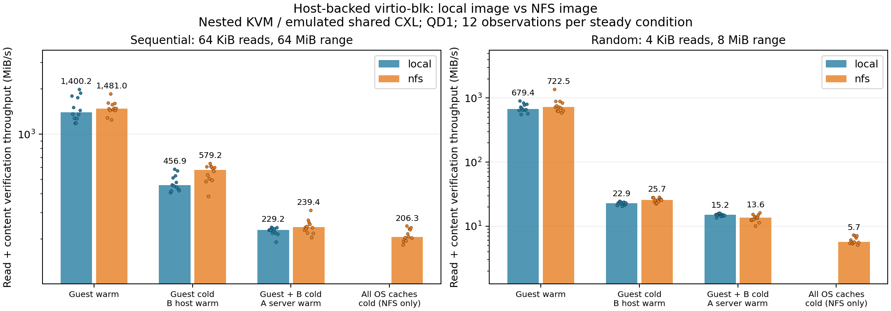
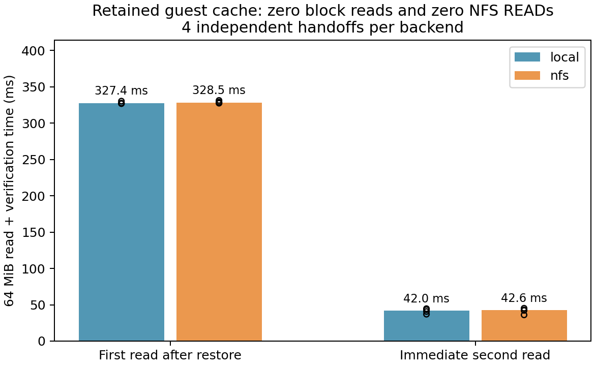

# Host NFS를 사용하는 microVM의 cache 보존과 읽기 성능

측정일: 2026년 10월 27일. Read-only 파일 접근의 첫 구현·검증이다.

## 검증하려는 구조

A의 로컬 image에서 실행한 microVM을 B로 옮긴다. Guest RAM은 같은 CXL device-DAX 영역에 유지하고, B의 Firecracker는 NFS로 접근하는 **동일한 image**를 연다. Guest는 계속 같은 ext4·virtio-blk·열린 파일 FD를 사용한다.

```text
A: guest ext4 / page cache → virtio-blk → Firecracker → A의 local image
                            ↓ 상태만 snapshot / guest RAM은 shared DAX 유지
B: 같은 guest page cache → hit: 기존 RAM 사용
                         → miss: virtio-blk → Firecracker → B host NFS → A image
```

NFS client는 L1 host에 있다. L2 guest에는 network interface도 NFS mount도 없다. 이 시험은 guest MPTCP 경로와 독립적이다.

## 결과

**8회의 독립 A→B handoff와 192개 측정이 모두 통과했다.** 매번 guest의 열린 FD·PID·cookie를 유지했고, 모든 읽기 데이터가 기대값과 일치했다. 전달한 snapshot state는 매번 13,693 bytes였고 guest RAM 전송량은 0이다.

A에서 채운 64 MiB guest cache는 B에서도 16,384개 페이지가 상주했다. B의 host image cache는 0 pages인 상태였는데도, 이 범위를 읽을 때 **guest block read=0, NFS READ=0**이었다. 따라서 B의 host cache가 결과를 가린 것이 아니라 guest cache가 보존된 것이다. 처음 읽는 별도 범위에서는 실제 NFS READ와 guest block read가 발생했다.

### 정상 상태 처리량

단위는 MiB/s, 각 값은 12회 관측의 중앙값이다. `전체`는 읽기와 내용 검증을 포함한 `wall_mib_s`, `pread`는 호출 구간 합계 기준이다. 4개의 독립 guest trial에서 각 조건을 3회 관측한 것이며 12개의 독립 VM은 아니다.

| 조건 | Local 순차 전체 / pread | NFS 순차 전체 / pread | Local 무작위 전체 / pread | NFS 무작위 전체 / pread |
|---|---:|---:|---:|---:|
| Guest warm | 1,400.2 / 4,380.8 | 1,481.0 / 4,477.8 | 679.4 / 2,228.5 | 722.5 / 2,221.9 |
| Guest cold, B host warm | 456.9 / 676.7 | 579.2 / 784.3 | 22.9 / 23.2 | 25.7 / 26.1 |
| Guest+B host cold, A server warm | 229.2 / 277.3 | 239.4 / 296.8 | 15.2 / 15.3 | 13.6 / 13.7 |
| Guest+B host+A server cold | — | 206.3 / 249.7 | — | 5.7 / 5.7 |

Local에서는 A server cache를 사용하지 않는다. 따라서 세 번째 행은 local disk 접근과 NFS server-memory 접근의 비교다. 실제 저장장치 읽기를 요구하는 경우는 local 세 번째 행과 NFS 네 번째 행을 비교해야 한다. 이때 순차 전체 처리량은 229.2→206.3 MiB/s, 무작위는 15.2→5.7 MiB/s였다. 같은 물리 SSD와 emulated network를 사용하는 이 구성의 결과이며 일반적인 NFS 비용으로 확대하지 않는다.

Warm 조건의 차이는 NFS 전송 성능 차이가 아니다. 두 backend 모두 storage I/O를 하지 않았다. 또한 `cold_guest`에서도 NFS READ는 0이어서, guest cache miss가 항상 network miss를 의미하지 않음을 확인했다.

NFS server가 warm인 remote 읽기는 64 MiB 순차에서 READ 중앙값 517회, 8 MiB 무작위에서 1,690회였다. 무작위 전체 처리량은 B host warm의 25.7에서 remote server warm의 13.6, server도 cold일 때 5.7 MiB/s로 감소했다. 작은 무작위 miss와 저장장치 지연이 중요한 후속 검증 항목이다.



각 점은 관측값, 막대는 중앙값이며 세로축은 로그 축이다. [개별 sample CSV](samples.csv)와 [전체 범위가 포함된 요약 JSON](summary.json)에 원래 값이 있다.

### 복원 직후 첫 접근

아래는 64 MiB의 읽기와 내용 검증 시간 중앙값이다. Backend별 4회 관측이다.

| 읽기 | Local | NFS | Guest block / NFS READ |
|---|---:|---:|---|
| B 복원 직후 retained cache의 첫 접근 | 327.4 ms | 328.5 ms | 모두 0 |
| 같은 범위를 즉시 다시 접근 | 42.0 ms | 42.6 ms | 모두 0 |
| 처음 읽는 별도 64 MiB 범위 | 426.0 ms | 505.0 ms | block read 있음; NFS에서는 READ 중앙값 515회 |

**Cache가 보존되어도 복원 직후 첫 접근 비용은 남았다.** 새 KVM/EPT·mapping 준비 등의 영향은 후보 설명이지만, 이 시험은 EPT fault를 계측하지 않아 비용 전부를 특정 원인에 귀속할 수 없다. 처음부터 준비된 direct/reuse의 과거 latency와도 직접 비교하지 않는다.



State는 serial controller로 옮겼다. 이 전달만 평균 약 3.96초였으므로 이번 결과로 빠른 handoff downtime을 주장하지 않는다. 표의 읽기 시간은 restore·resume 후 probe 내부에서 잰 값이며 state 전달 시간은 포함하지 않는다.

### 검증과 원자료

[독립 검증기](../../verify_nfs_results.py)는 376개 raw event와 192개 측정, snapshot binary SHA256, PID/cookie 연속성, cache 상주량, I/O 조건, paired random seed, 독립적으로 계산한 데이터 checksum, 요약 수치를 대조했다. 원래의 7개 build artifact hash도 확인했다. [검증 결과](audit.json), [자원 정리 확인](cleanup.json)

192개 중 1개(`s79_cold_host_random`)에서 global NFS READ 시작 counter 차이는 1,699, mountstats의 완료 operation 차이는 1,700이었다. 두 counter는 서로 다른 시점에 갱신되고 순차 수집되며, aggregate 자료만으로 이 차이의 정확한 원인은 확정하지 않았다. 이 1건은 audit에 보존했다. 모든 warm 조건은 두 counter가 모두 0, 실제 remote 읽기 조건은 둘 다 양수였다. 데이터 오류는 없었다.

[Raw evidence archive](raw-evidence.tar.gz)에 각 trial의 A/B 로그·state binary, L1 serial 로그, host 환경과 **측정 당시의 정확한 소스**를 넣었다. 측정 뒤 최종 코드에는 기존 asset/dependency 덮어쓰기 방지와 cleanup 실패 전파를 보강했다. 측정 경로는 바꾸지 않았으며 차이는 archive의 `post-measurement-*.patch`에 기록했다.

```bash
mkdir -p /tmp/nfs-evidence
tar -xzf implementation/virtual_machine/results/nfs-20261027/raw-evidence.tar.gz -C /tmp/nfs-evidence
python3 implementation/virtual_machine/verify_nfs_results.py \
  implementation/virtual_machine/results/nfs-20261027/report.json \
  --formal --evidence-dir /tmp/nfs-evidence
# 그래프 재생성에는 matplotlib가 필요하다.
python3 implementation/virtual_machine/plot_nfs_results.py \
  implementation/virtual_machine/results/nfs-20261027/report.json \
  --out /tmp/nfs-figures
```

## 구성과 비교 조건

| 항목 | 설정 |
|---|---|
| 물리 host | Intel Xeon Gold 5317, Linux 5.15.0-191-generic |
| 외부 저장장치 | INTEL SSDSC2KB96, host ext4/LVM 위 raw image |
| L1 A/B | 각 2 vCPU·2 GiB, Linux 6.6.0-rc6-dcd-v3 |
| CPU 배치 | QEMU thread와 vhost worker 모두 A=0–2, B=3–5 |
| QEMU / network | 수정 QEMU 10.2.2, private TAP/bridge/vhost, 단일 queue, MTU 1500 |
| L2 microVM | Firecracker v1.17.0, 1 vCPU·512 MiB, 동일한 shared-DAX backing |
| CXL | 1 GiB emulation, 같은 coherent 물리 host에서 공유; 물리 CXL fabric 아님 |
| Disk | 256 MiB deterministic payload를 담은 320 MiB ext4 image; read-only |
| 외부 disk 연결 | L1 A/B에 동일한 384 MiB ext4 raw disk를 read-only로 연결, QEMU `cache=none` |
| Firecracker block | `Sync` I/O engine, buffered host FD, `Writeback` cache type; host O_DIRECT 아님 |
| NFS | A의 kernel NFSD, v3/TCP, B client `ro,hard,nolock`, rsize 1 MiB |
| 순차 읽기 | 64 MiB 범위, 64 KiB 단위, QD1 |
| 무작위 읽기 | 8 MiB 범위의 모든 4 KiB block을 한 번씩 방문하는 permutation, QD1 |
| 반복 | 4 cycles × local/NFS = 8회의 독립 A→B handoff; 정상 상태 조건마다 12회 |

Local baseline도 **B에서 실행**한다. 이때 B의 Firecracker는 B에 미리 준비된 같은 image를 로컬로 연다. 이미지 복제 비용은 측정하지 않는다. Cycle별 local/NFS 순서를 교대하고, trial 내 cache 조건 순서를 섞는다. 비교하는 random workload의 seed는 backend 간 같게 맞춘다.

각 trial은 A에서 새 guest를 부팅하고 파일을 읽은 뒤 B로 한 번 이전한다. 같은 guest의 반복 A↔B 이전 실험은 아니다. Guest RAM의 최초 DRAM→CXL promotion도 포함하지 않는다.

## Cache 조건을 확인하는 방법

| 이름 | Guest 파일 cache | B host image cache | A server image cache |
|---|---|---|---|
| `retained` | A에서 채운 cache, B 복원 후 최초 접근 | 별도로 기록 | warm |
| `retouch` | retained 범위를 곧바로 다시 읽음 | 별도로 강제하지 않음 | warm |
| `warm` | 측정 직전에 같은 범위를 읽어 채움 | 무관 | 무관 |
| `cold_guest` | 대상 범위 0 pages | image 전체 warm | image 전체 warm |
| `cold_host` | 대상 범위 0 pages | image 전체 0 pages | image 전체 warm |
| `cold_all` (NFS만) | 대상 범위 0 pages | image 전체 0 pages | image 전체 0 pages |

`mincore`로 guest와 A/B image cache의 상주 페이지 수를 확인한다. Guest는 `POSIX_FADV_DONTNEED`, host는 disposable L1 내부의 `drop_caches=3`을 사용한다. 후자는 image 외의 metadata 등 reclaim 가능한 cache도 영향을 받는다. SSD/controller cache는 통제하지 않으므로 `cold_all`을 물리 저장장치 cold라고 해석하지 않는다.

Warm 읽기는 guest block read와 NFS READ가 모두 0인지 확인한다. `cold_guest`의 NFS READ도 0이어야 한다. NFS `cold_host/cold_all`은 실제 READ가 있어야 한다. `/proc/self/mountstats`의 READ operation/bytes와 `/proc/net/rpc/nfs`, interface byte counters를 함께 수집한다. RPC header·readahead·filesystem metadata 때문에 전송량과 payload 크기는 정확히 같지 않을 수 있다.

## 시간 지표

- `wall_ns`, `wall_mib_s`: 전체 읽기 loop의 시간·처리량. 각 block의 내용 검증을 포함한다. Cache 조작, mincore, counter 수집, serial 제어 시간은 제외한다.
- `read_ns`, `read_mib_s`: `pread` 호출 안의 시간 합계·처리량. 호출 사이 내용 검증 시간은 제외한다.
- `pread_latency_ns`: 개별 pread의 nearest-rank p50/p95/p99. 요약의 p99 값은 각 run의 p99를 모은 중앙값이며, 모든 request를 합친 p99가 아니다.

모든 64-bit word를 offset 기반 기대값과 비교한다. 검증을 read 사이에 수행하므로 readahead가 진행될 시간도 생긴다. 이 probe의 처리량을 검증 없는 fio나 실제 application throughput과 동일하게 해석하지 않는다.

검증기는 Python 3와 C compiler(`cc`)를 사용하며 VM 실행 권한은 필요하지 않다.

## 재현

기존 lab의 수정 Linux/QEMU/Firecracker와 static BusyBox가 필요하다. 아래는 저장소 루트에서 실행하며, `CXL_NFS_KERNEL_SOURCE`는 이미 CXL/KVM lab patch가 적용된 Linux source를 지정한다. 새 asset/dependency/session 경로를 사용한다. Host에 NFS package를 설치하거나 NFS 서비스를 시작하지 않는다.

```bash
export CXL_LAB_SESSION=nfs-new-run
export CXL_LAB_ASSETS="$PWD/implementation/virtual_machine/.local/assets-nfs-new-run"
export CXL_NFS_OUT="$PWD/implementation/virtual_machine/.local/nfs-deps-new-run"
export CXL_NFS_KERNEL_SOURCE="$PWD/implementation/linux"
# 호환되는 기존 O= build가 있으면 복사해서 incremental build한다.
export CXL_NFS_KERNEL_CACHE=/absolute/path/to/compatible-kernel-build
export CXL_NFS_CPUS=0-5
export JOBS=6
bash implementation/virtual_machine/nfs_dependencies.sh

python3 implementation/virtual_machine/nfs_bench.py prepare \
  --dependencies "$CXL_NFS_OUT" --firecracker /absolute/path/to/firecracker

taskset -c 0-5 python3 implementation/virtual_machine/lab.py start \
  --vcpus 2 --memory-mib 2048 --cxl-mib 1024 --dax-guest --dax-4k \
  --migration-network --network-backend tap --memory-backing-dir /dev/shm \
  --storage-image "$CXL_LAB_ASSETS/storage.raw" \
  --qemu /absolute/path/to/patched-qemu-system-x86_64

taskset -c 0-5 python3 implementation/virtual_machine/nfs_bench.py run \
  --cycles 4 --repetitions 3 --host-cpus-a 0-2 --host-cpus-b 3-5
python3 implementation/virtual_machine/lab.py stop
```

QEMU의 기존 extracted BIOS/library tree를 다른 checkout에서 사용할 때는 `CXL_LAB_QEMU_ROOT=/absolute/path/to/qemu/root`를 지정한다. TAP/bridge 생성과 소유 vhost worker affinity 설정은 기존 lab 방식대로 `sudo -n`이 필요하다. 실험의 bridge에는 host IP나 외부 uplink를 추가하지 않는다.

## 현재 범위와 다음 단계

이번 범위는 read-only image, 일반 semantic snapshot 복원, 하나의 guest FD/cache 보존, 로컬/NFS 읽기 성능이다. Writable image의 flush 오류 전파·단일 writer fencing·반복 전환, direct/reuse 장치 승계, PML의 VMM block-completion writer 추적, 최초 DRAM→CXL 이동은 후속 단계다.
